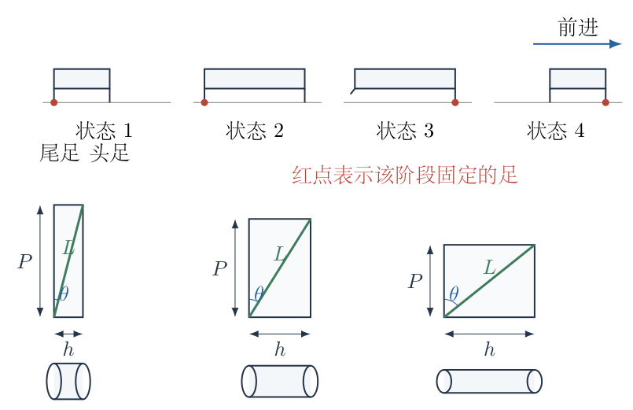
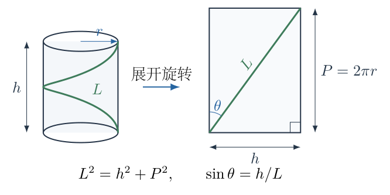
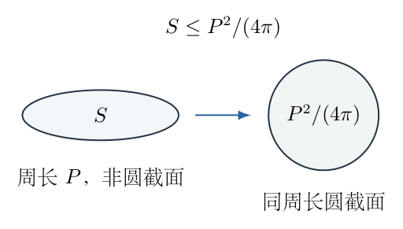
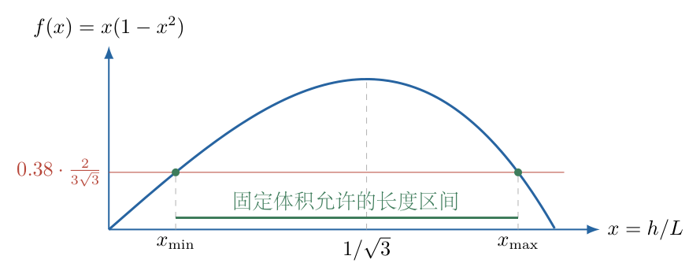

# 第 1 题

<!-- question-start -->

一种虫子只有头足和尾足，靠身体的蜷缩与伸展移动。身体上有许多长度保持不变的线形基膜，每条基膜从头部延伸至尾部，并绕身体一圈。将身体侧面展开时，基膜总是一条直线。一次伸缩移动及不同伸缩状态的侧面展开示意如下。

（1）假设虫子的身体始终为圆柱，基膜长度为 $L$。求身体能够达到的最大体积 $V_m$，以及此时图中夹角 $\theta_0$。图中 $\theta$ 为基膜与侧面展开图的周向边之间的夹角。

（2）改设虫子的体积恒定。测得其体积为 $V_0=0.38V_m$；自然状态下为椭圆柱，其截面周长和身体长度分别与第（1）问体积最大时相等。证明：虫子达到最长或最短状态时，截面一定为圆。求这两种状态的身体长度。

<!-- question-end -->

## 一、题型定位

不可伸长的斜向基膜把轴向长度与截面周长耦合起来。本题先在圆柱模型下求体积极值，再在定体积模型下利用等周不等式确定可行长度区间。两个模型的控制条件不同：第（1）问允许体积变化，第（2）问允许截面形状变化，但不允许体积和基膜长度变化。

判断“最长或最短时为圆柱”不能只凭圆形看起来对称。必须证明非圆截面受到更强的面积限制，并说明区间两端为什么恰好达到等号。最后的三次方程有三个实根，其中只有两个是物理允许的长度。

## 二、知识点

- 圆柱侧面展开成矩形，一圈螺旋展开后跨越一个完整周长。
- 直角三角形中，斜边为基膜长度，轴向边为身体长度，另一边为截面周长。
- 圆柱体积为截面积乘轴向长度，不包含展开矩形的面积。
- 对固定周长的简单闭合平面曲线，圆的包围面积最大，且只有圆达到等号。
- 导数的符号用于判断极大、极小；物理定义域和端点不能省略。
- 无量纲化可把不同 $L$ 的情形统一为一个三次函数的交点问题。
- 数值求根后须代回长度、周长和体积关系，不能只检查计算器显示了一个根。

## 三、物理图像

用 $h>0$ 表示身体长度，$P>0$ 表示横截面周长，$S>0$ 表示截面积。侧面展开矩形的两边分别为 $h$ 与 $P$。基膜只绕一圈，因此从展开图的左下角连接至右上角，不是跨越 $2P$，也不是连接某条截面直径。

按题图，角度 $\theta$ 定义为基膜与周向展开边的夹角，而不是与轴向的夹角。因此

$$
L^2=h^2+P^2,\qquad \sin\theta=\frac hL,\qquad
\cos\theta=\frac PL.
$$

第（1）问截面为圆，故 $P=2\pi r$、$S=\pi r^2$。第（2）问可以是非圆截面，不能继续把 $S$ 等同于 $P^2/(4\pi)$；只能先写 $S\le P^2/(4\pi)$。

把身体看成截面沿轴向保持相同的柱体，是题给展开与体积关系采用的几何模型。这里不需要猜测基膜张力、肌肉作用力或两足摩擦力，因为题目只问可实现的几何状态，并没有要求计算移动速度。

## 四、解题入口

第（1）问先用基膜长度消去半径，只留下一个变量 $h$；在 $0<h<L$ 内求体积函数的极大值，再由 $h/L$ 求图中夹角。第（2）问保持同一条展开关系，但将圆面积等式替换为等周不等式，然后与 $V_0=Sh$ 联立。

定体积条件得到的不是一个立刻可取等号的方程，而是一个不等式。先找它的完整解集，再说明两个边界的等号只能由圆截面实现，最后求解边界三次方程。

## 五、解析

（1）把一圈基膜转化为直角三角形。

图1-2左侧画出圆柱上的一圈基膜，右侧是切开侧面后的矩形。展开只改变曲面的展示方式，不改变膜的长度；上下底面没有加入展开矩形。图中的 $h$、$P$ 和 $L$ 组成直角三角形，角 $\theta$ 位于基膜与竖直周向边之间，横向边 $h$ 才是身体轴向。

圆截面的周长为 $P=2\pi r$，故由图中直角三角形得

$$
\begin{aligned}
L^2&=h^2+(2\pi r)^2,\\
4\pi^2r^2&=L^2-h^2,\\
r^2&=\frac{L^2-h^2}{4\pi^2}.
\end{aligned}\tag{1}
$$

这里要求 $r>0$，所以 $h<L$；身体长度也必须为正，所以物理定义域是 $0<h<L$。在 $h\to0$ 或 $h\to L$ 时，体积都趋于零，分别对应轴向长度消失或圆截面缩小为零。它们是检验用的极限构形，不是具有正体积的正常状态。

由体积定义 $V=\pi r^2h$，代入式（1）：

$$
\begin{aligned}
V(h)
&=\pi h\frac{L^2-h^2}{4\pi^2}\\
&=\frac{h(L^2-h^2)}{4\pi}\\
&=\frac{L^2h-h^3}{4\pi}.
\end{aligned}\tag{2}
$$

这一步把半径消去，是因为 $r$ 和 $h$ 不能独立变化。若直接对 $V=\pi r^2h$ 的 $r,h$ 分别求极值而不带约束，会得到一个不属于本题的问题。

（2）求体积函数的唯一极大点。

对式（2）关于 $h$ 求导；$L$ 是常量，不能随着 $h$ 改变：

$$
\begin{aligned}
\frac{\mathrm dV}{\mathrm dh}
&=\frac{L^2-3h^2}{4\pi},\\
\frac{\mathrm d^2V}{\mathrm dh^2}
&=-\frac{6h}{4\pi}.
\end{aligned}
$$

令一阶导数为零：

$$
\begin{aligned}
L^2-3h^2&=0,\\
h^2&=\frac{L^2}{3},\\
h_0&=\frac L{\sqrt3}.
\end{aligned}
$$

负根 $-L/\sqrt3$ 不在物理定义域内。对于 $0<h<h_0$，一阶导数为正，体积随长度增加；对于 $h_0<h<L$，一阶导数为负，体积随长度减小。加上两端体积趋于零，证明 $h_0$ 是全定义域唯一的体积最大点，不只是某个局部驻点。

回代式（1）求此时半径与周长：

$$
\begin{aligned}
r_0^2
&=\frac{L^2-L^2/3}{4\pi^2}
=\frac{L^2}{6\pi^2},\\
r_0&=\frac L{\sqrt6\pi},\\
P_0&=2\pi r_0=\sqrt{\frac23}\,L.
\end{aligned}\tag{3}
$$

将 $h_0,r_0$ 代入体积，保留各个系数的约分：

$$
\begin{aligned}
V_m
&=\pi\left(\frac{L^2}{6\pi^2}\right)\frac L{\sqrt3}\\
&=\frac{L^3}{6\sqrt3\pi}\\
&=\boxed{\frac{\sqrt3}{18\pi}L^3}.
\end{aligned}\tag{4}
$$

这两种写法完全相同，因为 $1/\sqrt3=\sqrt3/3$。量纲为长度的三次方，符合体积要求。

（3）求对应的基膜夹角。

图1-2中 $P$ 是角 $\theta$ 的邻边，$h$ 是对边。因此应先辨认几何位置，再选择三角函数：

$$
\begin{aligned}
\sin\theta_0&=\frac{h_0}{L}=\frac1{\sqrt3},\\
\cos\theta_0&=\frac{P_0}{L}=\sqrt{\frac23},\\
\tan\theta_0&=\frac{h_0}{P_0}=\frac1{\sqrt2}.
\end{aligned}
$$

因此

$$
\boxed{\theta_0=\arccos\frac{\sqrt6}{3}
=\arcsin\frac1{\sqrt3}\approx35.2644^\circ.}\tag{5}
$$

基膜与轴向的夹角约为 $54.7356^\circ$，是题图 $\theta_0$ 的余角。两者描述同一个几何状态，但不能在不改变图中角度定义的情况下交换答案。本题的 $\theta_0$ 采用式（5）。

还可直接用角度表示体积，交叉核对式（4）：

$$
\begin{aligned}
h&=L\sin\theta,\\
r&=\frac{L\cos\theta}{2\pi},\\
V(\theta)&=\frac{L^3}{4\pi}\cos^2\theta\sin\theta.
\end{aligned}
$$

利用乘积求导并提取公共因子：

$$
\begin{aligned}
\frac{\mathrm d}{\mathrm d\theta}
(\cos^2\theta\sin\theta)
&=-2\cos\theta\sin^2\theta+\cos^3\theta\\
&=\cos\theta(\cos^2\theta-2\sin^2\theta)\\
&=\cos\theta(1-3\sin^2\theta).
\end{aligned}
$$

在 $0<\theta<\pi/2$ 内，$\cos\theta>0$，所以驻点仍是 $\sin^2\theta=1/3$。它与以 $h$ 为变量的方法给出同一结果。

（4）定体积模型中仍保持展开关系，但截面积不再固定为圆面积。

对于任意允许的柱形截面，设其面积为 $S$、周长为 $P$。基膜展开后仍跨越一个完整周长，因此

$$
P^2+h^2=L^2,\qquad V_0=Sh.
$$

等周不等式指出：同周长下圆截面的面积最大。图1-3比较非圆截面与同周长的圆；两者不是同面积截面，不能据图把 $S$ 直接替换为圆面积。

对应图中的量，写成

$$
S\le\frac{P^2}{4\pi},
$$

并且只有圆截面达到等号。将 $S=V_0/h$ 代入，再用 $P^2=L^2-h^2$：

$$
\begin{aligned}
\frac{V_0}{h}&\le\frac{L^2-h^2}{4\pi},\\
4\pi V_0&\le h(L^2-h^2).
\end{aligned}\tag{6}
$$

从第一行到第二行乘以 $4\pi h$，该因子为正，所以不等号方向不变。若没有先说明 $h>0$，这一步的符号依据就不完整。

式（6）与式（2）一致：对于给定长度 $h$，圆柱是所有同基膜长度柱形身体中能够容纳体积最大的形状。因此第（1）问的 $V(h)$ 现在成为第（2）问的体积上限，而不是实际体积；实际体积始终为 $V_0$。

自然状态给出的椭圆柱与这一结论相容。它的 $h=h_0$、$P=P_0$，而面积为

$$
S_{\text{自然}}=\frac{V_0}{h_0}
=0.38\frac{V_m}{h_0}
=0.38\pi r_0^2.
$$

其周长与最大体积圆柱相同，面积只有该圆截面的 $0.38$ 倍，正是非圆截面可以具有的情况。不能把“周长相等”误读为“面积相等”，否则会错误地认为题给自然状态互相矛盾。

（5）把不等式无量纲化，确定完整长度区间。

定义 $x=h/L$，则 $0<x<1$。代入式（4）、$V_0=0.38V_m$ 及式（6）：

$$
\begin{aligned}
L^3x(1-x^2)&\ge4\pi\cdot0.38\frac{\sqrt3}{18\pi}L^3,\\
x(1-x^2)&\ge\frac{0.76\sqrt3}{9},\\
x(1-x^2)&\ge\frac{0.76}{3\sqrt3}.
\end{aligned}\tag{7}
$$

左右约去 $L^3$ 是合法的，因为 $L>0$。右侧两种写法也相同，不能把 $\sqrt3$ 的有理化误当成多了一个系数。

令 $f(x)=x(1-x^2)$。其导数是

$$
f'(x)=1-3x^2,
$$

所以在 $(0,1/\sqrt3)$ 上严格递增，在 $(1/\sqrt3,1)$ 上严格递减。最大值为

$$
f\!\left(\frac1{\sqrt3}\right)
=\frac1{\sqrt3}\left(1-\frac13\right)
=\frac2{3\sqrt3}.
$$

式（7）的右侧等于这个最大值的 $0.38$ 倍，因此必有两个正交点。图1-4中的水平线截取了函数曲线的一个完整区间：左交点是最短长度，右交点是最长长度，区间外无法容纳题给体积。

若以 $x_{\min},x_{\max}$ 表示两交点，便有

$$
\boxed{x_{\min}\le x\le x_{\max}},\qquad
0<x_{\min}<\frac1{\sqrt3}<x_{\max}<1.
$$

区间内部的严格不等式允许非圆截面；区间两端则必须满足式（6）的等号。

（6）证明最短与最长状态必须为圆柱，而不是只证明圆柱可以实现它们。

在任何允许长度处，等周不等式给出了面积上限 $P^2/(4\pi)$。当长度达到两交点时，式（6）恰好为等号，即

$$
\frac{V_0}{h}=\frac{P^2}{4\pi}.
$$

因此该状态的截面积已经达到给定周长的最大值。等周不等式的唯一等号构形是圆，所以两端截面必须为圆。若仍是非圆，则面积严格小于右侧，不可能装下固定的 $V_0$，与该长度是可实现状态矛盾。

也需要排除“区间内部仍可能因为某种形状限制成为全局最长或最短”的疑问。题目没有规定椭圆偏心率上限等额外限制。在固定周长下，连续改变椭圆长短轴比例，包围面积可以从圆的最大面积连续减小到趋于零。故在式（6）为严格不等式时，所需面积 $V_0/h$ 可由某个非圆截面实现；端点的圆截面同样能实现。整个数学区间都是允许的几何状态，因而两端确实给出全局最长与最短。

这个证明没有把第（1）问“始终圆柱”的假设带进第（2）问。恰恰相反，第（2）问先允许非圆，再从极端长度所需的面积等号推出圆。

（7）求边界方程的两个物理根，写清数值计算的入口与根的筛选。

边界条件是

$$
x-x^3=\kappa,\qquad
\kappa:=\frac{0.76\sqrt3}{9}\approx0.146262.
$$

等价的三次方程为

$$
g(x):=x^3-x+\kappa=0.\tag{8}
$$

两段单调区间分别包含一个根，可以用二分法先确定区间，再用Newton法提高精度。短根的初始区间可取 $[0.14,0.16]$：

$$
\begin{aligned}
f(0.14)&=0.14-0.14^3=0.137256<\kappa,\\
f(0.16)&=0.16-0.16^3=0.155904>\kappa.
\end{aligned}
$$

长根的初始区间可取 $[0.91,0.93]$：

$$
\begin{aligned}
f(0.91)&=0.91-0.91^3=0.156429>\kappa,\\
f(0.93)&=0.93-0.93^3=0.125643<\kappa.
\end{aligned}
$$

这两组比较还核对了递增段与递减段上不等号的方向不同。Newton迭代来自函数在当前点的切线近似：

$$
g(x+\Delta x)\approx g(x)+g'(x)\Delta x=0,
\qquad g'(x)=3x^2-1.
$$

所以

$$
\boxed{x_{j+1}=x_j-\frac{x_j^3-x_j+\kappa}{3x_j^2-1}}.\tag{9}
$$

分别从 $x_0=0.15$ 和 $x_0=0.92$ 出发，式（9）给出

$$
x_{\min}=0.149610870001\ldots,\qquad
x_{\max}=0.916765258739\ldots.
$$

另外一个实根为负，不在 $0<x<1$ 内，应舍去。利用三次方程没有 $x^2$ 项，三根之和为零，可以独立检查第三根：

$$
x_{\text{负}}=-(x_{\min}+x_{\max})
\approx-1.066376128740.
$$

它既是负长度，其绝对值也大于 $1$，不能作为身体状态。

（8）回到有量纲答案，并代回几何与体积核验。

最终最长与最短长度分别为

$$
\begin{aligned}
\boxed{h_{\max}=0.916765258739\,L\approx0.92L},\\
\boxed{h_{\min}=0.149610870001\,L\approx0.15L}.
\end{aligned}\tag{10}
$$

若把最长记作 $h_1$、最短记作 $h_2$，则 $h_1=h_{\max}$、$h_2=h_{\min}$；题目本身没有固定这两个下标的大小顺序，所以用“最大、最小”下标可以避免混淆。

对任一边界根，圆半径由两条独立关系都能算出：

$$
r=\frac{L\sqrt{1-x^2}}{2\pi},\qquad
r=\sqrt{\frac{V_0}{\pi xL}}.
$$

二者一致，是因为边界方程 $x(1-x^2)=4\pi V_0/L^3$。把第一式代回体积：

$$
\begin{aligned}
\pi r^2h
&=\pi\frac{L^2(1-x^2)}{4\pi^2}\,xL\\
&=\frac{L^3}{4\pi}x(1-x^2)\\
&=V_0.
\end{aligned}
$$

再代回基膜关系：

$$
h^2+(2\pi r)^2
=x^2L^2+(1-x^2)L^2=L^2.
$$

长状态对应较小周长和较细截面，短状态对应较大周长和较粗截面；它们的体积相同，但基膜倾角不同，分别满足 $\sin\theta=h/L$。不能为了保持体积而同时把周长固定为自然状态的 $P_0$，否则展开关系会强迫长度也固定，无法描述伸缩。

极限检查也清楚：若 $V_0\to0$，短根趋于 $0$、长根趋于 $L$；若 $V_0\to V_m$，两根合并到 $L/\sqrt3$，只剩最大体积的圆柱构形；若 $V_0>V_m$，式（6）无解，说明给定基膜长度根本不能包容如此大的体积。

## 六、关键洞察

第（1）问的圆柱体积函数在第（2）问中变成“给定长度能容纳的体积上限”。同一函数承担了两种不同作用：先求它的最高点，再用一条固定体积水平线截取允许区间。这样就把变形中的截面细节从主计算中消去了。

角 $\theta_0$ 不取决于 $L$，因为把所有长度按比例放大，只改变体积的尺度 $L^3$，不会改变最大点处的无量纲比值。式（3）中 $P_0/h_0=\sqrt2$ 是更直接的几何表达。

不用求导也可核对最大体积。把恒等式 $h^2+(2\pi r)^2=L^2$ 写成三个非负数之和：

$$
h^2+2\pi^2r^2+2\pi^2r^2=L^2.
$$

由算术—几何平均不等式，

$$
\begin{aligned}
\frac{L^2}{3}
&\ge(h^2\cdot2\pi^2r^2\cdot2\pi^2r^2)^{1/3},\\
\frac{L^6}{27}&\ge4\pi^4h^2r^4,\\
\pi^2r^4h^2&\le\frac{L^6}{108\pi^2},\\
V^2&\le\frac{L^6}{108\pi^2}.
\end{aligned}
$$

取正平方根得到 $V\le L^3/(6\sqrt3\pi)$。等号要求 $h^2=2\pi^2r^2$，配合基膜约束再次得到 $h=L/\sqrt3$。这条路线解释了最优点为何不是轴向长度与周长相等，而是周长平方恰为轴向长度平方的两倍。

边界三次方程也可用三倍角公式求闭式。对一般体积比 $q=V_0/V_m\in(0,1)$，令 $x=(2/\sqrt3)\cos\psi$，则

$$
\begin{aligned}
x^3-x
&=\frac{2}{3\sqrt3}(4\cos^3\psi-3\cos\psi)\\
&=\frac{2}{3\sqrt3}\cos3\psi.
\end{aligned}
$$

所以 $\cos3\psi=-q$。令 $\psi=(1/3)\arccos(-q)$，则两个物理根分别为

$$
\begin{aligned}
x_{\max}&=\frac2{\sqrt3}\cos\psi,\\
x_{\min}&=\frac2{\sqrt3}\cos\left(\psi-\frac{2\pi}{3}\right).
\end{aligned}
$$

第三根为负。闭式适合分析参数，数值求根适合给出本题的具体长度，二者没有改变物理模型。

## 七、易错点

- 把一圈周长误写成 $\pi r$，或把基膜长度当成圆柱的母线长度。
- 把题图与周向边所成的角误当作轴向夹角，因而把 $\sin\theta=h/L$ 错写为余弦关系。
- 把第（1）问允许体积变化与第（2）问体积固定混为同一个假设。
- 对非圆截面仍写 $S=P^2/(4\pi)$，提前假设待证明的结论。
- 等周不等式只写结论，没有核对唯一等号构形，无法证明极端状态必须为圆。
- 将自然状态“周长相同”理解为“面积相同”，或把自然状态长度当作最大长度。
- 数值求根只保留一个正根，漏掉最短或最长状态；或者保留三次方程的负根。
- 把 $0.15L$、$0.92L$ 的近似值再当作精确数代回并要求零误差。

## 八、课堂讲解建议

先让学生用纸条绕圆柱一圈，再剪开侧面，指出矩形的两条边分别是什么。板书只保留 $L,h,P$ 三个长度，不先写半径，以防学生把周长和直径混淆。

随后分开讨论两问。第一问让学生解释为什么变长不一定让体积变大，第二问让学生解释为什么固定体积却能改变长短。教师应要求每次写方程前说明究竟保持了哪些量。

在等周不等式处，展示同周长椭圆和圆的面积差，让学生判断把等号提前写进推导会遗漏什么。最后用函数曲线寻找两个端点，要求学生说明两个正根分别属于哪一段单调区间。

数值部分可以先让学生估计短根接近零、长根接近一，再使用计算器。板书保留根的物理筛选与回代核验，不把按键求根当作完整答案。

## 九、变式训练

变式：基膜不再绕一圈，而是从头部到尾部均匀绕 $N$ 圈，其中 $N$ 为正整数、总长度仍为 $L$。身体始终为圆柱，求最大体积、对应身体长度和轴向夹角。再判断把 $N$ 增大是否提高可容纳体积。

解：展开时跨越的总周向距离为 $NP=2\pi Nr$，故

$$
L^2=h^2+(2\pi Nr)^2,
\qquad r^2=\frac{L^2-h^2}{4\pi^2N^2}.
$$

体积函数变成

$$
V_N(h)=\frac{h(L^2-h^2)}{4\pi N^2}.
$$

对 $h$ 求导：

$$
\frac{\mathrm dV_N}{\mathrm dh}
=\frac{L^2-3h^2}{4\pi N^2}.
$$

由于 $N^2>0$，导数变号点不变，所以

$$
\boxed{h_0=\frac L{\sqrt3},\qquad
r_0=\frac L{\sqrt6\pi N},\qquad
V_{m,N}=\frac{L^3}{6\sqrt3\pi N^2}.}
$$

另用 $\phi$ 表示本变式要求的轴向夹角，以免与主问题的周向夹角 $\theta$ 混用。由 $\cos\phi=h_0/L=1/\sqrt3$，得 $\phi\approx54.7356^\circ$，相应的周向夹角仍为 $\theta\approx35.2644^\circ$。增加圈数并不改变最优轴向长度和膜的倾角，但使截面半径按 $1/N$ 缩小，最大体积按 $1/N^2$ 缩小。用 $N=1$ 回代，恰好恢复本题；用长度量纲检查，$N$ 是无量纲数，不会改变体积的量纲。
