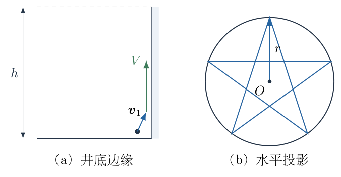
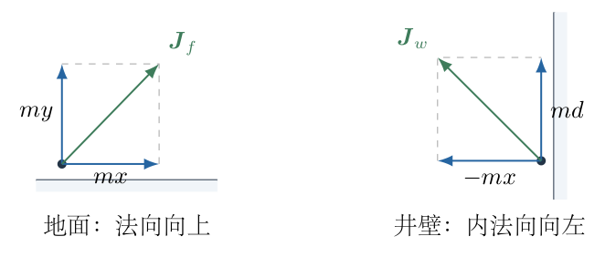
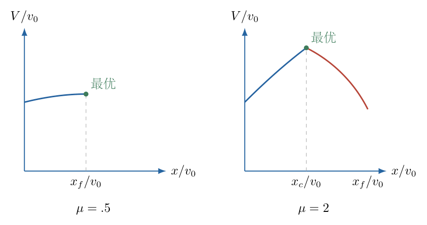
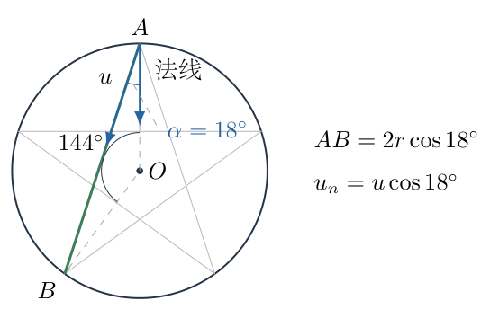
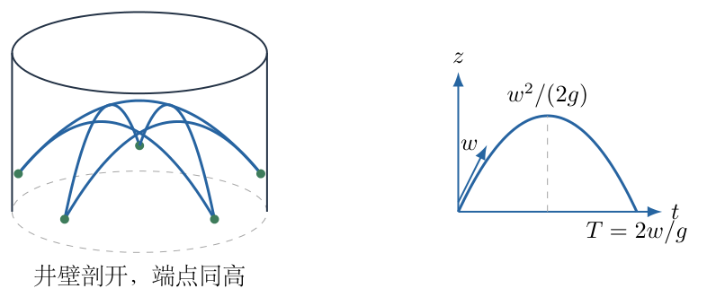

# 第 2 题

<!-- question-start -->

波斯王子掉入一口圆形井中。王子身高为 $l$，质量为 $m$。每次蹬墙或蹬地所能获得的冲量大小均不超过 $I_0=mv_0$；除接触面约束外，冲量方向可以选择。井壁、井底与王子之间的摩擦系数均为 $\mu$。重力加速度为 $g$。

（a）王子不能直接跳出井，但可在井底边缘先蹬地一次，再很快蹬墙一次，随后竖直向上运动，恰好到达井口。求可到达的最大井高 $h$。

（b）井很高，王子需要不断蹬墙。如图，运动的水平投影为圆内接五角星，形成周期运动。求能够实现这种周期运动的最大井半径 $r$。

<!-- question-end -->

## 一、题型定位

本题研究受接触摩擦限制的冲量优化，而不是普通的斜抛射程最优化。冲量大小有上限，还必须位于接触面的摩擦锥内；这两个条件缺一不可。第（a）问要求第二次蹬踏消掉第一次产生的水平速度。第（b）问要求五次碰壁后重复同一运动状态，水平弦长、竖直飞行时间和每次冲量彼此耦合。

最优解随 $\mu$ 改变。摩擦较小时，限制来自可获得的切向冲量；摩擦较大时，限制来自冲量总大小。临界值为 $\mu=1$，不能把一条只在 $\mu\le1$ 时成立的式子不加说明地用于所有摩擦系数。

## 二、知识点

- 冲量定理 $\boldsymbol J=m(\boldsymbol v_+-\boldsymbol v_-)$，其中正负号由统一坐标决定。
- 非黏附接触只提供朝向离开接触面的法向冲量，切向冲量满足 $|J_t|\le\mu J_n$。
- 总冲量有上限时，其各分量不能分别同时取最大值；它们满足平方和约束。
- 同一高度之间的自由飞行，竖直速度前后反号，时间为 $2w/g$。
- 五角星相邻碰壁点不是圆周上相邻的五等分点，而是每次跨过一个顶点。
- 最优化须同时考察定义域、驻点和不同约束接替起作用的边界。
- 周期运动要求碰壁前后状态重复，不等于只画出了一个闭合的水平折线。

## 三、物理图像

第（a）问取水平正方向从井内指向近旁井壁、竖直正方向向上。蹬地后速度为 $(x,y)$，其中 $x\ge0$、$y\ge0$。紧接着蹬墙，使水平速度归零；墙冲量的水平分量沿井壁内法线，与第一次水平速度反向，其大小为 $mx$，竖直分量记为 $md$，$d\ge0$。第二次蹬踏后的速度为 $(0,y+d)$。

井底边缘允许先朝近旁井壁获得水平速度，再由该壁面的朝内法向冲量消掉它。不能把第一次速度画成离开同一井壁，再让井壁提供朝外的“拉力”。题给“很快”使两次冲量之间的重力作用和高度变化可忽略。人体伸展、转身和蹬踏的详细姿态不在质点近似内；身高 $l$ 在最后作为可到达高度的几何修正加入。

第（b）问取碰壁后的水平速率为 $u$、竖直向上速率为 $w$。五角星的弦与碰壁点的内法线成 $18^\circ$。一次飞行的水平运动匀速，竖直运动为抛体运动；因此真实轨迹是五段空间抛物线，其俯视投影才是五角星。

## 四、解题入口

第（a）问先写出蹬地、蹬墙各自的冲量圆与摩擦限制，再把最终竖直速度化为一元函数。先固定水平分量 $x$，求允许的最大 $y$ 和最大 $d$，这样不会漏掉对两次动作的共同约束。

第（b）问先由五角星几何求弦长和入射角，再由同高飞行求周期时间。最后把 $u,w$ 改写为墙法向速度分量 $X=u\cos18^\circ$ 和竖直速度分量 $Z=w$，将问题变成圆盘内受斜线限制的乘积最大值。

## 五、解析

（1）明确两次冲量的大小限制和摩擦限制。

图2-2分别展示蹬地与蹬墙的速度变化；两个小图的法向均按所在接触面确定。图中 $mx,my$ 是蹬地冲量的两个分量，$mx,md$ 是蹬墙冲量分量的大小。第二次水平冲量不是可自由增大的新变量，因为最终要求水平速度为零。

第一次蹬地从近似静止开始，冲量定理给出

$$
J_{fx}=mx,\qquad J_{fy}=my.
$$

地面法向竖直向上，故总冲量和切向约束分别为

$$
\begin{aligned}
(mx)^2+(my)^2&\le m^2v_0^2,\\
mx&\le\mu my.
\end{aligned}
$$

约去正数 $m^2$ 或 $m$，得

$$
x^2+y^2\le v_0^2,\qquad x\le\mu y.\tag{1}
$$

第二次冲量把 $mx$ 消为零，所以其水平分量是 $-mx$，竖直分量为 $md$。墙法向水平，竖直分量才是墙面的切向冲量，因此

$$
x^2+d^2\le v_0^2,\qquad d\le\mu x.\tag{2}
$$

式（1）与式（2）的摩擦不等式不能互换：蹬地限制水平分量，蹬墙限制竖直分量。第二次动作后的竖直速度为

$$
V=y+d.\tag{3}
$$

忽略冲量期间重力的条件，是接触持续时间远小于上升和飞行时间，并非认为重力在后续运动中也可以省略。

（2）固定 $x$，分别求两个竖直分量的可行上界。

由式（1）的冲量圆，

$$
0\le y\le\sqrt{v_0^2-x^2}.
$$

为使 $V$ 最大，应取 $y=\sqrt{v_0^2-x^2}$。但这个选择还要能满足地面摩擦：

$$
\begin{aligned}
x&\le\mu\sqrt{v_0^2-x^2},\\
x^2&\le\mu^2(v_0^2-x^2),\\
(1+\mu^2)x^2&\le\mu^2v_0^2.
\end{aligned}
$$

这里两边非负，故平方不会引入符号错误。可行区间是

$$
0\le x\le x_f:=\frac{\mu v_0}{\sqrt{1+\mu^2}}.\tag{4}
$$

对第二次动作，式（2）给出两个上界：

$$
d\le\mu x,\qquad d\le\sqrt{v_0^2-x^2}.
$$

因此最佳选择为较小者：

$$
d_{\max}(x)=\min\left\{\mu x,\sqrt{v_0^2-x^2}\right\}.\tag{5}
$$

这一步的物理含义是：摩擦允许的竖直冲量再大，也不能突破总冲量圆；反过来，总冲量尚有余量，也不能突破摩擦锥。

两个上界相等时，

$$
\begin{aligned}
\mu x&=\sqrt{v_0^2-x^2},\\
(1+\mu^2)x^2&=v_0^2,\\
x&=x_c:=\frac{v_0}{\sqrt{1+\mu^2}}.
\end{aligned}\tag{6}
$$

于是整个最优化函数为

$$
V(x)=\begin{cases}
\sqrt{v_0^2-x^2}+\mu x,&0\le x\le x_c,\\
2\sqrt{v_0^2-x^2},&x_c\le x\le x_f,
\end{cases}\tag{7}
$$

其中第二段只有在 $x_f\ge x_c$ 时才属于可行域。由 $x_f/x_c=\mu$，立即看到 $\mu=1$ 是两种情况的分界。

（3）当 $0\le\mu\le1$ 时，第一段给出全局最优。

此时 $x_f\le x_c$，整个可行域都位于第一段。对其求导：

$$
\begin{aligned}
\frac{\mathrm dV}{\mathrm dx}
&=-\frac{x}{\sqrt{v_0^2-x^2}}+\mu.
\end{aligned}
$$

导数为零的条件为

$$
\frac{x}{\sqrt{v_0^2-x^2}}=\mu,
$$

解得 $x=x_f$。在 $0\le x<x_f$ 时，左侧小于 $\mu$，所以导数为正。故最优点为允许的右端，而不是一个被漏掉的内部极值。

代入各速度分量，逐项化简：

$$
\begin{aligned}
x&=\frac{\mu v_0}{\sqrt{1+\mu^2}},\\
y&=\sqrt{v_0^2-\frac{\mu^2v_0^2}{1+\mu^2}}
=\frac{v_0}{\sqrt{1+\mu^2}},\\
d&=\mu x=\frac{\mu^2v_0}{\sqrt{1+\mu^2}},\\
V_{\max}&=y+d
=\frac{(1+\mu^2)v_0}{\sqrt{1+\mu^2}}
=v_0\sqrt{1+\mu^2}.
\end{aligned}\tag{8}
$$

还应回代第二次总冲量，检验没有超出上限：

$$
\begin{aligned}
x^2+d^2
&=\frac{\mu^2v_0^2+\mu^4v_0^2}{1+\mu^2}
=\mu^2v_0^2\le v_0^2.
\end{aligned}
$$

所以地面冲量达到上限，而墙冲量大小为 $\mu mv_0$，在 $\mu<1$ 时并未达到 $I_0$。不能凭“最大高度”就假定每次冲量都必须用满。

（4）当 $\mu\ge1$ 时，最优点转移到两上界的交界。

此时 $x_f\ge x_c$，式（7）的两段均有可行部分。第一段的导数在 $x_c$ 处为

$$
V'(x_c)=\mu-\frac1\mu\ge0.
$$

因为 $x/\sqrt{v_0^2-x^2}$ 随 $x$ 增大而增大，第一段在 $[0,x_c]$ 上非减。第二段导数为

$$
V'(x)=-\frac{2x}{\sqrt{v_0^2-x^2}}<0\qquad(x>0).
$$

故第一段上升、第二段下降，全局最大值恰在 $x=x_c$。由式（6），

$$
\begin{aligned}
x&=\frac{v_0}{\sqrt{1+\mu^2}},\\
y&=d=\frac{\mu v_0}{\sqrt{1+\mu^2}},\\
V_{\max}&=\frac{2\mu v_0}{\sqrt{1+\mu^2}}.
\end{aligned}\tag{9}
$$

此时两次总冲量都恰为 $mv_0$。地面摩擦要求 $x\le\mu y$，回代后变成 $1\le\mu^2$，正好符合本段条件；墙面切向冲量仍达到摩擦锥边界 $d=\mu x$。

图2-3把式（7）的两段和真实可行域画在同一坐标中。横坐标为 $x/v_0$，纵坐标为 $V/v_0$；绿色点分别位于 $x_f$ 或 $x_c$，后面的高度公式使用的就是这两个点的纵坐标。

（5）将速度最优值转为最大井高。

第二次动作后只剩竖直运动，到最高点竖直速度为零。以这段运动的起点为零高度，由匀变速公式或机械能守恒得

$$
0=V_{\max}^2-2gH,\qquad H=\frac{V_{\max}^2}{2g}.
$$

按题目身高修正，井口可达到高度为 $h=l+H$。所以第（a）问为

$$
\boxed{
h_{\max}=l+\begin{cases}
\dfrac{(1+\mu^2)v_0^2}{2g},&0\le\mu\le1,\\[4pt]
\dfrac{2\mu^2v_0^2}{(1+\mu^2)g},&\mu\ge1.
\end{cases}}\tag{10}
$$

在 $\mu=1$ 时，两式同为 $l+v_0^2/g$，故不存在高度跳变。当 $\mu\to0$，高度退化为只蹬地可达到的 $l+v_0^2/(2g)$；第二次墙冲量也趋于零。当 $\mu\to\infty$，最终速率趋近 $2v_0$，高度趋近 $l+2v_0^2/g$，没有超过两次冲量同向叠加能够提供的绝对上界。

（6）由五角星几何求碰壁角和弦长。

圆周上五个顶点等分圆周，相邻圆周顶点中心角为 $72^\circ$。五角星每次从一个顶点跨过一个顶点到下一个碰壁点，因此一段弦对应的较小中心角为 $144^\circ$。

在图2-4中，$A,B$ 是连续碰壁点，$O$ 为圆心。三角形 $OAB$ 为等腰三角形，其底角为

$$
\alpha=\frac{180^\circ-144^\circ}{2}=18^\circ.
$$

这个角就是弦 $AB$ 与 $A$ 点指向圆心的内法线之间的角。作弦的垂直平分线，或用余弦定理，可得

$$
\begin{aligned}
AB&=2r\sin\frac{144^\circ}{2}
=2r\sin72^\circ
=2r\cos18^\circ.
\end{aligned}\tag{11}
$$

因此碰壁后的水平法向速度分量为 $u\cos\alpha$，切向速度分量的大小为 $u\sin\alpha$。使用 $\sin18^\circ$ 作法向投影会把这两个分量互换。

（7）由周期状态建立竖直时间与水平弦长的联系。

每段飞行开始时竖直速度向上为 $w$，结束时必须回到同一碰壁高度。取该高度为 $z=0$，竖直运动为

$$
z(t)=wt-\frac12gt^2.
$$

令下一次碰壁时 $z(T)=0$，得到

$$
T\left(w-\frac12gT\right)=0.
$$

$T=0$ 是起点，非实际飞行时间；故应取

$$
T=\frac{2w}{g},\qquad v_z(T)=w-gT=-w.\tag{12}
$$

水平无外力，速率 $u$ 保持不变。一段弦的长度为 $uT$，与式（11）联立：

$$
\begin{aligned}
u\frac{2w}{g}&=2r\cos\alpha,\\
r&=\frac{uw}{g\cos\alpha}.
\end{aligned}\tag{13}
$$

真实的空间轨迹见图2-5。各端点在同一高度，每段中点升高 $w^2/(2g)$，并不是五条水平直线。此图中的 $u$ 决定水平弦长，$w$ 决定飞行时间和拱高，二者进入式（12）、（13）。

（8）求每次墙冲量，并施加同一个摩擦锥。

在任一碰壁点，碰壁前法向速度朝墙，碰壁后法向速度朝井内，两者大小均为 $u\cos\alpha$。为保持规则五角星，水平切向速度不变。所以墙的水平切向冲量为零，法向冲量为

$$
J_n=m[u\cos\alpha-(-u\cos\alpha)]
=2mu\cos\alpha.
$$

竖直速度由 $-w$ 变成 $+w$，因此竖直切向冲量为

$$
J_z=m[w-(-w)]=2mw.
$$

总切向冲量此时就是竖直分量，而不是额外再加一次水平切向量。冲量上限与摩擦限制变成

$$
\begin{aligned}
(2mu\cos\alpha)^2+(2mw)^2&\le m^2v_0^2,\\
2mw&\le\mu(2mu\cos\alpha).
\end{aligned}
$$

约去公共因子，定义 $X=u\cos\alpha$、$Z=w$：

$$
X^2+Z^2\le\frac{v_0^2}{4},\qquad
0\le Z\le\mu X,\qquad X\ge0.\tag{14}
$$

式（13）改写为

$$
r=\frac{XZ}{g\cos^2\alpha}.\tag{15}
$$

至此，运动问题才化为乘积的最优化。两个因子均不能任意增大，因为受同一个半径为 $v_0/2$ 的冲量圆盘限制。

（9）在圆盘与摩擦边界中求最大乘积。

若 $\mu\ge1$，圆盘内无摩擦约束的最大乘积点 $X=Z$ 本身可行。由

$$
2XZ\le X^2+Z^2\le\frac{v_0^2}{4},
$$

得 $XZ\le v_0^2/8$。等号须同时满足 $X=Z$ 和位于圆周上，因此

$$
X=Z=\frac{v_0}{2\sqrt2},\qquad XZ=\frac{v_0^2}{8}.\tag{16}
$$

若 $0\le\mu\le1$，可行域在 $Z=X$ 的下侧。用极坐标

$$
X=\frac{v_0}{2}\cos\beta,\qquad
Z=\frac{v_0}{2}\sin\beta,
$$

只需考察圆周，是因为固定方向时增大半径会使乘积按半径平方增大。摩擦条件成为 $0\le\beta\le\arctan\mu\le\pi/4$，而

$$
XZ=\frac{v_0^2}{8}\sin2\beta.
$$

在上述角度区间内，$\sin2\beta$ 单调增加，故最优点取 $\tan\beta=\mu$，即 $Z=\mu X$。与圆周条件联立：

$$
\begin{aligned}
(1+\mu^2)X^2&=\frac{v_0^2}{4},\\
X&=\frac{v_0}{2\sqrt{1+\mu^2}},\\
Z&=\frac{\mu v_0}{2\sqrt{1+\mu^2}},\\
XZ&=\frac{\mu v_0^2}{4(1+\mu^2)}.
\end{aligned}\tag{17}
$$

把 $\alpha=18^\circ$ 代回式（15），第（b）问为

$$
\boxed{r_{\max}=\begin{cases}
\dfrac{\mu v_0^2}{4(1+\mu^2)g\cos^218^\circ},&0\le\mu\le1,\\[5pt]
\dfrac{v_0^2}{8g\cos^218^\circ},&\mu\ge1.
\end{cases}}\tag{18}
$$

（10）核验周期性、单位和极限，并界定答案的适用范围。

采用式（16）或式（17）的速度，先由式（12）得非零飞行时间，再由式（15）确定半径。水平弦到达下一规定顶点，竖直位置回到原高；墙冲量将法向速度反转、竖直速度从 $-w$ 恢复为 $+w$，水平切向速度保持原值。圆形井的旋转对称保证下一段完全同构，五段后位置与速度都重复，所以不是只有位置闭合。

式（18）的量纲为 $v_0^2/g$，即长度；质量 $m$ 约去，是因为冲量上限本身正比于质量。$\cos^218^\circ$ 无量纲且非零，不引入额外尺度。

当 $\mu=1$ 时，两段半径公式相等。当 $\mu\to0$ 时，$w\to0$、飞行时间趋于零，最大可持续半径趋于零；无竖直摩擦冲量便无法补回重力造成的竖直动量损失。当 $\mu\to\infty$ 时，半径保持有限，因为冲量总大小仍有上限。若把小摩擦公式继续用于很大 $\mu$，反而会得到半径减小，这只是选择了一个非最优摩擦边界，不是物理上摩擦增大使可行能力降低。

本问求已经建立起来的墙间周期运动，而没有要求它必须由“仅一次蹬地”直接进入。因此不能额外把第（a）问的地面摩擦限制套到稳态 $u,w$ 上。井足够高使每段拱高和人体长度不会触碰井口；若井高有限，还须另加最高点几何约束，那属于条件改变后的问题。

（11）恢复实际速度、飞行时间与冲量，核验可行状态。

优化时的 $X,Z$ 是速度分量，不是完整水平速率。由 $u=X/\cos18^\circ$、$w=Z$，当 $0<\mu\le1$ 时，

$$
\begin{aligned}
u&=\frac{v_0}{2\cos18^\circ\sqrt{1+\mu^2}},\\
w&=\frac{\mu v_0}{2\sqrt{1+\mu^2}},\\
T&=\frac{\mu v_0}{g\sqrt{1+\mu^2}},\\
H_{\rm apex}&=\frac{w^2}{2g}
=\frac{\mu^2v_0^2}{8g(1+\mu^2)}.
\end{aligned}
$$

每次冲量分量为

$$
J_n=\frac{mv_0}{\sqrt{1+\mu^2}},\qquad
J_z=\frac{\mu mv_0}{\sqrt{1+\mu^2}}.
$$

它们满足 $J_z/J_n=\mu$，且 $J_n^2+J_z^2=m^2v_0^2$；摩擦边界与总冲量边界同时达到。把 $uT$ 直接算出，再除以 $2\cos18^\circ$，会恢复式（18）的半径，因而几何、时间和冲量三项约束彼此一致。

当 $\mu\ge1$ 时，同样恢复得

$$
\begin{aligned}
u&=\frac{v_0}{2\sqrt2\cos18^\circ},\qquad
w=\frac{v_0}{2\sqrt2},\\
T&=\frac{v_0}{\sqrt2g},\qquad
H_{\rm apex}=\frac{v_0^2}{16g},\\
J_n&=J_z=\frac{mv_0}{\sqrt2}.
\end{aligned}
$$

此时总冲量仍为 $mv_0$，但切向与法向之比为1，小于或等于允许的 $\mu$。所以摩擦增大后最优状态不必继续取 $J_z=\mu J_n$。上述 $H_{\rm apex}$ 是相对于碰壁高度的升高，若要核验有限井口，必须用这个高度与身高和碰壁位置共同比较。

## 六、关键洞察

第（a）问的两次冲量并不是两份独立的竖直速度增量：第一次水平分量 $x$ 决定第二次能够得到多少法向冲量，从而决定墙面摩擦能够提供多少竖直冲量。这个“借水平动量获得竖直冲量”的耦合，正是连续蹬踏比单次竖直跳跃可能更有效的原因。

固定 $x$ 后分别最大化 $y,d$ 是一种消元，而不是额外假设。对给定 $x$，式（3）对两者都单调增加，并且其余约束中没有把 $y$ 与 $d$ 直接相连，故取各自的最大允许值不会失去可行解。

小摩擦时墙冲量没有用满，大摩擦时地面摩擦锥没有用满。最优点未必使所有不等式同时取等号；真正需要确认的是哪几条约束在当前参数范围内起决定作用。

第（b）问把 $u$ 替换为法向分量 $X$ 后，几何和动力学分别集中在两个位置：$\cos^2\alpha$ 留在半径式中，冲量圆不再含角度。这种选变量的方法比直接对复杂的 $u,w,r$ 三式同时求极值更清晰。

可用功率核验周期补能，但不能以此代替动量约束。每次碰壁前后水平速度大小相同、竖直速度大小也相同，故质点机械能在碰壁前后相同。这里“蹬墙”是主动动作，墙的约束法向配合人体做功与冲量；仅靠一个被动、静止、无能量供给的碰撞模型，不能自动实现竖直速度从 $-w$ 变成 $+w$。题设给定可施加冲量的能力，正是在理想化地包含这一主动控制。

## 七、易错点

- 把 $I_0$ 当作每个分量的上限，写出两个分量都为 $mv_0$，从而违反总大小限制。
- 在墙面写 $J_n\le\mu J_z$，把法向和切向作用颠倒。
- 只用第二次动作的条件，不检查第一次蹬地的摩擦锥。
- 不分 $\mu\le1$ 和 $\mu\ge1$，机械地让所有约束取等号。
- 把五角星弦当作五边形边，使用 $72^\circ$ 中心角或 $54^\circ$ 碰壁角。
- 用 $w/g$ 作同高飞行时间，漏掉下降半程，进而使半径差一个因子 $2$。
- 把 $J_z=mw$ 当作补偿冲量，忘记它要把 $-w$ 变为 $+w$，正确变化量是 $2mw$。
- 只验证五条水平弦的位置闭合，不检查每段的竖直高度和碰壁后速度是否重复。

## 八、课堂讲解建议

先让学生分别指出地面和墙面的法向，板书两套不等式时不要立即化简。将第二次“最终竖直”翻译成水平动量完全消除，说明两个动作为什么共享变量 $x$。随后让学生用极端情形 $\mu=0$ 检验墙面能否提供向上冲量，再从 $x_f$ 与 $x_c$ 的大小比较发现分段条件。

讲五角星时先画俯视图，让学生沿真实访问顺序逐个标顶点，确认每段跨过一个点；随后切换到空间图，区分“投影直线”和“真实抛物线”。在板书 $J_z=2mw$ 前，把碰壁前后的竖直箭头画出，避免学生凭记忆漏掉因子 $2$。

最优化可以先用乘积不等式找 $X=Z$，再问这个点是否落在摩擦允许区域内。教师应强调：数学上无约束的最优点只有通过全部物理约束检查后，才能成为最终答案。

## 九、变式训练

变式：井内水平投影改为正三角形，连续碰壁点是圆内接正三角形的三个顶点，其余冲量和摩擦条件不变。求能够实现同高周期运动的最大井半径，并与五角星结果比较。

解：一段弦对应中心角 $120^\circ$，等腰三角形底角为 $\alpha=30^\circ$。故弦长为 $2r\cos30^\circ=\sqrt3r$，而法向水平速度分量仍为 $X=u\cos30^\circ$。由同高飞行 $T=2w/g$，

$$
r=\frac{uw}{g\cos30^\circ}
=\frac{XZ}{g\cos^230^\circ}
=\frac{4XZ}{3g}.
$$

每次墙冲量依旧为法向 $2mX$、竖直 $2mZ$，因此式（14）的可行域不变。最优乘积分别为 $\mu v_0^2/[4(1+\mu^2)]$ 和 $v_0^2/8$。代回可得

$$
\boxed{r_{\triangle,\max}=\begin{cases}
\dfrac{\mu v_0^2}{3(1+\mu^2)g},&0\le\mu\le1,\\[4pt]
\dfrac{v_0^2}{6g},&\mu\ge1.
\end{cases}}
$$

同一个 $\mu$ 下，两种轨迹的最优冲量分量相同，半径差异只来自几何因子。其比值为

$$
\frac{r_{\triangle,\max}}{r_{\star,\max}}
=\frac{\cos^218^\circ}{\cos^230^\circ}
=\frac{4\cos^218^\circ}{3}\approx1.2060.
$$

正三角形允许的半径稍大，并不表示其每次向上冲量更大；它的弦在给定半径下较短，因此同一组水平与竖直速度可以跨越更大的井。用 $\mu=1$ 回代，两边公式连续；用 $\mu\to0$ 回代，两种周期运动的最大半径均趋于零。
