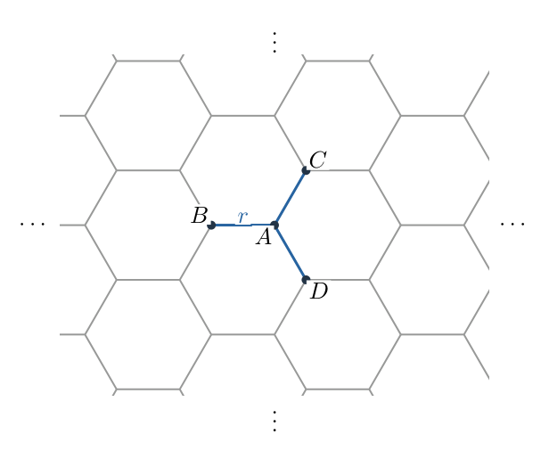
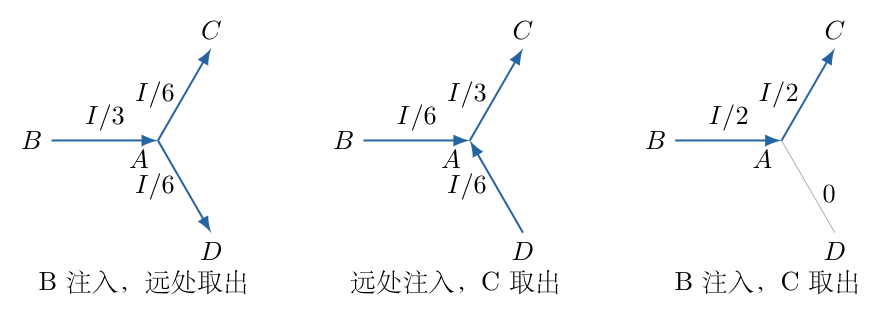
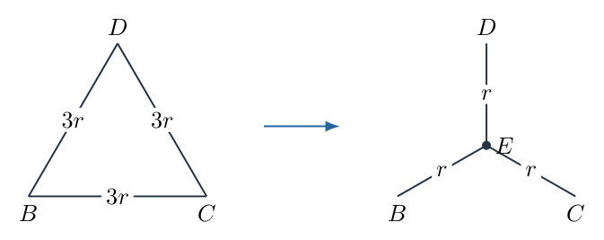
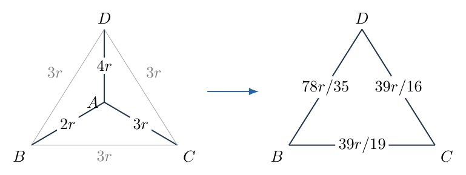
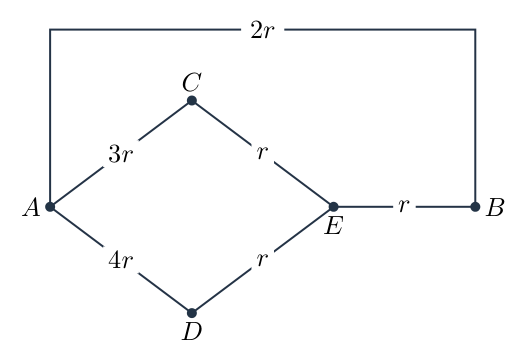

# 第 3 题

<!-- question-start -->

如图，一无穷大蜂窝状电阻网络中，每个六边形小边的电阻均为 $r$。$B,C,D$ 为节点 $A$ 的三个相邻节点。

（1）求 $B,C$ 之间的等效电阻 $R_1$。

（2）去掉 $A,B$ 之间和 $A,C$ 之间的电阻，求此时 $B,C$ 之间的等效电阻 $R_2$。

（3）在完整网络中，将 $AB,AC,AD$ 三条边的电阻分别换为 $2r,3r,4r$。求此时 $B,C$ 之间的等效电阻 $R_3$，以及 $A,B$ 之间的等效电阻 $R_{AB}$。

<!-- question-end -->

## 一、题型定位

无限规则电阻网络中的局部改动。第一步靠对称性和电流源叠加求原网络的端口电阻，第二步把没有改动的无限部分压缩为一个三端网络，第三步只在有限等效电路中进行电阻变换或节点计算。

“无限”并不意味着可以把任何远处路径随意断开，也不意味着某条局部支路没有电流。对称性必须针对指定的电源接法成立；第（3）问三个局部阻值不同后，不能继续照搬第（1）问的电流平分关系。

## 二、知识点

- 线性电阻网络满足欧姆定律、节点电流定律和叠加原理。
- 旋转与镜面对称决定某些支路电流相等，或某些节点等势。
- 从单点向远处均匀边界送电流的辅助解，只用来叠加支路电流；二维无限网络的单源绝对电势不必有限。
- 三个端子间完全对称的无源电阻网络，可用等边三角形或等臂星形表示。
- 串联需要中间节点没有其他有效分支，并联需要两端节点相同。
- 星形—三角形变换保持三个端子的电流—电势关系，而不是只保留某一对电阻。
- 独立节点方程可以检验电路变换是否接错端子或写错分母。

## 三、物理图像

图3-1中 $A$ 有三个邻点。所有较远处边仍为 $r$；第三问只改 $AB,AC,AD$，不是把整个蜂窝中的三个方向全部改成不同阻值。

把节点 $A$ 及三条连接边暂时拿掉，剩余无限网络只有 $B,C,D$ 三个需要保留的端子。绕原来 $A$ 的 $120^\circ$ 旋转循环交换三个端子，剩余网络不变。正是这一对称性，允许将它替换成三个相同边电阻的三角形。

第二问中没有去掉 $AD$，但当 $AB,AC$ 都断开后，$A$ 只通过 $AD$ 与网络连接。节点 $A$ 既不是电源端子，也没有第二条通路，所以 $AD$ 为悬支路，稳态电流为零。这里的零电流来自节点电流定律，不是因为支路“很远”或“很短”。

## 四、解题入口

先在 $B$ 注入电流 $I$、在 $C$ 取出电流 $I$，利用两个辅助单源解叠加求中央路径 $B\to A\to C$ 的电流。由路径电压降得到 $R_1$，再反推出不经过中央路径的其余网络电阻。

随后确定剩余三端网络的三角形边值。第三问将新的 $2r,3r,4r$ 星形与剩余三角形组合；求 $R_3$ 时将新星形变三角形，求 $R_{AB}$ 时将剩余三角形变星形。最后分别用节点方程核验，避免只用同一条计算路线重复确认。

## 五、解析

（1）用辅助电流源求完整网络的中央支路电流。

先考虑在 $B$ 注入电流 $I$，电流在远处对称边界取出的辅助情况。蜂窝绕 $B$ 的三条邻边具有三重旋转对称，所以由 $B$ 流向每个邻点的电流均为 $I/3$，特别有

$$
I_{BA}^{(B)}=\frac I3.
$$

这股电流到达 $A$ 后，沿 $AC,AD$ 分流。通过 $AB$ 的镜面对称交换 $C,D$，因此这两股电流相等。由节点 $A$ 的电流守恒，

$$
I_{AC}^{(B)}=I_{AD}^{(B)}=\frac12\frac I3=\frac I6.
$$

再考虑在 $C$ 注入 $I$、在远处取出 $I$ 的辅助解。同理，$C\to A$ 为 $I/3$，$A\to B$ 和 $A\to D$ 各为 $I/6$。将这一解的所有电流反向，就得到远处注入、$C$ 取出的辅助解。

两个辅助解叠加后，远处净电流为零，剩下的正是 $B$ 注入、$C$ 取出的实际接法。图3-2以箭头标出方向；计算时应先按实际路径方向统一正负号。

于是

$$
\begin{aligned}
I_{BA}&=\frac I3+\frac I6=\frac I2,\\
I_{AC}&=\frac I6+\frac I3=\frac I2,\\
I_{AD}&=\frac I6-\frac I6=0.
\end{aligned}\tag{1}
$$

单源辅助电势在无限远的选零方式可能涉及极限；这里使用的是有限支路电流的对称极限。源、汇叠加之后，相距有限的 $B,C$ 之间电势差是明确的，不能由单源绝对电势的发散误判端口电阻不存在。

（2）由中央路径电压降求第一问电阻。

中央路径的两个电阻均为 $r$。沿 $B\to A\to C$ 方向，电势连续下降：

$$
\begin{aligned}
U_{BC}&=(V_B-V_A)+(V_A-V_C)\\
&=rI_{BA}+rI_{AC}\\
&=r\frac I2+r\frac I2=rI.
\end{aligned}
$$

等效电阻的定义是端口电压除以注入的总电流 $I$，不是除以中央路径电流 $I/2$，所以

$$
\boxed{R_1=\frac{U_{BC}}I=r.}\tag{2}
$$

中央串联路径本身为 $2r$，只是它和其余网络并联后成为 $r$。若把 $I/2$ 当成端口总电流，就会把中央支路电阻错误地写成整个网络的答案。

（3）确定去掉中央两条边后的电阻。

式（1）中 $AD$ 无电流，故可先移除这一悬挂于等势点的无效支路，不影响当前 $B,C$ 端口。完整网络由中央的 $2r$ 路径与其余网络并联。设其余网络在 $B,C$ 之间的电阻为 $R_* $，则

$$
\begin{aligned}
\frac1r&=\frac1{2r}+\frac1{R_*},\\
\frac1{R_*}&=\frac1r-\frac1{2r}=\frac1{2r},\\
R_*&=2r.
\end{aligned}\tag{3}
$$

第二问去掉 $AB,AC$ 后，$A$ 通过 $AD$ 只剩一个连接点。节点 $A$ 的电流守恒直接给 $I_{AD}=0$。因此剩余端口电路恰等于上面的其余网络，

$$
\boxed{R_2=2r.}\tag{4}
$$

这个推理只在去掉的是 $AB,AC$ 时成立。若只去掉一条边，$A$ 仍有两条连接，不能把它直接当作悬支路处理。

（4）把剩余无限网络压缩为对称的三端电路。

拿掉 $A$ 与其三条邻边后，剩余网络在 $B,C,D$ 之间对称。其端口电流—电势关系为线性关系，且电势整体加常数不改变电流。对称性要求三个端子之间的等效耦合相同，因此可用三个相等电阻 $s$ 组成的三角形表示。

当第三端 $D$ 不接外电源时，$B,C$ 之间有一条直接的 $s$ 路径和经过 $D$ 的 $2s$ 路径：

$$
R_{BC}^{\rm rest}=s\parallel2s
=\frac{s\cdot2s}{s+2s}=\frac{2s}{3}.
$$

由第二问 $R_{BC}^{\rm rest}=2r$，得到

$$
\frac{2s}{3}=2r\quad\Longrightarrow\quad s=3r.\tag{5}
$$

图3-3左侧显示这个剩余三角形；右侧将它变为星形，每条臂为 $r$，中心记作 $E$。三个端子的位置和编号在变换前后保持不变，后续求 $R_{AB}$ 使用的就是右侧 $E$ 节点。

注意三角形每条边是 $3r$，不是 $2r$；$2r$ 是任取两个端子、第三端悬空时测得的电阻。三条边同时存在时，另外两边构成并联路径。

（5）第三问将新的局部星形变为三角形。

修改后的中央星形为

$$
R_{AB}=2r,\qquad R_{AC}=3r,\qquad R_{AD}=4r
$$

这里三式是支路阻值，尚不是最终端口等效电阻。为避免混淆，以下把变换后的边记为 $s_{BC},s_{BD},s_{CD}$。

星形变三角形时，连接两个端子的三角形边等于三对星形臂乘积之和，除以第三端对应的臂。因此共同的乘积和为

$$
(2r)(3r)+(3r)(4r)+(4r)(2r)
=(6+12+8)r^2=26r^2.
$$

于是

$$
\begin{aligned}
s_{BC}&=\frac{26r^2}{4r}=\frac{13}{2}r,\\
s_{BD}&=\frac{26r^2}{3r}=\frac{26}{3}r,\\
s_{CD}&=\frac{26r^2}{2r}=13r.
\end{aligned}\tag{6}
$$

例如求 $BC$ 边时，分母应为连接 $D$ 的 $4r$，不能按字母相邻随意选用 $2r$ 或 $3r$。

这三个新边与原来剩余网络的 $3r$ 三角形逐边并联。图3-4中每条合并边的两端节点相同，所以可以直接并联；这不是把三条不同端子的电阻全部并在一起。

合并后的边值逐项为

$$
\begin{aligned}
t_{BC}&=\frac{(13r/2)(3r)}{13r/2+3r}
=\frac{39}{19}r,\\
t_{BD}&=\frac{(26r/3)(3r)}{26r/3+3r}
=\frac{78}{35}r,\\
t_{CD}&=\frac{(13r)(3r)}{13r+3r}
=\frac{39}{16}r.
\end{aligned}\tag{7}
$$

各式分子为电阻平方、分母为电阻，量纲都正确。合并边也都小于 $3r$，符合增加并联路径会减小电阻的性质。

（6）把三角形的两条端口路径合并，求 $R_3$。

经过 $D$ 的串联路径为

$$
\begin{aligned}
t_{BD}+t_{CD}
&=\left(\frac{78}{35}+\frac{39}{16}\right)r\\
&=\frac{78\cdot16+39\cdot35}{560}r\\
&=\frac{1248+1365}{560}r
=\frac{2613}{560}r.
\end{aligned}
$$

它与直接边 $t_{BC}=39r/19$ 并联：

$$
\begin{aligned}
R_3
&=\frac{(39/19)(2613/560)}{39/19+2613/560}r\\
&=\frac{39\cdot2613}{39\cdot560+2613\cdot19}r\\
&=\frac{101907}{21840+49647}r\\
&=\frac{101907}{71487}r
=\boxed{\frac{67}{47}r}.
\end{aligned}\tag{8}
$$

最后分子、分母同时除以 $1521=39^2$，得到 $67/47$。数值约为 $1.42553r$，介于原值 $r$ 与中央两支路完全断开的 $2r$ 之间，符合局部电阻增大后的单调变化。

（7）求 $A,B$ 端口电阻时，不能保留已经被消去的节点 $A$。

式（6）的星形—三角形变换消去了 $A$，只保留 $B,C,D$ 三端关系。因此求 $A,B$ 电阻不能直接在图3-4上寻找 $A$，必须回到保留 $A$ 的电路。

此时将未改动部分的 $3r$ 三角形变为图3-3右侧的星形，每条臂均为 $r$，中心为 $E$。整个电路见图3-5：

节点 $C,D$ 不是电源端子，各自只有两条有效连接，所以可以串联：

$$
\begin{aligned}
R_{A\to C\to E}&=3r+r=4r,\\
R_{A\to D\to E}&=4r+r=5r.
\end{aligned}
$$

这两条路径在 $A,E$ 之间并联：

$$
R_{AE}^{(C,D)}=4r\parallel5r
=\frac{4r\cdot5r}{4r+5r}=\frac{20}{9}r.
$$

再与 $E\to B$ 的 $r$ 串联，形成不走直接 $AB$ 边的路径：

$$
R_{A\to E\to B}=\frac{20}{9}r+r=\frac{29}{9}r.
$$

最后与直接边 $AB$ 的 $2r$ 并联，

$$
\begin{aligned}
R_{AB}
&=2r\parallel\frac{29}{9}r\\
&=\frac{2r\,(29r/9)}{2r+29r/9}\\
&=\frac{58/9}{47/9}r
=\boxed{\frac{58}{47}r}.
\end{aligned}\tag{9}
$$

它小于直接支路的 $2r$，因为还存在经过其余网络的通路；也大于原完整蜂窝相邻节点之间的 $2r/3$，因为本次只增加了局部支路阻值。

（8）用原四节点网络独立核验 $B,C$ 端口。

保留中央三条新边和剩余的 $3r$ 三角形，不使用式（6）—（8）的变换。令 $V_B=U$、$V_C=0$、$V_A=aU$、$V_D=dU$。$A,D$ 均无外接电流，节点方程为

$$
\begin{aligned}
\frac{a-1}{2}+\frac a3+\frac{a-d}{4}&=0,\\
\frac{d-a}{4}+\frac{d-1}{3}+\frac d3&=0.
\end{aligned}
$$

每式已约去公共因子 $U/r$。乘以 $12$ 清除分母，得

$$
13a-3d=6,\qquad 11d-3a=4.
$$

由第二式 $d=(4+3a)/11$，代入第一式：

$$
\begin{aligned}
13a-\frac{3(4+3a)}{11}&=6,\\
143a-12-9a&=66,\\
134a&=78,\\
a&=\frac{39}{67},\qquad d=\frac{35}{67}.
\end{aligned}
$$

从端口 $B$ 注入的总电流为其三条相连支路电流之和：

$$
\begin{aligned}
I_B&=\frac Ur\left[\frac{1-a}{2}+\frac13+\frac{1-d}{3}\right]\\
&=\frac Ur\left[\frac{14}{67}+\frac13+\frac{32}{201}\right]\\
&=\frac Ur\frac{42+67+32}{201}
=\frac Ur\frac{47}{67}.
\end{aligned}
$$

所以 $U/I_B=67r/47$，与式（8）一致。节点电势都在 $0,U$ 之间，也符合无源网络中内部节点不会超出端口电势范围的性质。

（9）独立核验 $A,B$ 端口，并检查端口不能互换。

令 $V_A=U$、$V_B=0$、$V_C=cU$、$V_D=dU$。对 $C,D$ 写方程：

$$
\begin{aligned}
\frac{c-1}{3}+\frac c3+\frac{c-d}{3}&=0,\\
\frac{d-1}{4}+\frac d3+\frac{d-c}{3}&=0.
\end{aligned}
$$

化简为 $3c-d=1$、$11d-4c=3$。由 $d=3c-1$ 代入，得

$$
33c-11-4c=3,
\qquad c=\frac{14}{29},\qquad d=\frac{13}{29}.
$$

端口 $A$ 电流为

$$
\begin{aligned}
I_A&=\frac Ur\left[\frac12+\frac{1-c}{3}+\frac{1-d}{4}\right]\\
&=\frac Ur\left[\frac12+\frac5{29}+\frac4{29}\right]\\
&=\frac Ur\frac{47}{58}.
\end{aligned}
$$

因此 $U/I_A=58r/47$，再次核验式（9）。第三问两个答案的分母相同，但分子不同；这来自两个不同的电源接法，而不是书写顺序可以任意交换。

（10）汇总答案与适用条件。

$$
\boxed{R_1=r,\qquad R_2=2r,\qquad
R_3=\frac{67}{47}r,\qquad R_{AB}=\frac{58}{47}r.}
$$

所有结果正比于 $r$，因为线性电路的全部边电阻同比例放大时，等效电阻也同比例放大。端口电流 $I$ 或电压 $U$ 是辅助测试量，最终均消去。

上述三端等效对所有 $B,C,D$ 端口驱动保持有效，但不保留被消去的内部节点电势。因而每次电路变换前必须确认要测量的端子仍在图中。作为数值交叉检验，可以构造逐渐增大的周期蜂窝网，直接求解所有节点电势；随着网格扩大，四个端口结果应趋向上述值，而有限边界结果不能不加说明地当作精确无限网络答案。

（11）按支路电流再做功率守恒检查。

以第三问 $B,C$ 接法的节点解为准，六条有效边的电流为

$$
\begin{aligned}
I_{BA}&=\frac{14U}{67r},& I_{AC}&=\frac{13U}{67r},&
I_{AD}&=\frac{U}{67r},\\
I_{BC}&=\frac{U}{3r},& I_{BD}&=\frac{32U}{201r},&
I_{DC}&=\frac{35U}{201r}.
\end{aligned}
$$

节点A的流入14/67等于流出13/67加1/67；节点D的流入1/67加32/201等于流出35/201。特别是 $AD$ 电流不为零，不能沿用第一问的删支路结论。

逐边热功率求和，用电流单位 $U/r$ 提出公共因子，得到

$$
\begin{aligned}
P&=\frac{U^2}{r}\left[
\frac{2\cdot14^2+3\cdot13^2+4}{67^2}
+\frac13+\frac{3(32^2+35^2)}{201^2}\right]\\
&=\frac{U^2}{r}\frac{2709+4489+2249}{3\cdot4489}\\
&=\frac{U^2}{r}\frac{9447}{13467}
=\frac{47U^2}{67r}.
\end{aligned}
$$

端口输入功率为 $UI_B=47U^2/(67r)$，与各边发热一致。这项检查既使用了每条新支路阻值，也使用了其真实电流，能发现端子误接或公共支路被遗漏的问题。

## 六、关键洞察

无限部分之所以能被有限三端电路替代，不是因为远处可以忽略，而是因为它对外只通过三个端子交换电流。线性、无源性和三个端子的对称性限制了它的完整端口关系，测得其中一对电阻后即可确定唯一的对称三角形边值。

也可用三端导纳矩阵理解这一点。令三个端口电势为 $V_B,V_C,V_D$，对称性与整体电势平移不变性要求

$$
\begin{pmatrix}I_B\\I_C\\I_D\end{pmatrix}
=G\begin{pmatrix}2&-1&-1\\-1&2&-1\\-1&-1&2\end{pmatrix}
\begin{pmatrix}V_B\\V_C\\V_D\end{pmatrix}.
$$

它正是边电导均为 $G$ 的三角形。若 $I_D=0$，得 $V_D=(V_B+V_C)/2$，从而 $I_B=(3G/2)(V_B-V_C)$。已知端口电阻 $2r$，故 $2/(3G)=2r$，得到 $G=1/(3r)$，与式（5）一致。这条路线直接说明等效保持的是整个三端关系，而不是只有某一次测量。

第一问的 $AD$ 无电流依赖 $B,C$ 驱动时的镜面对称。第三问 $2r,3r,4r$ 不相等后，$A,D$ 一般不等势。比如在 $B,C$ 接法中，式（8）的节点核验给

$$
I_{AD}=\frac{V_A-V_D}{4r}
=\frac{(39-35)U}{67\cdot4r}
=\frac{U}{67r}\ne0.
$$

因此将第三问的 $AD$ 直接删掉，会改变答案。不同小问的对称性不能只因电路“外观看起来类似”而继续沿用。

## 七、易错点

- 将第一问中央支路的 $I/2$ 当作端口总电流，得到错误的 $2r$。
- 忘记辅助 $C$ 单源解在叠加前必须反向，导致 $AD$ 电流不是相减。
- 把第二问的悬支路结论用于第三问，错误删除 $AD$。
- 把三端两两测得的 $2r$ 当作三角形单边值，遗漏第三端提供的串联通路。
- 星形变三角形时使用连接当前端子的臂作分母，而正确分母属于未连接的第三端。
- 求 $A,B$ 电阻时使用已消去 $A$ 的三角形，实际上已经失去待测端口。
- 把第三问局部修改理解为整张网络三个方向的阻值都改变，破坏原先三端对称等效。

## 八、课堂讲解建议

先让学生追踪一次“B注入、C取出”的真实电流，说明为什么仅靠节点A三分流不够。再画两个辅助单源图，分别标 $I/3$ 和 $I/6$，最后按方向相加。板书端口电流和中央支路电流的区别，让学生用欧姆定律解释为什么中央两边各为r而端口答案仍为r。

等效变换阶段始终在板书上保留 B、C、D 标签，教师可要求学生每次串并联前说清两端节点是谁。求 $R_{AB}$ 时，先问学生在已经消去A的图中还能否接电源，以此建立“电路变换必须保留测量端口”的观念。

最后用节点方程核验，不把分数化简当作唯一验收。让学生估计 $R_3$ 应在 $r$ 与 $2r$ 之间，再计算67/47；若数值落到区间外，应先查连接关系和并联公式，而非继续增加小数位。

## 九、变式训练

变式：将中央三条边 $AB,AC,AD$ 同时改为 $kr$，其中 $k>0$。求新的 $B,C$ 端口电阻和 $A,B$ 端口电阻，并检验 $k=1$、$k\to0$、$k\to\infty$ 三种情况。

解：剩余网络仍是每边 $3r$ 的三角形。中央等臂星形变为每边 $3kr$ 的三角形，逐边并联后得到

$$
t=3r\parallel3kr=\frac{3k}{k+1}r.
$$

对称三角形任意两端口的电阻为 $t\parallel2t=2t/3$，所以

$$
\boxed{R_{BC}(k)=\frac{2k}{k+1}r.}
$$

求 $A,B$ 时保留A。以A、B接电源，C、D由镜面对称等势，故CD无电流；AC、AD可并为 $kr/2$，CB、DB可并为 $3r/2$，它们串联后为 $(k+3)r/2$。再与直接AB的 $kr$ 并联：

$$
\begin{aligned}
R_{AB}(k)
&=kr\parallel\frac{k+3}{2}r\\
&=\frac{k(k+3)/2}{k+(k+3)/2}r\\
&=\boxed{\frac{k(k+3)}{3(k+1)}r.}
\end{aligned}
$$

在 $k=1$ 时，$R_{BC}=r$、$R_{AB}=2r/3$，恢复完整蜂窝的两种端口。在 $k\to0$ 时，中央三臂短路把四个节点接为同一点，两种端口电阻均趋零。在 $k\to\infty$ 时，$R_{BC}\to2r$，只剩外部网络；而 $R_{AB}$ 发散，因为节点A逐渐与网络断开。
