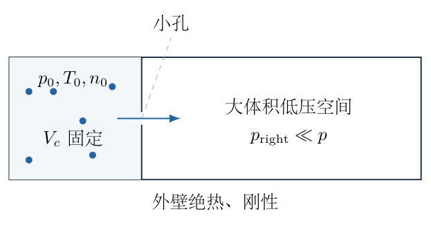
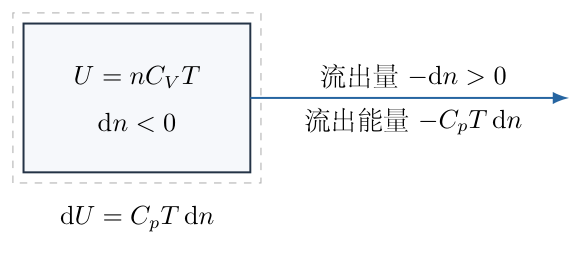
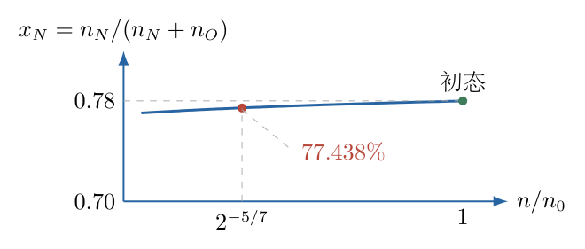

# 第 4 题

<!-- question-start -->

如图，绝热的固定容器左侧装有初始摩尔数为 $n_0$ 的理想气体，初始压强和温度分别为 $p_0,T_0$。左侧通过一个小孔与右侧很大的真空容器连通。右侧容器足够大，其气体压强始终远小于左侧压强，气体缓慢地从左侧流向右侧。题目给出理想气体的准静态绝热关系

$$
pV^\gamma=\text{常量},\qquad \gamma=\frac{C_V+R}{C_V}.
$$

（1）左侧是单一理想气体，摩尔定容热容为 $C_V=5R/2$。求左侧压强降为 $p_0/2$ 时，剩余气体的摩尔数 $n_{1/2}$。

（2）左侧初始气体为 $78\%$ 的 $\mathrm N_2$ 和 $22\%$ 的 $\mathrm O_2$，两者均有 $C_V=5R/2$，摩尔质量分别为 $28\,\mathrm{g\,mol^{-1}}$、$32\,\mathrm{g\,mol^{-1}}$。假设每种分子穿孔速率与其数密度和平均速率的乘积成正比。求压强降为 $p_0/2$ 时，$\mathrm N_2$ 与 $\mathrm O_2$ 的分子数之比。小孔足够小，气体流失很慢。

<!-- question-end -->

## 一、题型定位

变质量理想气体的冷却与选择性流失。容器体积固定，但左侧气体摩尔数改变，因此不能把闭口气体的 $pV^\gamma$ 常量直接套到实际储气室的固定体积上。必须先明确流出气体带走的能量，再建立 $T,n,p$ 的关系。

本题有一个需要说明的模型边界：按题目采用的准静态绝热流出近似，出口每摩尔带走焓 $C_pT$，得到通常的 $n_{1/2}=2^{-5/7}n_0$；若小孔严格处于自由分子逸出条件，逸出分子的能量选择效应会改变这个指数。以下先完整求出题给准静态模型的结果，再给出自由分子模型的对照，二者不混用。

## 二、知识点

- 理想气体状态方程 $pV=nRT$，以及摩尔内能 $C_VT$。
- 固定控制体内的气体质量可变，绝热只表示没有通过壁面的热交换，不表示剩余气体内能不变。
- 准静态连续流出气体携带的焓为 $C_pT$，其中 $C_p=C_V+R$。
- 同温下平均分子速率与摩尔质量平方根的倒数成正比。
- 混合气体各组分流失率不同，压强减半不表示两个组分各自都减半。
- 分离变量积分时，初始值决定积分常数；对数式须使用无量纲的比值。
- 压强、温度、总摩尔数三个量不能只凭其中一个的变化比例推出另两个。

## 三、物理图像

左侧体积记为 $V_c$，它在全过程中保持不变。气体经过分子碰撞达到共同温度 $T$，左侧可近似使用单一压强 $p$。右侧的压强可忽略，不发生显著回流。左侧减少的气体把能量带出，储气室内的剩余气体因此冷却。

令 $n$ 为左侧瞬时总摩尔数，发生少量流失时 $\mathrm dn<0$。出口带出的摩尔数为 $-\mathrm dn>0$。写能量方程时坚持这一符号约定，就不容易把冷却误写成升温。

混合气体中令 $n_N,n_O$ 分别表示两种气体的摩尔数。它们与分子数只差共同的阿伏伽德罗常数，因此摩尔数之比就是分子数之比。氮气较轻，平均速率稍高，流失相对更快，故剩余气体中氮气比例应低于 $78\%$；这一方向性判断应在计算前建立。

## 四、解题入口

先由变质量储气室的能量平衡求 $T$ 随 $n$ 的变化，再用定容状态方程得到压强随 $n$ 的变化，最后代入 $p/p_0=1/2$。第二问将两种穿孔速率相除，消去小孔面积、共同温度因子和未知时间，直接得到两个组分剩余量的关系。

求组成必须与总剩余摩尔数联立，不能只写一个微分比例就停止。数值计算保留 $2^{-5/7}$ 的精度，最后才按合理有效数字报告。最后另列自由分子逸出时的能量修正，以说明主结果的假设范围。

## 五、解析

（1）计算绝热指数，辨认不变的是哪一个体积。

由题给 $C_V=5R/2$，

$$
\begin{aligned}
C_p&=C_V+R=\frac72R,\\
\gamma&=\frac{C_p}{C_V}
=\frac{(7/2)R}{(5/2)R}=\frac75.
\end{aligned}\tag{1}
$$

但是实际储气室体积是固定的 $V_c$。若错误地写 $pV_c^{7/5}=p_0V_c^{7/5}$，立刻得到 $p=p_0$，与气体流失后的压强下降相矛盾。闭口准静态绝热公式中的 $V$ 是同一份定量气体的体积；在开放储气室中，需要重新建立摩尔数与温度的关系。

（2）按准静态流出近似写变质量能量平衡。

图4-2把储气室作为控制体。刚流出的 $-\mathrm dn$ 摩尔气体携带的能量为 $C_pT(-\mathrm dn)$；壁面绝热、刚性壁不做体积功。能量流出的方向和 $\mathrm dn$ 的符号必须分别标清。

储气室内能为 $U=nC_VT$。内能变化等于流出能量的负值，因此

$$
\begin{aligned}
\mathrm dU&=-C_pT(-\mathrm dn)=C_pT\,\mathrm dn,\\
\mathrm d(nC_VT)&=C_pT\,\mathrm dn,\\
C_V(n\,\mathrm dT+T\,\mathrm dn)&=C_pT\,\mathrm dn,\\
nC_V\,\mathrm dT&=(C_p-C_V)T\,\mathrm dn
=RT\,\mathrm dn.
\end{aligned}\tag{2}
$$

乘积微分中既有 $n\,\mathrm dT$，也有 $T\,\mathrm dn$，不能只保留第一项。右端为负，左端的 $nC_V>0$，所以 $\mathrm dT<0$，物理上确实冷却。

分离变量并使用初始条件：

$$
\begin{aligned}
\frac{\mathrm dT}{T}&=\frac{R}{C_V}\frac{\mathrm dn}{n},\\
\int_{T_0}^{T}\frac{\mathrm dT'}{T'}
&=\frac25\int_{n_0}^{n}\frac{\mathrm dn'}{n'},\\
\ln\frac{T}{T_0}&=\frac25\ln\frac{n}{n_0},\\
\frac{T}{T_0}&=\left(\frac n{n_0}\right)^{2/5}.
\end{aligned}\tag{3}
$$

这里 $2/5=\gamma-1$，不是 $\gamma$ 本身。对数中写 $T/T_0$、$n/n_0$，避免对有量纲的量直接取对数。

（3）将温度关系代入定容状态方程。

初始和当前状态分别满足

$$
p_0V_c=n_0RT_0,\qquad pV_c=nRT.
$$

相除后约去相同的 $V_c,R$：

$$
\begin{aligned}
\frac p{p_0}
&=\frac n{n_0}\frac T{T_0}\\
&=\frac n{n_0}\left(\frac n{n_0}\right)^{2/5}\\
&=\left(\frac n{n_0}\right)^{7/5}.
\end{aligned}\tag{4}
$$

令 $p=p_0/2$，因为所有比例均为正数，可以取 $5/7$ 次幂：

$$
\boxed{n_{1/2}=2^{-5/7}n_0
\approx0.6095068271\,n_0.}\tag{5}
$$

温度同时为

$$
\frac{T_{1/2}}{T_0}
=\left(2^{-5/7}\right)^{2/5}
=2^{-2/7}\approx0.8203353560.
$$

检查压强：$2^{-5/7}\cdot2^{-2/7}=2^{-1}$，正确。摩尔数剩余比例高于一半，因为除了数量减少，温度下降也帮助降低压强。

（4）说明与题给闭口绝热公式的对应关系。

可以用一个等效定量气体的体积比来表达同一近似。若将最终剩余的 $n$ 摩尔气体在初始 $p_0,T_0$ 下等效为体积 $V'=nRT_0/p_0$，则由初始状态方程有 $V'/V_c=n/n_0$。让这一等效定量气体从 $V'$ 准静态绝热膨胀到 $V_c$，有

$$
p_0(V')^\gamma=pV_c^\gamma,
\qquad \frac p{p_0}=\left(\frac{V'}{V_c}\right)^\gamma
=\left(\frac n{n_0}\right)^\gamma.
$$

这说明了式（4）与 $pV^\gamma$ 形式的联系，却没有说实际容器体积从 $V'$ 增大为 $V_c$。它是连续流出近似的等效描述，不能据此省掉开放系统能量条件。严格自由分子逸出是否满足这个等效过程，将在后面核对。

（5）建立两组分的流失率，先消掉未知时间。

设共同温度为 $T$，两种气体的平均分子速率分别为 $\bar v_N,\bar v_O$。由同温理想气体速率关系，

$$
\bar v\propto\sqrt{\frac{T}{M}},\qquad
\frac{\bar v_N}{\bar v_O}
=\sqrt{\frac{M_O}{M_N}}
=\sqrt{\frac{32}{28}}=\sqrt{\frac87}=:a.
$$

记小孔几何及共同因子为正数 $K$，则数密度与摩尔数成正比，流失率可写为

$$
\frac{\mathrm dn_N}{\mathrm dt}=-K n_N\sqrt{\frac{T}{M_N}},
\qquad
\frac{\mathrm dn_O}{\mathrm dt}=-K n_O\sqrt{\frac{T}{M_O}}.
$$

两个负号表示两者都在减少；相除后负号、$K$ 和 $\sqrt T$ 消去：

$$
\frac{\mathrm dn_N}{\mathrm dn_O}
=a\frac{n_N}{n_O}.\tag{6}
$$

不能把它误读成 $n_N/n_O$ 始终等于初始比值，因为微分量的比值不等于状态量的比值。图4-3显示氮气的相对损失率稍大，后面的指数 $a>1$ 正是这一差异的数学表达。

（6）分离变量并保留初始组成。

将式（6）移项：

$$
\frac{\mathrm dn_N}{n_N}=a\frac{\mathrm dn_O}{n_O}.
$$

初始摩尔数为 $n_{N0}=0.78n_0$、$n_{O0}=0.22n_0$。分别积分得

$$
\begin{aligned}
\ln\frac{n_N}{0.78n_0}
&=a\ln\frac{n_O}{0.22n_0},\\
\frac{n_N}{0.78n_0}
&=\left(\frac{n_O}{0.22n_0}\right)^a.
\end{aligned}\tag{7}
$$

两种热容相同，因此在题给连续流出模型下，混合气体总内能仍为 $(n_N+n_O)C_VT$，每摩尔流出焓仍为 $C_pT$。组成变化不改变式（2）—（5）的热容系数。故压强减半时还满足

$$
n_N+n_O=2^{-5/7}n_0.\tag{8}
$$

流失率与组成关系适用于哪一个温度演化模型，不影响式（7）的形式；但压强减半对应多少总摩尔数，则依赖能量流出模型。

（7）用单调的一元方程求组成，并展示数值计算入口。

令 $s=n_O/(0.22n_0)$，$s$ 是氧气剩余比例。由式（7）—（8）：

$$
\begin{aligned}
n_O&=0.22n_0s,\\
n_N&=0.78n_0s^a,\\
F(s)&:=0.78s^a+0.22s-2^{-5/7}=0.
\end{aligned}\tag{9}
$$

物理区间为 $0<s<1$，且

$$
F'(s)=0.78a s^{a-1}+0.22>0.
$$

同时 $F(0)<0$、$F(1)>0$，因此恰有一个物理根。无需猜测是否存在多个不同组成。

可先二分法缩小区间，再按Newton迭代提高精度：

$$
s_{j+1}=s_j-
\frac{0.78s_j^a+0.22s_j-2^{-5/7}}
{0.78a s_j^{a-1}+0.22}.
$$

不应把 $s$ 直接设置为 $2^{-5/7}$，那等于假设两组分流失比例相同。求根后，可用以下两个条件独立回代：总摩尔数等于式（8）；对数关系满足式（7）。

数值结果为

$$
\begin{aligned}
\frac{n_N}{n_N+n_O}&\approx0.7743821474,\\
\frac{n_O}{n_N+n_O}&\approx0.2256178526,\\
\boxed{\frac{n_N}{n_O}}&\boxed{\approx3.432273370\approx3.43.}
\end{aligned}\tag{10}
$$

这就是分子数之比。氮气由 $78\%$ 降至约 $77.438\%$，氧气由 $22\%$ 升至约 $22.562\%$，符合氮气平均速率较大、相对流失较快的预判。这里的氧气“比例升高”不等于氧气绝对数量增加；两种气体摩尔数都在减少。

（8）直接检查组成变化的符号。

将流失率改写为相对变化率，可得

$$
\begin{aligned}
\frac{\mathrm d}{\mathrm dt}\ln\frac{n_N}{n_O}
&=\frac1{n_N}\frac{\mathrm dn_N}{\mathrm dt}
-\frac1{n_O}\frac{\mathrm dn_O}{\mathrm dt}\\
&=-K\sqrt T\left(\frac1{\sqrt{M_N}}-\frac1{\sqrt{M_O}}\right)<0.
\end{aligned}
$$

因为 $M_N<M_O$，括号为正。故氮氧比随流失时间单调下降，不只是某一次数值求根偶然得出下降。若两种摩尔质量相等，$a=1$，式（7）使两者剩余比例相同，组成保持初值，符合对称极限。

（9）严格自由分子逸出模型的能量修正。

若孔径小于平均自由程，并以热平衡分子分布独立穿孔，则高速分子更容易穿孔，逸出样本不等于容器内的随机样本。对 $C_V=5R/2$ 的双原子气体，平衡气体每摩尔有平动能 $3RT/2$、转动能 $RT$；逸出分子的平均平动能为 $2RT$，转动能仍为 $RT$，因此每摩尔带走 $3RT$，不是 $C_pT=7RT/2$。

此时能量账本需改为

$$
\begin{aligned}
\mathrm d(nC_VT)&=3RT\,\mathrm dn,\\
nC_V\,\mathrm dT&=(3R-C_V)T\,\mathrm dn
=\frac R2T\,\mathrm dn,\\
\frac{\mathrm dT}{T}&=\frac15\frac{\mathrm dn}{n},\\
\frac T{T_0}&=\left(\frac n{n_0}\right)^{1/5},\\
\frac p{p_0}&=\left(\frac n{n_0}\right)^{6/5}.
\end{aligned}\tag{11}
$$

因此严格自由分子模型给出

$$
\begin{aligned}
n_{1/2}^{\rm eff}&=2^{-5/6}n_0
\approx0.5612310242n_0,\\
T_{1/2}^{\rm eff}&=2^{-1/6}T_0
\approx0.8908987181T_0.
\end{aligned}\tag{12}
$$

第二问的组分关系式（7）不变，只需将式（9）的总剩余比例换成 $2^{-5/6}$。独立求根得到

$$
\left(\frac{n_N}{n_O}\right)_{\rm eff}
\approx3.413760292,\qquad
x_N^{\rm eff}\approx0.7734358158.
$$

这不是对同一套假设得出两套互相矛盾的答案，而是两种不同出口能量模型。仅仅“流出很慢”只保证容器内近似平衡，并不能自动把自由分子孔变成连续介质的准静态出口。按题给准静态流出近似采用式（5）、（10）；若明确要求严格分子逸出能量，则应采用式（12）及其组成结果。

## 六、关键洞察

压强减半有两个来源：粒子数减少和剩余气体冷却。先写定容比例 $p/p_0=(n/n_0)(T/T_0)$，可以直接看出“压强减半所以摩尔数减半”只有在温度保持不变时才成立。

一般地，若出口每摩尔带走的能量为 $(C_V+\delta R)T$，则能量方程统一为

$$
\begin{aligned}
nC_V\,\mathrm dT&=\delta RT\,\mathrm dn,\\
T/T_0&=(n/n_0)^{\delta R/C_V},\\
p/p_0&=(n/n_0)^{1+\delta R/C_V}.
\end{aligned}
$$

连续流出焓模型对应 $\delta=1$，自由分子逸出模型对应 $\delta=1/2$。公式来源的差别全部集中在出口的能量，而不是状态方程或比热本身。

自由分子逸出平动能 $2RT$ 可以用积分核验。取孔法线为 $z$，设单分子质量为 $m_g$、$b=m_g/(2k_BT)$。穿孔通量的权重为 $v_z$，且只计 $v_z>0$。由高斯分布，两个切向方向仍满足 $\langle v_x^2\rangle=\langle v_y^2\rangle=1/(2b)=k_BT/m_g$。法向的通量加权二阶矩为

$$
\langle v_z^2\rangle_{\rm flux}
=\frac{\int_0^\infty v_z^3e^{-bv_z^2}\,\mathrm dv_z}
{\int_0^\infty v_ze^{-bv_z^2}\,\mathrm dv_z}.
$$

令 $q=bv_z^2$，有 $v_z\,\mathrm dv_z=\mathrm dq/(2b)$，故分母为 $1/(2b)$。分子中 $v_z^2=q/b$，所以为

$$
\frac1{2b^2}\int_0^\infty q e^{-q}\,\mathrm dq
=\frac1{2b^2},
$$

其中积分可分部积分得 $1$。因此 $\langle v_z^2\rangle_{\rm flux}=1/b=2k_BT/m_g$。三方向平动能合计为

$$
\frac{m_g}{2}\left(\frac{k_BT}{m_g}
+\frac{k_BT}{m_g}+\frac{2k_BT}{m_g}\right)=2k_BT.
$$

乘以阿伏伽德罗常数，得到每摩尔平动能 $2RT$。这一计算说明，能量选择效应由穿孔权重产生，不是把气体的定容热容改成了另一个值。

## 七、易错点

- 将固定储气室体积直接代入闭口气体 $pV^\gamma$ 常量，推得压强不变。
- 认为绝热表示内能不变，遗漏流出物质携带的能量。
- 写 $\mathrm dU=nC_V\mathrm dT$，遗漏变质量导致的 $C_VT\mathrm dn$。
- 混淆“减少的正摩尔数”与负的 $\mathrm dn$，把温度变化方向写反。
- 用初始氮氧比直接乘平均速率比，当成最终状态比，未积分。
- 把氧气比例上升解释为氧气绝对数量上升。
- 将总剩余比例过早取成 $0.61$，然后报告过多小数位。
- 一面使用连续流出焓，一面声称已经严格计入自由分子逸出的能量选择，混用不相容的模型。

## 八、课堂讲解建议

先让学生写出初末两个定容状态方程并相除，明确还缺温度关系。教师再通过控制体能量图解释气体带走能量，板书 $\mathrm dn<0$ 与流出量 $-\mathrm dn>0$，逐项展开乘积微分。不要先给结论指数，让学生看到7/5是内能账本与状态方程共同产生的。

组分部分先问“氮气和氧气哪种相对流失更快”，再说明比例变化和绝对数量变化不是同一件事。积分时保留78%和22%作为初值，板书正比速率不代表组成不变。

最后将两种出口能量模型并列，教师强调物理竞赛中公式的适用条件比记住单一指数更重要。自由分子积分可作为已有概率分布基础学生的拓展；没有该基础时，仍应清楚说明主解采用的是哪一种能量假设。

## 九、变式训练

变式：在连续流出焓模型中，储气室为单一理想气体，$C_V=cR$，压强降为初值的 $\eta$ 倍，$0<\eta<1$。求剩余摩尔数、温度及剩余内能比例。再比较 $c=3/2$ 和 $c=5/2$ 在 $\eta=1/2$ 时的结果。

解：由式（2）的同样展开，$n cR\,\mathrm dT=RT\,\mathrm dn$，所以

$$
T/T_0=(n/n_0)^{1/c},\qquad
p/p_0=(n/n_0)^{(c+1)/c}.
$$

令压强比为 $\eta$，得

$$
\boxed{\frac n{n_0}=\eta^{c/(c+1)},\qquad
\frac T{T_0}=\eta^{1/(c+1)}.}
$$

内能比为

$$
\frac U{U_0}=\frac{ncRT}{n_0cRT_0}
=\frac n{n_0}\frac T{T_0}=\eta.
$$

因此对固定体积、相同比热的理想气体，内能与压强同比例下降，不意味着气体摩尔数与压强同比例下降。

在 $c=3/2$、$\eta=1/2$ 时，$n/n_0=2^{-3/5}\approx0.659754$、$T/T_0=2^{-2/5}\approx0.757858$。在 $c=5/2$ 时，分别为 $2^{-5/7}\approx0.609507$、$2^{-2/7}\approx0.820335$。较小比热使温度下降更多，所以达到同样的压强降幅时可保留更多摩尔数。两种情况都满足乘积等于 $1/2$，且内能比例均为 $1/2$。
