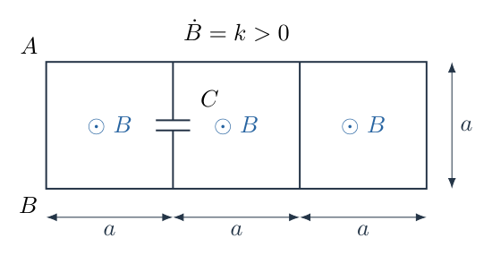
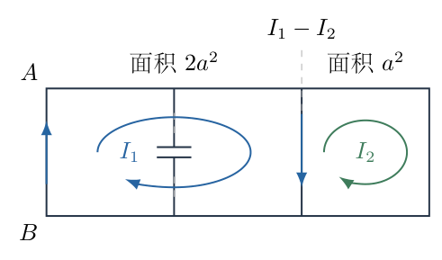
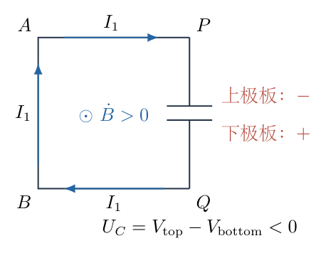
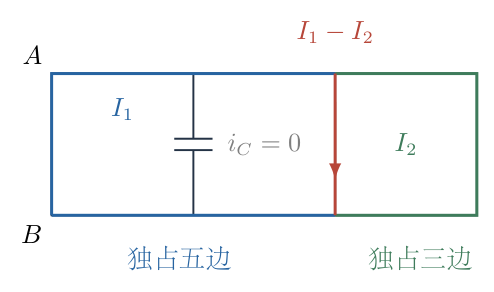

# 第 5 题

<!-- question-start -->

导线焊接成如图所示的平面网络，由三个边长为 $a$ 的正方形组成。在图示公共边中串接一个电容为 $C$ 的小电容器。网络处于垂直于其平面的均匀磁场中，磁场方向指向纸外，并以恒定速率 $\mathrm dB/\mathrm dt=k>0$ 增强。每条正方形边的导线电阻均为 $r$。系统达到稳定状态后，求：

（1）边 $AB$ 中的电流大小和方向；

（2）电容器带电量 $Q$，以及两个极板的电荷符号；

（3）稳态时间 $t$ 内整个网络放出的热量 $W$。

<!-- question-end -->

## 一、题型定位

含电容的多回路电磁感应电路。磁场仍在变化，但感应电动势因 $k$ 恒定而保持不变；电路可以达到恒定电流、恒定电容电压的稳态。稳态电容支路无传导电流，并不表示电容电压为零，也不表示该支路可以在求极板电势差时完全忽略。

需要同时使用法拉第定律、网络电流关系和逐支路焦耳热。感应电场不是保守场，任意导线两点之间不能脱离选定路径直接使用普通静电势差的环路规则；电容极板电压应由包含电容的指定闭合回路求出。

## 二、知识点

- 感应电动势由磁通变化率决定，面积和回路方向必须明确。
- 楞次定律确定增强的纸外磁场对应顺时针感应驱动。
- 稳态电容的电流为零、极板电压恒定，带电量满足 $q=CU$。
- 网孔电流在公共电阻上相减，在外边上直接等于支路电流。
- 焦耳热由真实支路电流求和，不能把网孔电流各自绕一周产生的热量简单相加。
- 电容带电量的大小与某一极板带电量的正负号是两种不同的报告方式。
- 恒定磁通变化率下的电路稳态不等于磁场本身不随时间改变。

## 三、物理图像

按图从左至右排列三个正方形。$A$ 是左上角，$B$ 是左下角；电容在第一个与第二个正方形的公共竖边上。记该公共边上端为 $P$、下端为 $Q$，电容上、下极板分别连接上、下侧导线。

稳定时电容支路电流为零，因此左边两个正方形的外周形成一个面积 $2a^2$ 的网孔，右边正方形为面积 $a^2$ 的另一个网孔。两网孔共同使用中间偏右的竖边，而不是电容所在竖边。

取两个网孔电流 $I_1,I_2$ 均为顺时针。共同竖边上，左网孔向下、右网孔向上，所以真实电流为 $I_1-I_2$ 向下。外侧 $AB$ 上左网孔电流向上，故最终应报告 $B\to A$。

## 四、解题入口

先把一个小正方形的感应电动势记为 $\mathcal E=ka^2$。在稳态拓扑中分别给面积 $2a^2$ 和 $a^2$ 的两个闭合网孔写法拉第回路方程，解出 $I_1,I_2$。

随后回到左边第一个小正方形，它虽然含开路电容，仍可用沿导线、电容间隙组成的闭合轮廓求电容电压。最后列出五条左网孔独占边、三条右网孔独占边和一条公共边的热功率，避免漏计或重复计数。

## 五、解析

（1）确定感应方向与每个基本方格的电动势。

磁场指向纸外且增强，感应电流应产生指向纸内的磁场，因而驱动方向为顺时针。若闭合轮廓也取顺时针，它的右手法向指向纸内，磁通为 $\Phi=-Ba^2$。由法拉第定律，

$$
\mathcal E=-\frac{\mathrm d\Phi}{\mathrm dt}
=-\frac{\mathrm d(-Ba^2)}{\mathrm dt}=ka^2>0.\tag{1}
$$

同一磁场下，面积 $2a^2$ 的左大网孔对应 $2\mathcal E$，右小网孔对应 $\mathcal E$。两个面积不能都按 $a^2$ 处理。

（2）建立稳态电路，辨认公共边。

电容的电荷不再改变，所以 $i_C=\mathrm dq/\mathrm dt=0$。图5-2用断开的电容支路表示这一电流条件，用顺时针箭头显示两个剩余网孔。图中左网孔外周有六条原边，右网孔外周有四条原边，共同竖边只算一条实际导线。

左网孔的五条独占边电流均为 $I_1$，公共边沿左网孔方向的电流为 $I_1-I_2$。沿顺时针回路，电阻电压降与感应驱动相等：

$$
\begin{aligned}
5rI_1+r(I_1-I_2)&=2\mathcal E,\\
6rI_1-rI_2&=2\mathcal E.
\end{aligned}\tag{2}
$$

右网孔有三条独占边电流为 $I_2$，公共边沿右网孔方向为 $I_2-I_1$，因此

$$
\begin{aligned}
3rI_2+r(I_2-I_1)&=\mathcal E,\\
4rI_2-rI_1&=\mathcal E.
\end{aligned}\tag{3}
$$

互相耦合项的负号来自两网孔对同一公共边的遍历方向相反，不是来自磁场方向相反。

（3）逐步消元，求两网孔电流。

定义无量纲电流 $j_1=rI_1/\mathcal E$、$j_2=rI_2/\mathcal E$，式（2）—（3）化为

$$
6j_1-j_2=2,\qquad -j_1+4j_2=1.
$$

由第一式 $j_2=6j_1-2$，代入第二式：

$$
\begin{aligned}
-j_1+4(6j_1-2)&=1,\\
23j_1-8&=1,\\
j_1&=\frac9{23},\\
j_2&=6\frac9{23}-2=\frac{54-46}{23}=\frac8{23}.
\end{aligned}
$$

于是

$$
\boxed{I_1=\frac{9ka^2}{23r},\qquad
I_2=\frac{8ka^2}{23r}.}\tag{4}
$$

公共边电流为

$$
I_s=I_1-I_2=\frac{ka^2}{23r}>0,
$$

所以沿左网孔规定的方向向下；不是 $I_1+I_2$。$AB$ 为左网孔独占边，第一问答案为

$$
\boxed{I_{AB}=\frac{9ka^2}{23r},\quad\text{方向为 }B\to A.}\tag{5}
$$

用式（2）、（3）回代：$6\cdot9-8=46=2\cdot23$，$4\cdot8-9=23$，两条方程均满足。

（4）沿含电容的小回路求极板电压。

定义 $U_C=V_{\rm top}-V_{\rm bottom}$ 为上极板相对下极板的电压，定义上极板电荷为 $q_{\rm top}=CU_C$。图5-3的闭合轮廓沿左小正方形顺时针，即从 $A$ 沿上边到 $P$，穿过电容至 $Q$，再沿下边到 $B$，最后沿 $BA$ 回到 $A$。

轮廓包围面积为 $a^2$，所以感应驱动为 $\mathcal E$。其三条有电流的导线边均沿 $I_1$ 方向，电阻总压降为 $3rI_1$。电容支路的导线电流为零，因此该边的串联导线电阻没有稳态压降。穿过电容时从上极板到下极板的电势下降为 $U_C$，可能为负，不能事先把它设成正数。

因此回路方程为

$$
3rI_1+U_C=\mathcal E.
$$

代入式（4），

$$
\begin{aligned}
U_C&=\mathcal E-3r\frac{9\mathcal E}{23r}\\
&=\mathcal E-\frac{27}{23}\mathcal E\\
&=-\frac4{23}\mathcal E=-\frac{4ka^2}{23}.
\end{aligned}\tag{6}
$$

负值表示上极板电势低于下极板。因此上极板负、下极板正；两极板电荷分别为

$$
q_{\rm top}=-\frac{4Cka^2}{23},\qquad
q_{\rm bottom}=+\frac{4Cka^2}{23}.
$$

题目所说电容器带电量通常指任一极板电荷的绝对值，所以

$$
\boxed{Q=\frac{4Cka^2}{23};\quad
\text{上极板负，下极板正}.}\tag{7}
$$

若只写 $Q<0$ 而不说明所指极板，就混淆了带电量大小与带符号的极板电荷。

（5）用另一个含电容的轮廓检查电压符号。

沿中间小正方形顺时针，三条有电流的边分别为上边 $I_1$、右边 $I_s=I_1-I_2$、下边 $I_1$，而左边由下向上穿过电容，电容压降为 $-U_C$。于是

$$
\begin{aligned}
rI_1+r(I_1-I_2)+rI_1-U_C&=\mathcal E,\\
3rI_1-rI_2-U_C&=\mathcal E.
\end{aligned}
$$

代入 $I_1=9\mathcal E/(23r)$、$I_2=8\mathcal E/(23r)$，得

$$
U_C=\left(\frac{27-8}{23}-1\right)\mathcal E
=-\frac4{23}\mathcal E,
$$

与式（6）一致。两个闭合轮廓都保留了各自的感应磁通，因此不是在非保守感应电场中随意更换路径。

（6）逐条支路核算热功率。

图5-4按真实支路电流给导线分组。左大网孔独占五边，右小网孔独占三边，公共导线一边；电容所在导线边虽有电阻 $r$，稳态电流为零，不发热。

各组热功率分别为

$$
P_L=5rI_1^2,\qquad P_R=3rI_2^2,
\qquad P_s=r(I_1-I_2)^2.
$$

故总功率为

$$
\begin{aligned}
P&=r\left(5I_1^2+3I_2^2+(I_1-I_2)^2\right)\\
&=r\frac{\mathcal E^2}{23^2r^2}
\left(5\cdot9^2+3\cdot8^2+1^2\right)\\
&=\frac{\mathcal E^2}{529r}(405+192+1)\\
&=\frac{598}{529}\frac{\mathcal E^2}{r}
=\frac{26}{23}\frac{\mathcal E^2}{r}.
\end{aligned}\tag{8}
$$

最后一步利用 $598=26\cdot23$、$529=23^2$。因此稳态时间 $t$ 内

$$
\boxed{W=Pt=\frac{26k^2a^4}{23r}\,t.}\tag{9}
$$

把公共边分别计入两个网孔的 $6rI_1^2+4rI_2^2$ 是错误的；那会把同一条导线算成两条，并忽略真实电流是差值。

（7）利用总输入功率作独立能量核验。

将式（2）乘以 $I_1$，式（3）乘以 $I_2$，相加：

$$
\begin{aligned}
2\mathcal E I_1+\mathcal E I_2
&=6rI_1^2+4rI_2^2-2rI_1I_2\\
&=5rI_1^2+3rI_2^2+r(I_1-I_2)^2\\
&=P.
\end{aligned}
$$

由式（4），左侧为

$$
\mathcal E\frac{18\mathcal E+8\mathcal E}{23r}
=\frac{26\mathcal E^2}{23r},
$$

与逐支路发热结果一致。这说明维持变化磁场的外部装置持续向电路供能，而不是电容不断释放能量维持稳态。

电容稳态能量为

$$
E_C=\frac12CU_C^2
=\frac{8C\mathcal E^2}{529},
$$

它是恒定储能，不应再加到每个稳态时间区间的热量 $W$ 中。若题目改问从初始不带电到稳态的过程，则必须另解瞬态，不可以直接把 $Pt$ 从零时刻积分。

（8）量纲、极限与方向核验。

$ka^2$ 的单位为磁通变化率，即伏特；所以 $ka^2/r$ 是电流，$Cka^2$ 是电荷，$k^2a^4t/r$ 是能量。令 $k\to0$，三个求量同时趋零；磁场虽可有非零恒定值，但静止网络没有感应驱动。

增大 $C$ 只增大稳态极板电荷，不改变式（4）的电流和式（9）的热功率，因为理想电容在直流稳态仍为开路。增大 $r$ 会同比例减小电流与热功率，但电容电压不改变，因为各导线压降 $rI$ 保持由感应电动势决定的比例。

若磁场变化方向反转，即 $k<0$，所有有向电流和带符号的极板电荷都反转，但热量由 $k^2$ 决定仍为正。以上答案采用题给 $k>0$ 和纸外磁场增强的方向。

## 六、关键洞察

电容开路是电流条件，不是电压条件。它使原来的三小网孔转化为两个导电网孔，却仍保留一个需要由法拉第闭合轮廓确定的极板电压。把电容永久删掉后再问其电压，往往会忘记感应电场本身沿该轮廓的贡献。

在时间变化磁场中，沿不同路径积分电场一般不同。式（6）与其另一回路检查并不矛盾，因为两条路径围成的面积不同，相应的感应电动势也不同。理想小电容器的极板间隔很小，可将它本身穿过的变化磁通忽略，才可以把该局部电压与 $q/C$ 对应。

把电容从公共边拿掉后，其上、下连接节点之间的纯电阻端口电阻为 $33r/23$；但是求充电时间常数时，还要算入电容原所在边的导线电阻 $r$。因此电容两极板实际看到的电阻为

$$
R_{\rm th}=r+\frac{33}{23}r=\frac{56}{23}r.
$$

这一区别不影响稳态，因为那条边的电流为零，却影响瞬态。把“去掉整条边后的节点端口”与“仅去掉电容后的极板端口”混为一谈，会得到错误的时间常数。

## 七、易错点

- 把恒定 $\mathrm dB/\mathrm dt$ 当作没有感应电动势。
- 认为电容稳态无电流，所以两极板等势或电荷为零。
- 左大网孔面积仍用 $a^2$，漏掉一倍感应驱动。
- 公共边电流用 $I_1+I_2$，忽略两个网孔的绕行方向相反。
- 求电容电压时只比较电阻压降，遗漏小回路中的 $ka^2$ 感应电动势。
- 只报告带电量而不明确哪块极板带正电，或将负的上极板电荷写成负的带电量大小。
- 发热计算重复计入公共边，或把恒定电容储能加进稳态热量。
- 计算时间常数时遗漏电容所在公共边的串联导线电阻。

## 八、课堂讲解建议

先让学生分别说出“磁场不变”和“磁场变化率不变”的差别，再用楞次定律给出顺时针方向。板书电容开路后的网络时，明确标出两种竖直公共边，避免学生把电容所在边与仍有电流的共用边混淆。

求电容电压前，不先画正负极板，而先定义上减下为 $U_C$。让学生用回路方向判断电容压降项的符号，再由算出的负数填上极板符号。热量部分可要求学生逐边计数，教师再用输入功率证明两种核验方式一致。

瞬态作为拓展时，先强调每条原边电阻仍在，只有理想电容不是电阻。板书时间常数时注明端口是两极板，而不是原正方形上下节点，从结构上解释56/23与33/23的差别。

## 九、变式训练

变式：磁场从某一时刻起保持 $\mathrm dB/\mathrm dt=k>0$，此时电容初始不带电。忽略导线自感，求上极板电荷 $q(t)$ 及充电时间常数。每条正方形边的导线总电阻仍为 $r$。

解：未到稳态时取三个小网孔电流 $i_0,i_1,i_2$ 均顺时针，上极板电压为 $U=q/C$。电容支路向下电流为 $j=i_0-i_1=\mathrm dq/\mathrm dt$。三个网孔分别有

$$
\begin{aligned}
4ri_0-ri_1+U&=\mathcal E,\\
4ri_1-ri_0-ri_2-U&=\mathcal E,\\
4ri_2-ri_1&=\mathcal E.
\end{aligned}
$$

其中第一式中的 $4ri_0-ri_1$ 已包含电容所在边导线压降 $r(i_0-i_1)$，不能删去。由首末两式，

$$
i_0=\frac{\mathcal E-U+ri_1}{4r},\qquad
i_2=\frac{\mathcal E+ri_1}{4r}.
$$

代入中间一式，整理为 $14ri_1=6\mathcal E+3U$，再回代，得到

$$
i_0=\frac{20\mathcal E-11U}{56r},\qquad
i_1=\frac{24\mathcal E+12U}{56r}.
$$

因此

$$
\frac{\mathrm dq}{\mathrm dt}=i_0-i_1
=-\frac{4\mathcal E+23q/C}{56r}.
$$

写成一阶线性方程：

$$
\frac{\mathrm dq}{\mathrm dt}+\frac{23}{56rC}q
=-\frac{\mathcal E}{14r}.
$$

稳态解为 $q_\infty=-4C\mathcal E/23$。令 $q-q_\infty=y$，则 $\mathrm dy/\mathrm dt=-y/\tau$，其中 $\tau=56rC/23$。分离变量积分并使用 $q(0)=0$，得到

$$
\boxed{q(t)=-\frac{4Cka^2}{23}
\left(1-e^{-23t/(56rC)}\right),\qquad
\tau=\frac{56rC}{23}.}
$$

初始 $\mathrm dq/\mathrm dt=-\mathcal E/(14r)<0$，所以上极板从开始就获得负电荷；$t\to\infty$ 时恢复主问题的带电量。时间常数单位为电阻乘电容，即秒；$C$ 增大使过程变慢，但不改变最终电压。
