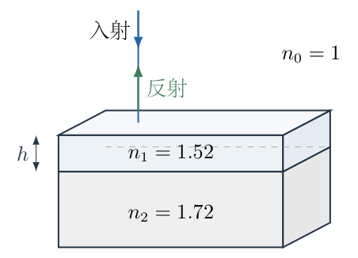
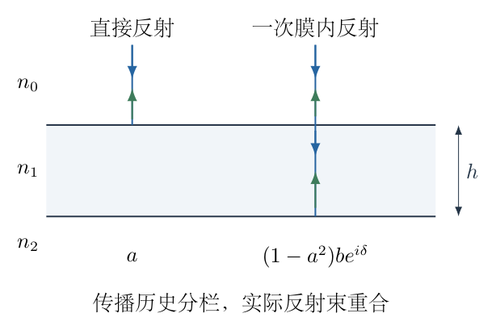
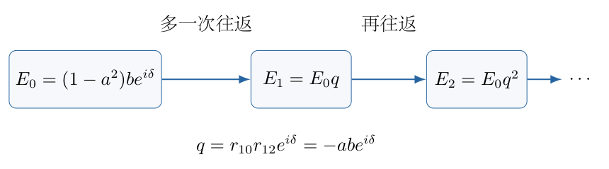
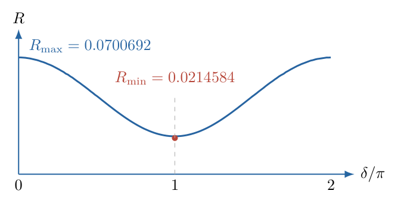

# 第 7 题

<!-- question-start -->

折射率为 $n_2=1.72$ 的基底表面镀有折射率为 $n_1=1.52$、厚度为 $h$ 的透明薄膜。外部介质为空气，$n_0=1$。一束真空波长为 $\lambda$ 的光从空气中垂直入射。

单个界面中，从 $n_0$ 到 $n_1$ 或从 $n_1$ 到 $n_0$ 的光强反射率均为 $R_1$；从 $n_1$ 到 $n_2$ 或从 $n_2$ 到 $n_1$ 的光强反射率均为 $R_2$。光强反射率等于反射电场振幅比模的平方。

（1）认为 $R_1,R_2$ 很小，只保留直接反射与一次膜内反射，写出总光强反射率关于 $\lambda$ 的函数。

（2）不再假设反射率很小，须计入多次反射。认为光波列足够长，各次反射光保持相干，求总光强反射率关于 $\lambda$ 的函数。

<!-- question-end -->

## 一、题型定位

透明薄膜正入射的相干叠加。第一问是两束近似，第二问是全部膜内往返的振幅级数。叠加的是带相位和符号的电场振幅，不是各束光强；光强须在求得总振幅后取模平方。

本题折射率顺序为 $n_0<n_1<n_2$，两束主要反射分别发生在空气到薄膜、薄膜到基底，均产生相位反转，故两束之间没有额外的相对半波损失。但是膜内从薄膜向空气反射不产生相位反转，多次反射的往返系数必须重新判断，不能把所有反射都用同一个正号处理。

## 二、知识点

- 正入射界面电场振幅系数 $r_{ij}=(n_i-n_j)/(n_i+n_j)$、$t_{ij}=2n_i/(n_i+n_j)$。
- 入射方向反转时振幅反射系数变号，光强反射率不变。
- 真空波长为 $\lambda$，介质内波长为 $\lambda/n_1$。
- 一次膜内往返增加光程 $2n_1h$，相位增加 $4\pi n_1h/\lambda$。
- 相干光场的总强度包含交叉项，不能把各束反射率简单相加。
- 等比级数适用于振幅往返比的模小于1，复数相位不能在求和前丢掉。
- 透射功率需乘折射率比；透射振幅平方通常不直接等于透射率。

## 三、物理图像

空气在最上层，薄膜介于两个平行界面之间，基底在下层。基底按半无限介质处理，只计题中指定的两个界面；图中基底底面是展示截断，不作为新增反射界面。正入射光沿界面法线传播，所有向上出射的反射束在空间中重合。为了区分不同往返次数，可以把同一光路的不同历史分栏绘出，但这些列不是不同入射角，也不是实际分离的斜光束。

定义电场振幅反射系数

$$
a=r_{01},\qquad b=r_{12}.
$$

本题 $a<0,b<0$，而 $r_{10}=-a>0$。用复振幅计算，令一次膜内往返传播相位为

$$
\delta=\frac{4\pi n_1h}{\lambda},\qquad z=e^{i\delta}.
$$

采用同一种时间谐波约定后，传播相位整体改成负号不会改变最后的模平方；但同一推导中不能交替使用两种约定。

## 四、解题入口

先由界面边界条件说明振幅系数的正负号，并算出一次往返相位。第一问保留两束电场求模平方，再按 $R_1,R_2\ll1$ 的精度简化透射系数。

第二问列出直接反射、首次膜内反射、增加一次往返后的反射三项，识别公比 $r_{10}r_{12}e^{i\delta}$，求复等比级数。最后化成 $R_1,R_2$ 与 $\cos\delta$ 的实函数，并用薄膜消失、最大最小反射率和能量守恒作检查。

## 五、解析

（1）从界面条件确定振幅反射、透射系数。

在无吸收、非磁介质正入射条件下，界面两侧切向电场和磁场连续。将入射电场振幅取为1，反射与透射振幅分别为 $r_{ij},t_{ij}$。电场连续给

$$
1+r_{ij}=t_{ij}.
$$

反向传播的反射波磁场相对电场方向反转，故磁场条件为

$$
n_i(1-r_{ij})=n_jt_{ij}.
$$

将第一式代入第二式，

$$
\begin{aligned}
n_i-n_ir_{ij}&=n_j+n_jr_{ij},\\
(n_i+n_j)r_{ij}&=n_i-n_j,\\
r_{ij}&=\frac{n_i-n_j}{n_i+n_j},\\
t_{ij}&=1+r_{ij}=\frac{2n_i}{n_i+n_j}.
\end{aligned}\tag{1}
$$

当 $n_i<n_j$ 时，$r_{ij}<0$ 表示电场反射时相位增加 $\pi$；当 $n_i>n_j$ 时为正，不发生这一相位反转。反方向系数满足 $r_{ji}=-r_{ij}$，而 $r_{ji}^2=r_{ij}^2$，因此题目给的光强反射率在两个方向上相同。

（2）计算本题两个界面的数值和符号。

$$
\begin{aligned}
a&=\frac{1-1.52}{1+1.52}
=-\frac{0.52}{2.52}\approx-0.2063492063,\\
b&=\frac{1.52-1.72}{1.52+1.72}
=-\frac{0.20}{3.24}\approx-0.0617283951.
\end{aligned}
$$

所以

$$
\begin{aligned}
R_1&=a^2\approx0.0425799950,\\
R_2&=b^2\approx0.0038103948,\\
a&=-\sqrt{R_1},\qquad b=-\sqrt{R_2},
\qquad r_{10}=+\sqrt{R_1}.
\end{aligned}\tag{2}
$$

两个主要反射都带负号，彼此的相对反射相位为零；但膜内上表面反射系数 $r_{10}$ 为正。后者决定多次往返级数的符号，不能仅由 $R_1$ 本身推断。

（3）求一次往返传播相位，并区分真空波长与膜内波长。

薄膜内波数为 $k_1=2\pi n_1/\lambda$，单程距离 $h$ 增加相位 $k_1h$。上下往返一次的几何距离为 $2h$，所以

$$
\delta=2k_1h=\frac{4\pi n_1h}{\lambda}.\tag{3}
$$

图7-2按不同历史分栏画出直接反射和一次膜内反射；各列的箭头均沿法线，实际两束反射重合。首次膜内反射比直接反射多走一次往返，因此后面的干涉项使用图中的 $\delta$。

（4）保留直接反射与一次膜内反射的电场。

直接反射相对入射电场的振幅为 $a$。另一束先从空气透入膜，振幅乘 $t_{01}$；到下界面反射，乘 $b$；往返传播乘 $e^{i\delta}$；最后从膜透出到空气，乘 $t_{10}$。因此两束相加的反射振幅为

$$
r_{\rm two}=a+t_{01}t_{10}b e^{i\delta}.\tag{4}
$$

注意第二束经历两次透射，不能在尚未说明小反射率近似前，直接把它的振幅写成 $b$。两个透射系数乘积为

$$
\begin{aligned}
t_{01}t_{10}
&=\frac{2n_0}{n_0+n_1}\frac{2n_1}{n_0+n_1}\\
&=\frac{4n_0n_1}{(n_0+n_1)^2}\\
&=1-\frac{(n_0-n_1)^2}{(n_0+n_1)^2}
=1-a^2=1-R_1.
\end{aligned}\tag{5}
$$

于是两束模型的模平方为

$$
\begin{aligned}
R_{\rm two}
&=|a+(1-R_1)b e^{i\delta}|^2\\
&=a^2+(1-R_1)^2b^2
+2(1-R_1)ab\cos\delta\\
&=R_1+(1-R_1)^2R_2
+2(1-R_1)\sqrt{R_1R_2}\cos\delta.
\end{aligned}\tag{6}
$$

其中 $ab>0$，所以余弦交叉项前为正号。如果界面顺序不同使 $ab<0$，这一符号也要随之改变；不能一概在公式中人为加上 $\pi$。

（5）按小反射率条件化简，给出第一问答案。

在 $R_1,R_2\ll1$ 时，将透射乘积 $1-R_1$ 按题目近似精度取为1，保留两主要反射振幅的干涉。由式（6），

$$
\boxed{R_{\rm approx}(\lambda)
=R_1+R_2+2\sqrt{R_1R_2}
\cos\frac{4\pi n_1h}{\lambda}.}\tag{7}
$$

近似的含义是忽略因反射损失造成的额外振幅修正和更高往返光束，而不是忽略两束间的相干交叉项。若只写 $R_1+R_2$，就丢掉了题目要求的波长依赖。

式（6）是保留准确界面透射系数的两束结果，式（7）是题设小反射率下进一步简化的结果。两者都没有包含全部多次反射，不能将式（6）称为精确薄膜反射率。

（6）列出多次反射的前几项，识别复振幅公比。

首次膜内出射束振幅为

$$
E_0=(1-a^2)b e^{i\delta}.
$$

光在膜内再多留一次往返，要在上表面从膜向空气反射一次，系数 $r_{10}=-a$；在下表面反射一次，系数 $b$；再获得传播相位 $e^{i\delta}$。因此每增加一次往返，振幅乘

$$
q=r_{10}b e^{i\delta}=-ab e^{i\delta}.\tag{8}
$$

后续两束为 $E_1=E_0q$、$E_2=E_0q^2$。图7-3将同一束光的不同往返次数分栏，标出这一重复过程；后面的级数逐项对应图中的历史，而不是另造一组斜入射光。

由于有限正折射率下 $|a|<1,|b|<1$，所以 $|q|=|ab|<1$，可使用复等比级数。直接反射不属于这组往返级数，必须单独加上：

$$
\begin{aligned}
r_{\rm total}
&=a+E_0(1+q+q^2+\cdots)\\
&=a+\frac{(1-a^2)b e^{i\delta}}{1+ab e^{i\delta}}.
\end{aligned}\tag{9}
$$

分母中的加号来自 $q=-ab e^{i\delta}$。如果公比只按 $\sqrt{R_1R_2}$ 写成正数，会得到错误的共振相位和错误的总反射率。

（7）合并复振幅分子，并计算模平方。

对式（9）通分：

$$
\begin{aligned}
r_{\rm total}
&=\frac{a(1+ab e^{i\delta})+(1-a^2)b e^{i\delta}}
{1+ab e^{i\delta}}\\
&=\frac{a+a^2b e^{i\delta}+b e^{i\delta}-a^2b e^{i\delta}}
{1+ab e^{i\delta}}\\
&=\frac{a+b e^{i\delta}}{1+ab e^{i\delta}}.
\end{aligned}\tag{10}
$$

反射光与入射光都在空气中，功率比例就是振幅模平方。使用 $|X|^2=X X^*$：

$$
\begin{aligned}
|a+b e^{i\delta}|^2
&=(a+b e^{i\delta})(a+b e^{-i\delta})\\
&=a^2+b^2+ab(e^{i\delta}+e^{-i\delta})\\
&=a^2+b^2+2ab\cos\delta,\\
|1+ab e^{i\delta}|^2
&=1+a^2b^2+2ab\cos\delta.
\end{aligned}
$$

代入 $a^2=R_1,b^2=R_2,ab=\sqrt{R_1R_2}$，第二问答案为

$$
\boxed{R(\lambda)=
\frac{R_1+R_2+2\sqrt{R_1R_2}\cos(4\pi n_1h/\lambda)}
{1+R_1R_2+2\sqrt{R_1R_2}\cos(4\pi n_1h/\lambda)}.}\tag{11}
$$

分母并非人为用于“归一化”的补充项，而是全部多次反射振幅级数的结果。把式（7）简单除以 $1+R_1R_2$ 会漏掉分母同样随相位改变的交叉项。

（8）求最大、最小反射率，检查给定膜能否完全消反射。

令 $C_\delta=\cos\delta$，式（11）对它的导数为

$$
\frac{\mathrm dR}{\mathrm dC_\delta}
=\frac{2ab(1-a^2)(1-b^2)}
{(1+a^2b^2+2abC_\delta)^2}>0.
$$

所以 $\cos\delta=1$ 时最大，$\cos\delta=-1$ 时最小：

$$
\begin{aligned}
R_{\max}&=\left(\frac{a+b}{1+ab}\right)^2
\approx0.0700692042,\\
R_{\min}&=\left(\frac{a-b}{1-ab}\right)^2
\approx0.0214583536.
\end{aligned}\tag{12}
$$

图7-4采用往返相位作为横坐标，显示反射率的上下限。它不是以波长为等间距横坐标；改变波长时，应先代入 $\delta=4\pi n_1h/\lambda$，再读取相位对应的反射率。

极小对应

$$
\delta=(2m+1)\pi,\qquad
h=\frac{(2m+1)\lambda}{4n_1},\qquad m=0,1,2,\ldots.
$$

但反射率最小不等于零。要让分子振幅在 $\delta=\pi$ 时为零，还要 $a=b$。由界面系数解得

$$
n_1^2=n_0n_2.
$$

本题所需理想膜折射率应为 $\sqrt{1.72}\approx1.31149$，而给定为1.52，所以即使选择最佳四分之一波厚度，也仍有约 $2.146\%$ 的反射。

（9）用极限和单位检查全部反射结果。

相位 $4\pi n_1h/\lambda$ 无量纲，$R$ 也是无量纲。改变波长只改变传播相位，界面系数在本题忽略色散时固定。若计入真实材料色散，$n_1,n_2$ 本身也会依赖 $\lambda$，那是题设之外的修正。

当 $h\to0$ 时，$\delta\to0$，式（10）化为 $(a+b)/(1+ab)$。代入两个界面表达式并通分，可得

$$
\frac{a+b}{1+ab}=\frac{n_0-n_2}{n_0+n_2},
$$

因此恢复空气直接面对基底的反射率，数值为 $(0.72/2.72)^2\approx0.0700692$。薄膜消失后不应仍有两块独立界面的反射强度相加。

若 $n_1=n_0$，则 $a=0$，式（11）变成 $R=b^2$，仅下界面反射，传播相位不影响反射强度；若 $n_1=n_2$，则 $b=0$，只剩上界面反射 $R=a^2$。两种退化极限都与物理图像一致。

（10）用透射率验证能量守恒。

总透射振幅为

$$
t_{\rm total}=
\frac{t_{01}t_{12}e^{i\delta/2}}{1+ab e^{i\delta}}.
$$

因透射光在基底中，其功率系数必须为

$$
T=\frac{n_2}{n_0}|t_{\rm total}|^2.
$$

界面无吸收能量关系由式（1）直接得到

$$
\frac{n_1}{n_0}t_{01}^2=1-a^2,
\qquad \frac{n_2}{n_1}t_{12}^2=1-b^2.
$$

所以

$$
T=\frac{(1-a^2)(1-b^2)}{1+a^2b^2+2ab\cos\delta}.
$$

与此同时，由式（11）作差：

$$
\begin{aligned}
1-R
&=\frac{1+a^2b^2+2ab\cos\delta
-(a^2+b^2+2ab\cos\delta)}
{1+a^2b^2+2ab\cos\delta}\\
&=\frac{1-a^2-b^2+a^2b^2}
{1+a^2b^2+2ab\cos\delta}\\
&=\frac{(1-a^2)(1-b^2)}{1+a^2b^2+2ab\cos\delta}=T.
\end{aligned}
$$

因此 $R+T=1$，全部多次反射结果满足能量守恒。两束近似在有限反射率下不必严格满足这一等式，因为遗漏了后续束；这正是它只能作为近似解的原因。

## 六、关键洞察

薄膜干涉中有两种不同的符号信息：光强反射率 $R_j\ge0$ 不包含相位，振幅系数 $r_{ij}$ 的正负才包含反射相位。本题两束主反射同为负，使式（7）的交叉项为正；但多次往返在上、下界面分别使用 $r_{10}$ 和 $r_{12}$，乘积为负，导致式（9）的分母为加号。

第一问和第二问的区别不只是“多添几项光强”，而是用全部反射振幅的复几何级数代替两束截断。若光波列短到不同往返束不相干，才可以在强度层面相加，所得结果不会有同样的 $\cos\delta$ 干涉项。

四分之一波厚度只负责相位相消，折射率的几何平均条件负责振幅匹配。把“相位差为 $\pi$”直接等同于零反射，会漏掉振幅不相等的问题。式（12）的最小值也可写成

$$
R_{\min}=\left(\frac{n_0n_2-n_1^2}{n_0n_2+n_1^2}\right)^2,
$$

直接显示只有 $n_1^2=n_0n_2$ 时才为零。本题 $n_1^2=2.3104$、$n_0n_2=1.72$，两者不等。

## 七、易错点

- 用 $R_1,R_2$ 当电场振幅，交叉项失去平方根。
- 认为所有反射都发生半波损失，忽略膜到空气的反射符号不同。
- 以几何距离 $2h$ 除真空波长，漏掉折射率 $n_1$。
- 将第一次膜内反射当作没有透射过程，未说明近似便删除 $t_{01}t_{10}$。
- 多次反射公比只保留正的模，丢掉反射相位和传播相位。
- 把反射光强与透射光强都直接写成振幅平方，漏掉透射介质的折射率比。
- 将最佳厚度称为“完全消反射”，未检查界面振幅是否匹配。

## 八、课堂讲解建议

先让学生在上下两界面分别标明入射介质和反射符号，教师用两张小箭头图区分空气向膜、膜向空气两种方向。接着以“列出前三个反射振幅”为板书任务，在公比出现之前不直接给最终分式。

分栏图应说明仅用于区分历史，实际光为正入射且反射束重合。教师可让学生逐段读出首次膜内反射的两个透射、一个反射和一次往返相位，避免把常见斜入射示意图误当成该题真实几何。

最后让学生检查 $h=0$、$n_1=n_0$ 和 $n_1=n_2$ 三个极限。用给定折射率算最小反射率，再问“四分之一波是否足够”，把相位匹配与振幅匹配分开讲清。

## 九、变式训练

变式：为 $n_0=1$、$n_2=1.72$ 的无吸收基底设计一层在 $\lambda_0=550\,\mathrm{nm}$ 正入射时完全消反射的膜。求折射率和最小正厚度。若膜厚偏离最佳值 $\Delta h$，求反射率的最低非零阶近似，并计算 $\Delta h=5\,\mathrm{nm}$ 时的近似值，与精确式比较。

解：零反射要求 $a=b$ 与 $\delta=\pi$ 同时成立，所以

$$
\boxed{n_1=\sqrt{1.72}\approx1.3114877,\qquad
h_0=\frac{550\,\mathrm{nm}}{4\sqrt{1.72}}
\approx104.8428\,\mathrm{nm}.}
$$

令共同振幅反射系数为 $a$，$R_s=a^2$。厚度偏差产生 $\delta=\pi+\varepsilon$，其中 $\varepsilon=4\pi n_1\Delta h/\lambda_0$。将式（11）代入 $R_1=R_2=R_s$，并用 $\cos(\pi+\varepsilon)=-\cos\varepsilon$，得

$$
R=\frac{2R_s(1-\cos\varepsilon)}
{(1-R_s)^2+2R_s(1-\cos\varepsilon)}.
$$

当 $|\varepsilon|\ll1$，Taylor展开 $1-\cos\varepsilon=\varepsilon^2/2+O(\varepsilon^4)$。分子最低阶为 $R_s\varepsilon^2$，分母常数为 $(1-R_s)^2$，所以

$$
\boxed{R\approx\frac{R_s}{(1-R_s)^2}
\left(\frac{4\pi n_1\Delta h}{\lambda_0}\right)^2.}
$$

厚度正负偏差在最低阶产生相同反射率，因为最佳点的一阶导数为零，反射率从二阶增长。取 $\Delta h=0$ 恢复零反射；括号为无量纲，结果也无量纲。此近似仅在相位偏差很小时适用，不能外推到整波长量级的厚度误差。

以偏差 $5\,\mathrm{nm}$ 为例，先计算单界面反射率和无量纲相位偏差：

$$
\begin{aligned}
R_s&=\left(\frac{1-\sqrt{1.72}}{1+\sqrt{1.72}}\right)^2
\approx0.01815928071,\\
\varepsilon&=\frac{4\pi\sqrt{1.72}\,(5\,\mathrm{nm})}{550\,\mathrm{nm}}
\approx0.1498240050.
\end{aligned}
$$

厚度和波长使用同样的单位，纳米相互约去。代入二阶近似，

$$
R_{(2)}=\frac{0.01815928071}{(1-0.01815928071)^2}
(0.1498240050)^2\approx0.0004228432.
$$

直接代入未展开的精确相位式，得到

$$
R_{\rm exact}=\frac{2R_s(1-\cos\varepsilon)}
{(1-R_s)^2+2R_s(1-\cos\varepsilon)}
\approx0.0004218748.
$$

相对误差约为 $0.23\%$，说明这组小相位偏差下二阶近似可靠。反射率约为 $0.0422\%$，百分数比无量纲数大100倍，报告时不能把0.000422直接写成0.000422%。
