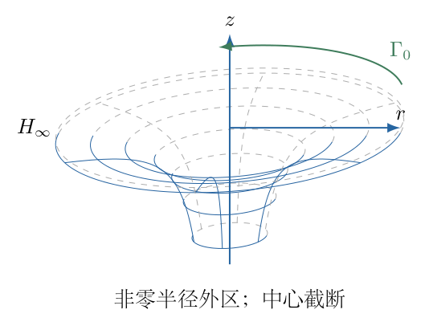
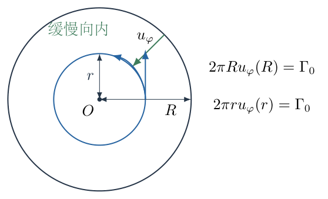
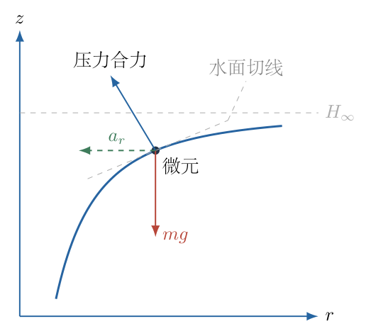

# 第 8 题

<!-- question-start -->

在只受保守力作用的理想不可压缩流体中，忽略黏滞阻力。对闭合曲线 $\mathcal C$，定义速度环流

$$
\Gamma(\mathcal C)=\oint_{\mathcal C}\boldsymbol v\cdot\mathrm d\boldsymbol l.
$$

环流守恒定律说明：若闭合曲线随同其上各流体质点移动，形成新的曲线 $\mathcal C'$，则 $\Gamma(\mathcal C')=\Gamma(\mathcal C)$。

利用环流守恒定律，考虑一个对称、稳定的漩涡，例如浴缸排水时的漩涡。忽略黏滞力和表面张力，建立合适的模型、选取坐标，写出流出量不大时自由表面应满足的方程。已知最外圈环流为 $\Gamma_0$，水密度为 $\rho$，重力加速度为 $g$。

<!-- question-end -->

## 一、题型定位

环流输运约束下的轴对称自由涡，以及旋转流体自由表面的确定。核心是先由弱但非零的排水流将外圈环流带入内圈，确定切向速度，再由径向向心加速度、竖直重力与自由面恒压条件求表面形状。

Kelvin定律适用于随流体移动的物质闭合曲线，不是任意固定圆圈。仅知最外圈环流，不能在没有进一步模型时直接宣布所有半径的固定圆圈环流相等。题目允许建立模型，因此需要明确轴对称、稳态、弱径向流和外区近似，并说明靠近排水核心时近似失效。

## 二、知识点

- 柱坐标 $r,\varphi,z$ 适合轴对称漩涡，$z$ 轴竖直向上。
- 切向速度沿圆周方向时，圆周环流为 $2\pi r u_\varphi$。
- 物质圆圈被弱径向流带向中心，环流守恒相当于比角动量 $ru_\varphi$ 守恒。
- 稳态圆周运动具有径向加速度 $-u_\varphi^2/r$，即使速度大小不随时间改变，加速度也不为零。
- Euler方程为单位体积质量乘加速度等于压力梯度力加体力。
- 弱竖直运动下，竖向近似静水分布；自由面上压强等于外界大气压。
- 径向压力梯度与竖直压力梯度共同确定自由表面斜率。
- 理想自由涡轴心速度发散，只能用于非零半径的外区，不能当作真实轴心结构。

## 三、物理图像

以漩涡轴为 $z$ 轴，取 $z$ 正向向上，$r$ 为到轴的水平距离，$\varphi$ 正向按右手约定。速度分量记为 $u_r,u_\varphi,u_z$。假设绕轴旋转对称、统计上稳定，并在离排水口和涡核足够远的区域内有

$$
|u_r|,|u_z|\ll|u_\varphi|.
$$

保留小的 $u_r<0$ 来确定环流向内输运，却在自由表面主阶方程中忽略 $u_r,u_z$ 的动能和相关加速度。这是有顺序的弱流出近似，不是从一开始把排水流严格设为零。

令自由表面高度为 $z=H(r)$，外圈半径为 $R$，外圈表面高度为 $H_R$。实际题目未给容器半径或水面绝对高度，所以最终方程应允许一个积分常数；当外圈很远，可用远处水面高度 $H_\infty$ 作为参考。

## 四、解题入口

先用随体圆圈的环流守恒或轴对称角动量输运，得到外区 $u_\varphi=\Gamma_0/(2\pi r)$。再写径向Euler方程和竖向近静水方程，在自由面上用 $p=p_a$ 联立，求 $\mathrm dH/\mathrm dr$。

积分时保留有限外边界 $H(R)=H_R$，然后再取远处极限。最终检查水面应靠近中心降低、远离中心趋平，且密度应约去。对 $r\to0$ 的发散只说明模型需要涡核或排水口截断，不应把它解释为实际水面可以无限向下。

## 五、解析

（1）正确使用物质圆圈的环流守恒。

取一个由流体质点组成的同轴圆圈。轴对称保证圆圈上的各点以同样的径向、竖向速度移动，它仍可近似保持圆形，半径随时间变化。沿圆周微元

$$
\mathrm d\boldsymbol l=r\,\mathrm d\varphi\,\boldsymbol e_\varphi,
$$

径向和竖向速度与它正交，故环流为

$$
\begin{aligned}
\Gamma&=\int_0^{2\pi}
(u_r\boldsymbol e_r+u_\varphi\boldsymbol e_\varphi+u_z\boldsymbol e_z)
\cdot(r\,\mathrm d\varphi\,\boldsymbol e_\varphi)\\
&=\int_0^{2\pi}ru_\varphi\,\mathrm d\varphi
=2\pi r u_\varphi.
\end{aligned}\tag{1}
$$

随体圆圈从外圈缓慢向内移，环流仍为 $\Gamma_0$。在由同一外部环流供给的稳定外区，所有这些物质圆圈依次经过各半径，得到

$$
\boxed{u_\varphi(r)=\frac{\Gamma_0}{2\pi r}.}\tag{2}
$$

图8-2显示物质圆圈由 $R$ 移向 $r$，以及切向速度在圆周上的方向；后续向心加速度使用的就是图中的 $u_\varphi$，而不是径向排水速度。

式（2）不是“所有固定圆圈自动满足Kelvin定律”的结论，而是稳态弱排水使随体环流与不同半径建立联系后的结果。

（2）用角动量输运交叉说明为什么保留微小排水流。

轴对称时没有切向压力梯度，重力也没有切向分量。Euler切向方程为

$$
u_r\frac{\partial u_\varphi}{\partial r}
+u_z\frac{\partial u_\varphi}{\partial z}
+\frac{u_ru_\varphi}{r}=0.
$$

外区模型取 $u_\varphi$ 对高度近似不变，第二项可忽略。乘以 $r$ 后得

$$
u_r\frac{\mathrm d(ru_\varphi)}{\mathrm dr}=0.
$$

排水流虽小但不为零，因此

$$
\frac{\mathrm d(ru_\varphi)}{\mathrm dr}=0,
\qquad ru_\varphi=\text{常量}=\frac{\Gamma_0}{2\pi}.
$$

再次得到式（2）。若从开始就把 $u_r$ 严格设为零，这条方程退化成 $0=0$，不能再推导出 $ru_\varphi$ 为常量。模型中“保留它选出速度分布”和“忽略它对表面主阶形状的影响”承担不同任务。

（3）在惯性系中写径向Euler方程。

圆周速度的方向不断改变，流体质点的径向加速度近似为

$$
a_r=-\frac{u_\varphi^2}{r}.
$$

柱坐标中更完整的稳态径向加速度含有 $u_r\partial_ru_r+u_z\partial_zu_r$，这里按弱流出条件忽略这些小项，只保留主要向心项。重力在径向无分量，压力梯度力每单位体积为 $-\partial p/\partial r$。因此

$$
\begin{aligned}
\rho\left(-\frac{u_\varphi^2}{r}\right)
&=-\frac{\partial p}{\partial r},\\
\boxed{\frac{\partial p}{\partial r}}
&\boxed{=\rho\frac{u_\varphi^2}{r}.}
\end{aligned}\tag{3}
$$

右端为正，所以同一高度上压强向外增大，压力合力指向轴心，才能提供向心加速度。若写出压强向中心增大，压力力将朝外，与运动方向相反。

（4）由近静水竖向分布引入自由表面高度。

由于竖直运动较弱，取 $a_z\approx0$，竖直Euler方程为

$$
0=-\frac{\partial p}{\partial z}-\rho g,
\qquad \frac{\partial p}{\partial z}=-\rho g.\tag{4}
$$

在给定半径 $r$，自由面 $z=H(r)$ 处压强等于大气压 $p_a$。向下积分，流体内部 $z\le H(r)$ 满足

$$
p(r,z)=p_a+\rho g[H(r)-z].\tag{5}
$$

这不是说整个流体压强只有高度函数，因为水面 $H(r)$ 随半径变化；其径向依赖正是提供向心力的来源。

对式（5）在固定 $z$ 下求偏导：

$$
\frac{\partial p}{\partial r}=\rho g\frac{\mathrm dH}{\mathrm dr}.
$$

与式（3）联立，约去 $\rho>0$：

$$
\boxed{g\frac{\mathrm dH}{\mathrm dr}
=\frac{u_\varphi^2}{r}.}\tag{6}
$$

图8-3的轴向剖面标出向内的压力合力分量和向下重力。图中的水面切线向外上升，法向压力合力有向内、向上的分量；其竖向部分平衡重力、径向部分提供向心加速度。后面的斜率方程正是这一几何与动力学的对应关系。

这里向心加速度不是一项额外施加的力；图中用虚线箭头表示它，不能将它再次与重力、压力相加。

（5）也可直接由自由面恒压条件求斜率。

沿自由面 $z=H(r)$，压强始终为 $p_a$。对复合函数求全导数：

$$
\begin{aligned}
0=\frac{\mathrm d}{\mathrm dr}p(r,H(r))
&=\frac{\partial p}{\partial r}
+\frac{\partial p}{\partial z}\frac{\mathrm dH}{\mathrm dr}\\
&=\rho\frac{u_\varphi^2}{r}
-\rho g\frac{\mathrm dH}{\mathrm dr}.
\end{aligned}
$$

这与式（6）完全一致。不能因为自由面压强不变，就误写 $\partial p/\partial r=0$；沿曲面的全导数还包含高度改变造成的压强变化。

（6）代入环流速度，得到自由面的微分方程。

由式（2），

$$
u_\varphi^2=\frac{\Gamma_0^2}{4\pi^2r^2}.
$$

代入式（6）：

$$
\boxed{\frac{\mathrm dH}{\mathrm dr}
=\frac{\Gamma_0^2}{4\pi^2g}\frac1{r^3}.}\tag{7}
$$

这已经是题目所求自由表面应满足的方程。右端非负，表示半径越大水面越高；若旋转方向反转，$\Gamma_0$ 变号但平方不变，水面形状不变。

（7）以有限外圈为边界逐步积分。

取 $H(R)=H_R$，对式（7）从 $R$ 积分到 $r$：

$$
\begin{aligned}
H(r)-H_R
&=\frac{\Gamma_0^2}{4\pi^2g}
\int_R^r s^{-3}\,\mathrm ds\\
&=\frac{\Gamma_0^2}{4\pi^2g}
\left[-\frac1{2s^2}\right]_R^r\\
&=\frac{\Gamma_0^2}{8\pi^2g}
\left(\frac1{R^2}-\frac1{r^2}\right).
\end{aligned}\tag{8}
$$

积分技巧是幂函数积分 $\int s^{-3}\mathrm ds=-s^{-2}/2$。当 $r<R$ 时，积分方向从大半径到小半径，结果为负，正好表示中心侧水面下降。

所以有限外圈模型的表面为

$$
\boxed{H(r)=H_R+
\frac{\Gamma_0^2}{8\pi^2g}
\left(\frac1{R^2}-\frac1{r^2}\right).}\tag{9}
$$

回代 $r=R$ 恢复 $H_R$，对式（9）求导恢复式（7），边界和微分方程都满足。题目没有给出总水量或容器几何，因此 $H_R$ 不能额外算出一个确定数值。

（8）外边界很远时，写成常用漩涡表面形式。

当 $R$ 很大、$H_R\to H_\infty$，忽略 $1/R^2$：

$$
\boxed{H(r)=H_\infty-
\frac{\Gamma_0^2}{8\pi^2g r^2}.}\tag{10}
$$

若以远处水面为 $z=0$，则

$$
\boxed{z=-\frac{\Gamma_0^2}{8\pi^2g r^2},\qquad
r=\sqrt{x^2+y^2}.}\tag{11}
$$

即三维自由表面可表示为

$$
z=-\frac{\Gamma_0^2}{8\pi^2g(x^2+y^2)},
\qquad x^2+y^2>0,
$$

但还要限制在外区模型有效的半径范围。图8-1按这一曲面作空间投影，剖面是 $-1/r^2$ 曲线，不能用直母线圆锥替代，否则会把水面斜率画成常数，与式（7）相矛盾。

（9）用Bernoulli方程交叉核验，而不改变模型。

自由涡外区满足 $ru_\varphi$ 为常量，除核心外可视为无旋，因而Bernoulli常量在连通外区统一。自由面上 $p=p_a$，忽略小的径向和竖向动能，得

$$
\frac{p_a}{\rho}+gH(r)+\frac{u_\varphi^2(r)}2
=\frac{p_a}{\rho}+gH_R+\frac{u_\varphi^2(R)}2.
$$

约去大气压项，代入式（2）：

$$
\begin{aligned}
g[H(r)-H_R]
&=\frac12\left[\frac{\Gamma_0^2}{4\pi^2R^2}
-\frac{\Gamma_0^2}{4\pi^2r^2}\right],\\
H(r)-H_R
&=\frac{\Gamma_0^2}{8\pi^2g}
\left(\frac1{R^2}-\frac1{r^2}\right).
\end{aligned}
$$

与式（9）一致。不能对任意有旋流动直接宣称不同圆周流线的Bernoulli常量相同；这里先确定自由涡外区，才允许使用这一交叉检查。径向Euler方法不需要先调用跨流线Bernoulli，因此作为主路线更稳妥。

（10）单位、密度与极限检查，并说明涡核边界。

环流单位为 $\mathrm{m^2\,s^{-1}}$，所以

$$
\left[\frac{\Gamma_0^2}{g r^2}\right]
=\frac{\mathrm{m^4\,s^{-2}}}
{\mathrm{m\,s^{-2}}\cdot\mathrm{m^2}}
=\mathrm m,
$$

符合高度单位。式（7）斜率无量纲。密度 $\rho$ 从式（3）、（4）的比值中约去，原因是向心惯性与重力、压力梯度都对同一密度成比例；并非水没有质量。

当 $\Gamma_0\to0$ 时，表面回到水平；当 $r\to\infty$ 时，切向速率和表面下降都趋零；当 $g$ 增大时，同一环流引起的下降减小。正反方向的环流产生同样的形状，但速度方向相反。

当 $r\to0$ 时，式（2）速度与式（10）深度均发散。这是理想外区模型失效的信号。真实排水漩涡中存在有限排水口、气核、有限流量、黏滞或其他核心结构；题设没有给这些数据，所以不能从外区公式推断轴心真实深度，也不能把曲面画成一直延伸到无限深而不说明截断。

## 六、关键洞察

本题容易混淆“环流守恒”和“速度场处处无旋”。Kelvin定律守恒的是随体闭合曲线的环流，并不强迫每个固定圆圈的环流相同。自由涡的 $1/r$ 速度分布还用到了轴对称稳态和外部环流沿弱排水流进入内圈的模型。

作为对照，若没有排水，流体整体以角速度 $\Omega$ 刚体旋转，也可满足理想流体的环流守恒，但固定半径圆圈的环流为 $2\pi\Omega r^2$，并不是常量。径向方程给

$$
H'(r)=\frac{\Omega^2r}{g},\qquad
H(r)-H_R=\frac{\Omega^2}{2g}(r^2-R^2).
$$

这是一张旋转抛物面，不是自由涡的 $-1/r^2$ 表面。即使两者在最外圈有相同的 $\Gamma_0$，内区形状仍不同，说明只给最外圈环流、却不建立流动模型时不能唯一决定水面。

自由面压强不变与同一水平面的径向压强梯度非零也不矛盾。沿水面向外移动时，高度升高引起的静水压减小，恰抵消向外压强增大的径向项。式（6）是两种变化的精确配合，而非简单将水面视为某种“离心力和重力的等势面”后不加论证地套用刚体旋转公式。

## 七、易错点

- 把固定空间闭合曲线当作随体曲线，直接套环流不变。
- 一开始令径向速度严格为零，然后从退化的切向方程推出不存在的约束。
- 混淆角速度与切向线速度，写 $u_\varphi=\Gamma_0/(2\pi r^2)$。
- 认为稳态就没有加速度，遗漏圆周运动的向心项。
- 径向压力梯度符号写反，使压力合力朝外。
- 自由面恒压就写 $\partial p/\partial r=0$，遗漏沿水面高度变化的链式项。
- 积分 $r^{-3}$ 时漏掉负号或因子 $1/2$，使中心水面反而升高。
- 把自由涡画成直母线圆锥，或把外区发散当成真实轴心水面。

## 八、课堂讲解建议

先让学生沿一个圆周画速度箭头，教师说明“速度大小不变”与“速度方向不变”不同，从而引出向心加速度。再把一个随流体移动的圆圈画成半径逐渐缩小的环，解释环流守恒保持的是 $ru_\varphi$，并明确它的模型前提。

压力部分先要求学生判断同高压强应向哪边增大，再板书Euler方程的负号。用剖面图指出压力合力的向内和向上分量，但不要另添一个所谓“向心力”与已有力重复相加。随后通过自由面全导数解释恒压条件，帮助学生区分偏导和沿曲面导数。

最后比较自由涡和刚体旋转两种水面，教师可让学生用圆锥、抛物面和 $-1/r^2$ 三种剖面判断各自斜率趋势。用核心失效说明竞赛模型应给出适用区域，不必为了得到全域曲面而猜造额外参数。

## 九、变式训练

变式：用有限核心修正自由涡。外区 $r\ge r_c$ 仍满足 $u_\varphi=\Gamma_0/(2\pi r)$；内区 $r\le r_c$ 为刚体旋转 $u_\varphi=\Omega r$，并要求速度在 $r=r_c$ 连续。远处水面为 $H_\infty$。求整个自由表面及轴心下降深度，检查连接处是否有斜率突变。

解：速度连续给

$$
\Omega r_c=\frac{\Gamma_0}{2\pi r_c},
\qquad \Omega=\frac{\Gamma_0}{2\pi r_c^2}.
$$

外区水面为

$$
H_{\rm out}(r)=H_\infty-
\frac{\Gamma_0^2}{8\pi^2g r^2}.
$$

内区由 $gH'=\Omega^2r$，从 $r_c$ 积分到 $r$，并匹配水面高度：

$$
\begin{aligned}
H_{\rm in}(r)-H_{\rm out}(r_c)
&=\frac{\Omega^2}{2g}(r^2-r_c^2),\\
H_{\rm in}(r)
&=H_\infty-\frac{\Gamma_0^2}{8\pi^2g r_c^2}
+\frac{\Gamma_0^2}{8\pi^2g r_c^4}(r^2-r_c^2)\\
&=H_\infty-\frac{\Gamma_0^2}{4\pi^2g r_c^2}
+\frac{\Gamma_0^2r^2}{8\pi^2g r_c^4}.
\end{aligned}
$$

因此轴心高度与下降深度为

$$
\boxed{H(0)=H_\infty-\frac{\Gamma_0^2}{4\pi^2g r_c^2},\qquad
\Delta H_0=\frac{\Gamma_0^2}{4\pi^2g r_c^2}.}
$$

连接处两侧斜率分别为

$$
H'_{\rm in}(r_c)=\frac{\Omega^2r_c}{g}
=\frac{\Gamma_0^2}{4\pi^2g r_c^3}
=H'_{\rm out}(r_c).
$$

所以高度和一阶斜率都连续，轴心水面斜率为零，深度有限。核心半径缩小时下降增大；$r_c\to0$ 又趋向理想自由涡的奇异行为。这一变式给出一种明确修正，但主问题没有给 $r_c$，不能把变式的轴心深度作为主问题的唯一数值答案。
