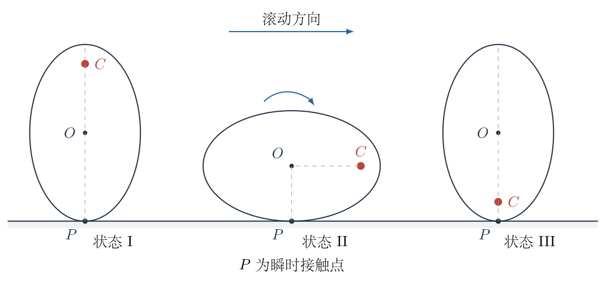
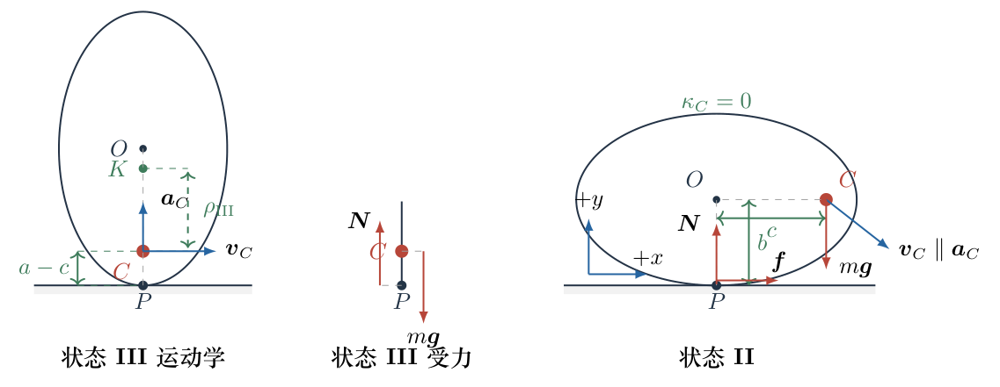

# 第 1 题

<!-- question-start -->

如图，一个长半轴为 $a$、短半轴为 $b$ 的轻质椭圆塑料板竖立在粗糙水平桌面上，椭圆上焦点处嵌有一个质量为 $m$ 的质点。受到微小扰动后，椭圆板在桌面上向右滚动，先后经过状态I、II、III。已知整个滚动过程中始终没有相对滑动，接触处也始终不离开桌面。重力加速度为 $g$。

（1）在状态III，求质点 $C$ 的速度大小 $v_C$、加速度大小 $a_C$ 和桌面对系统的支持力 $N$。

（2）取水平向右为 $x$ 轴正方向、竖直向上为 $y$ 轴正方向。在状态II，求质点速度分量 $v_{Cx}$、$v_{Cy}$，加速度分量 $a_{Cx}$、$a_{Cy}$，以及桌面对系统的支持力 $N$ 和摩擦力 $f$。

<!-- question-end -->

## 一、题型定位

本题是“非圆形刚体纯滚动与质点轨迹”问题。椭圆板本身质量可忽略，全部惯性和重力都来自焦点处的质点；但质点并不是绕一个固定点作圆周运动。椭圆每转过一个角度，板的几何中心高度、瞬时接触点和焦点相对桌面的位置都会同时改变，所以必须先确定焦点相对地面的真实轨迹，再用能量和轨迹曲率求速度、加速度，最后由牛顿第二定律求支持力和摩擦力。

状态III的焦点轨迹处于局部最低点，加速度只有法向分量；状态II则恰好相反：焦点轨迹在该点的曲率为零，加速度只有切向分量。识别这两个特殊几何性质，是把复杂滚动问题化简的关键。

## 二、知识点

- 椭圆焦距参数 $c=\sqrt{a^2-b^2}$。
- 纯滚动时，瞬时接触点的速度为零；接触力对整个系统的瞬时功率为零。
- 轻质板与单个质点组成的系统，其动能只有 $\tfrac12mv_C^2$，不能擅自加入椭圆板的转动动能。
- 曲线运动的加速度分解：$a_n=v^2/\rho$，$a_t=dv/dt$。
- 平面曲线 $\boldsymbol r(\alpha)=(x(\alpha),y(\alpha))$ 的曲率

$$
\kappa=
\frac{|x'y''-y'x''|}{(x'^2+y'^2)^{3/2}},
\qquad \rho=\frac1\kappa.
$$

- 非圆形物体滚动时，几何中心的高度并非常量；需要使用椭圆在竖直方向的支承距离。
- 接触力不做功不等于接触力为零。支持力和摩擦力仍由平动方程及力矩关系决定。

## 三、物理图像

记椭圆焦距为

$$
\boxed{c=\sqrt{a^2-b^2}},\qquad 0<c<a.
$$

用 $\alpha$ 表示椭圆板从状态I开始顺时针转过的角度。于是

$$
\alpha_{\mathrm{I}}=0,
\qquad
\alpha_{\mathrm{II}}=\frac\pi2,
\qquad
\alpha_{\mathrm{III}}=\pi.
$$

椭圆长轴与竖直方向夹角为 $\alpha$ 时，几何中心 $O$ 到桌面的竖直距离为

$$
h(\alpha)
=\sqrt{a^2\cos^2\alpha+b^2\sin^2\alpha}
=\sqrt{b^2+c^2\cos^2\alpha}.
$$

焦点 $C$ 相对几何中心的位矢在状态I为竖直向上，随板顺时针转动后，其竖直分量为 $c\cos\alpha$。因此质点的高度为

$$
\boxed{y_C(\alpha)=h(\alpha)+c\cos\alpha}.
$$

三个特殊位置的高度立即得到

$$
y_{\mathrm{I}}=a+c,
\qquad
y_{\mathrm{II}}=b,
\qquad
y_{\mathrm{III}}=a-c.
$$

状态I到III的质点高度降低 $2c$；状态I到II的质点高度降低 $a+c-b$。这些高度差直接决定两处速度。

## 四、解题入口

先利用接触力不做功写机械能守恒，求状态II和III的速率。速度分量和加速度不能只靠椭圆外形判断，需要进一步求焦点轨迹的切线与曲率。

纯滚动给出一个很有用的几何关系。板顺时针转过 $d\alpha$ 时，几何中心的水平位移为

$$
dx_O=h(\alpha)\,d\alpha.
$$

焦点相对中心的水平坐标为 $c\sin\alpha$，所以

$$
\frac{dx_C}{d\alpha}
=h(\alpha)+c\cos\alpha
=y_C(\alpha).
$$

也就是说，只要求出 $y_C$ 及其对 $\alpha$ 的导数，就能同时得到焦点轨迹的 $x$、$y$ 两个方向导数：

$$
x_C'=y_C,
\qquad
x_C''=y_C'.
$$

随后在 $\alpha=\pi$ 和 $\alpha=\pi/2$ 分别代入曲率公式。

## 五、解析

图1-2把两处需要使用的几何量、速度方向和接触力画在同一坐标约定下。状态III使用左侧的 $y_C=a-c$ 和曲率方向；状态II使用右侧的 $y_C=b$、$x_C'=b$、$y_C'=-c$ 建立速度分量，最后用图中接触点处的 $N$、$f$ 写动力学方程。

先说明能量为什么守恒。桌面固定，纯滚动时瞬时接触点 $P$ 的速度为零，因此支持力和静摩擦力的瞬时功率都为零。椭圆板质量可忽略，系统动能只有质点的动能。因此从近于静止的状态I释放后，在任意位置都有

$$
\frac12mv_C^2+mg y_C=mg(a+c).
$$

质量 $m$ 在求速度时约去。

（1）求状态III的速度。

状态III有 $y_C=a-c$。代入机械能守恒式：

$$
\begin{aligned}
\frac12m v_C^2+mg(a-c)
&=mg(a+c),\\
\frac12m v_C^2
&=mg\bigl[(a+c)-(a-c)\bigr]\\
&=2mgc.
\end{aligned}
$$

所以

$$
\boxed{v_C=2\sqrt{gc}}.
$$

这里的 $v_C$ 是焦点处质点相对地面的速度，不是椭圆几何中心的速度。状态III的瞬时接触点到质点的距离为 $a-c$，若记板在该瞬间的角速度大小为 $\omega_{\mathrm{III}}$，也有

$$
v_C=(a-c)\omega_{\mathrm{III}}.
$$

这一关系只用于该瞬间，不能把 $a-c$ 当作整段运动中不变的转动半径。

接下来求状态III焦点轨迹的曲率。先计算支承距离 $h$ 的导数。由

$$
h^2=b^2+c^2\cos^2\alpha
$$

对 $\alpha$ 求导：

$$
2hh'=-2c^2\sin\alpha\cos\alpha,
$$

从而

$$
h'=-\frac{c^2\sin\alpha\cos\alpha}{h}.
$$

在 $\alpha=\pi$ 处，$h=a$、$h'=0$。再对上式求导，含有 $\sin\alpha$ 的项在此处消失，得到

$$
h''(\pi)=-\frac{c^2}{a}.
$$

由于 $y_C=h+c\cos\alpha$，所以

$$
\begin{aligned}
y_C(\pi)&=a-c,\\
y_C'(\pi)&=h'(\pi)-c\sin\pi=0,\\
y_C''(\pi)&=h''(\pi)-c\cos\pi\\
&=-\frac{c^2}{a}+c\\
&=\frac{c(a-c)}{a}.
\end{aligned}
$$

再利用 $x_C'=y_C$、$x_C''=y_C'$，可得

$$
x_C'(\pi)=a-c,
\qquad
x_C''(\pi)=0.
$$

代入曲率公式：

$$
\begin{aligned}
\kappa_{\mathrm{III}}
&=\frac{|x_C'y_C''-y_C'x_C''|}
{(x_C'^2+y_C'^2)^{3/2}}\\
&=\frac{(a-c)\,c(a-c)/a}{(a-c)^3}\\
&=\frac{c}{a(a-c)}.
\end{aligned}
$$

于是焦点轨迹在状态III的曲率半径为

$$
\boxed{\rho_{\mathrm{III}}=\frac{a(a-c)}{c}}.
$$

状态III是焦点轨迹的最低点，切线水平，重力沿切线方向的分量为零，故切向加速度为零。加速度只有竖直向上的法向分量：

$$
\begin{aligned}
a_C
&=\frac{v_C^2}{\rho_{\mathrm{III}}}\\
&=\frac{4gc}{a(a-c)/c}\\
&=\frac{4gc^2}{a(a-c)}.
\end{aligned}
$$

将 $c^2=a^2-b^2$ 代回，可写成题给量：

$$
\boxed{
a_C=\frac{4g(a^2-b^2)}
{a\bigl(a-\sqrt{a^2-b^2}\bigr)}
}
\qquad\text{（方向竖直向上）}.
$$

在状态III，质点、接触点和椭圆中心在同一竖直线上。水平方向加速度为零，因此摩擦力为零。竖直方向列牛顿第二定律：

$$
N-mg=ma_C.
$$

所以

$$
\begin{aligned}
N
&=m(g+a_C)\\
&=mg\left[1+\frac{4c^2}{a(a-c)}\right].
\end{aligned}
$$

即

$$
\boxed{
N=mg\left[
1+\frac{4(a^2-b^2)}
{a\bigl(a-\sqrt{a^2-b^2}\bigr)}
\right].
}
$$

（2）求状态II的速度分量。

状态II的质点高度为 $b$。由机械能守恒：

$$
\begin{aligned}
\frac12m v_C^2+mgb&=mg(a+c),\\
v_C^2&=2g(a+c-b).
\end{aligned}
$$

因此

$$
v_C=\sqrt{2g(a+c-b)}.
$$

为了分解速度，需要求轨迹切线。状态II对应 $\alpha=\pi/2$。此时

$$
h=b,
\qquad h'=0,
\qquad y_C=b,
\qquad y_C'=-c.
$$

因 $x_C'=y_C$，轨迹切向量为 $(x_C',y_C')=(b,-c)$。它的长度和对应的单位切向量依次为

$$
\begin{aligned}
\sqrt{b^2+c^2}
&=\sqrt{b^2+a^2-b^2}=a,\\
\boldsymbol e_t&=\frac1a(b,-c).
\end{aligned}
$$

将速率乘以单位切向量，两个速度分量同时得到

$$
\boxed{
v_{Cx}=\frac ba\sqrt{2g(a+c-b)}
},
\qquad
\boxed{
v_{Cy}=-\frac ca\sqrt{2g(a+c-b)}
}.
$$

负号表示质点在状态II仍向下运动。

下面证明状态II的焦点轨迹曲率为零，而不是直接把加速度写成 $v_C^2/b$。在 $\alpha=\pi/2$ 处，由 $h^2=b^2+c^2\cos^2\alpha$ 得

$$
h''\left(\frac\pi2\right)=\frac{c^2}{b}.
$$

于是

$$
\begin{aligned}
y_C\left(\frac\pi2\right)&=b,\\
y_C'\left(\frac\pi2\right)&=-c,\\
y_C''\left(\frac\pi2\right)&=\frac{c^2}{b},\\
x_C'\left(\frac\pi2\right)&=b,\\
x_C''\left(\frac\pi2\right)&=-c.
\end{aligned}
$$

曲率公式的分子为

$$
\begin{aligned}
x_C'y_C''-y_C'x_C''
&=b\cdot\frac{c^2}{b}-(-c)(-c)\\
&=c^2-c^2=0.
\end{aligned}
$$

因此

$$
\boxed{\kappa_{\mathrm{II}}=0},
\qquad
\rho_{\mathrm{II}}=\infty.
$$

状态II没有法向加速度，加速度完全沿轨迹切线。对能量关系 $\tfrac12mv_C^2+mgy_C=\text{常量}$ 求时间导数：

$$
mv_C\frac{dv_C}{dt}+mg\frac{dy_C}{dt}=0.
$$

又因为 $dy_C/dt=v_C(e_t)_y$，且 $(e_t)_y=-c/a$，所以切向加速度为

$$
\begin{aligned}
\frac{dv_C}{dt}
&=-g(e_t)_y\\
&=\frac{gc}{a}.
\end{aligned}
$$

将它乘以单位切向量，再分别读取两个坐标分量：

$$
\boldsymbol a_C
=\frac{gc}{a}\cdot\frac1a(b,-c),
\qquad
\boxed{a_{Cx}=\frac{gbc}{a^2}},
\qquad
\boxed{a_{Cy}=-\frac{gc^2}{a^2}}.
$$

最后求支持力和摩擦力。把椭圆板与质点作为整体，板质量为零，因此系统总质量为 $m$。状态II水平方向只有静摩擦力，故

$$
\boxed{f=\frac{mgbc}{a^2}}
\qquad\text{（方向水平向右）}.
$$

竖直方向列牛顿第二定律并逐步化简：

$$
N-mg=ma_{Cy}=-\frac{mgc^2}{a^2}.
$$

$$
\begin{aligned}
N
&=mg\left(1-\frac{c^2}{a^2}\right)\\
&=mg\frac{a^2-c^2}{a^2}\\
&=\boxed{\frac{mgb^2}{a^2}}.
\end{aligned}
$$

还可以同时检查轻质板的力矩约束与静摩擦条件。接触点到质点 $C$ 的水平、竖直距离分别为 $c$、$b$，代入所得结果有 $bf-cN=b(mgbc/a^2)-c(mgb^2/a^2)=0$，与轻质板不保留自身角动量完全一致；同时 $|f|/N=c/b$，故状态II局部要求 $\mu_s\ge c/b$。后一条件只是对题设可实现性的局部检查；题目已经假定全程无滑动，因此不需要把它另列为所求答案，也不能据此断言它就是全程所需摩擦系数的最大值。

最后做三项物理自检。第一，所有速度式都含有 $\sqrt{g\times\text{长度}}$，所有加速度式都含有 $g$ 乘无量纲比值，$N$、$f$ 都是 $mg$ 乘无量纲因子，量纲一致。第二，令 $a\to b$，则 $c\to0$，椭圆连续退化为圆，而质点退化到圆心；此时状态I、II、III的质点高度相同，公式相应给出

$$
v_C\to0,
\qquad a_C\to0,
\qquad f\to0,
\qquad N\to mg,
$$

与圆心静止的纯滚动极限相符。第三，当椭圆越来越扁时 $c\to a$，状态III的 $a-c$ 和焦点轨迹曲率半径 $\rho_{\rm III}=a(a-c)/c$ 同时趋近于零，因而法向加速度与支持力迅速增大。这不是代数发散错误，而是在提示“极扁椭圆的焦点轨迹在状态III形成极尖转弯”；真实材料的变形和有限接触区会使理想刚体模型在这一极限附近失效。

## 六、关键洞察

核心并不是椭圆边界本身的曲率，而是焦点随纯滚动形成的轨迹曲率。状态III处椭圆边界的曲率半径为 $b^2/a$，焦点轨迹的曲率半径却是 $a(a-c)/c$；二者描述不同曲线，不能互换。

纯滚动关系 $dx_O=h\,d\alpha$ 与焦点高度 $y_C=h+c\cos\alpha$ 恰好给出 $x_C'=y_C$。这一等式把二维轨迹的求导压缩为对一个函数 $y_C(\alpha)$ 的求导，是本题最有效的几何入口。

状态III与状态II形成鲜明对照：前者轨迹切线水平、切向加速度为零、法向加速度非零；后者轨迹曲率为零、法向加速度为零、切向加速度非零。曲率为零只说明瞬时没有法向加速度，不说明总加速度为零。

## 七、易错点

- 把椭圆几何中心的高度始终写成 $a$ 或 $b$。实际高度为随姿态变化的 $h(\alpha)$。
- 把质点到瞬时接触点的距离当作固定转动半径，用同一个 $v=\omega r$ 贯穿整个过程。
- 把椭圆边界在顶点的曲率半径 $b^2/a$ 当作焦点轨迹曲率半径。
- 在状态II误写 $a_C=v_C^2/b$。焦点轨迹在此处曲率为零，法向加速度正好为零。
- 因为静摩擦不做功就把 $f$ 写成零。状态II的摩擦力不做功，却负责提供水平合力。
- 漏掉 $v_{Cy}$、$a_{Cy}$ 的负号。题设坐标中质点在状态II向右、向下运动，并且加速度也指向右下方。
- 只用平动方程而不检查轻质板的力矩。代入所得 $N$、$f$ 后应满足 $bf=cN$。

## 八、课堂讲解建议

讲解时先让学生分别回答三个问题：质点在I、II、III的高度是多少；接触力为什么不做功；状态II的质点轨迹是否一定“向内弯”。前两个问题自然引出能量法，第三个问题迫使学生放弃凭外形猜曲率。

板书可把整题压缩成两条主线：第一条是 $y_C=h+c\cos\alpha$，负责能量；第二条是 $x_C'=y_C$，负责切线和曲率。到状态II时，应把曲率分子 $bc^2/b-c^2=0$ 单独写出，使“法向加速度为零”有可检查的依据，而不是口头结论。

在求接触力后，可让学生立即做两项反查：量纲是否为力；$bf-cN$ 是否为零。这样能把轻质板的力矩约束与最后答案联系起来。

## 九、变式训练

把焦点处质点改为嵌在长轴上距几何中心为 $d$ 的位置，取 $c^2/a<d<a$；初态仍为该质点在中心正上方，椭圆板从近于静止开始向右纯滚动。求状态III的速率、加速度和支持力，以及状态II的速度、加速度、支持力和摩擦力。这个变式也用于检验“状态II曲率为零”是否是任意长轴内点都具有的性质。

此时只需把焦距 $c$ 改为一般偏心距 $d$。质点高度为

$$
y=h+d\cos\alpha,
$$

状态I、II、III的高度分别为 $a+d$、$b$、$a-d$。

状态III的能量方程为

$$
\frac12mv_{\mathrm{III}}^2=2mgd,
$$

所以

$$
v_{\mathrm{III}}=2\sqrt{gd}.
$$

在状态III，轨迹导数为

$$
\begin{aligned}
x'&=a-d,& y'&=0,\\
x''&=0,& y''&=d-\frac{c^2}{a}=\frac{ad-c^2}{a}.
\end{aligned}
$$

条件 $d>c^2/a$ 保证曲率中心在质点上方。曲率半径和向上的法向加速度依次为

$$
\begin{aligned}
\rho_{\mathrm{III}}
&=\frac{a(a-d)^2}{ad-c^2},\\
a_{\mathrm{III}}
&=\frac{v_{\mathrm{III}}^2}{\rho_{\mathrm{III}}}\\
&=\frac{4gd(ad-c^2)}{a(a-d)^2}.
\end{aligned}
$$

于是

$$
N_{\mathrm{III}}
=mg\left[1+\frac{4d(ad-c^2)}{a(a-d)^2}\right].
$$

状态II的速率为

$$
v_{\mathrm{II}}=\sqrt{2g(a+d-b)}.
$$

记 $q=\sqrt{b^2+d^2}$。轨迹切向量为 $(b,-d)$，故

$$
\begin{aligned}
v_x&=\frac bqv_{\mathrm{II}},\\
v_y&=-\frac dqv_{\mathrm{II}}.
\end{aligned}
$$

这一点的轨迹导数为

$$
\boldsymbol r'=(b,-d),
\qquad
\boldsymbol r''=\left(-d,\frac{c^2}{b}\right).
$$

所以有向曲率为

$$
\kappa
=\frac{bc^2/b-d^2}{q^3}
=\frac{c^2-d^2}{q^3}.
$$

可见只有 $d=c$ 时状态II才是轨迹拐点。沿运动方向的单位切向量和左法向单位向量分别为

$$
\boldsymbol e_t=\frac1q(b,-d),
\qquad
\boldsymbol e_n=\frac1q(d,b).
$$

重力沿切线产生 $a_t=gd/q$，法向加速度的有向大小为 $v_{\mathrm{II}}^2\kappa$。因此

$$
\begin{aligned}
a_x
&=\frac{gbd}{q^2}
+\frac{v_{\mathrm{II}}^2(c^2-d^2)d}{q^4},\\
a_y
&=-\frac{gd^2}{q^2}
+\frac{v_{\mathrm{II}}^2(c^2-d^2)b}{q^4}.
\end{aligned}
$$

由牛顿第二定律得到完整答案 $\boxed{f=ma_x}$、$\boxed{N=m(g+a_y)}$。

最后把一般结果退回本题作一致性检验。取 $d=c=\sqrt{a^2-b^2}$，曲率项 $c^2-d^2$ 消失且 $q=a$；这说明状态II曲率为零确实来自焦点位置的特殊消去，并不是任意长轴内点共有的性质。代入后四个量恰好化为

$$
a_x=\frac{gbc}{a^2},
\quad
a_y=-\frac{gc^2}{a^2},
\quad
f=\frac{mgbc}{a^2},
\quad
N=\frac{mgb^2}{a^2},
$$

一般位置的公式还揭示了两个在焦点特例中被隐藏的分界。首先，状态III的曲率半径含有因子 $ad-c^2$；题设取 $d>c^2/a$，正是为了保证这一点附近的轨迹曲率方向不发生翻转。当 $d\downarrow c^2/a$ 时，$\rho_{\rm III}\to\infty$，虽然质点仍有非零速率，但该瞬间的法向加速度趋于零。其次，状态II的有向曲率正比于 $c^2-d^2$：若 $d<c$，轨迹向左法向弯曲；若 $d=c$，状态II成为拐点；若 $d>c$，曲率改变符号，法向加速度随之转向。由此可见，原题中“曲率恰为零”不是一个可忽略的小技巧，而是质点恰好位于焦点所导致的结构性简化。

这些结论也给出直接的符号检查：$v_{\rm III}^2=4gd>0$；在本变式规定的 $d>c^2/a$ 范围内，$N_{\rm III}>mg>0$；状态II则必须保留曲率项的正负号后再代入 $N=m(g+a_y)$，不能先把法向加速度一律写成正的 $v^2/\rho$。
