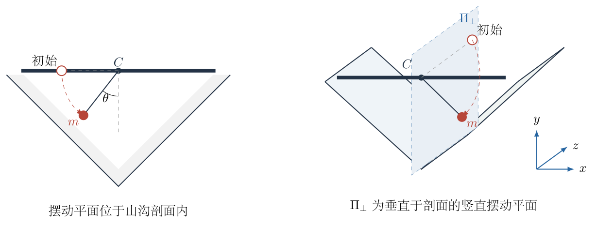
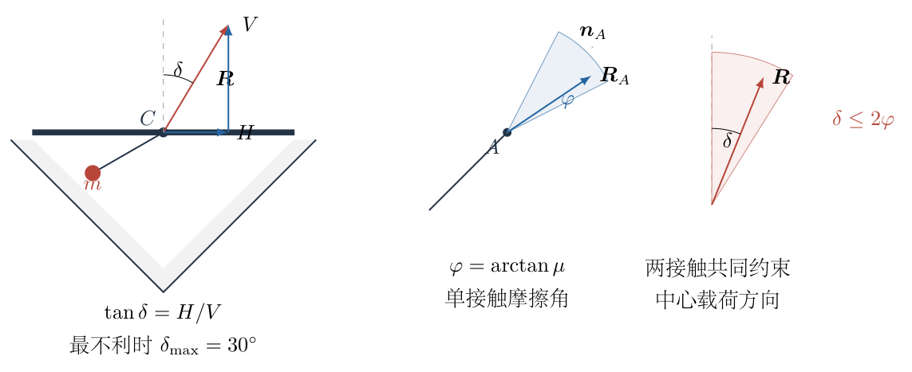
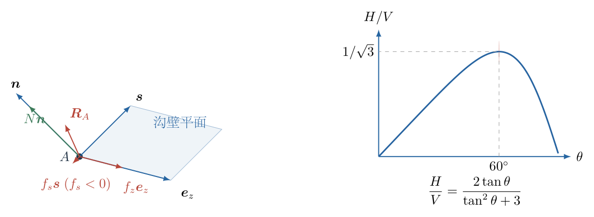

# 第 3 题

<!-- question-start -->

质量为 $m$ 的兔子发现，一根质量为 $1.5m$ 的均匀木棍水平卡在山沟正中。山沟两侧斜面与水平面的夹角均为 $45^\circ$，木棍与两侧斜面之间的摩擦系数均为 $\mu$。兔子用一根长度为 $l$ 的轻绳把自己拴在木棍中点，从绳水平的位置由静止开始摆动，并且运动中不会碰到沟壁。

（1）若兔子来回摆动的平面在山沟剖面内，求保证木棍与沟壁不发生相对滑动所需的最小摩擦系数。

（2）若兔子来回摆动的平面垂直于山沟剖面，求保证木棍与沟壁不发生相对滑动所需的最小摩擦系数。

<!-- question-end -->

## 一、题型定位

本题是摆运动力学与多接触静摩擦锥的耦合问题。兔子的绳张力随摆角变化，方向也随摆角转动；木棍两端同时与互成直角的沟壁接触。所求不是某一时刻的摩擦，而是整个摆动过程中都能维持静止的最小摩擦系数。

第一问可在山沟剖面内用“合力方向能否落入两接触力的合成摩擦锥”处理。第二问出现垂直剖面的轴向分力，单个接触处需要同时使用坡向摩擦和轴向摩擦，必须按摩擦合力 $\sqrt{f_s^2+f_z^2}$ 与法向力比较，不能把两个摩擦分量分别与 $\mu N$ 比较。

## 二、知识点

- 单摆从水平位置静止释放时的机械能守恒与径向动力学。
- 静摩擦锥半角 $\varphi=\arctan\mu$。
- 对称双接触的力与力矩平衡。
- 三维接触面内两个正交摩擦分量的合成。
- 含参数函数的极值：把 $\sin\theta\cos\theta$ 与 $\cos^2\theta$ 改写为 $\tan\theta$ 的有理式。
- 先对每一摆角优化接触力分配，再对全部摆角取最不利值。

## 三、物理图像

用 $\theta$ 表示轻绳与竖直向下方向的夹角。兔子从水平位置释放，因此运动范围可取

$$
0\leq\theta\leq\frac\pi2.
$$

在剖面内摆动时，绳张力对木棍的作用力具有剖面内的水平分量和竖直分量；在垂直剖面摆动时，相同大小的水平分量改为沿山沟延伸方向的轴向分量。

无论是哪一种摆动平面，木棍需要两侧沟壁提供的总接触力都可以分解为

$$
H=\text{水平或轴向分量大小},
\qquad
V=\text{竖直分量大小}.
$$

先求比值 $H/V$ 的最大值，再把这个外载方向转换为接触处所需的摩擦系数。

## 四、解题入口

第一步只研究兔子。由能量求速度，再沿绳方向列牛顿第二定律求张力 $T(\theta)$。第二步把兔子对木棍的拉力和木棍自身重力合成，得到 $H(\theta)$、$V(\theta)$ 及合力偏离竖直方向的角度 $\delta$。

第三步才研究接触。剖面内问题可用两个平面摩擦锥的角度叠加；垂直剖面问题则要在单个接触处把坡向摩擦和轴向摩擦作矢量合成，并允许法向力在满足竖直分量的条件下自行调整。两问的最不利摆角相同，但由外载方向到 $\mu$ 的转换不同。

## 五、解析

（1）先求任意摆角处的绳张力。

兔子从绳水平的位置由静止释放。运动到摆角 $\theta$ 时，下降高度为 $l\cos\theta$。机械能守恒给出

$$
\frac12mv^2=mgl\cos\theta.
$$

所以

$$
v^2=2gl\cos\theta.
$$

沿绳指向悬点的方向列牛顿第二定律。张力指向悬点，重力沿背离悬点方向的分量为 $mg\cos\theta$，故

$$
T-mg\cos\theta=\frac{mv^2}{l}.
$$

代入速度：

$$
\begin{aligned}
T
&=mg\cos\theta+\frac{m(2gl\cos\theta)}{l}\\
&=3mg\cos\theta.
\end{aligned}
$$

即

$$
\boxed{T=3mg\cos\theta}.
$$

（2）求木棍所受中心载荷的方向。

轻绳对木棍中点的作用力沿绳指向兔子。其非竖直分量大小为

$$
H=T\sin\theta
=3mg\sin\theta\cos\theta.
$$

竖直向下分量为 $T\cos\theta$。再加上木棍自身重力 $1.5mg$，竖直载荷大小为

$$
\begin{aligned}
V
&=1.5mg+T\cos\theta\\
&=1.5mg+3mg\cos^2\theta\\
&=1.5mg(1+2\cos^2\theta).
\end{aligned}
$$

两侧沟壁接触力的合力与这个中心载荷大小相等、方向相反。若合力偏离竖直方向的角度为 $\delta$，则

$$
\tan\delta
=\frac HV
=\frac{2\sin\theta\cos\theta}{1+2\cos^2\theta}.
$$

令 $u=\tan\theta$。利用

$$
\sin\theta\cos\theta=\frac{u}{1+u^2},
\qquad
\cos^2\theta=\frac1{1+u^2},
$$

得到

$$
\tan\delta=\frac{2u}{u^2+3}.
$$

对 $u\geq0$ 求导：

$$
\frac{d}{du}\left(\frac{2u}{u^2+3}\right)
=\frac{2(3-u^2)}{(u^2+3)^2}.
$$

因此最大值出现在

$$
u=\sqrt3,
\qquad
\theta=60^\circ.
$$

代回得

$$
\tan\delta_{\max}=\frac1{\sqrt3},
\qquad
\boxed{\delta_{\max}=30^\circ}.
$$

图3-2左侧表示中心载荷的分量和方向；右侧先画出单个接触处以法线为轴、半角为 $\varphi$ 的摩擦锥，再画出两端接触和刚体平衡共同约束下中心载荷的允许偏角。这里的 $2\varphi$ 是系统几何约束的结果，不能把两支接触力箭头直接首尾相接后凭图读出。

（3）第一问：把合力偏角转换为摩擦系数。

每一接触处的摩擦锥半角记为

$$
\varphi=\arctan\mu.
$$

左、右沟壁法向分别向竖直线右侧和左侧偏转 $45^\circ$。中心载荷作用于木棍中点，木棍自身重力也通过中点。对中点取矩可知，两接触力的竖直分量必须相等，均为 $V/2$。

为了使接触合力尽可能向右偏，左端接触力相对竖直方向取角

$$
\beta_A=45^\circ+\varphi,
$$

右端接触力相对竖直方向取角

$$
\beta_B=-45^\circ+\varphi.
$$

两者竖直分量相等，所以合力的水平、竖直分量之比的最大值为

$$
\begin{aligned}
\tan\delta_{\mathrm{allow}}
&=\frac12\bigl(\tan\beta_A+\tan\beta_B\bigr)\\
&=\frac12\left[\tan(45^\circ+\varphi)
-\tan(45^\circ-\varphi)\right]\\
&=\frac{2\tan\varphi}{1-\tan^2\varphi}\\
&=\tan(2\varphi).
\end{aligned}
$$

在本题所需的小角范围内，这说明双接触合力相对竖直方向的最大允许偏角为 $2\varphi$。要覆盖整个摆动过程，必须满足

$$
2\varphi\geq\delta_{\max}=30^\circ.
$$

所以

$$
\varphi_{\min}=15^\circ,
$$

进而

$$
\boxed{
\mu_{\min}^{(1)}=\tan15^\circ=2-\sqrt3
}.
$$

（4）第二问：建立单个接触处的三维摩擦分量。

兔子的摆动平面垂直于山沟剖面时，$H$ 沿山沟延伸方向。由于载荷仍作用于木棍中点，对称性和力矩平衡要求两端接触力的竖直分量相等，轴向分量也相等。每一接触处承担

$$
\frac V2\quad\text{的竖直分量},
\qquad
\frac H2\quad\text{的轴向分量}.
$$

如图3-3，在任一接触处，把接触力分解为法向力 $N$、剖面内沿坡面的摩擦分量 $f_s$ 和沿山沟轴向的摩擦分量 $f_z$。

沟壁倾角为 $45^\circ$，法向力和坡向摩擦的竖直分量分别为 $N/\sqrt2$、$f_s/\sqrt2$。取 $f_s$ 的正方向为竖直分量向上。图中基矢 $\boldsymbol s$ 沿坡面向上，实际坡向分力按最优分配画为 $f_s<0$，所以箭头与 $\boldsymbol s$ 相反。下面 $f_s$ 始终是带符号的分量，不能把图中的向下分力再作为正值代入。竖直平衡关系为

$$
\frac{N+f_s}{\sqrt2}=\frac V2.
$$

轴向分量由轴向摩擦承担：

$$
f_z=\frac H2.
$$

为了简化记号，定义

$$
A=\frac V{\sqrt2},
\qquad
B=\frac H2.
$$

于是

$$
f_s=A-N,
\qquad
f_z=B.
$$

单个接触处的摩擦合力必须满足

$$
\sqrt{f_s^2+f_z^2}\leq\mu N.
$$

对于给定的摆角，法向力 $N$ 尚可在满足平衡的范围内调整。所需摩擦系数平方为

$$
\begin{aligned}
\mu_{\mathrm{req}}^2(N)
&=\frac{(A-N)^2+B^2}{N^2}\\
&=1-\frac{2A}{N}+\frac{A^2+B^2}{N^2}.
\end{aligned}
$$

对 $N$ 求极小值：

$$
\frac{d\mu_{\mathrm{req}}^2}{dN}
=\frac{2A}{N^2}-\frac{2(A^2+B^2)}{N^3}=0.
$$

由此得到最优法向力

$$
N_*=\frac{A^2+B^2}{A}.
$$

代回：

$$
\begin{aligned}
\mu_{\mathrm{req,min}}^2
&=1-\frac{A^2}{A^2+B^2}\\
&=\frac{B^2}{A^2+B^2}.
\end{aligned}
$$

因此该摆角所需的最小摩擦系数为 $B/\sqrt{A^2+B^2}$。再定义无量纲比值

$$
q=\frac BA
=\frac{H}{\sqrt2V}.
$$

则同一结果可改写为

$$
\mu_{\mathrm{req,min}}=\frac q{\sqrt{1+q^2}}.
$$

这个函数随 $q\geq0$ 单调增加。前面已经求得 $(H/V)_{\max}=1/\sqrt3$，所以 $q_{\max}=1/\sqrt6$。于是全程所需的最小摩擦系数为

$$
\begin{aligned}
\mu_{\min}^{(2)}
&=\frac{1/\sqrt6}{\sqrt{1+1/6}}\\
&=\frac{1/\sqrt6}{\sqrt{7/6}}\\
&=\boxed{\frac1{\sqrt7}}.
\end{aligned}
$$

第二问不能把答案写成 $1/\sqrt6$。$1/\sqrt6$ 是最不利时 $B/A$ 的值，还没有计入坡向摩擦与法向力之间可优化的分配；完成矢量摩擦锥优化后才得到 $1/\sqrt7$。

## 六、关键洞察

两问中兔子对木棍造成的非竖直、竖直载荷比 $H/V$ 完全相同，最不利时刻也都为 $\theta=60^\circ$。差别只出现在接触力如何实现这个外载方向：第一问由两个平面摩擦锥共同偏转合力，第二问由每个接触面内的二维摩擦矢量承担轴向载荷。

第一问出现 $2\varphi$，来自两端接触力在保持相等竖直分量时可以同时向同一侧偏转。第二问出现 $1/\sqrt7$，来自先对法向力 $N$ 优化；若预先强制坡向摩擦为零，会得到较大的需求，不能证明那是最小摩擦系数。

三维库仑摩擦条件只有一个：$\sqrt{f_s^2+f_z^2}\leq\mu N$。分别写成 $|f_s|\leq\mu N$ 和 $|f_z|\leq\mu N$ 只是两个必要条件，不能代替圆形摩擦锥。

## 七、易错点

- 把绳张力写成 $mg\cos\theta$，漏掉向心力项 $mv^2/l$。正确张力为 $3mg\cos\theta$。
- 只在最低点检查摩擦。最低点 $H=0$，反而不是最不利时刻；最不利摆角是 $60^\circ$。
- 把木棍质量误作 $m$。竖直载荷中必须保留 $1.5mg$。
- 第一问只看一个接触点的摩擦角，漏掉两接触力合成后可有 $2\varphi$ 的偏角。
- 第二问把轴向摩擦单独除以法向力，忽略坡向摩擦也参与竖直平衡以及两摩擦分量要作平方和。
- 看到中间量 $1/\sqrt6$ 就停止。它是 $B/A$，不是最终的库仑摩擦比。
- 用平面草图代替第二问的空间关系，容易把“沿沟方向”和“沿斜坡方向”误认为同一方向。

## 八、课堂讲解建议

课堂上可先只完成兔子部分，让学生画出 $H/V$ 随摆角的变化并猜测最不利位置。很多学生会先猜最低点；实际求导得到 $60^\circ$，能突出“张力大小和方向同时变化”的作用。

讲第一问时，可用两支等高的力箭头表示两端接触力，再同时旋转摩擦锥边界，直观看出合力偏角为 $2\varphi$。讲第二问时应展示图3-1右侧的三维摆动平面和图3-3的局部接触坐标，明确 $f_s$ 与 $f_z$ 互相垂直。

板书第二问的顺序宜固定为“先定 $V/2,H/2$—再写 $f_s=A-N,f_z=B$—最后对 $N$ 优化”。这样不容易把 $1/\sqrt6$ 误当作最终答案。

## 九、变式训练

把木棍质量改为 $\eta m$，其中 $\eta>0$，其余条件不变。分别求两种摆动平面所需的最小摩擦系数，并验证 $\eta=1.5$ 时恢复本题答案。

绳张力仍为 $T=3mg\cos\theta$。载荷分量变为

$$
H=3mg\sin\theta\cos\theta,
\qquad
V=mg(\eta+3\cos^2\theta).
$$

令 $u=\tan\theta$，则

$$
\frac HV
=\frac{3u}{\eta u^2+\eta+3}.
$$

求导后，最大值位置满足

$$
u^2=\frac{\eta+3}{\eta}.
$$

代回得到

$$
r_{\max}
\equiv\left(\frac HV\right)_{\max}
=\frac{3}{2\sqrt{\eta(\eta+3)}}.
$$

剖面内摆动时，允许偏角为 $2\varphi$，所以

$$
\boxed{
\mu_{\min}^{(1)}
=\tan\left(\frac12\arctan r_{\max}\right)
=\frac{r_{\max}}{\sqrt{1+r_{\max}^2}+1}
}.
$$

垂直剖面摆动时，$q_{\max}=r_{\max}/\sqrt2$，因此

$$
\boxed{
\mu_{\min}^{(2)}
=\frac{q_{\max}}{\sqrt{1+q_{\max}^2}}
=\frac{r_{\max}}{\sqrt{2+r_{\max}^2}}
}.
$$

取 $\eta=1.5$：

$$
r_{\max}
=\frac{3}{2\sqrt{1.5\times4.5}}
=\frac1{\sqrt3}.
$$

于是

$$
\mu_{\min}^{(1)}=\tan15^\circ=2-\sqrt3,
\qquad
\mu_{\min}^{(2)}=\frac1{\sqrt7},
$$

与主问题完全一致。
