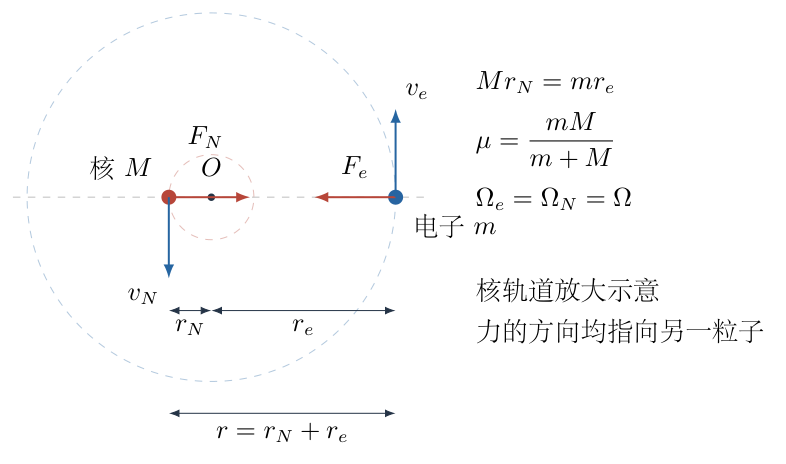
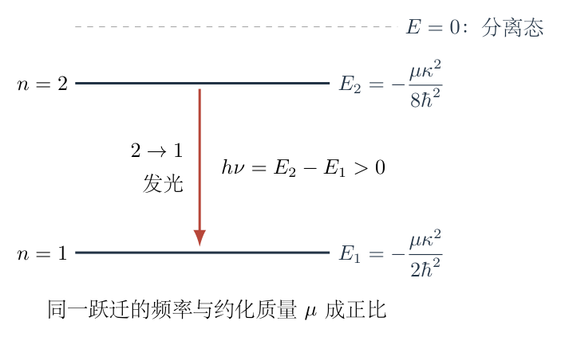

# 第 8 题

<!-- question-start -->

采用玻尔原子模型，计算氢原子 ${}^{1}_{1}\mathrm H$ 与氘原子 ${}^{2}_{1}\mathrm H$ 从第一激发态跃迁到基态所发光子频率的相对差 $\delta\nu/\nu$。已知电子静能为 $m_ec^2=0.51\,\mathrm{MeV}$，氢核与氘核质量近似满足

$$
M_{\mathrm H}c^2\simeq\frac12M_{\mathrm D}c^2=938\,\mathrm{MeV}.
$$

提示：考虑原子核运动时，量子化条件是核与电子组成的体系关于质心的总角动量为 $n\hbar$。

<!-- question-end -->

## 一、题型定位

本题是玻尔模型中的两体运动与同位素频移。电子与原子核都绕质心运动，不能将原子核视为严格固定。有限核质量使轨道尺度和能级中的质量参数由电子质量 $m_e$ 改为约化质量；两种同位素核质量不同，因而对应跃迁频率略有差别。

第一激发态是 $n=2$，基态是 $n=1$。相对差应先说明分母。下文取氢的频率为基准，定义 $\delta\nu=\nu_{\mathrm D}-\nu_{\mathrm H}$、$\nu=\nu_{\mathrm H}$；两者差为正，代表氘发出的频率略高。

## 二、知识点

- 孤立核—电子体系在质心系中动量相反，两个轨道半径与质量成反比。
- 总角动量是电子角动量与核角动量之和，不能只量子化电子角动量。
- 约化质量 $\mu=m_eM/(m_e+M)$ 同时描述相对运动动能与相对运动角动量。
- 库仑向心力、玻尔角动量量子化与负的束缚态能量。
- 光子能量 $h\nu$ 等于跃迁前后原子内能差。
- 同位素频率比中公共常量抵消，可用精确分式与小参数展开交叉检查。

## 三、物理图像

令核质量为一般的 $M$，电子质量简记为 $m=m_e$，核与电子间距离为 $r$。它们绕共同质心 $O$ 作同一角速度的圆周运动，电子到质心的距离记为 $r_e$，核到质心的距离记为 $r_N$。两者位于质心两侧，满足

$$
r_e+r_N=r,\qquad mr_e=Mr_N.
$$

核质量越大，质心越接近核，核的轨道越小；$M\to\infty$ 时才退化为固定核模型。氘核约为氢核的两倍重，其约化质量更接近 $m$，故束缚能绝对值与跃迁能量都稍大。

题给的 $0.51\,\mathrm{MeV}$ 和 $938\,\mathrm{MeV}$ 是静能 $mc^2$、$Mc^2$。求质量比时共同的 $c^2$ 消去，因此可以直接相除；它们不能作为未除以 $c^2$ 的国际单位质量代入向心力方程。

## 四、解题入口

先解出 $r_e$、$r_N$ 与 $r$ 的关系，再把两者角动量和动能分别相加。只有这一步明确得到相同的约化质量，后面将玻尔模型中的质量改为 $\mu$ 才有依据。

随后联立库仑力与总角动量量子化条件求 $r_n$、$E_n$，取 $E_2-E_1$ 求频率。最后在同一公式中分别令 $M=M_{\mathrm H}$、$M=M_{\mathrm D}\simeq2M_{\mathrm H}$，直接求比值，避免先计算两个十分接近的大频率再相减。

## 五、解析

（1）求质心轨道半径与共同角速度。

在图8-1中，$r_N$、$r_e$ 都从质心 $O$ 量起，$r$ 从核量到电子；速度箭头与各自圆周相切。图仅说明位置及方向，核轨道为便于识别放大表示。下面用图中的距离关系确定精确比例。

由 $mr_e=Mr_N$，有 $r_N=(m/M)r_e$。代入 $r=r_e+r_N$：

$$
\begin{aligned}
r&=r_e\left(1+\frac mM\right),\\
r_e&=\frac{M}{M+m}r,\\
r_N&=\frac{m}{M+m}r.
\end{aligned}
$$

记共同角速度为 $\Omega$，则速率为

$$
v_e=\Omega r_e,\qquad v_N=\Omega r_N.
$$

因两者的瞬时速度方向相反，核相对电子的速率大小为两速率之和：

$$
v_{\rm rel}=v_e+v_N=\Omega(r_e+r_N)=\Omega r.
$$

这不是把同向速度相加，而是对反向运动的两个质点取相对速度的大小；下面的 $v_{\rm rel}$ 一直指核—电子距离矢量转动的速率。

（2）分别相加核与电子的角动量、动能。

两个位置矢量相反，两个速度矢量也相反，所以二者的 $\boldsymbol r\times m\boldsymbol v$ 方向相同，总角动量大小是相加，而非相减：

$$
J=m r_e^2\Omega+M r_N^2\Omega.
$$

将上一段轨道半径代入：

$$
\begin{aligned}
J
&=\left[
\frac{mM^2}{(M+m)^2}
+\frac{Mm^2}{(M+m)^2}
\right]r^2\Omega\\
&=\frac{mM(M+m)}{(M+m)^2}r^2\Omega\\
&=\frac{mM}{M+m}r^2\Omega.
\end{aligned}
$$

定义约化质量

$$
\boxed{\mu=\frac{mM}{M+m}},
$$

于是

$$
\boxed{J=\mu r^2\Omega=\mu r v_{\rm rel}}.
$$

同样，体系总动能为

$$
\begin{aligned}
K
&=\frac12m\Omega^2r_e^2+\frac12M\Omega^2r_N^2\\
&=\frac12\left[m\left(\frac M{M+m}\right)^2
+M\left(\frac m{M+m}\right)^2\right]\Omega^2r^2\\
&=\frac12\mu\Omega^2r^2
=\frac12\mu v_{\rm rel}^2.
\end{aligned}
$$

因此约化质量不是只出现在某一个公式中的修正，它使相对运动的角动量与总动能具有一致的单粒子形式。

（3）建立相对运动的向心力方程。

两种原子核电荷都为 $+e$，电子电荷为 $-e$，库仑力大小相同。令

$$
\kappa=\frac{e^2}{4\pi\varepsilon_0},
\qquad F=\frac{\kappa}{r^2}.
$$

直接对电子列向心力方程：

$$
\frac{\kappa}{r^2}=m\Omega^2r_e.
$$

由 $mr_e=mMr/(M+m)=\mu r$，得到

$$
\frac{\kappa}{r^2}=\mu\Omega^2r
=\frac{\mu v_{\rm rel}^2}{r}.
$$

对核列式 $F=M\Omega^2r_N$ 也得到同一结果，因为 $Mr_N=\mu r$。由此可得

$$
\boxed{\mu v_{\rm rel}^2=\frac{\kappa}{r}}.
$$

这里核与电子所受库仑力是同一对作用与反作用力；总角动量虽然有两项，库仑势能仍只有一项 $-\kappa/r$，不能再乘2。

（4）由量子化条件求轨道半径与能级。

按题目提示，体系总角动量满足

$$
\mu r_n v_n=n\hbar,
\qquad n=1,2,\ldots,
$$

其中 $v_n$ 是相对运动速率。先解出

$$
v_n=\frac{n\hbar}{\mu r_n}.
$$

代入向心力关系，逐步消去速率：

$$
\begin{aligned}
\mu\left(\frac{n\hbar}{\mu r_n}\right)^2&=\frac{\kappa}{r_n},\\
\frac{n^2\hbar^2}{\mu r_n^2}&=\frac{\kappa}{r_n},\\
n^2\hbar^2&=\mu\kappa r_n,\\
r_n&=\boxed{\frac{n^2\hbar^2}{\mu\kappa}}.
\end{aligned}
$$

束缚态总能量是核与电子总动能加相互作用势能：

$$
\begin{aligned}
E_n
&=K+U
=\frac12\mu v_n^2-\frac{\kappa}{r_n}\\
&=\frac12\frac{\kappa}{r_n}-\frac{\kappa}{r_n}
=-\frac{\kappa}{2r_n}\\
&=\boxed{-\frac{\mu\kappa^2}{2n^2\hbar^2}}.
\end{aligned}
$$

负号表示以无限远分离、相对静止的核与电子为零能量时，原子为束缚态。更大的 $\mu$ 对应更小的 $r_n$ 和更负的 $E_n$，不是能级整体向更高能量移动。

（5）从第一激发态到基态的光子频率。

图8-2以分离态为能量零点，$E_2$ 在 $E_1$ 上方。箭头向下表示原子内能减少，箭头旁正的 $h\nu$ 表示光子带走的能量；两者不能混用符号。

第一激发态为 $n=2$，因此

$$
E_2=-\frac{\mu\kappa^2}{8\hbar^2},
\qquad
E_1=-\frac{\mu\kappa^2}{2\hbar^2}.
$$

由光子能量关系，

$$
\begin{aligned}
h\nu
&=E_2-E_1\\
&=-\frac{\mu\kappa^2}{8\hbar^2}
+\frac{\mu\kappa^2}{2\hbar^2}\\
&=\frac{3\mu\kappa^2}{8\hbar^2}.
\end{aligned}
$$

所以

$$
\boxed{\nu=\frac{3\kappa^2}{8h\hbar^2}\mu}.
$$

前面的系数对氢、氘相同，因为二者核电荷相同、跃迁的两个量子数相同。差别只在 $\mu$，所以无需知道 $e$、$\varepsilon_0$、$h$ 的数值就能求频率的相对差。

（6）先求精确频率比，再代入质量比。

令 $M=M_{\mathrm H}$，采用题给近似 $M_{\mathrm D}=2M$。两种约化质量分别为

$$
\mu_{\mathrm H}=\frac{mM}{M+m},
\qquad
\mu_{\mathrm D}=\frac{2mM}{2M+m}.
$$

因为 $\nu\propto\mu$，频率比为

$$
\begin{aligned}
\frac{\nu_{\mathrm D}}{\nu_{\mathrm H}}
&=\frac{\mu_{\mathrm D}}{\mu_{\mathrm H}}\\
&=\frac{2mM}{2M+m}\frac{M+m}{mM}\\
&=\frac{2(M+m)}{2M+m}.
\end{aligned}
$$

分子比分母多 $m$，因此 $\nu_{\mathrm D}>\nu_{\mathrm H}$。按以氢为基准的相对差定义：

$$
\begin{aligned}
\frac{\delta\nu}{\nu_{\mathrm H}}
&=\frac{\nu_{\mathrm D}}{\nu_{\mathrm H}}-1\\
&=\frac{2(M+m)-(2M+m)}{2M+m}\\
&=\boxed{\frac{m}{2M+m}}.
\end{aligned}
$$

把分子分母同时乘以 $c^2$，便可以使用题给静能：

$$
\begin{aligned}
\frac{\delta\nu}{\nu_{\mathrm H}}
&=\frac{mc^2}{2Mc^2+mc^2}\\
&=\frac{0.51}{2\times938+0.51}\\
&=\frac{0.51}{1876.51}\\
&\approx2.71781\times10^{-4}.
\end{aligned}
$$

故按题给数据的有效数字，

$$
\boxed{\frac{\delta\nu}{\nu}\simeq2.7\times10^{-4}\simeq0.027\%},
\qquad\nu_{\mathrm D}>\nu_{\mathrm H}.
$$

（7）用另一种差分与展开核验。

直接相减两个约化质量，保持通分步骤：

$$
\begin{aligned}
\mu_{\mathrm D}-\mu_{\mathrm H}
&=\frac{2mM(M+m)-mM(2M+m)}{(2M+m)(M+m)}\\
&=\frac{m^2M}{(2M+m)(M+m)}.
\end{aligned}
$$

再除以 $\mu_{\mathrm H}=mM/(M+m)$，仍得到 $m/(2M+m)$，与先求比值的方法相同。

令小参数 $\epsilon=m/M$，则精确结果为

$$
\frac{\delta\nu}{\nu_{\mathrm H}}
=\frac{\epsilon}{2+\epsilon}
=\frac\epsilon2\frac1{1+\epsilon/2}.
$$

利用 $1/(1+z)=1-z+z^2-\cdots$，展开至二阶：

$$
\frac{\delta\nu}{\nu_{\mathrm H}}
=\frac\epsilon2-\frac{\epsilon^2}{4}+O(\epsilon^3).
$$

其中 $\epsilon=0.51/938\simeq5.44\times10^{-4}$。一阶结果 $\epsilon/2\simeq2.71855\times10^{-4}$ 与精确结果仅相差约 $7.4\times10^{-8}$，在题给质量的精度下都表示为 $2.7\times10^{-4}$。

若相对差改以氘频率为分母，则

$$
\frac{\delta\nu}{\nu_{\mathrm D}}
=\frac{m}{2(M+m)}.
$$

它与以氢为分母的表达式在二阶才出现差别。一阶时两者都为 $m/(2M)$，所以在最终近似答案里可统一写成 $\delta\nu/\nu\simeq m/(2M)$，但精确计算必须交代分母。

（8）检查固定核极限与模型适用范围。

当 $M\to\infty$ 时，$\mu\to m$，$r_N\to0$，$r_n$、$E_n$ 都退化为通常的固定核玻尔结果；此时两同位素若都按无限核质量处理，其频移为零。有限质量修正正是题目保留核运动的原因。

当 $M$ 增大时，

$$
\frac{d\mu}{dM}=\frac{m^2}{(M+m)^2}>0,
$$

因此同一跃迁的频率随核质量增加而增大，符合上面求出的正号。量纲方面，$\kappa$ 的单位为能量乘长度，$\mu\kappa^2/\hbar^2$ 为能量，再除以 $h$ 才是频率；相对差 $m/(2M+m)$ 无量纲。

本题在非相对论玻尔模型内计算核的轨道运动对能级的修正；没有另加入精细结构、核尺寸等效应。核与电子的两体圆周运动已经包含在 $\mu$ 中，不能在得到约化质量后再重复扣除一份同样的“核动能修正”。

## 六、关键洞察

与核运动有关的三个量同时改变：电子的质心轨道半径、核的质心轨道半径，以及体系总角动量。仅补上核动能、却仍将电子角动量写成 $n\hbar$，会使力学条件和量子化条件彼此不一致。

两同位素的相对频移与跃迁选择无关，只要核电荷相同、量子数相同，任意玻尔跃迁能量都正比于约化质量。第一激发态到基态的 $3/4$ 能级差因子在频率比中消去；这个规律也可用作另一条核验。

发光时原子整体的动量反冲与核—电子内部轨道的有限质量修正是不同效应。若进一步考虑整体反冲，静止原子发光后光子动量约为 $h\nu/c$，原子平动动能约为 $(h\nu)^2/(2M_{\rm atom}c^2)$，能量守恒变为 $\Delta E=h\nu+(h\nu)^2/(2M_{\rm atom}c^2)$。其相对修正量约为光子能量与原子静能之比的一半，远小于本题的 $m/M$ 级修正；本题没有要求在玻尔模型结果之外再计算它。

## 七、易错点

- 将第一激发态当作 $n=1$，混淆基态与激发态。对应跃迁是 $2\to1$。
- 以电子绕质心的半径 $r_e$ 代替库仑力中的核—电子距离 $r$。
- 因两速度反向就把两角动量相减。位置矢量也反向，角动量方向实际相同。
- 只使用电子角动量量子化，遗漏题目强调的体系总角动量。
- 总动能计入两项后又把库仑势能加两次。核—电子相互作用势能只有一项。
- 把 $E_1-E_2<0$ 当作发出光子的能量；正的发光能量是 $E_2-E_1$。
- 两原子核电荷相同就判断频率完全相同，忽略质量导致的约化质量差。
- 精确相对差没有说明分母，或误把无量纲的 $2.7\times10^{-4}$ 写成 $2.7\times10^{-4}\%$。

## 八、课堂讲解建议

先在图8-1上只标质心、两个半径与两速度，不先给约化质量。让学生用质心条件求半径比，再把动能和角动量分别相加，亲自看到同一个 $mM/(m+M)$ 出现在两处。

板书能级时始终以核—电子分离态为零能量，并把光子能量写在向下跃迁箭头旁。要求学生先判断氘频率更大还是更小，再开始质量比化简；最终用 $d\mu/dM>0$ 回查判断。

相对频移可安排两条核验：先求频率比再减1；先通分相减约化质量再除以基准值。最后比较精确式与一阶展开，说明为何没有必要把题给两位有效数字的电子静能计算成过多小数位的最终答案。

## 九、变式训练

若同核电荷的第二种同位素核质量为 $\eta M$，其中 $\eta>1$，两原子完成相同的 $n_i\to n_f$ 跃迁，求以核质量 $M$ 的原子为基准的相对频移；再求两原子同一量子数轨道的核—电子距离之比。

一般跃迁能量为

$$
\Delta E
=\frac{\mu\kappa^2}{2\hbar^2}
\left(\frac1{n_f^2}-\frac1{n_i^2}\right),
\qquad n_i>n_f.
$$

量子数括号因子在两原子频率比中消去。令 $\epsilon=m/M$，两约化质量为

$$
\mu_1=\frac{m}{1+\epsilon},
\qquad
\mu_2=\frac{m}{1+\epsilon/\eta}.
$$

所以

$$
\begin{aligned}
\frac{\nu_2-\nu_1}{\nu_1}
&=\frac{1+\epsilon}{1+\epsilon/\eta}-1\\
&=\frac{\epsilon(1-1/\eta)}{1+\epsilon/\eta}\\
&=\boxed{\frac{(\eta-1)m}{\eta M+m}}.
\end{aligned}
$$

当 $\eta=2$ 时得到本题的 $m/(2M+m)$。当 $\eta\to1$ 时两质量相同，频移为零；当 $\eta\to\infty$ 时第二原子趋于固定核极限，相对频移趋于 $m/M$，即第一原子距离固定核近似的全部一阶修正。

轨道距离 $r_n\propto1/\mu$，因此

$$
\frac{r_{n,2}}{r_{n,1}}
=\frac{\mu_1}{\mu_2}
=\frac{1+\epsilon/\eta}{1+\epsilon}<1.
$$

较重同位素的轨道更小，与其能级绝对值更大互相对应。注意这里比较的是核—电子间距；电子自身到质心的半径还要再乘 $M/(M+m)$。代入 $r_{e,n}=Mr_n/(M+m)$，进一步得到

$$
r_{e,n}
=\frac{M}{M+m}\frac{n^2\hbar^2}{\mu\kappa}
=\frac{n^2\hbar^2}{m\kappa}.
$$

在这一圆轨道玻尔模型中，相同 $n$ 下电子到质心的半径竟与核质量无关，变化来自核轨道半径及共同角速度。这个结果不能由“重核使电子离质心更近”的直觉替代，必须同时代入质心比例与量子化轨道距离才能看清。
