# 第 1 题

<!-- question-start -->

如图，一个长半轴为 $a$、短半轴为 $b$ 的轻质椭圆塑料板竖立在粗糙水平桌面上，椭圆上焦点处嵌有一个质量为 $m$ 的质点。受到微小扰动后，椭圆板在桌面上向右滚动，先后经过状态I、II、III。已知整个滚动过程中始终没有相对滑动，接触处也始终不离开桌面。重力加速度为 $g$。

（1）在状态III，求质点 $C$ 的速度大小 $v_C$、加速度大小 $a_C$ 和桌面对系统的支持力 $N$。

（2）取水平向右为 $x$ 轴正方向、竖直向上为 $y$ 轴正方向。在状态II，求质点速度分量 $v_{Cx}$、$v_{Cy}$，加速度分量 $a_{Cx}$、$a_{Cy}$，以及桌面对系统的支持力 $N$ 和摩擦力 $f$。

<!-- question-end -->

## 一、题型定位

本题是“非圆形刚体纯滚动与质点轨迹”问题。椭圆板本身质量可忽略，全部惯性和重力都来自焦点处的质点；但质点并不是绕一个固定点作圆周运动。椭圆每转过一个角度，板的几何中心高度、瞬时接触点和焦点相对桌面的位置都会同时改变，所以必须先确定焦点相对地面的真实轨迹，再用能量和轨迹曲率求速度、加速度，最后由牛顿第二定律求支持力和摩擦力。

状态III的焦点轨迹处于局部最低点，加速度只有法向分量；状态II则恰好相反：焦点轨迹在该点的曲率为零，加速度只有切向分量。识别这两个特殊几何性质，是把复杂滚动问题化简的关键。

## 二、知识点

- 椭圆焦距参数 $c=\sqrt{a^2-b^2}$。
- 纯滚动时，瞬时接触点的速度为零；接触力对整个系统的瞬时功率为零。
- 轻质板与单个质点组成的系统，其动能只有 $\tfrac12mv_C^2$，不能擅自加入椭圆板的转动动能。
- 曲线运动的加速度分解：$a_n=v^2/\rho$，$a_t=dv/dt$。
- 平面曲线 $\boldsymbol r(\alpha)=(x(\alpha),y(\alpha))$ 的曲率

$$
\kappa=
\frac{|x'y''-y'x''|}{(x'^2+y'^2)^{3/2}},
\qquad \rho=\frac1\kappa.
$$

- 非圆形物体滚动时，几何中心的高度并非常量；需要使用椭圆在竖直方向的支承距离。
- 接触力不做功不等于接触力为零。支持力和摩擦力仍由平动方程及力矩关系决定。

## 三、物理图像

记椭圆焦距为

$$
\boxed{c=\sqrt{a^2-b^2}},\qquad 0<c<a.
$$

用 $\alpha$ 表示椭圆板从状态I开始顺时针转过的角度。于是

$$
\alpha_{\mathrm{I}}=0,
\qquad
\alpha_{\mathrm{II}}=\frac\pi2,
\qquad
\alpha_{\mathrm{III}}=\pi.
$$

椭圆长轴与竖直方向夹角为 $\alpha$ 时，几何中心 $O$ 到桌面的竖直距离为

$$
h(\alpha)
=\sqrt{a^2\cos^2\alpha+b^2\sin^2\alpha}
=\sqrt{b^2+c^2\cos^2\alpha}.
$$

焦点 $C$ 相对几何中心的位矢在状态I为竖直向上，随板顺时针转动后，其竖直分量为 $c\cos\alpha$。因此质点的高度为

$$
\boxed{y_C(\alpha)=h(\alpha)+c\cos\alpha}.
$$

三个特殊位置的高度立即得到

$$
y_{\mathrm{I}}=a+c,
\qquad
y_{\mathrm{II}}=b,
\qquad
y_{\mathrm{III}}=a-c.
$$

状态I到III的质点高度降低 $2c$；状态I到II的质点高度降低 $a+c-b$。这些高度差直接决定两处速度。

## 四、解题入口

先利用接触力不做功写机械能守恒，求状态II和III的速率。速度分量和加速度不能只靠椭圆外形判断，需要进一步求焦点轨迹的切线与曲率。

纯滚动给出一个很有用的几何关系。板顺时针转过 $d\alpha$ 时，几何中心的水平位移为

$$
dx_O=h(\alpha)\,d\alpha.
$$

焦点相对中心的水平坐标为 $c\sin\alpha$，所以

$$
\frac{dx_C}{d\alpha}
=h(\alpha)+c\cos\alpha
=y_C(\alpha).
$$

也就是说，只要求出 $y_C$ 及其对 $\alpha$ 的导数，就能同时得到焦点轨迹的 $x$、$y$ 两个方向导数：

$$
x_C'=y_C,
\qquad
x_C''=y_C'.
$$

随后在 $\alpha=\pi$ 和 $\alpha=\pi/2$ 分别代入曲率公式。

## 五、解析

图1-2把两处需要使用的几何量、速度方向和接触力画在同一坐标约定下。状态III使用左侧的 $y_C=a-c$ 和曲率方向；状态II使用右侧的 $y_C=b$、$x_C'=b$、$y_C'=-c$ 建立速度分量，最后用图中接触点处的 $N$、$f$ 写动力学方程。

先说明能量为什么守恒。桌面固定，纯滚动时瞬时接触点 $P$ 的速度为零，因此支持力和静摩擦力的瞬时功率都为零。椭圆板质量可忽略，系统动能只有质点的动能。因此从近于静止的状态I释放后，在任意位置都有

$$
\frac12mv_C^2+mg y_C=mg(a+c).
$$

质量 $m$ 在求速度时约去。

（1）求状态III的速度。

状态III有 $y_C=a-c$。代入机械能守恒式：

$$
\begin{aligned}
\frac12m v_C^2+mg(a-c)
&=mg(a+c),\\
\frac12m v_C^2
&=mg\bigl[(a+c)-(a-c)\bigr]\\
&=2mgc.
\end{aligned}
$$

所以

$$
\boxed{v_C=2\sqrt{gc}}.
$$

这里的 $v_C$ 是焦点处质点相对地面的速度，不是椭圆几何中心的速度。状态III的瞬时接触点到质点的距离为 $a-c$，若记板在该瞬间的角速度大小为 $\omega_{\mathrm{III}}$，也有

$$
v_C=(a-c)\omega_{\mathrm{III}}.
$$

这一关系只用于该瞬间，不能把 $a-c$ 当作整段运动中不变的转动半径。

接下来求状态III焦点轨迹的曲率。先计算支承距离 $h$ 的导数。由

$$
h^2=b^2+c^2\cos^2\alpha
$$

对 $\alpha$ 求导：

$$
2hh'=-2c^2\sin\alpha\cos\alpha,
$$

从而

$$
h'=-\frac{c^2\sin\alpha\cos\alpha}{h}.
$$

在 $\alpha=\pi$ 处，$h=a$、$h'=0$。再对上式求导，含有 $\sin\alpha$ 的项在此处消失，得到

$$
h''(\pi)=-\frac{c^2}{a}.
$$

由于 $y_C=h+c\cos\alpha$，所以

$$
\begin{aligned}
y_C(\pi)&=a-c,\\
y_C'(\pi)&=h'(\pi)-c\sin\pi=0,\\
y_C''(\pi)&=h''(\pi)-c\cos\pi\\
&=-\frac{c^2}{a}+c\\
&=\frac{c(a-c)}{a}.
\end{aligned}
$$

再利用 $x_C'=y_C$、$x_C''=y_C'$，可得

$$
x_C'(\pi)=a-c,
\qquad
x_C''(\pi)=0.
$$

代入曲率公式：

$$
\begin{aligned}
\kappa_{\mathrm{III}}
&=\frac{|x_C'y_C''-y_C'x_C''|}
{(x_C'^2+y_C'^2)^{3/2}}\\
&=\frac{(a-c)\,c(a-c)/a}{(a-c)^3}\\
&=\frac{c}{a(a-c)}.
\end{aligned}
$$

于是焦点轨迹在状态III的曲率半径为

$$
\boxed{\rho_{\mathrm{III}}=\frac{a(a-c)}{c}}.
$$

状态III是焦点轨迹的最低点，切线水平，重力沿切线方向的分量为零，故切向加速度为零。加速度只有竖直向上的法向分量：

$$
\begin{aligned}
a_C
&=\frac{v_C^2}{\rho_{\mathrm{III}}}\\
&=\frac{4gc}{a(a-c)/c}\\
&=\frac{4gc^2}{a(a-c)}.
\end{aligned}
$$

将 $c^2=a^2-b^2$ 代回，可写成题给量：

$$
\boxed{
a_C=\frac{4g(a^2-b^2)}
{a\bigl(a-\sqrt{a^2-b^2}\bigr)}
}
\qquad\text{（方向竖直向上）}.
$$

在状态III，质点、接触点和椭圆中心在同一竖直线上。水平方向加速度为零，因此摩擦力为零。竖直方向列牛顿第二定律：

$$
N-mg=ma_C.
$$

所以

$$
\begin{aligned}
N
&=m(g+a_C)\\
&=mg\left[1+\frac{4c^2}{a(a-c)}\right].
\end{aligned}
$$

即

$$
\boxed{
N=mg\left[
1+\frac{4(a^2-b^2)}
{a\bigl(a-\sqrt{a^2-b^2}\bigr)}
\right].
}
$$

（2）求状态II的速度分量。

状态II的质点高度为 $b$。由机械能守恒：

$$
\begin{aligned}
\frac12m v_C^2+mgb&=mg(a+c),\\
v_C^2&=2g(a+c-b).
\end{aligned}
$$

因此

$$
v_C=\sqrt{2g(a+c-b)}.
$$

为了分解速度，需要求轨迹切线。状态II对应 $\alpha=\pi/2$。此时

$$
h=b,
\qquad h'=0,
\qquad y_C=b,
\qquad y_C'=-c.
$$

因 $x_C'=y_C$，轨迹切向量为 $(x_C',y_C')=(b,-c)$。它的长度和对应的单位切向量依次为

$$
\begin{aligned}
\sqrt{b^2+c^2}
&=\sqrt{b^2+a^2-b^2}=a,\\
\boldsymbol e_t&=\frac1a(b,-c).
\end{aligned}
$$

将速率乘以单位切向量，两个速度分量同时得到

$$
\boxed{
v_{Cx}=\frac ba\sqrt{2g(a+c-b)}
},
\qquad
\boxed{
v_{Cy}=-\frac ca\sqrt{2g(a+c-b)}
}.
$$

负号表示质点在状态II仍向下运动。

下面证明状态II的焦点轨迹曲率为零，而不是直接把加速度写成 $v_C^2/b$。在 $\alpha=\pi/2$ 处，由 $h^2=b^2+c^2\cos^2\alpha$ 得

$$
h''\left(\frac\pi2\right)=\frac{c^2}{b}.
$$

于是

$$
\begin{aligned}
y_C\left(\frac\pi2\right)&=b,\\
y_C'\left(\frac\pi2\right)&=-c,\\
y_C''\left(\frac\pi2\right)&=\frac{c^2}{b},\\
x_C'\left(\frac\pi2\right)&=b,\\
x_C''\left(\frac\pi2\right)&=-c.
\end{aligned}
$$

曲率公式的分子为

$$
\begin{aligned}
x_C'y_C''-y_C'x_C''
&=b\cdot\frac{c^2}{b}-(-c)(-c)\\
&=c^2-c^2=0.
\end{aligned}
$$

因此

$$
\boxed{\kappa_{\mathrm{II}}=0},
\qquad
\rho_{\mathrm{II}}=\infty.
$$

状态II没有法向加速度，加速度完全沿轨迹切线。对能量关系 $\tfrac12mv_C^2+mgy_C=\text{常量}$ 求时间导数：

$$
mv_C\frac{dv_C}{dt}+mg\frac{dy_C}{dt}=0.
$$

又因为 $dy_C/dt=v_C(e_t)_y$，且 $(e_t)_y=-c/a$，所以切向加速度为

$$
\begin{aligned}
\frac{dv_C}{dt}
&=-g(e_t)_y\\
&=\frac{gc}{a}.
\end{aligned}
$$

将它乘以单位切向量，再分别读取两个坐标分量：

$$
\boldsymbol a_C
=\frac{gc}{a}\cdot\frac1a(b,-c),
\qquad
\boxed{a_{Cx}=\frac{gbc}{a^2}},
\qquad
\boxed{a_{Cy}=-\frac{gc^2}{a^2}}.
$$

最后求支持力和摩擦力。把椭圆板与质点作为整体，板质量为零，因此系统总质量为 $m$。状态II水平方向只有静摩擦力，故

$$
\boxed{f=\frac{mgbc}{a^2}}
\qquad\text{（方向水平向右）}.
$$

竖直方向列牛顿第二定律并逐步化简：

$$
N-mg=ma_{Cy}=-\frac{mgc^2}{a^2}.
$$

$$
\begin{aligned}
N
&=mg\left(1-\frac{c^2}{a^2}\right)\\
&=mg\frac{a^2-c^2}{a^2}\\
&=\boxed{\frac{mgb^2}{a^2}}.
\end{aligned}
$$

还可以同时检查轻质板的力矩约束与静摩擦条件。接触点到质点 $C$ 的水平、竖直距离分别为 $c$、$b$，代入所得结果有 $bf-cN=b(mgbc/a^2)-c(mgb^2/a^2)=0$，与轻质板不保留自身角动量完全一致；同时 $|f|/N=c/b$，故状态II局部要求 $\mu_s\ge c/b$。后一条件只是对题设可实现性的局部检查；题目已经假定全程无滑动，因此不需要把它另列为所求答案，也不能据此断言它就是全程所需摩擦系数的最大值。

最后做三项物理自检。第一，所有速度式都含有 $\sqrt{g\times\text{长度}}$，所有加速度式都含有 $g$ 乘无量纲比值，$N$、$f$ 都是 $mg$ 乘无量纲因子，量纲一致。第二，令 $a\to b$，则 $c\to0$，椭圆连续退化为圆，而质点退化到圆心；此时状态I、II、III的质点高度相同，公式相应给出

$$
v_C\to0,
\qquad a_C\to0,
\qquad f\to0,
\qquad N\to mg,
$$

与圆心静止的纯滚动极限相符。第三，当椭圆越来越扁时 $c\to a$，状态III的 $a-c$ 和焦点轨迹曲率半径 $\rho_{\rm III}=a(a-c)/c$ 同时趋近于零，因而法向加速度与支持力迅速增大。这不是代数发散错误，而是在提示“极扁椭圆的焦点轨迹在状态III形成极尖转弯”；真实材料的变形和有限接触区会使理想刚体模型在这一极限附近失效。

## 六、关键洞察

核心并不是椭圆边界本身的曲率，而是焦点随纯滚动形成的轨迹曲率。状态III处椭圆边界的曲率半径为 $b^2/a$，焦点轨迹的曲率半径却是 $a(a-c)/c$；二者描述不同曲线，不能互换。

纯滚动关系 $dx_O=h\,d\alpha$ 与焦点高度 $y_C=h+c\cos\alpha$ 恰好给出 $x_C'=y_C$。这一等式把二维轨迹的求导压缩为对一个函数 $y_C(\alpha)$ 的求导，是本题最有效的几何入口。

状态III与状态II形成鲜明对照：前者轨迹切线水平、切向加速度为零、法向加速度非零；后者轨迹曲率为零、法向加速度为零、切向加速度非零。曲率为零只说明瞬时没有法向加速度，不说明总加速度为零。

## 七、易错点

- 把椭圆几何中心的高度始终写成 $a$ 或 $b$。实际高度为随姿态变化的 $h(\alpha)$。
- 把质点到瞬时接触点的距离当作固定转动半径，用同一个 $v=\omega r$ 贯穿整个过程。
- 把椭圆边界在顶点的曲率半径 $b^2/a$ 当作焦点轨迹曲率半径。
- 在状态II误写 $a_C=v_C^2/b$。焦点轨迹在此处曲率为零，法向加速度正好为零。
- 因为静摩擦不做功就把 $f$ 写成零。状态II的摩擦力不做功，却负责提供水平合力。
- 漏掉 $v_{Cy}$、$a_{Cy}$ 的负号。题设坐标中质点在状态II向右、向下运动，并且加速度也指向右下方。
- 只用平动方程而不检查轻质板的力矩。代入所得 $N$、$f$ 后应满足 $bf=cN$。

## 八、课堂讲解建议

讲解时先让学生分别回答三个问题：质点在I、II、III的高度是多少；接触力为什么不做功；状态II的质点轨迹是否一定“向内弯”。前两个问题自然引出能量法，第三个问题迫使学生放弃凭外形猜曲率。

板书可把整题压缩成两条主线：第一条是 $y_C=h+c\cos\alpha$，负责能量；第二条是 $x_C'=y_C$，负责切线和曲率。到状态II时，应把曲率分子 $bc^2/b-c^2=0$ 单独写出，使“法向加速度为零”有可检查的依据，而不是口头结论。

在求接触力后，可让学生立即做两项反查：量纲是否为力；$bf-cN$ 是否为零。这样能把轻质板的力矩约束与最后答案联系起来。

## 九、变式训练

把焦点处质点改为嵌在长轴上距几何中心为 $d$ 的位置，取 $c^2/a<d<a$；初态仍为该质点在中心正上方，椭圆板从近于静止开始向右纯滚动。求状态III的速率、加速度和支持力，以及状态II的速度、加速度、支持力和摩擦力。这个变式也用于检验“状态II曲率为零”是否是任意长轴内点都具有的性质。

此时只需把焦距 $c$ 改为一般偏心距 $d$。质点高度为

$$
y=h+d\cos\alpha,
$$

状态I、II、III的高度分别为 $a+d$、$b$、$a-d$。

状态III的能量方程为

$$
\frac12mv_{\mathrm{III}}^2=2mgd,
$$

所以

$$
v_{\mathrm{III}}=2\sqrt{gd}.
$$

在状态III，轨迹导数为

$$
\begin{aligned}
x'&=a-d,& y'&=0,\\
x''&=0,& y''&=d-\frac{c^2}{a}=\frac{ad-c^2}{a}.
\end{aligned}
$$

条件 $d>c^2/a$ 保证曲率中心在质点上方。曲率半径和向上的法向加速度依次为

$$
\begin{aligned}
\rho_{\mathrm{III}}
&=\frac{a(a-d)^2}{ad-c^2},\\
a_{\mathrm{III}}
&=\frac{v_{\mathrm{III}}^2}{\rho_{\mathrm{III}}}\\
&=\frac{4gd(ad-c^2)}{a(a-d)^2}.
\end{aligned}
$$

于是

$$
N_{\mathrm{III}}
=mg\left[1+\frac{4d(ad-c^2)}{a(a-d)^2}\right].
$$

状态II的速率为

$$
v_{\mathrm{II}}=\sqrt{2g(a+d-b)}.
$$

记 $q=\sqrt{b^2+d^2}$。轨迹切向量为 $(b,-d)$，故

$$
\begin{aligned}
v_x&=\frac bqv_{\mathrm{II}},\\
v_y&=-\frac dqv_{\mathrm{II}}.
\end{aligned}
$$

这一点的轨迹导数为

$$
\boldsymbol r'=(b,-d),
\qquad
\boldsymbol r''=\left(-d,\frac{c^2}{b}\right).
$$

所以有向曲率为

$$
\kappa
=\frac{bc^2/b-d^2}{q^3}
=\frac{c^2-d^2}{q^3}.
$$

可见只有 $d=c$ 时状态II才是轨迹拐点。沿运动方向的单位切向量和左法向单位向量分别为

$$
\boldsymbol e_t=\frac1q(b,-d),
\qquad
\boldsymbol e_n=\frac1q(d,b).
$$

重力沿切线产生 $a_t=gd/q$，法向加速度的有向大小为 $v_{\mathrm{II}}^2\kappa$。因此

$$
\begin{aligned}
a_x
&=\frac{gbd}{q^2}
+\frac{v_{\mathrm{II}}^2(c^2-d^2)d}{q^4},\\
a_y
&=-\frac{gd^2}{q^2}
+\frac{v_{\mathrm{II}}^2(c^2-d^2)b}{q^4}.
\end{aligned}
$$

由牛顿第二定律得到完整答案 $\boxed{f=ma_x}$、$\boxed{N=m(g+a_y)}$。

最后把一般结果退回本题作一致性检验。取 $d=c=\sqrt{a^2-b^2}$，曲率项 $c^2-d^2$ 消失且 $q=a$；这说明状态II曲率为零确实来自焦点位置的特殊消去，并不是任意长轴内点共有的性质。代入后四个量恰好化为

$$
a_x=\frac{gbc}{a^2},
\quad
a_y=-\frac{gc^2}{a^2},
\quad
f=\frac{mgbc}{a^2},
\quad
N=\frac{mgb^2}{a^2},
$$

一般位置的公式还揭示了两个在焦点特例中被隐藏的分界。首先，状态III的曲率半径含有因子 $ad-c^2$；题设取 $d>c^2/a$，正是为了保证这一点附近的轨迹曲率方向不发生翻转。当 $d\downarrow c^2/a$ 时，$\rho_{\rm III}\to\infty$，虽然质点仍有非零速率，但该瞬间的法向加速度趋于零。其次，状态II的有向曲率正比于 $c^2-d^2$：若 $d<c$，轨迹向左法向弯曲；若 $d=c$，状态II成为拐点；若 $d>c$，曲率改变符号，法向加速度随之转向。由此可见，原题中“曲率恰为零”不是一个可忽略的小技巧，而是质点恰好位于焦点所导致的结构性简化。

这些结论也给出直接的符号检查：$v_{\rm III}^2=4gd>0$；在本变式规定的 $d>c^2/a$ 范围内，$N_{\rm III}>mg>0$；状态II则必须保留曲率项的正负号后再代入 $N=m(g+a_y)$，不能先把法向加速度一律写成正的 $v^2/\rho$。

\newpage

# 第 2 题

<!-- question-start -->

在光滑水平桌面上放置一块质量为 $m_1$ 的木板，木板右端放有质量为 $m_2$ 的木块。木块用劲度系数为 $k$ 的轻质弹簧与左侧墙壁连接，弹簧初始未伸长。木板通过不可伸长的轻绳、定滑轮与质量为 $M$ 的悬挂重物连接。开始时系统静止，木块与木板之间的摩擦系数为 $\mu$。

求木块相对地面移动多大距离 $L$ 后开始相对木板滑动，并求木块移动距离 $L$ 所需的时间。需要对不同的 $\mu$ 分情况讨论。重力加速度为 $g$。

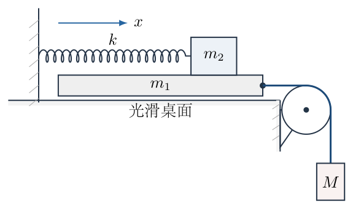

<!-- question-end -->

## 一、题型定位

本题是静摩擦约束下的受迫简谐运动与临界失稳问题。关键不是一开始就把摩擦力写成 $\mu m_2g$，而是先假设木块与木板共同运动，求维持这一约束实际需要多大的静摩擦力，再与最大静摩擦力比较。

所需摩擦力随弹簧伸长量单调增大，因此会出现三种物理情况：初始时约束就不能成立；约束先成立、运动到某一位置后失效；在整个往复运动中约束始终成立。两个临界等号的归属并不相同，必须单独判断。

## 二、知识点

- 静摩擦力是约束力，实际大小由共同运动条件决定，只满足 $|f|\leq\mu N$。
- 不滑动阶段，木块、木板和悬挂重物具有相同的位移大小、速度大小和加速度大小。
- 平衡位置平移后的简谐运动。
- 用能量或运动方程确定最大弹簧伸长量。
- 由临界摩擦条件求首次相对滑动的位置。
- 反余弦函数给出从端点释放后第一次到达指定位移的时间。

## 三、物理图像

取木板和木块向右为正方向，悬挂物向下为正方向。用 $x$ 表示木块相对地面的位移；在尚未滑动时，$x$ 同时也是木板向右的位移、悬挂物向下的位移和弹簧伸长量。

记共同运动阶段的总惯性质量为

$$
\mathcal M=M+m_1+m_2.
$$

悬挂重物提供恒定驱动力 $Mg$，弹簧提供随 $x$ 增大的反向力 $kx$，所以共同加速度会由正逐渐变为负。与此同时，为了让木块跟随木板，木板对木块的静摩擦力始终指向右方，而且所需大小随 $x$ 线性增大。

共同运动阶段的轨迹由静摩擦约束保证。需要先求出这条轨迹，再检验约束能维持到哪里；一旦发生滑动，下面的共同运动方程便不再适用。

## 四、解题入口

先在“不发生相对滑动”的假设下列方程。对三个物体组成的系统沿运动方向列牛顿第二定律，可消去绳张力和木块、木板间的内摩擦力；再单独对木块列方程，就能反推出维持共同运动所需的摩擦力。

然后求共同运动所能达到的最大位移 $x_{\max}$。因为所需静摩擦随 $x$ 单调增加，只需比较 $x=0$ 和 $x=x_{\max}$ 两端的需求，就能确定三个参数区间。中间区间的交点就是 $L$，再由简谐运动方程求首次到达该位置的时间。

## 五、解析

（1）先假设木块与木板保持相对静止。

不滑动时，三个物体的有向加速度相同，记为 $a=\ddot x$；木板、木块取向右为正，重物取向下为正。

这里的加速度关系来自两个不同的约束。设木板位移为 $x_1$、木块位移为 $x_2$，悬挂物向下的位移为 $y$。木块尚未滑动时 $x_2=x_1$。图2-1中定滑轮位置固定，木板右移会使水平绳段缩短 $x_1$，重物下降会使竖直绳段增长 $y$，绕轮部分长度固定。绳不可伸长，故

$$
-x_1+y=0,
\qquad x_1=x_2=y=x.
$$

分别对时间求一阶、二阶导数，就得到三者的速度与加速度关系。设绳张力为 $\mathcal T$，对三个研究对象分别列式：

$$
\begin{aligned}
\text{木块：}\quad &f_{\rm req}-kx=m_2\ddot x,\\
\text{木板：}\quad &\mathcal T-f_{\rm req}=m_1\ddot x,\\
\text{重物：}\quad &Mg-\mathcal T=M\ddot x.
\end{aligned}
$$

木板所受摩擦向左，是木块所受向右摩擦的反作用力。三式相加时，$+f_{\rm req}$ 与 $-f_{\rm req}$、$+\mathcal T$ 与 $-\mathcal T$ 各自抵消，剩下

$$
Mg-kx=\mathcal M a.
$$

所以共同加速度为

$$
\boxed{a=\frac{Mg-kx}{\mathcal M}}.
$$

弹簧直接拉木块向左。为使木块随木板共同向右运动，木板对木块的摩擦力应向右，记其大小为 $f_{\rm req}$。对木块列水平方向方程：

$$
f_{\rm req}-kx=m_2a.
$$

代入共同加速度：

$$
\begin{aligned}
f_{\rm req}
&=m_2\frac{Mg-kx}{\mathcal M}+kx\\
&=\frac{m_2Mg-m_2kx+\mathcal M kx}{\mathcal M}\\
&=\frac{m_2Mg+(M+m_1)kx}{\mathcal M}.
\end{aligned}
$$

因此维持共同运动所需的摩擦系数为

$$
\boxed{
\mu_{\rm req}(x)
=\frac{f_{\rm req}}{m_2g}
=\frac{m_2Mg+(M+m_1)kx}{m_2g\mathcal M}
}.
$$

它是 $x$ 的一次函数，斜率为

$$
\frac{d\mu_{\rm req}}{dx}
=\frac{(M+m_1)k}{m_2g\mathcal M}>0.
$$

所以在第一次从左端点运动到右端点的过程中，所需静摩擦单调增大。

（2）求初始时刻的临界摩擦系数。

在 $x=0$ 处，弹簧力为零，共同加速度为 $Mg/\mathcal M$。所需摩擦系数为

$$
\boxed{
\mu_0=\mu_{\rm req}(0)
=\frac{M}{\mathcal M}
=\frac{M}{M+m_1+m_2}
}.
$$

若 $\mu<\mu_0$，最大静摩擦力从开始时就不足，木块与木板立即发生相对滑动。

若 $\mu=\mu_0$，初始瞬间恰好达到静摩擦极限；但对任何 $x>0$，都有 $\mu_{\rm req}(x)>\mu_0$。因此共同运动不能维持任何有限位移，仍应归入“立即滑动”：

$$
\boxed{L=0,\qquad t_L=0\quad(\mu\leq\mu_0)}.
$$

（3）求共同运动能够达到的最大弹簧伸长量。

只要没有滑动，接触处是静摩擦，不产生机械能损失。系统从 $x=0$ 静止释放；到任意位移 $x$、共同速率 $v$ 时，悬挂物重力势能的减少量等于弹簧势能与三个物体动能之和：

$$
Mgx=\frac12kx^2+\frac12\mathcal M v^2.
$$

第一次到达右侧转折点时 $v=0$。除去初始根 $x=0$，另一个根满足

$$
Mgx_{\max}=\frac12kx_{\max}^2.
$$

因此

$$
\boxed{x_{\max}=\frac{2Mg}{k}}.
$$

定义平衡位置到初始端点的距离

$$
A=\frac{Mg}{k},
$$

则 $x_{\max}=2A$。

（4）求整个共同运动过程中所需摩擦系数的最大值。

在图2-2中，左图横坐标是共同位移 $x$，纵坐标是维持约束所需的 $\mu_{\rm req}$；右图是第一次向右运动阶段的 $x(t)$。两图通过同一个临界位移 $L$ 联系。左图的交点先确定 $L$，右图的交点再确定 $t_L$，不能把滑动后的轨迹用于计算。

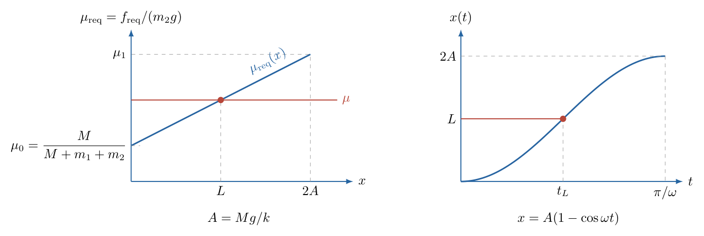

由于 $\mu_{\rm req}(x)$ 随 $x$ 单调增加，最大值出现在 $x=2Mg/k$。代入：

$$
\begin{aligned}
\mu_1
&=\mu_{\rm req}\left(\frac{2Mg}{k}\right)\\
&=\frac{m_2Mg+(M+m_1)k(2Mg/k)}{m_2g\mathcal M}\\
&=\frac{M\,[m_2+2(M+m_1)]}{m_2\mathcal M}\\
&=\boxed{
\frac{M(2m_1+m_2+2M)}
{m_2(M+m_1+m_2)}
}.
\end{aligned}
$$

若 $\mu\geq\mu_1$，全程都有 $f_{\rm req}\leq\mu m_2g$。当 $\mu=\mu_1$ 时，只在转折点瞬间达到极限，随后 $x$ 减小，所需摩擦也减小，因此不会越过摩擦上限。故

$$
\boxed{
\mu\geq\mu_1\quad\Longrightarrow\quad
\text{始终不发生相对滑动}
}.
$$

这一情形不存在有限的“开始滑动距离”和“开始滑动时间”。

（5）求中间参数区间内的首次滑动距离。

当

$$
\mu_0<\mu<\mu_1
$$

时，初始约束能够成立，但在到达最大伸长量之前，所需摩擦会第一次达到上限。令该位移为 $L$，临界条件为

$$
f_{\rm req}(L)=\mu m_2g.
$$

代入所需摩擦力表达式：

$$
\frac{m_2Mg+(M+m_1)kL}{\mathcal M}
=\mu m_2g.
$$

两边乘以 $\mathcal M$，移项：

$$
(M+m_1)kL
=m_2g(\mu\mathcal M-M).
$$

所以

$$
\boxed{
L=
\frac{m_2g\,[\mu(M+m_1+m_2)-M]}
{k(M+m_1)}
}.
$$

边界检查十分直接：代入 $\mu=\mu_0$ 得 $L=0$；代入 $\mu=\mu_1$ 得 $L=2Mg/k$。因此在严格中间区间确有

$$
0<L<\frac{2Mg}{k},
$$

与“在第一次到达转折点以前失去静摩擦约束”的物理图像一致。

（6）求移动距离 $L$ 所需的时间。

共同运动方程为

$$
\mathcal M\ddot x+kx=Mg.
$$

令

$$
\omega=\sqrt{\frac{k}{\mathcal M}},
\qquad
A=\frac{Mg}{k}.
$$

把坐标平移到平衡位置：$q=x-A$。运动方程化为

$$
\ddot q+\omega^2q=0.
$$

初始条件为 $x(0)=0$、$\dot x(0)=0$，即 $q(0)=-A$、$\dot q(0)=0$。因此

$$
q(t)=-A\cos\omega t,
$$

从而

$$
\boxed{x(t)=A(1-\cos\omega t)}.
$$

第一次到达 $x=L$ 时，$0<t_L<\pi/\omega$，所以应取反余弦的主值：

$$
\cos(\omega t_L)=1-\frac{L}{A}
=1-\frac{kL}{Mg}.
$$

于是

$$
\boxed{
t_L=\sqrt{\frac{M+m_1+m_2}{k}}
\arccos\left(1-\frac{kL}{Mg}\right)
}
$$

其中 $L$ 取上面中间区间的表达式。完整分类为

$$
\boxed{
\begin{cases}
\mu\leq\mu_0:
&L=0,\quad t_L=0,\\[3pt]
\mu_0<\mu<\mu_1:
&L=\dfrac{m_2g[\mu(M+m_1+m_2)-M]}{k(M+m_1)},\\
&t_L=\sqrt{\dfrac{M+m_1+m_2}{k}}
\arccos\!\left(1-\dfrac{kL}{Mg}\right),\\[7pt]
\mu\geq\mu_1:
&\text{始终不发生相对滑动}.
\end{cases}
}
$$

这里

$$
\mu_0=\frac{M}{M+m_1+m_2},
\qquad
\mu_1=\frac{M(2m_1+m_2+2M)}{m_2(M+m_1+m_2)}.
$$

（7）核对绳张力与分类的适用边界。

绳只能受拉，不能受压，因此共同运动解还须满足 $\mathcal T>0$。由重物方程与共同加速度，有

$$
\begin{aligned}
\mathcal T
&=M(g-\ddot x)\\
&=M\left(g-\frac{Mg-kx}{\mathcal M}\right)\\
&=\frac{M[(m_1+m_2)g+kx]}{\mathcal M}>0.
\end{aligned}
$$

在 $0\leq x\leq2A$ 内张力始终为正，绳长约束不会因绳松弛而先失效。木块竖直方向没有加速度，弹簧水平，故木板对木块的法向力确为 $N=m_2g$；这也说明前面使用最大静摩擦力 $\mu m_2g$ 的依据。

时间公式中的反余弦自变量必须位于 $[-1,1]$。因为中间区间满足 $0<L<2Mg/k$，所以

$$
-1<1-\frac{kL}{Mg}<1,
$$

从而主值确在 $(0,\pi)$ 内。它描述首次到达，若加上 $2\pi$ 或取另一支，得到的是共同运动周期中的后来时刻，已经不是题目所问。

还要区分临界距离的连续极限与临界参数本身：当 $\mu\to\mu_1^-$ 时，$L\to2A$、$t_L\to\pi/\omega$；但恰在 $\mu=\mu_1$ 时，摩擦只在转折点瞬间达到上限，接着需求减小，始终不滑动。因此不能把这个极限时间当作等号情形的滑动时间。

## 六、关键洞察

静摩擦判据的对象是“共同运动需要的摩擦力”，不是预先指定的 $\mu m_2g$。先求 $f_{\rm req}(x)$，再比较上限，能够自动给出全部分类，也能清楚处理两个临界等号。

所需摩擦之所以随 $x$ 增大，是两项效应叠加的结果：弹簧向左拉木块的力 $kx$ 增大；同时系统共同加速度逐渐减小甚至反向。化简后两项共同形成斜率为 $(M+m_1)k/\mathcal M$ 的直线。

到达 $L$ 的时间也可以不用直接解微分方程。由能量式得到

$$
v^2=\frac{k}{\mathcal M}x(2A-x)
=\omega^2x(2A-x).
$$

于是

$$
t_L=\int_0^L\frac{dx}{\omega\sqrt{x(2A-x)}}.
$$

令 $x=A(1-\cos\theta)$，则 $dx=A\sin\theta\,d\theta$、$\sqrt{x(2A-x)}=A\sin\theta$，积分直接给出 $t_L=\theta_L/\omega$，与主解相同。

## 七、易错点

- 一开始就写 $f=\mu m_2g$，会丢失“未达到极限时静摩擦自行调节”的信息。
- 只对木块、木板和悬挂物分别列式，却没有先说明不滑动时三者加速度大小相同。
- 最大伸长量误写为 $Mg/k$。$Mg/k$ 是平衡位置，系统从零伸长处静止释放后会越过平衡位置，到达 $2Mg/k$。
- 在 $\mu=\mu_0$ 时给出正的 $L$。等号只在初始瞬间成立，任何正位移都会超出摩擦上限。
- 在 $\mu=\mu_1$ 时判为滑动。转折点处只是达到上限，并没有超过；随后需求下降，所以仍可保持不滑动。
- 时间公式选错反余弦分支。题目问第一次到达 $L$，应取 $0\leq\omega t_L\leq\pi$。
- 把 $M+m_1+m_2$ 漏成 $m_1+m_2$，忽略悬挂物同样具有动能和惯性。

## 八、课堂讲解建议

课堂上可先暂时不给出弹簧运动方程，只问学生：“如果希望木块始终跟随木板，摩擦力在运动过程中应该越来越大还是越来越小？”让学生分别观察弹簧力和共同加速度，再用方程验证直觉。

板书时建议画出 $\mu_{\rm req}(x)$ 的直线，并用一条水平线表示给定 $\mu$。水平线低于左端点、穿过线段、高于右端点，正好对应三种情况；两个端点等号的归属也能在图上直接说明。

时间部分可把 $x=A(1-\cos\omega t)$ 与图2-2右侧曲线对应起来，强调 $A$ 是平衡位置而 $2A$ 才是第一次最大伸长量。

## 九、变式训练

若弹簧初始已有伸长量 $x_0$，并满足 $0\leq kx_0<Mg$，系统仍从静止释放。用 $x$ 表示释放后木块向右增加的位移。求新的初始临界摩擦系数、全程不滑动的临界摩擦系数，以及中间情况下的首次滑动距离和时间。

共同运动方程变为

$$
\mathcal M\ddot x+k(x_0+x)=Mg.
$$

定义

$$
A_0=\frac{Mg-kx_0}{k}>0,
\qquad
\omega=\sqrt{\frac{k}{\mathcal M}}.
$$

满足 $x(0)=\dot x(0)=0$ 的解为

$$
x=A_0(1-\cos\omega t),
$$

所以释放后的最大附加位移为 $2A_0$。

对木块列方程：

$$
f_{\rm req}-k(x_0+x)=m_2\ddot x.
$$

代入共同加速度并化简：

$$
\begin{aligned}
f_{\rm req}
&=m_2\frac{Mg-k(x_0+x)}{\mathcal M}+k(x_0+x)\\
&=\frac{m_2Mg+(M+m_1)k(x_0+x)}{\mathcal M}.
\end{aligned}
$$

因此初始临界值为

$$
\boxed{
\mu_0'=
\frac{m_2Mg+(M+m_1)kx_0}{m_2g\mathcal M}
}.
$$

右侧转折点满足 $x=2A_0$，此时弹簧总伸长量为

$$
x_0+2A_0=\frac{2Mg}{k}-x_0.
$$

全程所需摩擦系数的最大值为

$$
\boxed{
\mu_1'=
\frac{m_2Mg+(M+m_1)(2Mg-kx_0)}{m_2g\mathcal M}
}.
$$

若 $\mu\leq\mu_0'$，立即滑动；若 $\mu\geq\mu_1'$，始终不滑动。中间区间内令 $f_{\rm req}(L)=\mu m_2g$，得到

$$
\boxed{
L=
\frac{\mu m_2g\mathcal M-m_2Mg-(M+m_1)kx_0}
{k(M+m_1)}
}.
$$

最后由 $L=A_0(1-\cos\omega t_L)$ 得

$$
\boxed{
t_L=\sqrt{\frac{\mathcal M}{k}}
\arccos\left(1-\frac{L}{A_0}\right)
}.
$$

令 $x_0=0$，即可完整恢复主问题的两个临界值、距离和时间公式。

还应检查两个临界值之间是否仍有中间区间。相减并利用 $kA_0=Mg-kx_0$，得到

$$
\begin{aligned}
\mu_1'-\mu_0'
&=\frac{(M+m_1)[2Mg-2kx_0]}{m_2g\mathcal M}\\
&=\frac{2(M+m_1)kA_0}{m_2g\mathcal M}>0.
\end{aligned}
$$

因而本变式限定 $kx_0<Mg$ 时，三个参数区间次序始终正确。如果 $x_0$ 逐渐接近 $Mg/k$，剩余驱动减小，最大附加位移 $2A_0$ 和两个临界值的间距都趋近零；该极限表示初态接近共同运动的平衡位置。

恰在 $kx_0=Mg$ 时则要重新审查，不能直接照搬立即滑动的等号分类。若 $\mu\geq M/m_2$，静摩擦可以提供 $f=Mg$，木板绳张力也是 $Mg$，三个物体可保持静止；原变式的正振幅运动已经消失。这个边界说明分类结论始终依赖“从平衡位置左侧静止释放”的条件。

\newpage

# 第 3 题

<!-- question-start -->

质量为 $m$ 的兔子发现，一根质量为 $1.5m$ 的均匀木棍水平卡在山沟正中。山沟两侧斜面与水平面的夹角均为 $45^\circ$，木棍与两侧斜面之间的摩擦系数均为 $\mu$。兔子用一根长度为 $l$ 的轻绳把自己拴在木棍中点，从绳水平的位置由静止开始摆动，并且运动中不会碰到沟壁。

（1）若兔子来回摆动的平面在山沟剖面内，求保证木棍与沟壁不发生相对滑动所需的最小摩擦系数。

（2）若兔子来回摆动的平面垂直于山沟剖面，求保证木棍与沟壁不发生相对滑动所需的最小摩擦系数。

<!-- question-end -->

## 一、题型定位

本题是摆运动力学与多接触静摩擦锥的耦合问题。兔子的绳张力随摆角变化，方向也随摆角转动；木棍两端同时与互成直角的沟壁接触。所求不是某一时刻的摩擦，而是整个摆动过程中都能维持静止的最小摩擦系数。

第一问可在山沟剖面内用“合力方向能否落入两接触力的合成摩擦锥”处理。第二问出现垂直剖面的轴向分力，单个接触处需要同时使用坡向摩擦和轴向摩擦，必须按摩擦合力 $\sqrt{f_s^2+f_z^2}$ 与法向力比较，不能把两个摩擦分量分别与 $\mu N$ 比较。

## 二、知识点

- 单摆从水平位置静止释放时的机械能守恒与径向动力学。
- 静摩擦锥半角 $\varphi=\arctan\mu$。
- 对称双接触的力与力矩平衡。
- 三维接触面内两个正交摩擦分量的合成。
- 含参数函数的极值：把 $\sin\theta\cos\theta$ 与 $\cos^2\theta$ 改写为 $\tan\theta$ 的有理式。
- 先对每一摆角优化接触力分配，再对全部摆角取最不利值。

## 三、物理图像

用 $\theta$ 表示轻绳与竖直向下方向的夹角。兔子从水平位置释放，因此运动范围可取

$$
0\leq\theta\leq\frac\pi2.
$$

在剖面内摆动时，绳张力对木棍的作用力具有剖面内的水平分量和竖直分量；在垂直剖面摆动时，相同大小的水平分量改为沿山沟延伸方向的轴向分量。

无论是哪一种摆动平面，木棍需要两侧沟壁提供的总接触力都可以分解为

$$
H=\text{水平或轴向分量大小},
\qquad
V=\text{竖直分量大小}.
$$

先求比值 $H/V$ 的最大值，再把这个外载方向转换为接触处所需的摩擦系数。

## 四、解题入口

第一步只研究兔子。由能量求速度，再沿绳方向列牛顿第二定律求张力 $T(\theta)$。第二步把兔子对木棍的拉力和木棍自身重力合成，得到 $H(\theta)$、$V(\theta)$ 及合力偏离竖直方向的角度 $\delta$。

第三步才研究接触。剖面内问题可用两个平面摩擦锥的角度叠加；垂直剖面问题则要在单个接触处把坡向摩擦和轴向摩擦作矢量合成，并允许法向力在满足竖直分量的条件下自行调整。两问的最不利摆角相同，但由外载方向到 $\mu$ 的转换不同。

## 五、解析

（1）先求任意摆角处的绳张力。

兔子从绳水平的位置由静止释放。运动到摆角 $\theta$ 时，下降高度为 $l\cos\theta$。机械能守恒给出

$$
\frac12mv^2=mgl\cos\theta.
$$

所以

$$
v^2=2gl\cos\theta.
$$

沿绳指向悬点的方向列牛顿第二定律。张力指向悬点，重力沿背离悬点方向的分量为 $mg\cos\theta$，故

$$
T-mg\cos\theta=\frac{mv^2}{l}.
$$

代入速度：

$$
\begin{aligned}
T
&=mg\cos\theta+\frac{m(2gl\cos\theta)}{l}\\
&=3mg\cos\theta.
\end{aligned}
$$

即

$$
\boxed{T=3mg\cos\theta}.
$$

（2）求木棍所受中心载荷的方向。

轻绳对木棍中点的作用力沿绳指向兔子。其非竖直分量大小为

$$
H=T\sin\theta
=3mg\sin\theta\cos\theta.
$$

竖直向下分量为 $T\cos\theta$。再加上木棍自身重力 $1.5mg$，竖直载荷大小为

$$
\begin{aligned}
V
&=1.5mg+T\cos\theta\\
&=1.5mg+3mg\cos^2\theta\\
&=1.5mg(1+2\cos^2\theta).
\end{aligned}
$$

两侧沟壁接触力的合力与这个中心载荷大小相等、方向相反。若合力偏离竖直方向的角度为 $\delta$，则

$$
\tan\delta
=\frac HV
=\frac{2\sin\theta\cos\theta}{1+2\cos^2\theta}.
$$

令 $u=\tan\theta$。利用

$$
\sin\theta\cos\theta=\frac{u}{1+u^2},
\qquad
\cos^2\theta=\frac1{1+u^2},
$$

得到

$$
\tan\delta=\frac{2u}{u^2+3}.
$$

对 $u\geq0$ 求导：

$$
\frac{d}{du}\left(\frac{2u}{u^2+3}\right)
=\frac{2(3-u^2)}{(u^2+3)^2}.
$$

因此最大值出现在

$$
u=\sqrt3,
\qquad
\theta=60^\circ.
$$

代回得

$$
\tan\delta_{\max}=\frac1{\sqrt3},
\qquad
\boxed{\delta_{\max}=30^\circ}.
$$

图3-2左侧表示中心载荷的分量和方向；右侧先画出单个接触处以法线为轴、半角为 $\varphi$ 的摩擦锥，再画出两端接触和刚体平衡共同约束下中心载荷的允许偏角。这里的 $2\varphi$ 是系统几何约束的结果，不能把两支接触力箭头直接首尾相接后凭图读出。

（3）第一问：把合力偏角转换为摩擦系数。

每一接触处的摩擦锥半角记为

$$
\varphi=\arctan\mu.
$$

左、右沟壁法向分别向竖直线右侧和左侧偏转 $45^\circ$。中心载荷作用于木棍中点，木棍自身重力也通过中点。对中点取矩可知，两接触力的竖直分量必须相等，均为 $V/2$。

为了使接触合力尽可能向右偏，左端接触力相对竖直方向取角

$$
\beta_A=45^\circ+\varphi,
$$

右端接触力相对竖直方向取角

$$
\beta_B=-45^\circ+\varphi.
$$

两者竖直分量相等，所以合力的水平、竖直分量之比的最大值为

$$
\begin{aligned}
\tan\delta_{\mathrm{allow}}
&=\frac12\bigl(\tan\beta_A+\tan\beta_B\bigr)\\
&=\frac12\left[\tan(45^\circ+\varphi)
-\tan(45^\circ-\varphi)\right]\\
&=\frac{2\tan\varphi}{1-\tan^2\varphi}\\
&=\tan(2\varphi).
\end{aligned}
$$

在本题所需的小角范围内，这说明双接触合力相对竖直方向的最大允许偏角为 $2\varphi$。要覆盖整个摆动过程，必须满足

$$
2\varphi\geq\delta_{\max}=30^\circ.
$$

所以

$$
\varphi_{\min}=15^\circ,
$$

进而

$$
\boxed{
\mu_{\min}^{(1)}=\tan15^\circ=2-\sqrt3
}.
$$

（4）第二问：建立单个接触处的三维摩擦分量。

兔子的摆动平面垂直于山沟剖面时，$H$ 沿山沟延伸方向。由于载荷仍作用于木棍中点，对称性和力矩平衡要求两端接触力的竖直分量相等，轴向分量也相等。每一接触处承担

$$
\frac V2\quad\text{的竖直分量},
\qquad
\frac H2\quad\text{的轴向分量}.
$$

如图3-3，在任一接触处，把接触力分解为法向力 $N$、剖面内沿坡面的摩擦分量 $f_s$ 和沿山沟轴向的摩擦分量 $f_z$。

沟壁倾角为 $45^\circ$，法向力和坡向摩擦的竖直分量分别为 $N/\sqrt2$、$f_s/\sqrt2$。取 $f_s$ 的正方向为竖直分量向上。图中基矢 $\boldsymbol s$ 沿坡面向上，实际坡向分力按最优分配画为 $f_s<0$，所以箭头与 $\boldsymbol s$ 相反。下面 $f_s$ 始终是带符号的分量，不能把图中的向下分力再作为正值代入。竖直平衡关系为

$$
\frac{N+f_s}{\sqrt2}=\frac V2.
$$

轴向分量由轴向摩擦承担：

$$
f_z=\frac H2.
$$

为了简化记号，定义

$$
A=\frac V{\sqrt2},
\qquad
B=\frac H2.
$$

于是

$$
f_s=A-N,
\qquad
f_z=B.
$$

单个接触处的摩擦合力必须满足

$$
\sqrt{f_s^2+f_z^2}\leq\mu N.
$$

对于给定的摆角，法向力 $N$ 尚可在满足平衡的范围内调整。所需摩擦系数平方为

$$
\begin{aligned}
\mu_{\mathrm{req}}^2(N)
&=\frac{(A-N)^2+B^2}{N^2}\\
&=1-\frac{2A}{N}+\frac{A^2+B^2}{N^2}.
\end{aligned}
$$

对 $N$ 求极小值：

$$
\frac{d\mu_{\mathrm{req}}^2}{dN}
=\frac{2A}{N^2}-\frac{2(A^2+B^2)}{N^3}=0.
$$

由此得到最优法向力

$$
N_*=\frac{A^2+B^2}{A}.
$$

代回：

$$
\begin{aligned}
\mu_{\mathrm{req,min}}^2
&=1-\frac{A^2}{A^2+B^2}\\
&=\frac{B^2}{A^2+B^2}.
\end{aligned}
$$

因此该摆角所需的最小摩擦系数为 $B/\sqrt{A^2+B^2}$。再定义无量纲比值

$$
q=\frac BA
=\frac{H}{\sqrt2V}.
$$

则同一结果可改写为

$$
\mu_{\mathrm{req,min}}=\frac q{\sqrt{1+q^2}}.
$$

这个函数随 $q\geq0$ 单调增加。前面已经求得 $(H/V)_{\max}=1/\sqrt3$，所以 $q_{\max}=1/\sqrt6$。于是全程所需的最小摩擦系数为

$$
\begin{aligned}
\mu_{\min}^{(2)}
&=\frac{1/\sqrt6}{\sqrt{1+1/6}}\\
&=\frac{1/\sqrt6}{\sqrt{7/6}}\\
&=\boxed{\frac1{\sqrt7}}.
\end{aligned}
$$

第二问不能把答案写成 $1/\sqrt6$。$1/\sqrt6$ 是最不利时 $B/A$ 的值，还没有计入坡向摩擦与法向力之间可优化的分配；完成矢量摩擦锥优化后才得到 $1/\sqrt7$。

## 六、关键洞察

两问中兔子对木棍造成的非竖直、竖直载荷比 $H/V$ 完全相同，最不利时刻也都为 $\theta=60^\circ$。差别只出现在接触力如何实现这个外载方向：第一问由两个平面摩擦锥共同偏转合力，第二问由每个接触面内的二维摩擦矢量承担轴向载荷。

第一问出现 $2\varphi$，来自两端接触力在保持相等竖直分量时可以同时向同一侧偏转。第二问出现 $1/\sqrt7$，来自先对法向力 $N$ 优化；若预先强制坡向摩擦为零，会得到较大的需求，不能证明那是最小摩擦系数。

三维库仑摩擦条件只有一个：$\sqrt{f_s^2+f_z^2}\leq\mu N$。分别写成 $|f_s|\leq\mu N$ 和 $|f_z|\leq\mu N$ 只是两个必要条件，不能代替圆形摩擦锥。

## 七、易错点

- 把绳张力写成 $mg\cos\theta$，漏掉向心力项 $mv^2/l$。正确张力为 $3mg\cos\theta$。
- 只在最低点检查摩擦。最低点 $H=0$，反而不是最不利时刻；最不利摆角是 $60^\circ$。
- 把木棍质量误作 $m$。竖直载荷中必须保留 $1.5mg$。
- 第一问只看一个接触点的摩擦角，漏掉两接触力合成后可有 $2\varphi$ 的偏角。
- 第二问把轴向摩擦单独除以法向力，忽略坡向摩擦也参与竖直平衡以及两摩擦分量要作平方和。
- 看到中间量 $1/\sqrt6$ 就停止。它是 $B/A$，不是最终的库仑摩擦比。
- 用平面草图代替第二问的空间关系，容易把“沿沟方向”和“沿斜坡方向”误认为同一方向。

## 八、课堂讲解建议

课堂上可先只完成兔子部分，让学生画出 $H/V$ 随摆角的变化并猜测最不利位置。很多学生会先猜最低点；实际求导得到 $60^\circ$，能突出“张力大小和方向同时变化”的作用。

讲第一问时，可用两支等高的力箭头表示两端接触力，再同时旋转摩擦锥边界，直观看出合力偏角为 $2\varphi$。讲第二问时应展示图3-1右侧的三维摆动平面和图3-3的局部接触坐标，明确 $f_s$ 与 $f_z$ 互相垂直。

板书第二问的顺序宜固定为“先定 $V/2,H/2$—再写 $f_s=A-N,f_z=B$—最后对 $N$ 优化”。这样不容易把 $1/\sqrt6$ 误当作最终答案。

## 九、变式训练

把木棍质量改为 $\eta m$，其中 $\eta>0$，其余条件不变。分别求两种摆动平面所需的最小摩擦系数，并验证 $\eta=1.5$ 时恢复本题答案。

绳张力仍为 $T=3mg\cos\theta$。载荷分量变为

$$
H=3mg\sin\theta\cos\theta,
\qquad
V=mg(\eta+3\cos^2\theta).
$$

令 $u=\tan\theta$，则

$$
\frac HV
=\frac{3u}{\eta u^2+\eta+3}.
$$

求导后，最大值位置满足

$$
u^2=\frac{\eta+3}{\eta}.
$$

代回得到

$$
r_{\max}
\equiv\left(\frac HV\right)_{\max}
=\frac{3}{2\sqrt{\eta(\eta+3)}}.
$$

剖面内摆动时，允许偏角为 $2\varphi$，所以

$$
\boxed{
\mu_{\min}^{(1)}
=\tan\left(\frac12\arctan r_{\max}\right)
=\frac{r_{\max}}{\sqrt{1+r_{\max}^2}+1}
}.
$$

垂直剖面摆动时，$q_{\max}=r_{\max}/\sqrt2$，因此

$$
\boxed{
\mu_{\min}^{(2)}
=\frac{q_{\max}}{\sqrt{1+q_{\max}^2}}
=\frac{r_{\max}}{\sqrt{2+r_{\max}^2}}
}.
$$

取 $\eta=1.5$：

$$
r_{\max}
=\frac{3}{2\sqrt{1.5\times4.5}}
=\frac1{\sqrt3}.
$$

于是

$$
\mu_{\min}^{(1)}=\tan15^\circ=2-\sqrt3,
\qquad
\mu_{\min}^{(2)}=\frac1{\sqrt7},
$$

与主问题完全一致。

\newpage

# 第 4 题

<!-- question-start -->

如图，水平放置的圆筒形绝热容器内有横截面积为 $S$ 的活塞，容器中盛有 $1\,\mathrm{mol}$ 理想气体。气体内能为 $U=CT$，其中 $C$ 为已知常量，$T$ 为热力学温度。器壁与活塞间不漏气，但存在摩擦，最大静摩擦力与滑动摩擦力均为 $F$。容器外的大气压强为 $p_0$，容器内有电阻丝 $r$，通电时可缓慢加热气体。

初始时气体压强为 $p_0$、温度为 $T_0$。开始对电阻丝通电。已知活塞运动时，克服摩擦力做功所产生热量的一半被容器内的气体吸收。若用 $Q$ 表示气体从电阻丝吸收的热量，以 $Q$ 为横坐标、$T$ 为纵坐标，画出 $Q$ 不断增加时的 $T$—$Q$ 关系图，并标出反映图线特征的已知量和普适气体常量 $R$。要求写出推导过程。

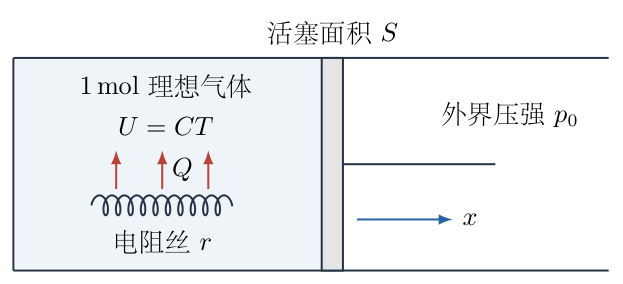

<!-- question-end -->

## 一、题型定位

本题是带摩擦活塞的分段准静态热力学过程。加热初期，静摩擦使活塞保持不动，气体作定容升温；压强差达到摩擦阈值后，活塞开始缓慢移动，气体转为定压膨胀。滑动阶段除了电阻丝传入的热量 $dQ$，还有摩擦耗散热的一半回流到气体，因此图线第二段的斜率不能直接写成通常定压热容的倒数。

题中 $Q$ 专指气体从电阻丝吸收的热量，不包括摩擦产生后回流给气体的热量。把这两种热量混为一个变量，会使第二段能量方程少一项。

## 二、知识点

- 静摩擦阶段的定容过程与理想气体状态方程。
- 活塞开始运动的压强阈值 $pS-p_0S=F$。
- 缓慢滑动阶段的机械平衡 $pS=p_0S+F$。
- 热力学第一定律及气体对外作功 $p\,dV$。
- 一摩尔理想气体在定压过程中满足 $p\,dV=R\,dT$。
- 摩擦耗散热的能量去向与有效热容。
- 分段线性函数的连续性、斜率与转折点。

## 三、物理图像

全过程分为两段。

第一段活塞静止，体积保持初值

$$
V_0=\frac{RT_0}{p_0}.
$$

电阻丝输入的热量全部增加气体内能，$T$ 随 $Q$ 以斜率 $1/C$ 上升。气体压强也随温度上升，直到向右的压强力比外界大气压力多出 $F$。

第二段活塞向右缓慢滑动。内部压强保持

$$
p_1=p_0+\frac FS.
$$

电阻热一部分增加内能，一部分用于膨胀作功；与此同时，摩擦耗散 $Fdx$ 中有一半，即 $\tfrac12Fdx$，重新进入气体。第二段仍是直线，但斜率小于第一段。

图4-2左侧画出滑动阶段每一个能量项的方向，右侧给出最终 $T$—$Q$ 图线。

## 四、解题入口

先求活塞开始运动时的压强 $p_1$、温度 $T_1$ 和电阻热 $Q_1$，这三个量确定图线转折点。随后对滑动阶段写微元形式的第一定律，必须同时列出：内能增量 $C\,dT$、电阻丝传热 $dQ$、回流摩擦热 $\tfrac12Fdx$ 和气体作功 $p_1Sdx$。

再利用理想气体状态方程消去 $dx$，把 $dQ$ 写成某个常量乘 $dT$。该常量就是以“电阻丝输入热量”为口径的有效热容，倒数即第二段斜率。

## 五、解析

（1）第一阶段：活塞保持静止。

初始内外压强相等。缓慢加热后，气体压强逐渐大于 $p_0$，活塞受到向右的净压强力

$$
(p-p_0)S.
$$

只要该力不超过最大静摩擦力 $F$，活塞就保持不动。开始向右运动的临界条件是

$$
(p_1-p_0)S=F.
$$

因此

$$
\boxed{p_1=p_0+\frac FS}.
$$

静止阶段体积不变。由初态和临界态的状态方程

$$
p_0V_0=RT_0,
\qquad
p_1V_0=RT_1,
$$

两式相除：

$$
\frac{T_1}{T_0}=\frac{p_1}{p_0}.
$$

所以转折温度为

$$
\begin{aligned}
T_1
&=T_0\frac{p_1}{p_0}\\
&=T_0\left(1+\frac{F}{p_0S}\right).
\end{aligned}
$$

即

$$
\boxed{T_1=T_0\left(1+\frac{F}{p_0S}\right)}.
$$

这一阶段没有体积变化，气体不作边界功；静摩擦接触也没有相对位移，不产生摩擦热。热力学第一定律化为

$$
dQ=dU=C\,dT.
$$

从 $T_0$ 积分到任意 $T$：

$$
Q=C(T-T_0).
$$

所以第一段图线为

$$
\boxed{T=T_0+\frac QC},
\qquad 0\leq Q\leq Q_1.
$$

转折点横坐标为

$$
\begin{aligned}
Q_1
&=C(T_1-T_0)\\
&=CT_0\frac{F}{p_0S}.
\end{aligned}
$$

即

$$
\boxed{Q_1=\frac{CT_0F}{p_0S}}.
$$

第一段斜率是

$$
\boxed{\frac{dT}{dQ}=\frac1C}.
$$

（2）第二阶段：活塞缓慢向右滑动。

题设说明滑动摩擦力大小仍为 $F$。因为活塞运动缓慢，可忽略活塞加速度；沿水平方向的机械平衡为

$$
pS=p_0S+F.
$$

故滑动阶段气体压强保持常量

$$
\boxed{p=p_1=p_0+\frac FS}.
$$

设活塞向右移动微小距离 $dx$。气体体积增加

$$
dV=S\,dx.
$$

图4-2左侧把本阶段的能量项逐一列出，右侧以电阻丝输入热量 $Q$ 为横坐标绘出两个阶段。下面先使用左图的 $dQ$、$\tfrac12Fdx$、$p_1Sdx$ 建立第一定律，再用右图的转折点 $(Q_1,T_1)$ 确定积分常数。

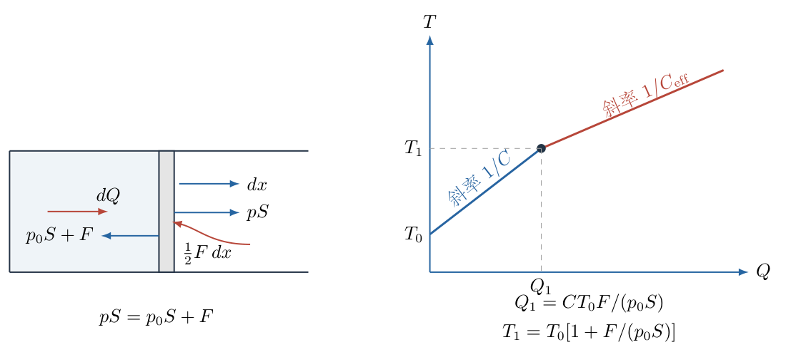

气体从电阻丝吸收 $dQ$；克服摩擦产生热量 $Fdx$，其中一半被气体吸收，所以气体另外得到

$$
dQ_f=\frac12F\,dx.
$$

气体对活塞作边界功

$$
dW=p_1\,dV=p_1S\,dx.
$$

按照“内能增量等于吸收热量减去气体对外作功”写第一定律：

$$
C\,dT=dQ+\frac12F\,dx-p_1S\,dx.
$$

滑动阶段是一摩尔理想气体的定压过程。对 $p_1V=RT$ 微分：

$$
p_1\,dV=R\,dT.
$$

因为 $dV=Sdx$，所以

$$
dx=\frac{R}{p_1S}\,dT.
$$

也可以先把气体作功项直接写为

$$
p_1S\,dx=p_1\,dV=R\,dT.
$$

代入第一定律：

$$
C\,dT
=dQ+\frac12F\frac{R}{p_1S}\,dT-R\,dT.
$$

把 $dQ$ 留在右侧，其余项移到左侧：

$$
dQ
=\left(C+R-\frac{FR}{2p_1S}\right)dT.
$$

定义以电阻丝输入热量为口径的有效热容

$$
C_{\mathrm{eff}}
=C+R-\frac{FR}{2p_1S}.
$$

再利用 $p_1S=p_0S+F$：

$$
\boxed{
C_{\mathrm{eff}}
=C+R-\frac{FR}{2(p_0S+F)}
}.
$$

因此第二段斜率为

$$
\boxed{
\frac{dT}{dQ}
=\frac1{C_{\mathrm{eff}}}
=\frac1{C+R-\dfrac{FR}{2(p_0S+F)}}
}.
$$

从转折点 $(Q_1,T_1)$ 开始积分，第二段直线方程为

$$
\boxed{
T=T_1+\frac{Q-Q_1}{C_{\mathrm{eff}}}
},
\qquad Q\geq Q_1.
$$

（3）汇总分段函数与图线特征。

最终关系为

$$
\boxed{
T(Q)=
\begin{cases}
T_0+\dfrac QC,
&0\leq Q\leq Q_1,\\[7pt]
T_1+\dfrac{Q-Q_1}{C_{\mathrm{eff}}},
&Q\geq Q_1,
\end{cases}
}
$$

其中

$$
\boxed{
\begin{aligned}
T_1&=T_0\left(1+\frac{F}{p_0S}\right),\\
Q_1&=\frac{CT_0F}{p_0S},\\
C_{\mathrm{eff}}&=C+R-\frac{FR}{2(p_0S+F)}.
\end{aligned}
}
$$

由于

$$
0<\frac{F}{2(p_0S+F)}<\frac12,
$$

有

$$
C_{\mathrm{eff}}>C+\frac R2>C.
$$

所以第二段斜率 $1/C_{\mathrm{eff}}$ 小于第一段斜率 $1/C$，图线在转折点以后变得更平缓。两段在 $(Q_1,T_1)$ 连续，但斜率不连续。

（4）用有限过程的能量账核对微分解。

从开始滑动的状态到某一温度 $T>T_1$，记活塞累计右移距离为 $X$。因为全程定压，状态方程直接给出

$$
p_1(V-V_0)=R(T-T_1),
\qquad
X=\frac{V-V_0}{S}=\frac{R(T-T_1)}{p_1S}.
$$

气体作的总功由对外界压强作功和摩擦功组成：

$$
W=p_1SX=p_0SX+FX.
$$

摩擦功中的 $FX/2$ 回流到气体，另 $FX/2$ 留在活塞及筒壁。只把气体作为研究系统，有

$$
\begin{aligned}
C(T-T_1)
&=(Q-Q_1)+\frac12FX-p_1SX,\\
Q-Q_1
&=C(T-T_1)+p_0SX+\frac12FX.
\end{aligned}
$$

第二行的物理意义是：电阻丝供能用于增加气体内能、向外界作功，以及补偿未回流的半份摩擦耗散。将 $X$ 代入，有

$$
\begin{aligned}
Q-Q_1
&=\left[C+\frac{R(p_0S+F/2)}{p_0S+F}\right](T-T_1)\\
&=\left[C+R-\frac{RF}{2(p_0S+F)}\right](T-T_1).
\end{aligned}
$$

这与微元积分完全相同，同时避免把摩擦耗散在热量和作功中重复计算。

最后检查两个参数极限。若 $F\to0$，则 $T_1\to T_0$、$Q_1\to0$，定容阶段消失，系统从开始就是压强 $p_0$ 的定压加热，$C_{\rm eff}\to C+R$。若 $F\gg p_0S$，则

$$
\frac{F}{p_0S+F}\to1,
\qquad C_{\rm eff}\to C+\frac R2.
$$

后一极限表示膨胀功几乎全部用于摩擦，而其中一半重新返回气体。这里的 $C$、$R$ 与 $C_{\rm eff}$ 均具有热容单位；$F/(p_0S)$ 无量纲，$Q_1$ 因而具有能量单位。

## 六、关键洞察

摩擦在本题中具有双重作用：机械上，它要求内部压强长期维持在 $p_0+F/S$；热学上，它把气体所做机械功中的一部分以热的形式返还给气体。前一种作用确定过程路径，后一种作用修改“电阻热—温升”的比例。

若只看气体对外总功，滑动阶段仍有 $p_1dV=R\,dT$；但其中对摩擦做的功 $Fdx$ 有一半回流。因此电阻丝需要提供的热量比没有回流时少，$C_{\mathrm{eff}}$ 小于通常的 $C+R$，却仍大于定容热容 $C$。

题目横坐标是电阻丝传给气体的 $Q$。若把横坐标改成气体收到的总热量 $Q+Q_f$，第二段斜率会变成 $1/(C+R)$。坐标量的定义不同，图线斜率也不同。

## 七、易错点

- 把活塞一受热就当作移动，漏掉静摩擦维持的定容阶段。
- 临界压强误写成 $p_0+F$。$F$ 是力，必须除以面积，正确为 $p_0+F/S$。
- 把转折热量写成 $(C+R)(T_1-T_0)$。第一阶段体积不变，应为 $C(T_1-T_0)$。
- 滑动阶段漏掉气体对外作功 $p_1dV=R\,dT$。
- 把摩擦热 $Fdx$ 全部计入气体，或完全不计入。题设明确只有一半被气体吸收。
- 把 $Q$ 当作气体收到的全部热量。它只表示电阻丝传热，回流摩擦热要另列。
- 图线第二段从原点重新画起。第二段必须经过转折点 $(Q_1,T_1)$。

## 八、课堂讲解建议

课堂上可先让学生只判断活塞“何时开始动”，要求写出力而不是压强的平衡式 $(p_1-p_0)S=F$。这样能提前消除把 $F$ 与压强相加的量纲错误。

板书滑动阶段时，建议把第一定律四项分列在同一行：$C\,dT$、$dQ$、$\tfrac12Fdx$、$p_1Sdx$，再用颜色标出只有 $dQ$ 属于横坐标增量。图4-2左侧也按这一顺序读取。

画图前先比较 $C_{\mathrm{eff}}$ 与 $C$：第二段斜率更小。完成图线后，再检查转折点是否同时满足第一段和第二段方程。

## 九、变式训练

若克服摩擦产生的热量中有比例 $\eta$ 被气体吸收，其中 $0\leq\eta\leq1$，其余条件不变，求新的 $T$—$Q$ 关系，并讨论 $\eta=0$、$1/2$、$1$ 三种情况。

静止阶段没有相对位移，不产生摩擦热，因此 $T_1$、$Q_1$ 与主问题完全相同：

$$
T_1=T_0\left(1+\frac{F}{p_0S}\right),
\qquad
Q_1=\frac{CT_0F}{p_0S}.
$$

滑动阶段的第一定律改为

$$
C\,dT=dQ+\eta Fdx-p_1Sdx.
$$

仍有

$$
p_1Sdx=R\,dT,
\qquad
dx=\frac{R}{p_1S}\,dT.
$$

代入后得到

$$
dQ=\left(C+R-\eta\frac{FR}{p_1S}\right)dT.
$$

所以

$$
\boxed{
C_{\mathrm{eff}}(\eta)
=C+R-\eta\frac{FR}{p_0S+F}
}.
$$

完整分段关系为

$$
\boxed{
T(Q)=
\begin{cases}
T_0+Q/C,&0\leq Q\leq Q_1,\\[3pt]
T_1+[Q-Q_1]/C_{\mathrm{eff}}(\eta),&Q\geq Q_1.
\end{cases}
}
$$

三个特例为

$$
\begin{aligned}
\eta=0:
&\quad C_{\mathrm{eff}}=C+R,\\
\eta=\frac12:
&\quad C_{\mathrm{eff}}=C+R-\frac{FR}{2(p_0S+F)},\\
\eta=1:
&\quad C_{\mathrm{eff}}=C+R-\frac{FR}{p_0S+F}.
\end{aligned}
$$

$\eta$ 越大，摩擦热回流越多，同样的电阻热 $dQ$ 所造成的温升越大，第二段斜率也越大。取 $\eta=1/2$ 即恢复主问题。

\newpage

# 第 5 题

<!-- question-start -->

一块透明圆柱形果冻的高度为 $h$，放在厚度为 $d$、折射率为 $n_0$ 的平行玻璃板上。采用旁轴近似。

（1）果冻上表面为平面。玻璃下表面与桌面上一小广告 $S$ 的距离为 $a$。当眼睛到果冻上表面的距离为 $b$ 时，眼睛经果冻上表面反射所成的像，恰与透过果冻和玻璃所看到的小广告像重合。求果冻的折射率 $n$。

（2）实际果冻上表面并非平面，而是向上凸起、可近似看成半径为 $R$ 的球面。小广告仍位于玻璃下方距离 $a$ 处，眼睛到球面顶点的距离为 $b$，此时眼睛经球面反射的像与小广告的折射像重合。随后把小广告贴在玻璃下表面，并把眼睛移到距球面顶点 $c$ 处，两像再次重合。求果冻的折射率。

（3）求球面的曲率半径 $R$。

第（2）、（3）问可使用

$$
d=1.00\,\mathrm{cm},\quad
h=5.00\,\mathrm{cm},\quad
n_0=1.50,
$$

$$
a=4.00\,\mathrm{cm},\quad
b=24.37\,\mathrm{cm},\quad
c=6.73\,\mathrm{cm}.
$$

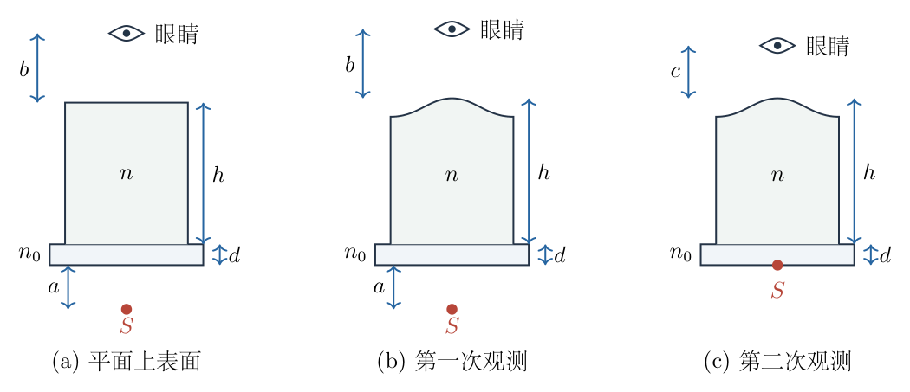

<!-- question-end -->

## 一、题型定位

本题是多层平行介质的视深与球面反射、球面折射的综合题。第（1）问只有平面界面，可以把每一层的“实际厚度除以折射率”相加得到等效视深。第（2）、（3）问的关键变化是果冻上表面具有曲率：小广告的折射像和眼睛的反射像都不再满足平面界面的等距关系，必须用同一套旁轴符号约定分别求出两像相对球面顶点的深度，再令它们相等。

最容易混淆的两个像来自不同光路：小广告的光先后通过空气、玻璃和果冻，再从球面折射到空气；眼睛的光只在果冻上表面发生反射。两者最后都被眼睛看成位于球面下方的虚像，但成像公式不能混用。

## 二、知识点

- 平行介质层的等效光学距离与视深。
- 旁轴光线的约化倾角 $p=n\theta$。
- 球面折射的近轴光焦度。
- 凸球面反射的虚像位置。
- 虚像重合条件与同一坐标、同一符号约定。
- 通过两次观测消去未知曲率半径。
- 二次方程正根的筛选、量纲检查和数值回代。

## 三、物理图像

对轴上小物点发出的一条近轴光线，经过若干平面界面时，约化倾角 $p=n\theta$ 保持不变。在折射率为 $n_i$、厚度为 $t_i$ 的一层中，光线高度的变化量为

$$
\Delta y=\frac{t_i}{n_i}p.
$$

因此，从小广告到果冻上表面顶点的多层结构，可以压缩成一个等效距离

$$
D=\sum_i\frac{t_i}{n_i}.
$$

平面上表面没有光焦度，小广告的像深就是 $D$；球面上表面会使出射光线额外偏折。另一方面，眼睛面对的是一个向眼睛凸出的球面反射面，其反射像位于球面下方，而且像深小于眼睛到顶点的距离。

图5-2把两条光路分开：左图只处理小广告经球面折射的近轴光线，右图只处理眼睛经球面反射的近轴光线。两图中的 $q_S$、$q_E$ 都从球面顶点向下量取；像重合就是 $q_S=q_E$。

## 四、解题入口

先约定球面顶点为 $V$，球面曲率半径的大小为 $R>0$，球心位于果冻内部。所有“像深”均从 $V$ 向下取正值。

第（1）问直接比较两个平面虚像的深度。第（2）、（3）问则分三步：

1. 把小广告到顶点的各层厚度压缩成等效距离 $D$；
2. 分别求小广告折射像深 $q_S$ 和眼睛反射像深 $q_E$；
3. 对两次观测分别写 $q_S=q_E$，先消去共同的 $(n+1)/R$ 求 $n$，再回代求 $R$。

第二次观测中“小广告贴在玻璃上”表示广告贴在玻璃下表面，因而空气间隙 $a$ 变为零，但光线仍要通过整块玻璃，$d/n_0$ 不能删去。

## 五、解析

（1）平面上表面的情形。

眼睛到平面的距离为 $b$。平面反射所成的眼睛虚像位于平面下方，像距仍为

$$
q_E=b.
$$

现在求小广告的视深。广告到玻璃下表面之间是空气层，贡献 $a$；玻璃层贡献 $d/n_0$；果冻层贡献 $h/n$。所以小广告的折射像位于果冻上表面下方

$$
q_S=a+\frac{d}{n_0}+\frac{h}{n}.
$$

两像重合要求 $q_S=q_E$，即

$$
b=a+\frac{d}{n_0}+\frac{h}{n}.
$$

逐步移项：

$$
\frac{h}{n}=b-a-\frac{d}{n_0},
$$

因此

$$
\boxed{
n=\frac{h}{\displaystyle b-a-\frac{d}{n_0}}
}.
$$

分母必须为正；若 $b\le a+d/n_0$，给定的平面像重合情形便不可能由正折射率实现。

（2）建立球面上表面的两个成像公式。

先处理小广告。设它到球面顶点的等效距离为 $D$。图5-2分别画出广告光线向上折射和眼睛光线经球面反射的过程。$D$ 是平面层折算后的距离，$q_S$、$q_E$ 均从球面顶点向下量取，$R$ 为正的几何曲率半径。下面的倾角关系与像深方程都按这些方向建立。

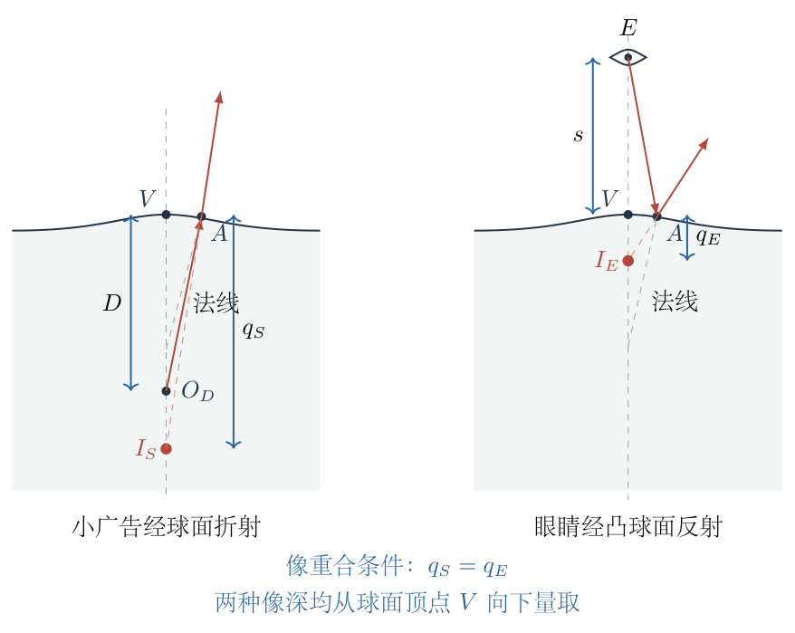

为说明约化倾角的来源，令 $p=n_j\theta_j$，其中 $n_j$ 是光线所在介质的折射率，$\theta_j$ 是旁轴倾角。对平面界面，斯涅尔定律在小角近似下为 $n_j\theta_j=n_{j+1}\theta_{j+1}$，因此同一条光线经过平面层时 $p$ 不变。在厚度 $d_j$ 的该层内，横向位移为 $d_j\theta_j=(d_j/n_j)p$。各层位移相加，便有

$$
y=p\left(a+\frac d{n_0}+\frac hn\right)=pD.
$$

各层厚度须按 $d_j/n_j$ 折算；球面顶点附近的高度差为二阶小量 $O(y^2/R)$，在一阶旁轴关系中忽略。由此，光线到达球面前的约化倾角为

$$
p_- =\frac{y}{D}.
$$

球心位于果冻一侧，球面法线相对光轴的旁轴倾角为 $y/R$。从折射率 $n$ 的果冻射入空气后，约化倾角变为

$$
p_+
=p_--\frac{n-1}{R}y.
$$

这一式也可直接从小角斯涅尔定律推出。把传播方向取为向上，令入射光线的有向倾角为 $\theta_-$，出射倾角为 $\theta_+$，界面法线倾角为 $\alpha=y/R$。两个相对法线的倾角分别为 $\theta_--\alpha$、$\theta_+-\alpha$，故

$$
\begin{aligned}
n(\theta_--\alpha)&=\theta_+-\alpha,\\
\theta_+&=n\theta_--(n-1)\alpha,\\
p_+&=p_--\frac{n-1}{R}y.
\end{aligned}
$$

负号由法线的倾斜方向与折射方向共同确定，不需要记忆未经说明的球面符号公式。空气中折射率为1，所以 $p_+=\theta_+$；果冻中则是 $p_-=n\theta_-$，两者不能把约化倾角和几何倾角混用。

空气中的出射光线若反向延长到球面下方深度 $q_S$ 处，应满足 $p_+=y/q_S$。两式相除以 $y$：

$$
\boxed{
\frac1{q_S}=\frac1D-\frac{n-1}{R}
}.
$$

这个负的曲率修正符合直觉：果冻向空气的凸球面是发散界面，使小广告的视深 $q_S$ 大于没有曲率时的 $D$。

再处理眼睛的反射像。设眼睛到球面顶点的距离为 $s$。该表面对眼睛是凸面镜，焦距为 $-R/2$。用实物距为正、实像距为正的球面镜公式

$$
\frac1s+\frac1v=-\frac2R.
$$

反射像在球面下方，是虚像。令其向下的像深为 $q_E>0$，则 $v=-q_E$。代入：

$$
\frac1s-\frac1{q_E}=-\frac2R.
$$

所以

$$
\boxed{
\frac1{q_E}=\frac1s+\frac2R
}.
$$

令两像重合，即 $q_S=q_E$，得到统一观测方程

$$
\frac1D-\frac{n-1}{R}
=\frac1s+\frac2R.
$$

把曲率项移到右边：

$$
\boxed{
\frac1D-\frac1s=\frac{n+1}{R}
}.
$$

第一次观测时

$$
D_1=a+\frac{d}{n_0}+\frac{h}{n},
\qquad s=b,
$$

故

$$
\frac1{D_1}-\frac1b=\frac{n+1}{R}.
\tag{1}
$$

第二次观测时，广告贴在玻璃下表面，空气间隙消失：

$$
D_2=\frac{d}{n_0}+\frac{h}{n},
\qquad s=c.
$$

于是

$$
\frac1{D_2}-\frac1c=\frac{n+1}{R}.
\tag{2}
$$

式（1）、（2）的右端相同。先消去曲率项：

$$
\frac1{D_1}-\frac1{D_2}
=\frac1b-\frac1c.
$$

又因为 $D_1=D_2+a$，所以

$$
\frac1{D_2+a}-\frac1{D_2}
=\frac1b-\frac1c.
$$

分别通分：

$$
-\frac{a}{D_2(D_2+a)}
=-\frac{b-c}{bc}.
$$

消去负号并交叉相乘：

$$
D_2(D_2+a)=\frac{abc}{b-c}.
$$

这给出关于 $D_2$ 的二次方程

$$
D_2^2+aD_2-\frac{abc}{b-c}=0.
$$

由于 $D_2$ 是正的等效距离，只能取正根：

$$
\boxed{
D_2=\frac{-a+\sqrt{a^2+\dfrac{4abc}{b-c}}}{2}
}.
$$

代入数值：

$$
\frac{abc}{b-c}
=\frac{(4.00)(24.37)(6.73)}{24.37-6.73}
=37.1905\,\mathrm{cm^2},
$$

$$
D_2
=\frac{-4.00+\sqrt{(4.00)^2+4(37.1905)}}2
=4.41798\,\mathrm{cm}.
$$

由 $D_2=d/n_0+h/n$，

$$
\frac hn=D_2-\frac d{n_0}
=4.41798-\frac{1.00}{1.50}
=3.75132\,\mathrm{cm}.
$$

因此

$$
\boxed{
n=\frac{5.00}{3.75132}=1.33287\approx1.33
}.
$$

若折射率只保留一位小数，则写为 $n\approx1.3$。

（3）回代求曲率半径。

先算第一次观测的等效距离：

$$
D_1=D_2+a=4.41798+4.00=8.41798\,\mathrm{cm}.
$$

由式（1）

$$
R=\frac{n+1}{\dfrac1{D_1}-\dfrac1b}.
$$

分母为

$$
\frac1{D_1}-\frac1b
=\frac1{8.41798}-\frac1{24.37}
=0.0777593\,\mathrm{cm^{-1}}.
$$

所以

$$
\boxed{
R=\frac{1.33287+1}{0.0777593}
=30.0011\,\mathrm{cm}
\approx30.0\,\mathrm{cm}
}.
$$

用第二次观测回代可得同样结果：

$$
\frac1{D_2}-\frac1c
=\frac1{4.41798}-\frac1{6.73}
=0.0777593\,\mathrm{cm^{-1}}.
$$

两次所得球面光焦度完全一致，说明正根选择和数值运算自洽。

（4）检验反演结果的物理可实现性。

二次方程的正根只是第一层筛选。由于 $D_2=d/n_0+h/n$，正折射率还要求

$$
D_2>\frac d{n_0}.
$$

对于折射率大于空气的普通透明果冻，还应有 $n>1$，即

$$
\frac d{n_0}<D_2<\frac d{n_0}+h.
$$

本题的 $D_2=4.41798\,\mathrm{cm}$ 落在这一范围内，所得 $n=1.33287>1$。反射像重合方程还要求凸球面的 $R>0$。由

$$
\frac{n+1}{R}=\frac1{D_1}-\frac1b
$$

可知必须有 $D_1<b$；把求得的 $D_1=D_2+a$ 与题给 $b$ 比较，同样满足。

最后检查广告折射像确在球面下方：用像重合条件替换曲率项，有

$$
\frac1{q_S}
=\frac1{D_1}-\frac{n-1}{R}
=\frac1b+\frac2R>0.
$$

因此 $q_S>0$，与图5-2采用的虚像向下延长方向一致。三项检验分别确认了介质参数、球面朝向和虚像位置；仅检查数值能代回二次方程，尚不能替代这些物理条件。

## 六、关键洞察

第（2）、（3）问并不需要先分别求出两个虚像的具体深度。把折射像和反射像的倒数像深相等后，会直接出现共同项 $(n+1)/R$；两次观测相减即可先消去未知曲率。这是本题最有效的消元顺序。

多层平面介质不是把几何厚度直接相加，而是把每层厚度除以该层折射率后再相加。第二次观测虽然没有空气间隙 $a$，玻璃仍然存在，因此 $D_2$ 中必须保留 $d/n_0$。

球面折射贡献 $-(n-1)/R$，凸面反射贡献 $+2/R$。两者移到同一边后成为 $(n+1)/R$。这个“$n+1$”不是记忆公式，而是两条不同光路的曲率效应相减所得。

## 七、易错点

- 把第（1）问写成 $b=a+d+h/n$，漏掉玻璃层的折射率 $n_0$。
- 把“广告贴在玻璃上”误解为玻璃层也消失，从 $D_2$ 中删去 $d/n_0$。
- 对凸面镜写成 $1/q_E=1/s-2/R$。眼睛的像位于球面下方，正确结果是 $1/q_E=1/s+2/R$。
- 把球面折射式中的 $n-1$ 与反射式中的 $2$ 直接相加为 $n-3$。必须先按同一像深方向写等式，再移项。
- 二次方程同时保留正、负两根。等效距离 $D_2$ 必须为正，负根没有物理意义。
- 用手持计算器过早把 $n$ 舍入为 $1.3$ 再求 $R$，会造成明显累计误差。应保留至少五位中间数，最后统一舍入。
- 把旁轴公式用于大孔径边缘光线。本题结论只在小角度、近轴条件下成立。

## 八、课堂讲解建议

讲解时先遮住球面部分，只让学生用一条近轴光线解释为什么三层结构的等效距离是 $a+d/n_0+h/n$。确认这一点后再引入曲率，避免学生同时处理多层介质和球面符号而失去主线。

球面部分宜把图5-2左右两幅图分开列式：左边只写 $1/q_S$，右边只写 $1/q_E$。两式写完后再令它们相等，并用颜色标出共同的 $1/q$。这样可以清楚看见 $(n+1)/R$ 的来源。

数值计算应先求 $D_2$，再求 $n$，最后求 $R$。每一步都保留单位：二次方程右端 $abc/(b-c)$ 的量纲是长度平方，$D_2$ 是长度，$1/D_1-1/b$ 是长度的倒数，最终 $R$ 才是长度。

## 九、变式训练

若果冻上方不是空气，而是折射率为 $n_a$ 的透明介质；眼睛与球面顶点的几何距离仍为 $s$。广告到顶点的等效距离仍记为 $D$。推导像重合条件，并说明当球面退化为平面时的结果。

对广告光线，球面折射前仍有 $p_-=y/D$。折射后进入上方介质，约化倾角满足

$$
p_+=p_- -\frac{n-n_a}{R}y.
$$

若广告虚像深度为 $q_S$，上方介质中的约化倾角还应写成 $p_+=n_a y/q_S$，因此

$$
\frac{n_a}{q_S}
=\frac1D-\frac{n-n_a}{R}.
$$

反射定律与介质折射率无关，眼睛的凸面反射像仍满足

$$
\frac1{q_E}=\frac1s+\frac2R.
$$

两像重合时 $q_S=q_E$。把第二式乘以 $n_a$ 后与第一式相等：

$$
\frac1D-\frac{n-n_a}{R}
=\frac{n_a}{s}+\frac{2n_a}{R}.
$$

移项得到

$$
\boxed{
\frac1D-\frac{n_a}{s}
=\frac{n+n_a}{R}
}.
$$

令 $n_a=1$，立即退化为原题的 $1/D-1/s=(n+1)/R$。再令 $R\to\infty$，曲率项消失，得到 $1/D=n_a/s$，即

$$
\boxed{s=n_aD}.
$$

这也可由平面折射直接解释：从上方介质观察时，多层结构的几何像深等于上方折射率 $n_a$ 乘以下方各层的约化距离总和。

再作一次数值回代。设上方介质为水，取 $n_a=1.33$，果冻折射率 $n=1.50$，广告等效距离 $D=5.00\,\mathrm{cm}$，球面半径 $R=20.0\,\mathrm{cm}$。由像重合条件

$$
\frac{n_a}{s}
=\frac1D-\frac{n+n_a}{R}
=\frac1{5.00}-\frac{1.50+1.33}{20.0}
=0.0585\,\mathrm{cm^{-1}},
$$

先求眼睛位置 $s$，再分别用反射、折射光路的公式独立回代像深：

$$
\begin{aligned}
s&=\frac{1.33}{0.0585}=22.735\,\mathrm{cm},\\
q_E&=\frac1{1/s+2/R}=6.945\,\mathrm{cm},\\
q_S&=\frac{n_a}{1/D-(n-n_a)/R}=6.945\,\mathrm{cm}.
\end{aligned}
$$

两值一致。这个例子还显示观测距离存在可实现条件：必须有 $1/D>(n+n_a)/R$，否则算出的 $s$ 不为正，轴上真实眼睛无法在球面上方满足像重合。

把这个条件改写为 $R>(n+n_a)D$，可看出曲率不能任意加大。令 $A=1/D-(n+n_a)/R$，则 $s=n_a/A$；当 $A\to0^+$ 时，像重合所需的眼睛距离趋于无穷远。这是系统接近可实现边界时的几何放大，不是第二个有限观测位置。

固定 $D$、$n$、$n_a$，对曲率半径求导：

$$
\frac{ds}{dR}
=-\frac{n_a(n+n_a)}{R^2[1/D-(n+n_a)/R]^2}<0.
$$

所以球面变得更平坦时，所需观测距离减小，并最终趋于平面极限 $s=n_aD$。这一方向与上面的平面退化结果相符，也有助于判断求半径时曲率项的正负号。

\newpage

# 第 6 题

<!-- question-start -->

两根平行理想导轨相距 $l$，放在垂直纸面向外的匀强磁场 $B$ 中。质量为 $m$、电阻可忽略的导体棒垂直跨接在导轨上，并可沿导轨无摩擦滑动。导体棒运动时受到与速度成正比、方向相反的阻力

$$
\boldsymbol f=-k\boldsymbol v.
$$

导轨、导体棒和外接非直流电源构成的回路自感为 $L$，其余电阻均忽略。

（1）用一个由电阻 $R_0$、电容 $C_0$、电感 $L_0$ 和原电源组成的纯电路模拟该机电系统，使电源端口的电压和电流在任意时刻均与原系统相同。画出连接方式，并用 $l$、$B$、$m$、$L$、$k$ 表示 $R_0$、$C_0$、$L_0$。

（2）若电源电压为

$$
U(t)=U_0\cos\omega t,
$$

求稳态时导体棒位移振幅 $x_0$。

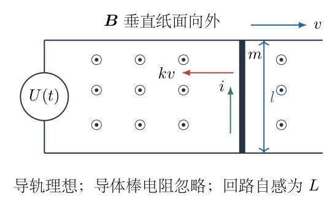

<!-- question-end -->

## 一、题型定位

本题是电磁感应、含自感电路与受迫运动的机电类比题。导体棒既是电路元件，也是机械运动物体：电流通过导体棒产生安培力，导体棒运动又产生动生电动势。把这两个耦合关系写成同一对端口变量后，质量与阻力可以分别等效为电容和电阻，原回路自感则保持为串联电感。

第（2）问本质上是线性受迫系统的正弦稳态响应。直接从复阻抗求电流再求速度可以完成；把两个一阶方程消元成关于速度的二阶方程，则更容易看清惯性项、阻尼项和电磁“回复项”的来源。

## 二、知识点

- 导体棒的动生电动势 $u_m=Blv$。
- 导体棒所受安培力 $F_B=Bli$。
- 含自感回路的端口电压方程。
- 机械方程与并联 $RC$ 支路的端口类比。
- 串联电感与并联 $RC$ 的复阻抗。
- 正弦稳态、相量法和位移—速度振幅关系 $v_0=\omega x_0$。
- 极限、量纲和平均功率检查。

## 三、物理图像

规定导体棒向右运动的速度 $v$ 为正，选取电流正方向，使正电流对棒产生向右的安培力。导体棒运动时产生的动生电动势反抗外电源驱动，因此电源端电压分成两部分：一部分加在原回路自感上，另一部分等于动生电动势

$$
u_m=Blv.
$$

机械侧的安培力 $Bli$ 一部分使质量产生加速度，另一部分克服线性阻力：

$$
Bli=m\frac{dv}{dt}+kv.
$$

把 $u_m=Blv$ 当作一个电支路的端电压后，右端的惯性项正比于 $du_m/dt$，阻力项正比于 $u_m$，它们正好对应电容电流和电阻电流。图6-2给出端口变量与纯电路的对应关系。

## 四、解题入口

不要从“质量像电感还是电容”的记忆表开始。先定义导体棒端口电压

$$
u_m=Blv,
$$

再把机械方程改写成 $i$ 关于 $u_m$ 和 $du_m/dt$ 的关系。只要所得形式与

$$
i=\frac{u_m}{R_0}+C_0\frac{du_m}{dt}
$$

逐项比较，$R_0$、$C_0$ 就会自然出现。随后由电源电压方程判断 $L_0$ 与这个并联支路是串联还是并联。

求振幅时，先求速度振幅 $v_0$。位移是速度对时间的积分，稳态正弦量的振幅满足 $x_0=v_0/\omega$；若直接把速度振幅当成位移振幅，会少一个 $\omega$。

## 五、解析

图6-2左侧保留导体棒的机械运动及电学端口，右侧将同一端口替换为纯电网络。两侧共用 $u_m$ 和 $i$：下面把机械方程改写成以 $u_m$ 为自变量的电流关系，并据此确定右侧支路是并联还是串联；图中各元件的数值均由这一关系求出。

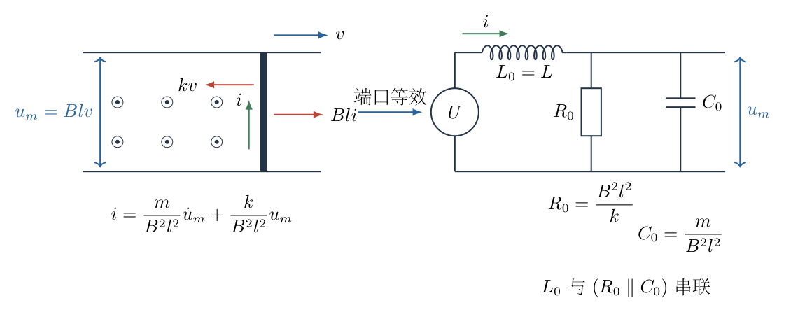

（1）建立原机电系统的两个耦合方程。

电流为 $i$ 时，导体棒受到向右的安培力

$$
F_B=Bli.
$$

线性阻力大小为 $kv$、方向向左。对导体棒列牛顿第二定律：

$$
m\frac{dv}{dt}=Bli-kv.
$$

移项得

$$
Bli=m\frac{dv}{dt}+kv.
\tag{1}
$$

导体棒向右运动产生动生电动势

$$
u_m=Blv.
\tag{2}
$$

因此

$$
v=\frac{u_m}{Bl},
\qquad
\frac{dv}{dt}=\frac1{Bl}\frac{du_m}{dt}.
$$

代入式（1）：

$$
Bli
=m\frac1{Bl}\frac{du_m}{dt}
+k\frac{u_m}{Bl}.
$$

两边再除以 $Bl$：

$$
i
=\frac{m}{B^2l^2}\frac{du_m}{dt}
+\frac{k}{B^2l^2}u_m.
\tag{3}
$$

并联电阻、电容支路的总电流为

$$
i=C_0\frac{du_m}{dt}+\frac{u_m}{R_0}.
\tag{4}
$$

逐项比较式（3）、（4）：

$$
\boxed{C_0=\frac{m}{B^2l^2}},
\qquad
\boxed{R_0=\frac{B^2l^2}{k}}.
$$

再看电源端电压。原回路自感为 $L$，按所定正方向列回路电压方程：

$$
U=L\frac{di}{dt}+u_m.
\tag{5}
$$

这表明电源电压等于电感电压与机电端口电压之和，而且流过两部分的是同一电流 $i$。因此原自感应与并联 $R_0C_0$ 支路串联，并且

$$
\boxed{L_0=L}.
$$

等效电路为：电源先串联电感 $L_0$，再串联一个由 $R_0$ 与 $C_0$ 并联构成的二端网络。

量纲也可直接检查。因为 $Blv$ 的量纲是电压、$Bli$ 的量纲是力，

$$
\frac{B^2l^2}{k}
=\frac{Blv}{Bli}
=\frac{U}{i}
$$

具有电阻量纲；而

$$
\frac{m}{B^2l^2}
=\frac{i}{d(Blv)/dt}
$$

具有电容量纲。

（2）求正弦稳态位移振幅。

为了不在复数相位中遗漏符号，先从时域方程消去电流。由式（1）

$$
i=\frac{m\dot v+kv}{Bl}.
$$

对时间求导：

$$
\frac{di}{dt}
=\frac{m\ddot v+k\dot v}{Bl}.
$$

代入电压方程（5）：

$$
U
=L\frac{m\ddot v+k\dot v}{Bl}+Blv.
$$

两边乘以 $Bl$：

$$
Lm\ddot v+Lk\dot v+B^2l^2v=BlU.
\tag{6}
$$

当 $U=U_0\cos\omega t$ 时，稳态速度可写为

$$
v(t)=\Re\!\left(\widetilde v e^{i\omega t}\right).
$$

于是

$$
\dot v\longrightarrow i\omega\widetilde v,
\qquad
\ddot v\longrightarrow-\omega^2\widetilde v.
$$

把它们代入式（6）：

$$
\left(B^2l^2-Lm\omega^2+iLk\omega\right)\widetilde v
=BlU_0.
$$

所以复速度振幅为

$$
\widetilde v
=\frac{BlU_0}
{B^2l^2-Lm\omega^2+iLk\omega}.
$$

取模得到速度振幅

$$
\boxed{
v_0
=\frac{BlU_0}
{\sqrt{\left(B^2l^2-Lm\omega^2\right)^2+\left(Lk\omega\right)^2}}
}.
$$

稳态位移满足 $v=dx/dt$。对正弦量，速度振幅与位移振幅相差因子 $\omega$：

$$
v_0=\omega x_0.
$$

因此

$$
\boxed{
x_0
=\frac{BlU_0}
{\omega\sqrt{\left(B^2l^2-Lm\omega^2\right)^2+\left(Lk\omega\right)^2}}
}.
$$

位移振幅与速度振幅之间的 $1/\omega$ 也可通过积分直接看出。记

$$
a_\omega=B^2l^2-Lm\omega^2,
\qquad b_\omega=Lk\omega.
$$

把复分母乘以其共轭，得到

$$
\widetilde v
=\frac{BlU_0(a_\omega-ib_\omega)}{a_\omega^2+b_\omega^2}.
$$

展开实部后，速度为

$$
v(t)=\frac{BlU_0}{a_\omega^2+b_\omega^2}
\left(a_\omega\cos\omega t+b_\omega\sin\omega t\right).
$$

逐项积分得到

$$
x(t)-\overline x
=\frac{BlU_0}{\omega(a_\omega^2+b_\omega^2)}
\left(a_\omega\sin\omega t-b_\omega\cos\omega t\right),
$$

其中 $\overline x$ 是由初始位置和暂态过程确定的平均位置。两个正交正弦项的振幅按平方和合成，恰好给出上面的 $x_0$。导轨上的棒没有位置回复力，所以题目能确定振幅，却不能仅凭稳态电压确定 $\overline x$。

若写为 $v=v_0\cos(\omega t-\phi)$，则相位应由

$$
\cos\phi=\frac{a_\omega}{\sqrt{a_\omega^2+b_\omega^2}},
\qquad
\sin\phi=\frac{b_\omega}{\sqrt{a_\omega^2+b_\omega^2}}
$$

联合确定。只写 $\tan\phi=b_\omega/a_\omega$ 会丢失象限；在 $a_\omega<0$ 时，速度滞后角已大于 $\pi/2$，不能仍取反正切的小角主值。

还可以从等效电路反查。并联支路阻抗为

$$
Z_{RC}
=\frac1{1/R_0+i\omega C_0}
=\frac{B^2l^2}{k+i\omega m}.
$$

总阻抗为

$$
Z=i\omega L+Z_{RC}.
$$

并联支路电压就是 $\widetilde u_m=Bl\widetilde v$。由分压关系计算出的 $\widetilde v$ 与上式完全相同，说明纯电路在电源端口的电压、电流关系和原机电系统一致。

平均功率也能核验等效电阻。机械阻力平均耗散功率为

$$
\overline P_{\rm mech}
=k\overline{v^2}
=\frac12kv_0^2.
$$

等效电阻两端电压振幅为 $u_{m0}=Blv_0$，其平均耗散功率为

$$
\overline P_R
=\frac{u_{m0}^2}{2R_0}
=\frac{B^2l^2v_0^2}{2(B^2l^2/k)}
=\frac12kv_0^2.
$$

两者相等，说明 $R_0=B^2l^2/k$ 不仅满足方程形式，也正确保存了能量耗散。

频率极限还可以检查振幅式的物理意义。当 $\omega\to0$ 时，外电压变化很慢，自感项可忽略，电压主要与动生电动势平衡，因而

$$
v_0\longrightarrow\frac{U_0}{Bl}.
$$

位移振幅 $x_0=v_0/\omega$ 随之增大，这表示无弹簧系统在很慢的交变驱动下可在每个半周内移动很长距离，并非公式发散失效。当 $\omega\to\infty$ 时，惯性与自感项占主导，有

$$
v_0\sim\frac{BlU_0}{Lm\omega^2},
\qquad
x_0\sim\frac{BlU_0}{Lm\omega^3}.
$$

高频下位移按 $\omega^{-3}$ 衰减，与“自感抑制电流变化、质量抑制加速度变化”的双重惰性一致。

（3）检查储能与暂态消失条件。

质量对应电容，还应在能量上成立。等效电容的电场能为

$$
W_C=\frac12C_0u_m^2
=\frac12\frac{m}{B^2l^2}(Blv)^2
=\frac12mv^2.
$$

它正好等于棒的动能；串联电感的储能 $Li^2/2$ 则与原回路磁场能相同。将机械方程乘以 $v$、电压方程乘以 $i$，消去功率交换项 $Bli v$，有

$$
\begin{aligned}
Bli v&=\frac{d}{dt}\left(\frac12mv^2\right)+kv^2,\\
Ui&=\frac{d}{dt}\left(\frac12Li^2\right)+Bli v,\\
Ui&=\frac{d}{dt}\left(\frac12Li^2+\frac12mv^2\right)+kv^2.
\end{aligned}
$$

这就是完整的瞬时能量守恒式：电源供给的功率等于储能增长率与阻力耗散之和。进入周期稳态后，储能一周期的净变化为零，对上式取周期平均便得 $\overline{Ui}=kv_0^2/2$。

暂态速度满足式（6）的齐次方程。设 $v_h\propto e^{\lambda t}$，则

$$
Lm\lambda^2+Lk\lambda+B^2l^2=0,
$$

所以

$$
\lambda_\pm=-\frac{k}{2m}
\pm\sqrt{\frac{k^2}{4m^2}-\frac{B^2l^2}{Lm}}.
$$

当 $k>0$ 时，两根为实数的情形下都为负；为复数时实部均为 $-k/(2m)<0$。因此速度和电流暂态最终衰减，上述稳态振幅与初始条件无关。若令 $k=0$，暂态一般不再衰减，且 $\omega=Bl/\sqrt{Lm}$ 时理想模型产生无阻尼共振，此时不能把有限稳态振幅公式用于共振点。

如果初始速度与初始电流分别为 $v(0)=v_i$、$i(0)=i_i$，机械方程还给出初始加速度

$$
\dot v(0)=\frac{Bl i_i-kv_i}{m}.
$$

设稳态解为 $v_s$，在两特征根不相同的情形，完整速度写为

$$
v(t)=v_s(t)+c_+e^{\lambda_+t}+c_-e^{\lambda_-t}.
$$

令 $a=v_i-v_s(0)$、$b=(Bl i_i-kv_i)/m-\dot v_s(0)$，代入两个初始条件得到

$$
c_++c_-=a,\qquad
\lambda_+c_++\lambda_-c_-=b.
$$

消去其中一个系数：

$$
c_+=\frac{b-\lambda_-a}{\lambda_+-\lambda_-},
\qquad
c_-=\frac{\lambda_+a-b}{\lambda_+-\lambda_-}.
$$

因此初态确实影响暂态系数，但 $k>0$ 时这两项衰减以后，只剩前面计算的稳态。重根时齐次解改为 $(c_1+c_2t)e^{-kt/(2m)}$，仍趋于零；这个情况不能把上述含 $\lambda_+-\lambda_-$ 的分式直接代零。

## 六、关键洞察

机电类比取决于选用哪一对端口变量。本题选 $u_m=Blv$ 后，速度对应电压，安培力方程中的质量项变成与 $du_m/dt$ 成正比的电流，所以质量等效为电容，而不是凭印象写成电感。

原回路自感 $L$ 与导体棒端口流过同一电流，电源电压又等于两者电压之和，因此 $L_0$ 必须串联在并联 $R_0C_0$ 网络之前。元件数值正确但拓扑画错，仍不能保证电源端口的电压、电流相同。

式（6）是关于速度而不是位移的受迫二阶方程。电磁项 $B^2l^2v$ 对速度变量起“回复项”作用，因此速度响应存在类似共振的频率结构；最后转换成位移振幅时还要除以 $\omega$。

## 七、易错点

- 把动生电动势在电压方程中写成帮助外电源的方向，导致 $U=L\dot i-Blv$。按本题正方向，动生电动势反抗驱动，电源必须同时提供 $L\dot i$ 与 $Blv$。
- 把安培力写成 $Bil^2$ 或漏掉导轨间距 $l$。导体棒有效长度就是 $l$，故 $F_B=Bli$。
- 直接套“质量对应电感”的另一种类比。本题端口变量选为 $u_m=Blv$，质量对应的是电容 $C_0$。
- 把 $R_0$、$C_0$ 串联。式（3）中两项电流相加，说明它们是同端电压下的并联支路。
- 求出 $v_0$ 后直接当成 $x_0$，漏掉 $x_0=v_0/\omega$。
- 把复数分母的模写成两项直接相加。应使用 $\sqrt{A^2+B^2}$。
- 忽略稳态限定。完整运动还含由初始条件决定的暂态项，题目所求振幅是暂态衰减后的正弦稳态振幅。

## 八、课堂讲解建议

讲解时先在原装置图上圈出两个端口量：棒的动生电动势 $u_m$ 和流过棒的电流 $i$。要求先把机械方程改写成式（3），再让学生识别“同一电压下两项电流相加”对应并联结构。这样比先给机械—电学对应表更不容易画错拓扑。

完成等效电路后，应同时做三项检查：电源端KVL是否与原式相同；$R_0$、$C_0$ 的量纲是否正确；电阻耗散功率是否等于机械阻力耗散功率。三项都成立时，类比才算完整。

第（2）问可分别用时域消元和复阻抗分压求一次。前者突出运动方程，后者突出“端口等效”的含义；两条路线得到同一复速度振幅，是很有价值的交叉核验。

## 九、变式训练

若导体棒除线性阻力 $-kv$ 外，还受到水平轻弹簧的回复力 $-Kx$，其余条件不变。仍取 $u_m=Blv$，说明纯电路中应再加入什么元件，并写出正弦电压驱动下的位移振幅。

机械方程变为

$$
Bli=m\dot v+kv+Kx.
$$

由于 $v=\dot x$ 且 $u_m=Blv$，有

$$
x=\frac1{Bl}\int u_m\,dt.
$$

两边除以 $Bl$：

$$
i
=\frac{m}{B^2l^2}\dot u_m
+\frac{k}{B^2l^2}u_m
+\frac{K}{B^2l^2}\int u_m\,dt.
$$

前两项仍对应 $C_0$ 与 $R_0$。电感支路在端电压为 $u_m$ 时满足

$$
i_L=\frac1{L_K}\int u_m\,dt.
$$

因此还应在 $R_0$、$C_0$ 两端并联一个电感

$$
\boxed{L_K=\frac{B^2l^2}{K}}.
$$

原回路自感 $L_0=L$ 仍与整个并联网络串联。

直接消去电流可得到位移方程。由

$$
i=\frac{m\ddot x+k\dot x+Kx}{Bl}
$$

和 $U=L\dot i+Bl\dot x$，

$$
Lm\dddot x+Lk\ddot x+(LK+B^2l^2)\dot x=BlU.
$$

对频率为 $\omega$ 的稳态，令 $\widetilde v=i\omega\widetilde x$。速度方程的复系数变为

$$
B^2l^2+LK-Lm\omega^2+iLk\omega.
$$

因此位移振幅为

$$
\boxed{
x_0
=\frac{BlU_0}
{\omega\sqrt{\left(B^2l^2+LK-Lm\omega^2\right)^2+\left(Lk\omega\right)^2}}
}.
$$

令 $K\to0$，新增并联电感 $L_K\to\infty$，该支路自动开路，振幅公式也退化为原题结果。

这个并联电感不仅在方程形式上对应弹簧，它储存的能量也恰好对应弹性势能。电感支路满足

$$
u_m=L_K\frac{di_K}{dt}.
$$

又因为 $u_m=Bl\dot x$，并取 $x=0$ 时 $i_K=0$，对时间积分得

$$
L_Ki_K=Blx,
\qquad
i_K=\frac{Bl}{L_K}x=\frac{Kx}{Bl}.
$$

因此电感的磁场能为

$$
\frac12L_Ki_K^2
=\frac12\frac{B^2l^2}{K}
\left(\frac{Kx}{Bl}\right)^2
=\frac12Kx^2,
$$

正好等于弹簧的弹性势能。这一能量检查同时确认了 $L_K=B^2l^2/K$ 的数值和并联位置。

若进一步考察速度振幅，其分母平方为

$$
F(\omega)
=\left(B^2l^2+LK-Lm\omega^2\right)^2
+L^2k^2\omega^2.
$$

记 $A_0=B^2l^2+LK$。对 $\omega$ 逐项求导：

$$
\begin{aligned}
F'(\omega)
&=2(A_0-Lm\omega^2)(-2Lm\omega)+2L^2k^2\omega\\
&=2L\omega[-2m(A_0-Lm\omega^2)+Lk^2].
\end{aligned}
$$

对非零驻点，方括号必须为零。移项得 $2Lm^2\omega^2=2mA_0-Lk^2$，所以

$$
\omega_v^2
=\frac{B^2l^2+LK}{Lm}-\frac{k^2}{2m^2}.
$$

只有右端为正时，速度响应才在非零频率处有极大值。位移振幅还多出 $1/\omega$ 因子，所以它的极值条件不能直接沿用上式。

\newpage

# 第 7 题

<!-- question-start -->

正二十面体的每一条棱均由电阻为 $r$ 的电阻丝组成，各顶点处理想连接。顶点 $A$、$B$、$C$、$D$ 的位置如图，其中 $AB$、$BC$、$BD$ 都是棱，$A$ 与 $C$ 不相邻。

（1）求完整网络中 $A$、$C$ 间的等效电阻 $R_{AC1}$。

（2）将 $AB$、$BC$、$BD$ 三条棱上的电阻丝去掉，求此时 $A$、$C$ 间的等效电阻 $R_{AC2}$。

（3）仅去掉 $AB$ 一条棱上的电阻丝，求此时 $A$、$C$ 间的等效电阻 $R_{AC3}$。

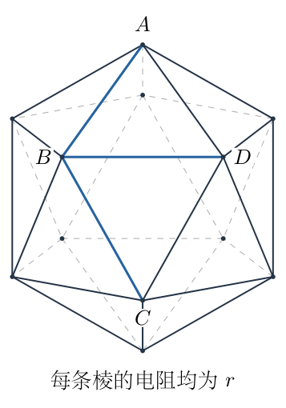

<!-- question-end -->

## 一、题型定位

本题是具有空间对称性的电阻网络问题。完整网络可利用旋转对称性和电流叠加求解；删边以后，对称性减弱，需要识别仍为零电流的棱，并把剩余网络化为三端等效网络。

三问之间有递进关系。第（1）问给出完整网络的非相邻顶点电阻，第（2）问利用特定电流的相互抵消删去支路，第（3）问再用三个端点的等效三角形补全计算。直接把空间图中的相交线都当作结点，或者只凭外观判断并联，都会改变网络。

## 二、知识点

- 欧姆定律与结点电流守恒：结点流出各支路电流之和等于该结点的外部注入电流。
- 电阻网络的线性叠加：各组注入电流产生的电势可逐点相加。
- 对称变换保持边、边电阻与端口条件时，对应结点等势。
- 等势结点之间没有电流；仅凭几何对称而不检查端口条件，不能判定等势。
- 三端线性无源电阻网络可由三个两两连接的等效电阻表示。
- 删去导电支路后等效电阻应增大，量纲应始终为电阻。

## 三、物理图像

图7-1中的正二十面体有12个顶点、30条棱、20个三角形面，每个顶点连接5条棱。以 $A$ 为上极点，把与 $A$ 相邻的五个顶点记为 $U_0,\ldots,U_4$；下一圈记为 $L_0,\ldots,L_4$；与 $A$ 相对的下极点记为 $Z$。本题取

$$
B=U_0,\qquad D=U_1,\qquad C=L_0.
$$

这里的两圈是空间中高低不同的五边形，且彼此错转。$L_i$ 连接 $U_i$、$U_{i+1}$，下标按模5循环；两圈内部又各有五条环边。因此 $A$ 与 $C$ 虽不相邻，却共同邻接 $B$ 和 $D$。图中的虚线表示被遮挡的棱，仍各含电阻 $r$；投影线条在非顶点位置相交时不连接。

在正式的两端测量中，只在 $A$ 注入电流、在 $C$ 抽出电流，其余十个结点没有外接电流。为了使用围绕一个顶点的五重对称性，可先人为构造辅助注流，再通过叠加恢复这一端口条件。

## 四、解题入口

先构造“在某顶点注入 $I_0$，在其余11个顶点各抽出 $I_0/11$”的辅助网络。它的注流总和为零，且完全保留绕该顶点的五重旋转对称性，故四层分别等势。按每层抽出的电流逐层递减，便可求出层间电势差。

再叠加以 $C$ 为中心的反向辅助注流，使所有非端口结点的外接电流抵消。由同一组层电势可同时算出 $R_{AC1}$ 和相邻顶点间电阻；后者将为第三问提供第二个独立条件。

## 五、解析

（1）建立单顶点辅助注流与分层电势。

在辅助问题中，从 $A$ 注入电流 $I_0$，从另外11个结点各抽出 $I_0/11$。取下极点 $Z$ 的电势为零。围绕 $AZ$ 轴旋转 $72^\circ$，网络及每个结点的外接电流都不变，所以同一圈的五个结点等势。记上圈、下圈电势分别为 $u_1$、$u_2$，上极点电势为 $u_A$。

图7-2左侧把四个等势层依次排列。层内的环边没有电流，可从这个辅助问题的电流图中暂时省略；相邻层之间分别有5、10、5条电阻。右侧给出两个辅助注流相加后，端口与其余结点的实际注流。

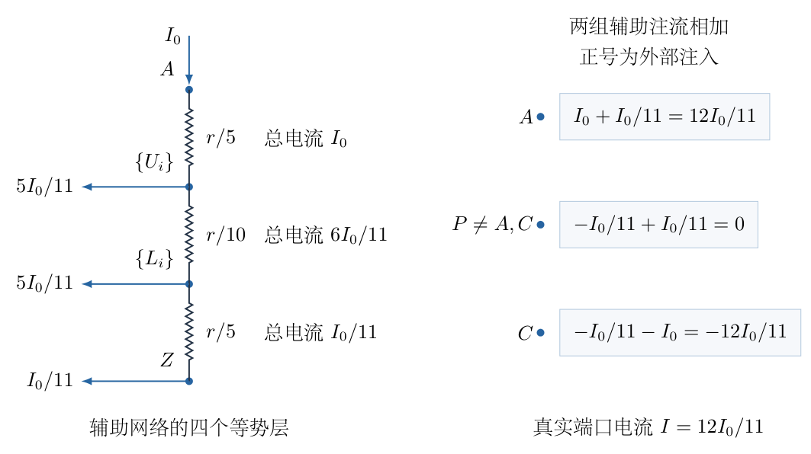

从 $A$ 到上圈的总电流为 $I_0$，均分到5条棱，每条电流为 $I_0/5$，故

$$
u_A-u_1=\frac{rI_0}{5}.
$$

上圈五个结点共抽出 $5I_0/11$。由电流守恒，继续流向下圈的总电流为

$$
I_{12}=I_0-\frac5{11}I_0=\frac6{11}I_0.
$$

两圈之间有10条电阻，每条两端电势差均为 $u_1-u_2$，所以它们电流相同；每条电流为 $I_{12}/10=3I_0/55$。于是

$$
u_1-u_2=\frac3{55}rI_0.
$$

下圈又抽出 $5I_0/11$，剩下流向 $Z$ 的总电流为

$$
I_{2Z}=\frac6{11}I_0-\frac5{11}I_0=\frac1{11}I_0.
$$

这部分由5条棱均分，每条电流为 $I_0/55$，因此

$$
u_2-u_Z=\frac1{55}rI_0.
$$

从 $u_Z=0$ 逐层回加，得到完整电势表：

$$
\begin{aligned}
u_Z&=0,\\
u_2&=\frac1{55}rI_0,\\
u_1&=\frac4{55}rI_0,\\
u_A&=\frac{15}{55}rI_0.
\end{aligned}
$$

四层分别对应距中心顶点0、1、2、3条棱的最短路径距离。记这四个系数为

$$
g_0=\frac{15}{55},\quad
g_1=\frac4{55},\quad
g_2=\frac1{55},\quad
g_3=0.
$$

（2）叠加恢复真实的 $A$—$C$ 两端测量。

第二个辅助问题在 $C$ 抽出 $I_0$，从其余11个结点各注入 $I_0/11$。它的电势是“以 $C$ 为中心的第一辅助电势”的负值。把两个问题相加，结点的净外接电流为

$$
\begin{aligned}
j_A&=I_0+\frac{I_0}{11}=\frac{12}{11}I_0,\\
j_C&=-\frac{I_0}{11}-I_0=-\frac{12}{11}I_0,\\
j_P&=-\frac{I_0}{11}+\frac{I_0}{11}=0\quad(P\ne A,C).
\end{aligned}
$$

所以叠加后的网络正是端口电流

$$
I=\frac{12}{11}I_0
$$

的 $A$—$C$ 测量。两端的最短棱数距离为2，故

$$
\begin{aligned}
V_A&=rI_0(g_0-g_2)=\frac{14}{55}rI_0,\\
V_C&=rI_0(g_2-g_0)=-\frac{14}{55}rI_0.
\end{aligned}
$$

端口电势差为 $28rI_0/55$，不是单个辅助问题中的 $14rI_0/55$。除以真实端口电流：

$$
\begin{aligned}
R_{AC1}
&=\frac{V_A-V_C}{I}\\
&=\frac{28rI_0/55}{12I_0/11}\\
&=\frac{28\times11}{55\times12}r\\
&=\boxed{\frac7{15}r}.
\end{aligned}
$$

同理，如果两端相邻，距离由2换成1，即得到

$$
\begin{aligned}
R_{\rm adj}
&=\frac{2rI_0(g_0-g_1)}{12I_0/11}\\
&=\frac{2(15-4)rI_0/55}{12I_0/11}\\
&=\boxed{\frac{11}{30}r}.
\end{aligned}
$$

特别地，完整网络的 $R_{AB}=R_{BC}=11r/30$。这两个电阻只适用于完整网络，删边后不能照搬。

（3）判断删去三条棱时哪些电势仍可沿用。

现在固定两端电势 $V_A=U$、$V_C=0$。由前面的叠加，任一结点 $P$ 的电势为

$$
V_P=\frac U2+rI_0\left(g_{d(A,P)}-g_{d(C,P)}\right),
$$

其中 $U=28rI_0/55$，$d$ 为最短路径的棱数。$B$、$D$ 都同时与 $A$、$C$ 相邻，故对应的两个 $g_1$ 相减为零：

$$
V_B=V_D=\frac U2.
$$

所以 $BD$ 上没有电流。$AB$、$BC$ 上的电流分别为

$$
I_{AB}=\frac{U-U/2}{r}=\frac{U}{2r},
\qquad
I_{BC}=\frac{U/2-0}{r}=\frac{U}{2r}.
$$

两者在 $B$ 处一进一出，净值为零。这一点比“这两条棱串联”更严格：$B$ 原本还接有另外三条棱，不能单凭画面说它是只有两支路的串联结点。

保持原来各结点电势，同时去掉 $AB$、$BC$，$B$ 的结点方程中被删掉的两项正好相互抵消，其余内部结点方程都没有改变。再去掉 $BD$，删掉的又是零电流项。因此原内部电势仍满足删边网络的全部结点方程，只是从端口流入的总电流减小了 $U/(2r)$。

完整网络的端口电流为 $I_1=U/R_{AC1}$，删三棱后的电流为

$$
I_2=\frac{U}{R_{AC1}}-\frac{U}{2r}.
$$

两边除以 $U$：

$$
\begin{aligned}
\frac1{R_{AC2}}
&=\frac1{R_{AC1}}-\frac1{2r}\\
&=\frac{15}{7r}-\frac1{2r}\\
&=\frac{30-7}{14r}=\frac{23}{14r}.
\end{aligned}
$$

所以

$$
\boxed{R_{AC2}=\frac{14}{23}r}.
$$

这个关系也可写成 $R_{AC1}=R_{AC2}\parallel2r$，但它成立的依据是上面的结点电流抵消，不能把一切看起来连成折线的两条棱都作为独立的 $2r$ 支路删除。

（4）把删去 $AB$、$BC$ 的剩余网络化为三端三角形。

为处理仅删 $AB$ 的情况，先取出 $AB$ 和 $BC$ 两条电阻，保留其余28条棱，包括 $BD$。把剩余网络看成只从 $A$、$B$、$C$ 三个端点接线的电阻网络。内部结点电势由这三个端点电势唯一决定，内部结点消去后，每个端口电流仍是三个端电势的线性函数。

交换 $A$、$C$ 的空间对称变换固定 $B$，并保持这个剩余网络，所以等效三角形的 $AB$、$BC$ 两边电阻相同，记为 $x$；$AC$ 一边记为 $y$。图7-3依次表示取出两条棱后的等效三角形、两棱都放回后的完整网络，以及只放回 $BC$ 的第三问网络。旁路 $y$ 是整个内部网络消元后的电阻，并非原图中一条不存在的直棱。

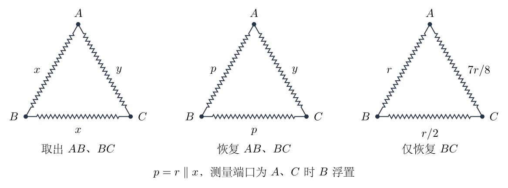

这里的等效关系对任意三端电势都成立，因此可以在等效三角形上把原来取出的两条电阻重新并联回去。在两端 $A$、$C$ 测量时，$B$ 是不外接电流的浮置端；此时两条 $x$ 才真正串联。

令

$$
x=\alpha r,\qquad y=\beta r,
\qquad p=r\parallel x=\frac{\alpha}{1+\alpha}r.
$$

第一项条件来自取出 $AB$、$BC$ 后的 $AC$ 电阻。由于 $BD$ 在这一测量中零电流，保留它与第（2）问相同，故

$$
\frac{2\alpha\beta}{2\alpha+\beta}=\frac{14}{23}.
$$

交叉相乘并逐步移项：

$$
\begin{aligned}
46\alpha\beta&=28\alpha+14\beta,\\
(46\alpha-14)\beta&=28\alpha,\\
\beta&=\frac{14\alpha}{23\alpha-7}.
\end{aligned}
$$

被动网络的 $\beta>0$，因此还要求 $\alpha>7/23$。

第二项条件来自两棱都恢复后的相邻端口电阻。两条 $x$ 分别与 $r$ 并联成为 $p$；测量 $A$、$B$ 时，一条路径是直接的 $p$，另一条路径是经过浮置端 $C$ 的 $y+p$，故

$$
\frac{R_{AB}}r
=\frac{\dfrac{\alpha}{1+\alpha}
\left(\dfrac{\alpha}{1+\alpha}+\beta\right)}
{\dfrac{2\alpha}{1+\alpha}+\beta}
=\frac{11}{30}.
$$

为避免省略消元，分别化简括号与分母：

$$
\begin{aligned}
\frac{\alpha}{1+\alpha}+\beta
&=\frac{\alpha(37\alpha+7)}{(1+\alpha)(23\alpha-7)},\\
\frac{2\alpha}{1+\alpha}+\beta
&=\frac{60\alpha^2}{(1+\alpha)(23\alpha-7)}.
\end{aligned}
$$

代入比值后公共因子消去，得到

$$
\frac{37\alpha+7}{60(1+\alpha)}=\frac{11}{30}.
$$

因此

$$
37\alpha+7=22(1+\alpha),
\qquad15\alpha=15,
\qquad\alpha=1.
$$

回代求 $\beta$：

$$
\beta=\frac{14}{23-7}=\frac78.
$$

所以剩余28棱的三端等效电阻为

$$
\boxed{x=r,\qquad y=\frac78r}.
$$

（5）仅恢复 $BC$，计算第三问。

仅去掉 $AB$ 等价于在上一等效网络中只恢复 $BC$。图7-3右侧的 $AB$ 等效边仍为 $x=r$，$BC$ 等效边变成

$$
x\parallel r=\frac{r^2}{2r}=\frac r2.
$$

测量端口仍为 $A$、$C$，所以经过浮置端 $B$ 的那条路径为 $r+r/2=3r/2$；它与 $y=7r/8$ 并联。逐步计算：

$$
\begin{aligned}
R_{AC3}
&=\frac{(3r/2)(7r/8)}{3r/2+7r/8}\\
&=\frac{21r^2/16}{19r/8}\\
&=\boxed{\frac{21}{38}r}.
\end{aligned}
$$

三个结果汇总为

$$
\boxed{
R_{AC1}=\frac7{15}r,\qquad
R_{AC2}=\frac{14}{23}r,\qquad
R_{AC3}=\frac{21}{38}r.
}
$$

（6）检查大小关系与电流分配。

数值上 $R_{AC1}\approx0.466667r$、$R_{AC3}\approx0.552632r$、$R_{AC2}\approx0.608696r$。只有删去一条棱时增幅较小，删去三棱时增幅较大，故

$$
R_{AC1}<R_{AC3}<R_{AC2}.
$$

这一顺序与删除导电路径的影响一致。第三问中，$B$ 已不再位于端电势的中点：在等效路径上取 $V_A=U$、$V_C=0$，电流为 $U/(3r/2)=2U/(3r)$，故

$$
V_B=\frac{2U}{3r}\frac r2=\frac U3.
$$

因此第三问不能沿用第一问的 $V_B=V_D=U/2$，也不能再把 $BD$ 判为零电流棱。这正是必须保留 $BD$ 并使用完整三端等效网络的原因。

三角形各边都为正，且每个式子均由无量纲系数乘 $r$，不存在把电导与电阻相加的量纲错误。最后可在原30棱图上直接对十个内部结点列电流方程；取一端接地并注入单位电流，端电势分别给出三个相同的有理数，可独立检验上述化简。

## 六、关键洞察

辅助注流将双端口中被破坏的五重对称性拆成两组各自对称的线性问题。它的有效性来自每个结点外接电流的逐项抵消，真实端口电流是 $12I_0/11$；若忘记这个因子，即使分层电势全部算对，最终电阻仍会错。

删去 $AB$、$BC$ 并不要求 $B$ 与剩余网络没有电流交换，只要求两条被删棱在 $B$ 的净贡献为零。内部结点电势保持不变的证明，是这次“去掉一条 $2r$ 路径”成立的依据。

等效三角形描述三个端口的全部响应，因此可在任何两个端口之间测量并联、串联关系。第二问的二端等效值只能提供一个条件；还要从完整网络取得 $R_{AB}$，才能分别确定 $x$、$y$。只用 $R_{AC1}$ 与 $R_{AC2}$ 会得到相互依赖的条件，不能唯一解出三角形。

## 七、易错点

- 把投影线的交叉处当成电气结点。只有原正二十面体的12个顶点连接。
- 因同在一圈就合并结点，却没有确认端口激励仍有旋转对称性。四层等势只对辅助问题成立。
- 辅助问题中流过上下两圈的电流仍取 $I_0$，漏掉上圈已抽走的 $5I_0/11$。
- 叠加后仍把测量电流当成 $I_0$；它实际为 $12I_0/11$。
- 只删 $AB$ 后还把 $BD$ 当作零电流棱，错误沿用完整网络的等势关系。
- 第三问把端口改成 $A$、$B$。本题始终求 $A$、$C$ 间电阻，串联路径必须是经过浮置端 $B$ 的两边之和。
- 把三端等效边 $y$ 理解为实际补上一条新棱。它是内部消元后的响应，不是改造原装置。

## 八、课堂讲解建议

先对照空间图数出12个顶点和30条棱，再把上下两圈的错转关系画清。让学生沿 $A\to B\to C$ 与 $A\to D\to C$ 走一遍，确认 $A$、$C$ 是隔一个顶点的非相邻端点。

讲解辅助注流时，板书四层抽取电流与三个层间总电流，逐次用结点守恒得到 $I_0$、$6I_0/11$、$I_0/11$。完成以后再逐项相加两组注流，尤其在 $A$ 和 $C$ 处写出额外的 $I_0/11$，避免只记叠加结论。

删棱时要求学生先写 $B$ 结点上被删的两项电流之和，再回答为什么剩余电势不变。最后沿图7-3的三个三角形逐步恢复原电阻，每次在图旁注明测量端口和浮置端；这样第三问的串联路径就不会选错。

## 九、变式训练

将 $AB$ 棱的电阻改成 $\lambda r$，其中 $\lambda\geq0$，其他29条棱仍为 $r$。求 $A$、$C$ 间等效电阻，检查 $\lambda=1$、$\lambda\to\infty$ 与 $\lambda=0$ 三个特例。

仍使用取出 $AB$、$BC$ 后的三端网络 $x=r$、$y=7r/8$。恢复 $BC$ 后，$BC$ 等效边为 $r/2$；恢复电阻为 $\lambda r$ 的 $AB$ 后，该边为

$$
p_\lambda=r\parallel(\lambda r)
=\frac{\lambda}{1+\lambda}r.
$$

通过 $B$ 的路径长度为

$$
s_\lambda=p_\lambda+\frac r2
=\frac{3\lambda+1}{2(1+\lambda)}r.
$$

它与 $7r/8$ 并联，故

$$
\begin{aligned}
R_{AC}(\lambda)
&=\frac{s_\lambda(7r/8)}{s_\lambda+7r/8}\\
&=\boxed{\frac{7(3\lambda+1)}{2(19\lambda+11)}r}.
\end{aligned}
$$

当 $\lambda=1$ 时恢复完整网络，得到 $7r/15$；当 $\lambda\to\infty$ 时 $AB$ 开路，得到 $21r/38$；当 $\lambda=0$ 时 $A$、$B$ 短接，得到 $7r/22$。短接后仍须保留其余支路，不能直接把网络的全部电阻置零。

还可用导数检查电阻随 $AB$ 电阻增大的变化方向：

$$
\begin{aligned}
\frac{dR_{AC}}{d\lambda}
&=\frac{7r}{2}
\frac{3(19\lambda+11)-19(3\lambda+1)}{(19\lambda+11)^2}\\
&=\frac{49r}{(19\lambda+11)^2}>0.
\end{aligned}
$$

所以端口电阻从 $7r/22$ 单调增加到 $21r/38$。这个带参数结果同时检验了完整网络与删一棱网络的两个端点，并显示一条棱逐渐变差时总电阻并非线性增加。

\newpage

# 第 8 题

<!-- question-start -->

采用玻尔原子模型，计算氢原子 ${}^{1}_{1}\mathrm H$ 与氘原子 ${}^{2}_{1}\mathrm H$ 从第一激发态跃迁到基态所发光子频率的相对差 $\delta\nu/\nu$。已知电子静能为 $m_ec^2=0.51\,\mathrm{MeV}$，氢核与氘核质量近似满足

$$
M_{\mathrm H}c^2\simeq\frac12M_{\mathrm D}c^2=938\,\mathrm{MeV}.
$$

提示：考虑原子核运动时，量子化条件是核与电子组成的体系关于质心的总角动量为 $n\hbar$。

<!-- question-end -->

## 一、题型定位

本题是玻尔模型中的两体运动与同位素频移。电子与原子核都绕质心运动，不能将原子核视为严格固定。有限核质量使轨道尺度和能级中的质量参数由电子质量 $m_e$ 改为约化质量；两种同位素核质量不同，因而对应跃迁频率略有差别。

第一激发态是 $n=2$，基态是 $n=1$。相对差应先说明分母。下文取氢的频率为基准，定义 $\delta\nu=\nu_{\mathrm D}-\nu_{\mathrm H}$、$\nu=\nu_{\mathrm H}$；两者差为正，代表氘发出的频率略高。

## 二、知识点

- 孤立核—电子体系在质心系中动量相反，两个轨道半径与质量成反比。
- 总角动量是电子角动量与核角动量之和，不能只量子化电子角动量。
- 约化质量 $\mu=m_eM/(m_e+M)$ 同时描述相对运动动能与相对运动角动量。
- 库仑向心力、玻尔角动量量子化与负的束缚态能量。
- 光子能量 $h\nu$ 等于跃迁前后原子内能差。
- 同位素频率比中公共常量抵消，可用精确分式与小参数展开交叉检查。

## 三、物理图像

令核质量为一般的 $M$，电子质量简记为 $m=m_e$，核与电子间距离为 $r$。它们绕共同质心 $O$ 作同一角速度的圆周运动，电子到质心的距离记为 $r_e$，核到质心的距离记为 $r_N$。两者位于质心两侧，满足

$$
r_e+r_N=r,\qquad mr_e=Mr_N.
$$

核质量越大，质心越接近核，核的轨道越小；$M\to\infty$ 时才退化为固定核模型。氘核约为氢核的两倍重，其约化质量更接近 $m$，故束缚能绝对值与跃迁能量都稍大。

题给的 $0.51\,\mathrm{MeV}$ 和 $938\,\mathrm{MeV}$ 是静能 $mc^2$、$Mc^2$。求质量比时共同的 $c^2$ 消去，因此可以直接相除；它们不能作为未除以 $c^2$ 的国际单位质量代入向心力方程。

## 四、解题入口

先解出 $r_e$、$r_N$ 与 $r$ 的关系，再把两者角动量和动能分别相加。只有这一步明确得到相同的约化质量，后面将玻尔模型中的质量改为 $\mu$ 才有依据。

随后联立库仑力与总角动量量子化条件求 $r_n$、$E_n$，取 $E_2-E_1$ 求频率。最后在同一公式中分别令 $M=M_{\mathrm H}$、$M=M_{\mathrm D}\simeq2M_{\mathrm H}$，直接求比值，避免先计算两个十分接近的大频率再相减。

## 五、解析

（1）求质心轨道半径与共同角速度。

在图8-1中，$r_N$、$r_e$ 都从质心 $O$ 量起，$r$ 从核量到电子；速度箭头与各自圆周相切。图仅说明位置及方向，核轨道为便于识别放大表示。下面用图中的距离关系确定精确比例。

由 $mr_e=Mr_N$，有 $r_N=(m/M)r_e$。代入 $r=r_e+r_N$：

$$
\begin{aligned}
r&=r_e\left(1+\frac mM\right),\\
r_e&=\frac{M}{M+m}r,\\
r_N&=\frac{m}{M+m}r.
\end{aligned}
$$

记共同角速度为 $\Omega$，则速率为

$$
v_e=\Omega r_e,\qquad v_N=\Omega r_N.
$$

因两者的瞬时速度方向相反，核相对电子的速率大小为两速率之和：

$$
v_{\rm rel}=v_e+v_N=\Omega(r_e+r_N)=\Omega r.
$$

这不是把同向速度相加，而是对反向运动的两个质点取相对速度的大小；下面的 $v_{\rm rel}$ 一直指核—电子距离矢量转动的速率。

（2）分别相加核与电子的角动量、动能。

两个位置矢量相反，两个速度矢量也相反，所以二者的 $\boldsymbol r\times m\boldsymbol v$ 方向相同，总角动量大小是相加，而非相减：

$$
J=m r_e^2\Omega+M r_N^2\Omega.
$$

将上一段轨道半径代入：

$$
\begin{aligned}
J
&=\left[
\frac{mM^2}{(M+m)^2}
+\frac{Mm^2}{(M+m)^2}
\right]r^2\Omega\\
&=\frac{mM(M+m)}{(M+m)^2}r^2\Omega\\
&=\frac{mM}{M+m}r^2\Omega.
\end{aligned}
$$

定义约化质量

$$
\boxed{\mu=\frac{mM}{M+m}},
$$

于是

$$
\boxed{J=\mu r^2\Omega=\mu r v_{\rm rel}}.
$$

同样，体系总动能为

$$
\begin{aligned}
K
&=\frac12m\Omega^2r_e^2+\frac12M\Omega^2r_N^2\\
&=\frac12\left[m\left(\frac M{M+m}\right)^2
+M\left(\frac m{M+m}\right)^2\right]\Omega^2r^2\\
&=\frac12\mu\Omega^2r^2
=\frac12\mu v_{\rm rel}^2.
\end{aligned}
$$

因此约化质量不是只出现在某一个公式中的修正，它使相对运动的角动量与总动能具有一致的单粒子形式。

（3）建立相对运动的向心力方程。

两种原子核电荷都为 $+e$，电子电荷为 $-e$，库仑力大小相同。令

$$
\kappa=\frac{e^2}{4\pi\varepsilon_0},
\qquad F=\frac{\kappa}{r^2}.
$$

直接对电子列向心力方程：

$$
\frac{\kappa}{r^2}=m\Omega^2r_e.
$$

由 $mr_e=mMr/(M+m)=\mu r$，得到

$$
\frac{\kappa}{r^2}=\mu\Omega^2r
=\frac{\mu v_{\rm rel}^2}{r}.
$$

对核列式 $F=M\Omega^2r_N$ 也得到同一结果，因为 $Mr_N=\mu r$。由此可得

$$
\boxed{\mu v_{\rm rel}^2=\frac{\kappa}{r}}.
$$

这里核与电子所受库仑力是同一对作用与反作用力；总角动量虽然有两项，库仑势能仍只有一项 $-\kappa/r$，不能再乘2。

（4）由量子化条件求轨道半径与能级。

按题目提示，体系总角动量满足

$$
\mu r_n v_n=n\hbar,
\qquad n=1,2,\ldots,
$$

其中 $v_n$ 是相对运动速率。先解出

$$
v_n=\frac{n\hbar}{\mu r_n}.
$$

代入向心力关系，逐步消去速率：

$$
\begin{aligned}
\mu\left(\frac{n\hbar}{\mu r_n}\right)^2&=\frac{\kappa}{r_n},\\
\frac{n^2\hbar^2}{\mu r_n^2}&=\frac{\kappa}{r_n},\\
n^2\hbar^2&=\mu\kappa r_n,\\
r_n&=\boxed{\frac{n^2\hbar^2}{\mu\kappa}}.
\end{aligned}
$$

束缚态总能量是核与电子总动能加相互作用势能：

$$
\begin{aligned}
E_n
&=K+U
=\frac12\mu v_n^2-\frac{\kappa}{r_n}\\
&=\frac12\frac{\kappa}{r_n}-\frac{\kappa}{r_n}
=-\frac{\kappa}{2r_n}\\
&=\boxed{-\frac{\mu\kappa^2}{2n^2\hbar^2}}.
\end{aligned}
$$

负号表示以无限远分离、相对静止的核与电子为零能量时，原子为束缚态。更大的 $\mu$ 对应更小的 $r_n$ 和更负的 $E_n$，不是能级整体向更高能量移动。

（5）从第一激发态到基态的光子频率。

图8-2以分离态为能量零点，$E_2$ 在 $E_1$ 上方。箭头向下表示原子内能减少，箭头旁正的 $h\nu$ 表示光子带走的能量；两者不能混用符号。

第一激发态为 $n=2$，因此

$$
E_2=-\frac{\mu\kappa^2}{8\hbar^2},
\qquad
E_1=-\frac{\mu\kappa^2}{2\hbar^2}.
$$

由光子能量关系，

$$
\begin{aligned}
h\nu
&=E_2-E_1\\
&=-\frac{\mu\kappa^2}{8\hbar^2}
+\frac{\mu\kappa^2}{2\hbar^2}\\
&=\frac{3\mu\kappa^2}{8\hbar^2}.
\end{aligned}
$$

所以

$$
\boxed{\nu=\frac{3\kappa^2}{8h\hbar^2}\mu}.
$$

前面的系数对氢、氘相同，因为二者核电荷相同、跃迁的两个量子数相同。差别只在 $\mu$，所以无需知道 $e$、$\varepsilon_0$、$h$ 的数值就能求频率的相对差。

（6）先求精确频率比，再代入质量比。

令 $M=M_{\mathrm H}$，采用题给近似 $M_{\mathrm D}=2M$。两种约化质量分别为

$$
\mu_{\mathrm H}=\frac{mM}{M+m},
\qquad
\mu_{\mathrm D}=\frac{2mM}{2M+m}.
$$

因为 $\nu\propto\mu$，频率比为

$$
\begin{aligned}
\frac{\nu_{\mathrm D}}{\nu_{\mathrm H}}
&=\frac{\mu_{\mathrm D}}{\mu_{\mathrm H}}\\
&=\frac{2mM}{2M+m}\frac{M+m}{mM}\\
&=\frac{2(M+m)}{2M+m}.
\end{aligned}
$$

分子比分母多 $m$，因此 $\nu_{\mathrm D}>\nu_{\mathrm H}$。按以氢为基准的相对差定义：

$$
\begin{aligned}
\frac{\delta\nu}{\nu_{\mathrm H}}
&=\frac{\nu_{\mathrm D}}{\nu_{\mathrm H}}-1\\
&=\frac{2(M+m)-(2M+m)}{2M+m}\\
&=\boxed{\frac{m}{2M+m}}.
\end{aligned}
$$

把分子分母同时乘以 $c^2$，便可以使用题给静能：

$$
\begin{aligned}
\frac{\delta\nu}{\nu_{\mathrm H}}
&=\frac{mc^2}{2Mc^2+mc^2}\\
&=\frac{0.51}{2\times938+0.51}\\
&=\frac{0.51}{1876.51}\\
&\approx2.71781\times10^{-4}.
\end{aligned}
$$

故按题给数据的有效数字，

$$
\boxed{\frac{\delta\nu}{\nu}\simeq2.7\times10^{-4}\simeq0.027\%},
\qquad\nu_{\mathrm D}>\nu_{\mathrm H}.
$$

（7）用另一种差分与展开核验。

直接相减两个约化质量，保持通分步骤：

$$
\begin{aligned}
\mu_{\mathrm D}-\mu_{\mathrm H}
&=\frac{2mM(M+m)-mM(2M+m)}{(2M+m)(M+m)}\\
&=\frac{m^2M}{(2M+m)(M+m)}.
\end{aligned}
$$

再除以 $\mu_{\mathrm H}=mM/(M+m)$，仍得到 $m/(2M+m)$，与先求比值的方法相同。

令小参数 $\epsilon=m/M$，则精确结果为

$$
\frac{\delta\nu}{\nu_{\mathrm H}}
=\frac{\epsilon}{2+\epsilon}
=\frac\epsilon2\frac1{1+\epsilon/2}.
$$

利用 $1/(1+z)=1-z+z^2-\cdots$，展开至二阶：

$$
\frac{\delta\nu}{\nu_{\mathrm H}}
=\frac\epsilon2-\frac{\epsilon^2}{4}+O(\epsilon^3).
$$

其中 $\epsilon=0.51/938\simeq5.44\times10^{-4}$。一阶结果 $\epsilon/2\simeq2.71855\times10^{-4}$ 与精确结果仅相差约 $7.4\times10^{-8}$，在题给质量的精度下都表示为 $2.7\times10^{-4}$。

若相对差改以氘频率为分母，则

$$
\frac{\delta\nu}{\nu_{\mathrm D}}
=\frac{m}{2(M+m)}.
$$

它与以氢为分母的表达式在二阶才出现差别。一阶时两者都为 $m/(2M)$，所以在最终近似答案里可统一写成 $\delta\nu/\nu\simeq m/(2M)$，但精确计算必须交代分母。

（8）检查固定核极限与模型适用范围。

当 $M\to\infty$ 时，$\mu\to m$，$r_N\to0$，$r_n$、$E_n$ 都退化为通常的固定核玻尔结果；此时两同位素若都按无限核质量处理，其频移为零。有限质量修正正是题目保留核运动的原因。

当 $M$ 增大时，

$$
\frac{d\mu}{dM}=\frac{m^2}{(M+m)^2}>0,
$$

因此同一跃迁的频率随核质量增加而增大，符合上面求出的正号。量纲方面，$\kappa$ 的单位为能量乘长度，$\mu\kappa^2/\hbar^2$ 为能量，再除以 $h$ 才是频率；相对差 $m/(2M+m)$ 无量纲。

本题在非相对论玻尔模型内计算核的轨道运动对能级的修正；没有另加入精细结构、核尺寸等效应。核与电子的两体圆周运动已经包含在 $\mu$ 中，不能在得到约化质量后再重复扣除一份同样的“核动能修正”。

## 六、关键洞察

与核运动有关的三个量同时改变：电子的质心轨道半径、核的质心轨道半径，以及体系总角动量。仅补上核动能、却仍将电子角动量写成 $n\hbar$，会使力学条件和量子化条件彼此不一致。

两同位素的相对频移与跃迁选择无关，只要核电荷相同、量子数相同，任意玻尔跃迁能量都正比于约化质量。第一激发态到基态的 $3/4$ 能级差因子在频率比中消去；这个规律也可用作另一条核验。

发光时原子整体的动量反冲与核—电子内部轨道的有限质量修正是不同效应。若进一步考虑整体反冲，静止原子发光后光子动量约为 $h\nu/c$，原子平动动能约为 $(h\nu)^2/(2M_{\rm atom}c^2)$，能量守恒变为 $\Delta E=h\nu+(h\nu)^2/(2M_{\rm atom}c^2)$。其相对修正量约为光子能量与原子静能之比的一半，远小于本题的 $m/M$ 级修正；本题没有要求在玻尔模型结果之外再计算它。

## 七、易错点

- 将第一激发态当作 $n=1$，混淆基态与激发态。对应跃迁是 $2\to1$。
- 以电子绕质心的半径 $r_e$ 代替库仑力中的核—电子距离 $r$。
- 因两速度反向就把两角动量相减。位置矢量也反向，角动量方向实际相同。
- 只使用电子角动量量子化，遗漏题目强调的体系总角动量。
- 总动能计入两项后又把库仑势能加两次。核—电子相互作用势能只有一项。
- 把 $E_1-E_2<0$ 当作发出光子的能量；正的发光能量是 $E_2-E_1$。
- 两原子核电荷相同就判断频率完全相同，忽略质量导致的约化质量差。
- 精确相对差没有说明分母，或误把无量纲的 $2.7\times10^{-4}$ 写成 $2.7\times10^{-4}\%$。

## 八、课堂讲解建议

先在图8-1上只标质心、两个半径与两速度，不先给约化质量。让学生用质心条件求半径比，再把动能和角动量分别相加，亲自看到同一个 $mM/(m+M)$ 出现在两处。

板书能级时始终以核—电子分离态为零能量，并把光子能量写在向下跃迁箭头旁。要求学生先判断氘频率更大还是更小，再开始质量比化简；最终用 $d\mu/dM>0$ 回查判断。

相对频移可安排两条核验：先求频率比再减1；先通分相减约化质量再除以基准值。最后比较精确式与一阶展开，说明为何没有必要把题给两位有效数字的电子静能计算成过多小数位的最终答案。

## 九、变式训练

若同核电荷的第二种同位素核质量为 $\eta M$，其中 $\eta>1$，两原子完成相同的 $n_i\to n_f$ 跃迁，求以核质量 $M$ 的原子为基准的相对频移；再求两原子同一量子数轨道的核—电子距离之比。

一般跃迁能量为

$$
\Delta E
=\frac{\mu\kappa^2}{2\hbar^2}
\left(\frac1{n_f^2}-\frac1{n_i^2}\right),
\qquad n_i>n_f.
$$

量子数括号因子在两原子频率比中消去。令 $\epsilon=m/M$，两约化质量为

$$
\mu_1=\frac{m}{1+\epsilon},
\qquad
\mu_2=\frac{m}{1+\epsilon/\eta}.
$$

所以

$$
\begin{aligned}
\frac{\nu_2-\nu_1}{\nu_1}
&=\frac{1+\epsilon}{1+\epsilon/\eta}-1\\
&=\frac{\epsilon(1-1/\eta)}{1+\epsilon/\eta}\\
&=\boxed{\frac{(\eta-1)m}{\eta M+m}}.
\end{aligned}
$$

当 $\eta=2$ 时得到本题的 $m/(2M+m)$。当 $\eta\to1$ 时两质量相同，频移为零；当 $\eta\to\infty$ 时第二原子趋于固定核极限，相对频移趋于 $m/M$，即第一原子距离固定核近似的全部一阶修正。

轨道距离 $r_n\propto1/\mu$，因此

$$
\frac{r_{n,2}}{r_{n,1}}
=\frac{\mu_1}{\mu_2}
=\frac{1+\epsilon/\eta}{1+\epsilon}<1.
$$

较重同位素的轨道更小，与其能级绝对值更大互相对应。注意这里比较的是核—电子间距；电子自身到质心的半径还要再乘 $M/(M+m)$。代入 $r_{e,n}=Mr_n/(M+m)$，进一步得到

$$
r_{e,n}
=\frac{M}{M+m}\frac{n^2\hbar^2}{\mu\kappa}
=\frac{n^2\hbar^2}{m\kappa}.
$$

在这一圆轨道玻尔模型中，相同 $n$ 下电子到质心的半径竟与核质量无关，变化来自核轨道半径及共同角速度。这个结果不能由“重核使电子离质心更近”的直觉替代，必须同时代入质心比例与量子化轨道距离才能看清。
