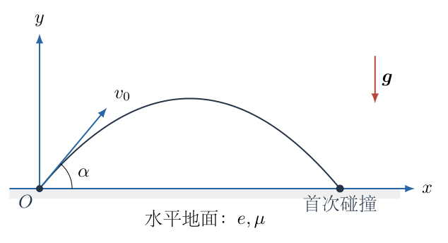
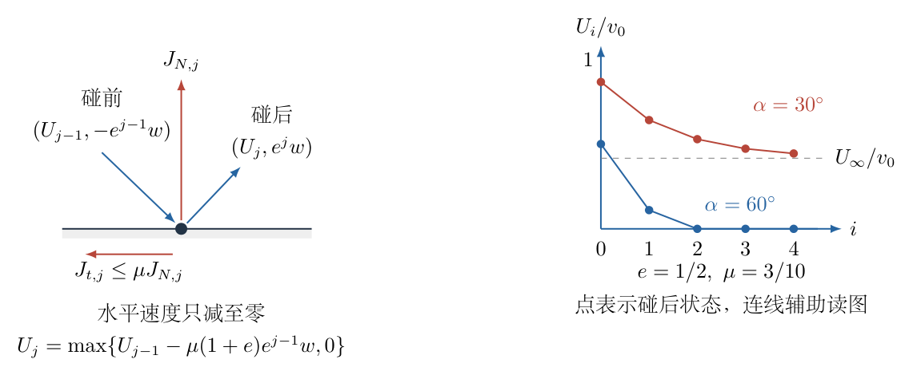

# 第 1 题

<!-- question-start -->

一个大小可忽略的球形物体从水平地面抛出，初速度大小为 $v_0$，抛射方向与水平面的夹角为 $\alpha\in(0,\pi/2)$。物体与地面碰撞的法向恢复系数为 $e\in(0,1)$，摩擦系数为 $\mu\in(0,1)$，重力加速度为 $g$。每次碰撞的持续时间很短，忽略空气阻力。

按质点模型处理碰撞与滑动，求不同参数条件下，物体相对出发点能够达到的最大水平位移。物体在地面上的运动方向取为水平方向正向。

<!-- question-end -->

## 一、题型定位

斜抛运动、非完全弹性碰撞和库仑摩擦相耦合的分段运动。每次落地时竖直速度反向并衰减，水平方向受到反向摩擦冲量；飞行过程中水平速度不变。最后可能在某次碰撞中失去全部水平速度，也可能在无限次反弹结束后仍有水平速度，并继续贴地滑行。

题目给定 $\alpha$ 时，所求是整个运动中水平坐标的最大值；不能只算第一次落点，也不能只把全部抛物线的水平距离相加而漏掉末段滑行。若另外允许选择发射角，则是在所得分段函数上继续优化的另一层问题。

## 二、知识点

- 法向恢复系数定义为碰撞后、前法向相对速度大小之比。
- 冲量定理适用于碰撞短时间；重力冲量与接触冲量相比可忽略。
- 滑动接触中的切向冲量大小为法向冲量的 $\mu$ 倍，但最多只能消去现有的正向切向动量。
- 斜抛从地面出发又回到地面，飞行时间为初始竖直速度的 $2/g$ 倍。
- 等比级数、取整不等式和无限碰撞的有限总时间。
- 贴地滑动的停止距离为初速度平方除以 $2\mu g$。

## 三、物理图像

取出发点为原点，$x$ 轴沿初始水平速度方向，$y$ 轴竖直向上。为了把符号的作用分清，记初速度的两个正分量为

$$
U=v_0\cos\alpha,\qquad w=v_0\sin\alpha.
$$

以 $i=0$ 表示第一次自由飞行，以 $i=1$ 表示第一次碰撞后的飞行，依此类推。第 $i$ 段飞行的竖直初速度为 $e^i w$。只要水平速度还没有变成零，第 $i$ 段飞行的水平速度记为 $U_i$；$U_0=U$。

法向反弹越来越弱，并不自动保证水平速度也趋于零。因为每次能够提供的摩擦冲量也随着法向冲量衰减，其总和可能不足以消去初始水平动量。这正是本题需要分类的原因。

## 四、解题入口

先独立求出第 $j$ 次碰撞的法向冲量，再由切向冲量得到水平速度递推式。随后比较“所有碰撞能提供的最大摩擦冲量总和”和初始水平动量，判断水平运动何时终止。

分类之后分别求距离：有限次碰撞停下时只加到最后一段有水平速度的飞行；无限次反弹后仍有剩余速度时，要补上贴地滑行。不能在尚未判断速度是否为正之前，把等比求和公式无限延伸。

## 五、解析

（1）确定每次碰撞前后的竖直速度与法向冲量。

第 $j$ 次碰撞前的竖直速度为 $-e^{j-1}w$，碰撞后为 $e^jw$。向上的法向冲量记为 $J_{N,j}$。对竖直方向列冲量定理：

$$
\begin{aligned}
J_{N,j}
&=m\bigl[e^jw-(-e^{j-1}w)\bigr]\\
&=m(1+e)e^{j-1}w.
\end{aligned}
$$

质量 $m$ 只是列式的辅助量，最后会约去。冲量中出现 $1+e$ 而不是 $1-e$，是因为竖直动量发生了反向；恢复系数只用于法向速度，不能同时把水平速度也乘以 $e$。

图1-2把碰撞前后的速度、切向冲量截断以及后续两种终止情形放在一起。图中的 $U_{j-1}$ 是第 $j$ 次碰撞前的水平速度，$U_j$ 是碰撞后水平速度。

在碰撞期间若始终保持正向滑动，向左摩擦冲量大小为 $\mu J_{N,j}$。一旦水平速度降为零，不能再把这一冲量公式延伸为反向加速；地面没有任何使质点重新向左运动的外部驱动。

（2）建立带有物理截断的速度递推。

未停止滑动时，水平方向的冲量定理为

$$
\begin{aligned}
mU_j-mU_{j-1}&=-\mu J_{N,j},\\
U_j&=U_{j-1}-\mu(1+e)e^{j-1}w.
\end{aligned}
$$

把“降到零就停止水平滑动”写入同一式，得到

$$
\boxed{
U_j=\max\!\left\{U_{j-1}-\mu(1+e)e^{j-1}w,\ 0\right\}.
}
$$

由于每次扣除的量都非负，$\{U_j\}$ 单调不增且始终非负。若某次已经得到 $U_j=0$，后续弹跳没有水平相对速度，也没有产生水平运动的原因，故以后各段水平速度均为零。

在停止以前，把前 $i$ 次摩擦减速量相加：

$$
\begin{aligned}
U_i
&=U-\mu(1+e)w(1+e+\cdots+e^{i-1})\\
&=U-\frac{\mu(1+e)}{1-e}w(1-e^i).
\end{aligned}
$$

这里使用有限等比数列求和。定义无量纲参数

$$
K=\frac{\mu(1+e)}{1-e},
$$

则对所有非负整数 $i$ 都可以统一写成

$$
\boxed{U_i=\max\{U-Kw(1-e^i),0\}.}
$$

写出截断以后，即使形式上的线性表达式变负，也不会引入不真实的反向运动。

（3）先计算法向弹跳的总时间。

第 $i$ 段飞行从地面出发又回到地面，竖直运动满足

$$
0=e^iw\,t_i-\frac12gt_i^2.
$$

除去刚出发的零时间根，取正根：

$$
t_i=\frac{2e^iw}{g}.
$$

所以全部竖直反弹所用时间之和为

$$
T_*=\sum_{i=0}^{\infty}t_i
=\frac{2w}{g}\sum_{i=0}^{\infty}e^i
=\frac{2w}{g(1-e)}.
$$

因 $0<e<1$，这个总时间有限。理想质点模型在 $T_*$ 后进入持续接触地面的状态；此时若仍有水平速度，就以法向支持力 $mg$ 产生摩擦力 $\mu mg$。无限次碰撞并不等于物体需要无限长时间才回到地面。

（4）判断有限次停下还是无限次后仍滑行。

未截断表达式的极限为

$$
U_\infty^{\mathrm{form}}=U-Kw.
$$

它与实际速度极限不同：只有右侧非负时才可以直接取用。于是分为三种情形：

- 若 $U>Kw$，每次碰撞后水平速度均为正，全部反弹结束后仍剩下 $U-Kw>0$。
- 若 $U=Kw$，有 $U_i=Kw e^i>0$，水平速度随反弹趋于零，但没有有限的某一次碰撞使其恰好停止。
- 若 $U<Kw$，由于 $U-Kw(1-e^i)$ 随 $i$ 降到负值，必在某个有限次碰撞时把水平速度消去。

用题给参数写，前两种情形的合并条件为

$$
U\geq Kw
\quad\Longleftrightarrow\quad
\boxed{\cot\alpha\geq\frac{\mu(1+e)}{1-e}.}
$$

等号必须单独说明其物理含义，不能把“极限为零”误认成“某次碰撞后已经为零”。

（5）在 $U\geq Kw$ 时求全部飞行距离。

第 $i$ 段飞行的水平距离为

$$
\Delta x_i=U_it_i
=\frac{2w}{g}\bigl[U-Kw+Kw e^i\bigr]e^i.
$$

此时所有 $U_i$ 非负，可以从 $i=0$ 求和到无穷：

$$
\begin{aligned}
D_{\mathrm{air}}
&=\frac{2w}{g}
\left[(U-Kw)\sum_{i=0}^{\infty}e^i
+Kw\sum_{i=0}^{\infty}e^{2i}\right]\\
&=\frac{2w}{g}
\left[\frac{U-Kw}{1-e}
+\frac{Kw}{1-e^2}\right]\\
&=\frac{2Uw}{g(1-e)}
+\frac{2Kw^2}{g}
\left[-\frac1{1-e}+\frac1{(1-e)(1+e)}\right]\\
&=\frac{2Uw}{g(1-e)}
-\frac{2Kew^2}{g(1-e)(1+e)}\\
&=\boxed{\frac{2Uw}{g(1-e)}
-\frac{2\mu e w^2}{g(1-e)^2}}.
\end{aligned}
$$

第二个求和的公比为 $e^2$，不是 $e$。最后一步代入了 $K=\mu(1+e)/(1-e)$，其中因子 $1+e$ 完整约去。

（6）补上无限反弹之后的贴地滑行。

剩余水平速度为 $U-Kw$。以滑行阶段刚开始的位置为起点，水平方向加速度为 $-\mu g$，由速度—位移关系

$$
0=(U-Kw)^2-2\mu gD_{\mathrm{slide}},
$$

得到

$$
D_{\mathrm{slide}}=\frac{(U-Kw)^2}{2\mu g}.
$$

临界情况 $U=Kw$ 自动给出零滑行距离。总距离为

$$
D=D_{\mathrm{air}}+D_{\mathrm{slide}}.
$$

把平方展开，并按 $U^2$、$Uw$、$w^2$ 分别合并：

$$
\begin{aligned}
gD
={}&\frac{U^2}{2\mu}
+\left[\frac2{1-e}-\frac K\mu\right]Uw
+\left[\frac{K^2}{2\mu}
-\frac{2\mu e}{(1-e)^2}\right]w^2.
\end{aligned}
$$

两个待化简系数分别为

$$
\begin{aligned}
\frac2{1-e}-\frac K\mu
&=\frac{2-(1+e)}{1-e}=1,\\
\frac{K^2}{2\mu}-\frac{2\mu e}{(1-e)^2}
&=\frac{\mu[(1+e)^2-4e]}{2(1-e)^2}\\
&=\frac{\mu(1-e)^2}{2(1-e)^2}=\frac\mu2.
\end{aligned}
$$

因此这一类参数下有简洁结果

$$
\boxed{
D=\frac{(U+\mu w)^2}{2\mu g}
=\frac{v_0^2}{2\mu g}
(\cos\alpha+\mu\sin\alpha)^2,
\qquad U\geq Kw.
}
$$

恢复系数 $e$ 在最终公式中消去，并不意味着它在整个问题中没有作用。它决定这一公式的适用范围，同时改变反弹距离和滑行距离之间的分配。

（7）在 $U<Kw$ 时确定首次停止水平运动的碰撞次数。

设第 $n$ 次碰撞刚好消去水平速度。它的严格定义是

$$
U_{n-1}>0,\qquad U_n=0.
$$

用未截断表达式判断，得到

$$
U-Kw(1-e^{n-1})>0,
\qquad
U-Kw(1-e^n)\leq0.
$$

由于 $Kw>0$，可以移项并同除 $Kw$。令

$$
z=1-\frac{U}{Kw}
=1-\frac{1-e}{\mu(1+e)\tan\alpha}.
$$

在本情形下 $0<z<1$，前述不等式等价于

$$
\boxed{e^{n-1}>z\geq e^n.}
$$

对正数取自然对数时保持不等号方向；随后除以负数 $\ln e<0$ 时要反向，故

$$
n-1<\frac{\ln z}{\ln e}\leq n.
$$

由此

$$
\boxed{
n=\left\lceil\frac{\ln z}{\ln e}\right\rceil.
}
$$

这里 $\lceil\cdot\rceil$ 表示向上取整。如果比值恰为整数，就取这个整数，而不是再加一。例如 $z=e^3$ 时，第3次碰撞恰好消去水平动量，应取 $n=3$。数值计算靠近整数边界时，还应回代 $e^{n-1}>z\geq e^n$ 检验，避免浮点取整错误。

（8）有限次停下时对正确的飞行段求和。

第 $n$ 次碰撞发生之前，最后一段有水平运动的飞行编号是 $i=n-1$。所以不是求到 $i=n$，而是

$$
D_n=\sum_{i=0}^{n-1}\Delta x_i.
$$

第 $n$ 次碰撞以后可能还有竖直弹跳，但它们的水平位移全为零，也没有后续贴地滑行。代入速度和飞行时间：

$$
\begin{aligned}
D_n
&=\frac{2w}{g}\sum_{i=0}^{n-1}
\bigl[U-Kw+Kw e^i\bigr]e^i\\
&=\frac{2w}{g}
\left[(U-Kw)\frac{1-e^n}{1-e}
+Kw\frac{1-e^{2n}}{1-e^2}\right].
\end{aligned}
$$

这已经是一个可直接计算的完整表达式。为了看清参数的作用，再令 $s=e^n$，利用 $1-s^2=(1-s)(1+s)$，把含 $Kw$ 的两项合并：

$$
\begin{aligned}
-\frac{1-s}{1-e}+\frac{1-s^2}{1-e^2}
&=\frac{1-s}{1-e}
\left[-1+\frac{1+s}{1+e}\right]\\
&=-\frac{(1-s)(e-s)}{(1-e)(1+e)}.
\end{aligned}
$$

因此

$$
\boxed{
D_n=
\frac{2Uw}{g}\frac{1-e^n}{1-e}
-\frac{2\mu w^2}{g}
\frac{(1-e^n)(e-e^n)}{(1-e)^2}.
}
$$

代回 $U,w$ 后，也可写为

$$
\begin{aligned}
D_n&=\frac{v_0^2}{g}
\left[A_n\sin2\alpha-B_n(1-\cos2\alpha)\right],\\
A_n&=\frac{1-e^n}{1-e},\\
B_n&=\frac{\mu(1-e^n)(e-e^n)}{(1-e)^2}.
\end{aligned}
$$

这三个量的定义都不带单位，距离的量纲由 $v_0^2/g$ 提供。

（9）检验首次碰撞即停下及临界连接。

当 $n=1$ 时，$e-e^n=0$，$A_1=1$，故

$$
D_1=\frac{2Uw}{g}=\frac{v_0^2\sin2\alpha}{g}.
$$

这正是第一次抛物线的射程。对应条件为

$$
U\leq\mu(1+e)w,
$$

即第一次碰撞能提供的摩擦冲量已足够消去全部水平动量。

在 $U=Kw(1-e^n)$ 的分界处，若用包含下一段的距离公式，则多出的那一段正好等于

$$
U_n t_n=0\times\frac{2e^nw}{g}=0.
$$

所以相邻碰撞次数分支的距离连续。跨过分界后虽然需要多一次碰撞才停止，但总距离不会发生无穷小参数变化引起的有限跳变。

当 $U<Kw$ 且逐渐接近 $Kw$ 时，$z\to0$、$n\to\infty$。有限求和中的 $e^n,e^{2n}$ 都趋于零，结果连续接到无穷反弹临界式。由两条路线都得到

$$
D=\frac{2\mu w^2}{g(1-e)^2}
\qquad(U=Kw).
$$

（10）用具体参数核对两类运动。

取 $e=1/2$、$\mu=3/10$，则 $K=9/10$。当 $\alpha=30^\circ$ 时，

$$
U=\frac{\sqrt3}{2}v_0,\qquad
w=\frac12v_0,\qquad U-Kw>0.
$$

总距离为

$$
D=\frac{v_0^2}{g}
\frac{(\sqrt3/2+3/20)^2}{3/5}
\approx1.72051\,\frac{v_0^2}{g}.
$$

其中飞行距离约为 $1.43205v_0^2/g$，剩余滑行距离约为 $0.28846v_0^2/g$，相加回到总结果。

若把角度改为 $60^\circ$，则

$$
\begin{aligned}
U_1&=\left(\frac12-\frac{9\sqrt3}{40}\right)v_0>0,\\
U_2^{\mathrm{form}}
&=\left(\frac12-\frac{27\sqrt3}{80}\right)v_0<0.
\end{aligned}
$$

故第2次碰撞停止水平运动，实际 $U_2=0$。用 $n=2$ 的公式，$A_2=3/2$、$B_2=9/40$，得到

$$
D_2=\frac{v_0^2}{g}
\left[\frac32\frac{\sqrt3}{2}-\frac9{40}\frac32\right]
=\left(\frac{3\sqrt3}{4}-\frac{27}{80}\right)\frac{v_0^2}{g}
\approx0.96154\,\frac{v_0^2}{g}.
$$

第一次飞行的距离约为 $0.86603v_0^2/g$，第二次约为 $0.09551v_0^2/g$。以后各段只发生竖直弹跳。这一逐次计算与分段公式相互独立地检查了求和上限和速度截断。

综上，实际水平速度在任何阶段都非负，所以水平坐标单调不减。上面求出的最终水平位移就是全过程最大水平位移，不需要再寻找某个中间时刻的局部极大值。

（11）检查恢复系数接近一时的有限碰撞极限。

虽然原题限定 $e<1$，仍可从 $e\to1^-$ 检查公式是否合理。固定 $U,w,\mu>0$ 时，$K=\mu(1+e)/(1-e)\to\infty$，最终属于有限次碰撞消去水平速度的分支，而不是保留末段滑行的分支。

对于固定的飞行编号 $i$，把等比和写回有限项后再取极限：

$$
\begin{aligned}
\mu(1+e)w(1+e+\cdots+e^{i-1})
&\longrightarrow2\mu wi,\\
U_i&\longrightarrow\max\{U-2\mu wi,0\},\\
t_i=\frac{2e^iw}{g}&\longrightarrow\frac{2w}{g}.
\end{aligned}
$$

因此每次碰撞削减的水平速度趋于同一值 $2\mu w$，各段飞行时间也趋于同一值。令 $n_0=\lceil U/(2\mu w)\rceil$，则极限总距离可直接由等差数列求和：

$$
\begin{aligned}
D_{\text{极限}}
&=\frac{2w}{g}\sum_{i=0}^{n_0-1}(U-2\mu wi)\\
&=\frac{2w}{g}
\left[n_0U-2\mu w\frac{n_0(n_0-1)}2\right]\\
&=\boxed{\frac{2w}{g}
\left[n_0U-\mu w n_0(n_0-1)\right]}.
\end{aligned}
$$

若 $U/(2\mu w)$ 恰为整数，从 $e<1$ 接近时可能多出一段水平速度趋于零的飞行，其距离也趋于零，所以上式仍连续成立。这里不能先把含 $1-e$ 的分式直接代成“分母为零”，也不能把 $e<1$ 的无限碰撞总时间公式当成 $e=1$ 时仍有限。恢复系数接近一时，竖直反弹长期持续，但摩擦仍可在有限次碰撞内消去全部水平动量。

## 六、关键洞察

法向冲量总和有限：

$$
\sum_{j=1}^{\infty}J_{N,j}
=\frac{m(1+e)w}{1-e}.
$$

与之对应的最大摩擦冲量总量为 $\mu m(1+e)w/(1-e)=mKw$。这使分类条件可以直接解释为动量预算：若初始水平动量 $mU$ 超过该值，就必然保留末段滑行。

更重要的是，有限次停止情形也存在统一上界。令 $s=e^n$，并定义

$$
C_n=\frac{1+e-2e^n}{1-e}.
$$

将主解的 $D_n$ 与 $(U+\mu w)^2/(2\mu g)$ 作差，按 $U^2,Uw,w^2$ 展开整理，得到

$$
\boxed{
\frac{(U+\mu w)^2}{2\mu g}-D_n
=\frac{(U-\mu C_nw)^2}{2\mu g}\geq0.
}
$$

这是一个完全平方差。因而不论属于哪种碰撞次数情形，都有

$$
D\leq\frac{v_0^2}{2\mu g}
(\cos\alpha+\mu\sin\alpha)^2
\leq\frac{(1+\mu^2)v_0^2}{2\mu g}.
$$

第二个不等式可由柯西不等式得到。它是整个参数范围内的上界，但不保证任意给定的 $e,\mu$ 都能取到；取等还必须满足所选发射角属于相应的物理分支。

## 七、易错点

- 把恢复系数同时用于水平速度，漏掉摩擦冲量。
- 将摩擦冲量机械算到水平速度为负，使无驱动质点反向滑行。
- 漏掉第0段初次飞行，或在第 $n$ 次停止时多算第 $n$ 段。
- 把 $\sum e^{2i}$ 的分母写成 $1-e$。
- 只算反弹过程，忘记无限反弹后仍可存在贴地滑行。
- 用向下取整代替向上取整；取对数后除以负数却不改变不等号。
- 用没有 $e$ 的简洁距离式覆盖所有参数，不检查适用条件。
- 将给定发射角下的最大位移，与对发射角再优化的全局最远距离混为一谈。

## 八、课堂讲解建议

课堂先只讨论一次碰撞，让学生分别写出法向和切向冲量，并用一个较大的摩擦系数检验“算出负水平速度”是否合理。明确截断以后，再用表格列出前三段飞行的 $U_i,e^iw,t_i$。

板书将 $i$ 表示飞行段、$j$ 表示碰撞次数的约定固定下来；求和前先圈出最后一段有水平位移的飞行。最后再讨论无限次反弹的有限总时间，以及为什么贴地滑行属于另一段运动，不能继续套用碰撞冲量公式。

## 九、变式训练

保持 $v_0$ 不变，取 $e=1/2$、$\mu=3/10$，现在允许自由选择发射角 $\alpha$，求全过程能够达到的最远水平位移，并证明其为全局最大值。

由主解及关键洞察的统一上界，

$$
D\leq\frac{(1+\mu^2)v_0^2}{2\mu g}.
$$

要使第二个不等式取等，向量 $(\cos\alpha,\sin\alpha)$ 必须与 $(1,\mu)$ 同向，故候选角度为

$$
\tan\alpha_*=\mu=\frac3{10}.
$$

还需检验第一步上界能否取等。这里 $K=9/10$，而

$$
\cot\alpha_*=\frac{10}{3}>\frac9{10}=K.
$$

所以候选角度确实落在无限反弹后仍滑行的分支，主解的平方公式适用，第一步上界也达到。因此

$$
\boxed{
\alpha_*=\arctan\frac3{10},\qquad
D_{\max}=\frac{109}{60}\frac{v_0^2}{g}.
}
$$

数值角度约为 $16.70^\circ$，不是通常无反弹抛射问题中的 $45^\circ$。这里最终距离包括碰撞后的全部运动，最优角度受到摩擦滑行收益的影响。

一般地，只要 $\mu^2\leq(1-e)/(1+e)$，同样的角度 $\alpha_*=\arctan\mu$ 便位于无限反弹或其临界分支，最远距离达到上述统一上界。如果该条件不满足，就不能继续断言这一角度最优，应按主解的有限碰撞次数区间比较各段函数与边界。
