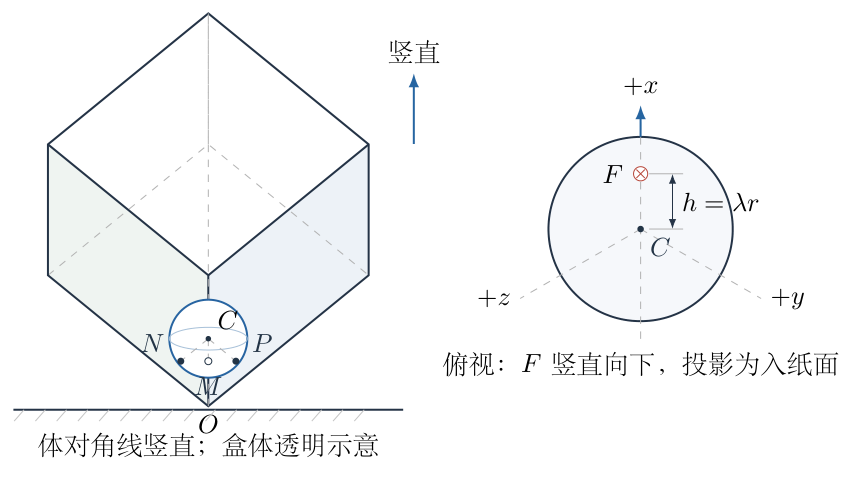
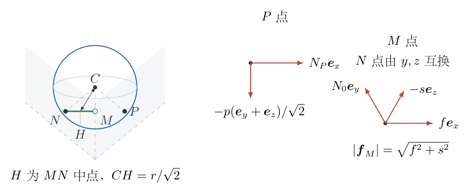
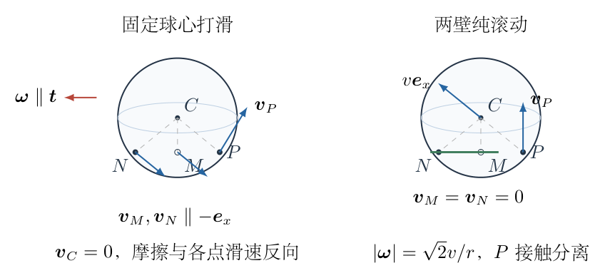
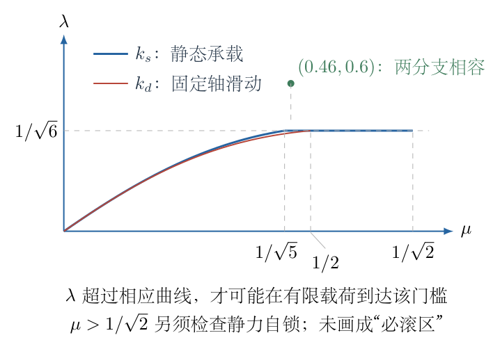

# 第 2 题

<!-- question-start -->

将一个立方体盒子放在水平地面上，使其一条体对角线竖直，并将盒子固定。把一个重力大小为 $G$ 的球放在盒内最低的角处，球的直径小于盒子边长。球面与盒内壁间的摩擦系数为 $\mu$。

对球施加一个竖直向下的力 $F$，其作用线与球心的距离为 $h=\lambda r$，其中 $r$ 是球的半径，$\lambda\in(0,1)$。力的作用线在俯视图中的位置如图所示。逐渐增大 $F$，直到球不再保持原来的静止平衡状态。

（1）要求球能够向上滚动，求 $\lambda$ 与 $\mu$ 应满足的条件。

（2）要求球能够原地打滑，求 $\lambda$ 与 $\mu$ 应满足的条件。

<!-- question-end -->

## 一、题型定位

三维接触、偏心力矩、矢量库仑摩擦与运动模式的相容性问题。球同时接触三个相互垂直的平面；静摩擦可以在各接触面的切平面内选择方向，滑动摩擦则必须与该接触点的相对滑动速度反向。

本题需要分别回答三个问题：静止平衡何时不存在；纯滚动模式何时有可行解；球心不动的打滑模式何时有可行解。这三者不能用同一组预设摩擦方向代替。原题只给一个摩擦系数，也未给接触柔性及运动分支选择规则，因而在部分参数区间不能推出唯一、互斥的起动模式。以下保留可确定的力学结论，并用直接运动方程说明这个限制。

## 二、知识点

- 刚体静止时，合外力与关于任一点的合外力矩均为零。
- 球与平面接触时，法向力沿平面法线，切向摩擦力位于该面的切平面。
- 静摩擦满足矢量约束 $|\boldsymbol f|\le\mu N$，不是每个切向分量分别达到 $\mu N$。
- 发生滑动时，$\boldsymbol f=-\mu N\boldsymbol v_{\rm rel}/|\boldsymbol v_{\rm rel}|$，摩擦方向由相对速度确定。
- 刚体接触点速度为 $\boldsymbol v_C+\boldsymbol\omega\times\boldsymbol r_{\text{接触}}$。
- 单侧接触的法向反力非负；算得负反力意味着该接触模式不成立。
- 一个运动模式满足方程，不等于题给加载过程必然选择该模式；边界上的静态可行也不等于越过边界后仍能无滑动运动。

## 三、物理图像

取最低盒角为原点 $O$，三个向盒内延伸的棱方向为 $\boldsymbol e_x,\boldsymbol e_y,\boldsymbol e_z$，构成右手正交基。三个内壁分别为 $x=0$、$y=0$、$z=0$。球心和三个接触点的坐标是

$$
\begin{aligned}
C&=(r,r,r),\\
P&=(0,r,r),\qquad M=(r,0,r),\qquad N=(r,r,0).
\end{aligned}
$$

竖直向上的单位向量为 $\boldsymbol u=(\boldsymbol e_x+\boldsymbol e_y+\boldsymbol e_z)/\sqrt3$。重力和外力都竖直向下。记

$$
W=G+F,\qquad w=\frac W{\sqrt3},\qquad
\boldsymbol t=\frac{\boldsymbol e_y-\boldsymbol e_z}{\sqrt2}.
$$

外加力矩沿 $+\boldsymbol t$，大小为 $\lambda rF$。图示的向上滚动，是球离开 $x=0$ 壁，仍与 $y=0,z=0$ 两壁保持接触，球心最初向 $+x$ 运动；该方向的竖直分量为正。原地打滑则指球心保持在 $C$，绕通过球心且平行于 $MN$ 的轴转动。

法向反力大小记为 $N_P,N_0,N_0$；后两个相等来自题图的镜像对称。用 $p,f,s$ 表示带符号的切向分量，反力写为

$$
\begin{aligned}
\boldsymbol R_P&=N_P\boldsymbol e_x-\frac p{\sqrt2}(\boldsymbol e_y+\boldsymbol e_z),\\
\boldsymbol R_M&=f\boldsymbol e_x+N_0\boldsymbol e_y-s\boldsymbol e_z,\\
\boldsymbol R_N&=f\boldsymbol e_x-s\boldsymbol e_y+N_0\boldsymbol e_z.
\end{aligned}
$$

静力分析中不能先令 $s=0$。这相当于提前把静摩擦限制成某种滑动的方向，会改变承载门槛。

## 四、解题入口

先由三维位置矢量与叉积求接触力矩，得到通用的静力方程。再在完整摩擦锥内寻找静力承载上限，而不是先假定球已经原地转动。

之后分别建立两个运动模式：两壁纯滚动时，第三壁法向反力为零，剩余两接触点必须满足无滑动约束；固定球心打滑时，三个接触点的速度确定摩擦方向，并要检查三个法向反力是否非负。最后比较不同模式的适用区间，处理临界等号及模式重叠。

## 五、解析

（1）先建立几何力臂与通用静力方程。

图2-2中，$MN$ 是两接触点的连线，$\boldsymbol t$ 与它平行。球心到这条线的最短距离不是 $r$，而是 $r/\sqrt2$；球心沿 $+x$ 运动的竖直分量为位移的 $1/\sqrt3$。后续力矩和滚动约束都必须使用这些关系。

关于球心的接触点位置矢量分别为

$$
\boldsymbol r_P=-r\boldsymbol e_x,\qquad
\boldsymbol r_M=-r\boldsymbol e_y,\qquad
\boldsymbol r_N=-r\boldsymbol e_z.
$$

球心到 $MN$ 中点的位矢为 $-r(\boldsymbol e_y+\boldsymbol e_z)/2$。它与 $MN$ 方向垂直，其长度为

$$
d=\sqrt{\left(\frac r2\right)^2+\left(\frac r2\right)^2}
=\frac r{\sqrt2}.
$$

静止时合力为零。逐分量展开 $\boldsymbol R_P+\boldsymbol R_M+\boldsymbol R_N=W\boldsymbol u$：

$$
\boxed{N_P+2f=w,\qquad N_0-s-\frac p{\sqrt2}=w.}\tag{1}
$$

三个法向力都指向球心，因此关于球心没有力矩；只有切向力产生接触力矩。以 $P$ 点为例，

$$
\begin{aligned}
\boldsymbol\tau_P
&=(-r\boldsymbol e_x)\times\left[-\frac p{\sqrt2}(\boldsymbol e_y+\boldsymbol e_z)\right]\\
&=\frac{rp}{\sqrt2}(\boldsymbol e_z-\boldsymbol e_y)
=-rp\boldsymbol t.
\end{aligned}
$$

$M,N$ 处的 $f$ 分量合力矩为 $-\sqrt2rf\boldsymbol t$；两个 $s$ 分量产生的 $x$ 向力矩大小相等、方向相反，彼此抵消。因此

$$
\boldsymbol\tau_{\text{接触}}=-r(p+\sqrt2f)\boldsymbol t.
$$

外加力矩平衡给出

$$
\boxed{\lambda F=p+\sqrt2f.}\tag{2}
$$

式（1）、（2）中每项都是力，因共同的球半径已约去。静摩擦条件还必须同时满足

$$
\boxed{
N_P,N_0\ge0,\quad |p|\le\mu N_P,\quad
\sqrt{f^2+s^2}\le\mu N_0.
}\tag{3}
$$

采用对称反力没有丢失静力解：任意解与交换 $y,z$ 后的镜像解取平均，仍满足线性力、力矩方程；摩擦锥是凸集合，平均反力仍在锥内。这里的对称只用于静力优化，并没有规定实际起动的唯一运动模式。

（2）两壁滚动的几何临界载荷。

若球将离开 $x=0$ 壁，则临界状态有 $N_P=0$。由式（3），该接触处切向力也必须为零，即 $p=0$。式（1）、（2）化为

$$
2f=w,\qquad \lambda F=\sqrt2f=\frac w{\sqrt2}.
$$

代入 $w=(G+F)/\sqrt3$，逐步解出 $F$：

$$
\begin{aligned}
\lambda F&=\frac{G+F}{\sqrt6},\\
\sqrt6\lambda F&=G+F,\\
(\sqrt6\lambda-1)F&=G,\\
F_t&=\boxed{\frac G{\sqrt6\lambda-1}}.
\end{aligned}\tag{4}
$$

有限、正的临界力要求

$$
\boxed{\lambda>\frac1{\sqrt6}}.
$$

当 $\lambda=1/\sqrt6$ 时，临界载荷趋于无穷，并非任意有限 $F$ 都会滚起。若 $\lambda<1/\sqrt6$，式（4）给出负数，表示这个两壁滚动的几何门槛不能由竖直向下的正载荷达到。

（3）临界两壁接触需要多大的静摩擦。

在 $N_P=p=0$ 的临界静态下，$f=w/2$，而式（1）给出 $N_0=w+s$。每个接触点需要的摩擦比为

$$
\mu_{\rm req}(s)=\frac{\sqrt{(w/2)^2+s^2}}{w+s},\qquad w+s>0.
$$

为求最小值，先对平方求导，避免根式：

$$
\begin{aligned}
\frac{\mathrm d}{\mathrm ds}\mu_{\rm req}^2
&=\frac{2s(w+s)^2-2(w+s)(w^2/4+s^2)}{(w+s)^4}\\
&=\frac{2[sw-w^2/4]}{(w+s)^3}.
\end{aligned}
$$

分母为正，导数在 $s=w/4$ 左负右正，故这是最小点。代入 $s=w/4$：

$$
\begin{aligned}
\mu_{\rm req,min}
&=\frac{\sqrt{w^2/4+w^2/16}}{5w/4}\\
&=\frac{w\sqrt5/4}{5w/4}
=\boxed{\frac1{\sqrt5}}.
\end{aligned}\tag{5}
$$

于是，临界两壁静态构形的存在条件为 $\mu\ge1/\sqrt5$。注意这还是临界静态的摩擦可行性；正的滚动加速度需要更高的摩擦比，不能直接把等号写成能够持续纯滚动。

若预先令 $s=0$，则 $N_0=w$、$f=w/2$，得到 $\mu_{\rm req}=1/2$。这只是把摩擦方向限制在 $+x$ 后的门槛，不是式（5）的等价写法。

（4）求完整三接触系统的静力承载上限。

先对 $0<\mu<1$ 处理。令 $A=w+p/\sqrt2$，由式（1）有 $N_0=A+s$。摩擦锥还给出 $|s|\le\mu N_0$，所以 $A=N_0-s\ge(1-\mu)N_0$。这里 $N_0$ 不能为零：否则 $f=s=0$、$N_P=w$、$p=-\sqrt2w$，与 $|p|\le\mu N_P$ 冲突。因此 $N_0>0$，也就有 $A>0$。对固定 $f,A$，两壁摩擦比的平方为

$$
\frac{f^2+s^2}{(A+s)^2}.
$$

采用同样的求导方法：

$$
\frac{\mathrm d}{\mathrm ds}\frac{f^2+s^2}{(A+s)^2}
=\frac{2(As-f^2)}{(A+s)^3}.
$$

最小值在 $s=f^2/A$ 取得，其值为 $f^2/(A^2+f^2)$。因此存在合适 $s$ 的充要条件可化为

$$
\begin{aligned}
\frac{f^2}{A^2+f^2}&\le\mu^2,\\
(1-\mu^2)f^2&\le\mu^2A^2,\\
|f|&\le cA,\qquad c=\frac\mu{\sqrt{1-\mu^2}}.
\end{aligned}\tag{6}
$$

下面使用无量纲反力 $\xi=N_P/w\ge0$、$u=p/w$。式（1）给出 $f/w=(1-\xi)/2$，而 $u\le\mu\xi$。由式（2），可抵抗的归一化力矩满足

$$
\begin{aligned}
\frac{\lambda F}{w}
&=\frac{1-\xi}{\sqrt2}+u\\
&\le\frac1{\sqrt2}+\left(\mu-\frac1{\sqrt2}\right)\xi.
\end{aligned}\tag{7}
$$

当 $\mu\le1/\sqrt2$ 时，右端随 $\xi$ 不增。要使承载力矩最大，应使允许的 $\xi$ 尽量小，并取 $u=\mu\xi$。

对于 $0<\mu<1/\sqrt5$，$c<1/2$，不能取 $\xi=0$。在最优点 $0<\xi<1$，将式（6）写成

$$
\begin{aligned}
\frac{1-\xi}{2}&\le c\left(1+\frac\mu{\sqrt2}\xi\right),\\
1-2c&\le(1+\sqrt2c\mu)\xi,\\
\xi_{\min}&=\frac{1-2c}{1+\sqrt2c\mu}.
\end{aligned}
$$

这是完整摩擦锥给出的最小第三壁反力，不是指定运动之后的滑动反力。由 $f/w=(1-\xi_{\min})/2$，继续化简：

$$
\begin{aligned}
\frac fw
&=\frac12\frac{(1+\sqrt2c\mu)-(1-2c)}{1+\sqrt2c\mu}\\
&=\frac{c(1+\mu/\sqrt2)}{1+\sqrt2c\mu}\\
&=\frac{\mu(1+\mu/\sqrt2)}{\sqrt{1-\mu^2}+\sqrt2\mu^2}.
\end{aligned}
$$

再用 $p=\mu(w-2f)$，得

$$
\begin{aligned}
\frac{\lambda F}{W}
&=\frac1{\sqrt3}\left[\mu+(\sqrt2-2\mu)\frac fw\right]\\
&=\boxed{k_s(\mu)}\\
&=\boxed{\frac{\mu[\sqrt{1-\mu^2}+\sqrt2-\mu]}{\sqrt3[\sqrt{1-\mu^2}+\sqrt2\mu^2]}}.
\end{aligned}\tag{8}
$$

分子化简可单独核对：$\mu\sqrt{1-\mu^2}+\sqrt2\mu^3+(\sqrt2-2\mu)\mu(1+\mu/\sqrt2)=\mu[\sqrt{1-\mu^2}+\sqrt2-\mu]$，三次项抵消。

对于 $1/\sqrt5\le\mu\le1/\sqrt2$，式（6）允许 $\xi=0$。式（7）的最大值因此为 $1/\sqrt2$，换回以 $W$ 归一化的量：

$$
\boxed{k_s(\mu)=\frac1{\sqrt6}}.
$$

当 $\mu=0$ 时，没有摩擦力矩，定义 $k_s(0)=0$，与式（8）的极限一致。这些上限能够实际取得；取达到等号的 $p,f$，再取 $s=f^2/A$ 即给出满足全部摩擦锥的反力。

令 $q(F)=\lambda F/(G+F)$。它的导数为

$$
q'(F)=\frac{\lambda G}{(G+F)^2}>0,
\qquad q(0)=0,\qquad \lim_{F\to\infty}q(F)=\lambda.
$$

若 $\lambda>k_s$，静力可行性的极限载荷为

$$
\begin{aligned}
\lambda F_s&=k_s(G+F_s),\\
(\lambda-k_s)F_s&=k_sG,\\
F_s&=\boxed{\frac{k_sG}{\lambda-k_s}}.
\end{aligned}\tag{9}
$$

若 $\lambda\le k_s$，任意有限正 $F$ 都没有越过这个静力承载上限；等号对应无限载荷极限。对 $1/\sqrt5\le\mu\le1/\sqrt2$，式（9）正好变成式（4）的 $F_t$。

（5）由接触点速度建立原地打滑模式。

现在指定球心不动、角速度沿 $+\boldsymbol t$，即 $\boldsymbol\omega=\omega\boldsymbol t$、$\omega>0$。图2-3给出各接触点的速度和摩擦方向；这一步是选择了具体运动模式，不能反过来替代前面的静力优化。

由 $\boldsymbol v_i=\boldsymbol\omega\times\boldsymbol r_i$，逐个计算得

$$
\begin{aligned}
\boldsymbol v_P&=\frac{r\omega}{\sqrt2}(\boldsymbol e_y+\boldsymbol e_z),\\
\boldsymbol v_M&=-\frac{r\omega}{\sqrt2}\boldsymbol e_x,\\
\boldsymbol v_N&=-\frac{r\omega}{\sqrt2}\boldsymbol e_x.
\end{aligned}
$$

所以 $P$ 处摩擦沿 $-(\boldsymbol e_y+\boldsymbol e_z)$，$M,N$ 处摩擦沿 $+x$；后两处没有 $y,z$ 方向的滑动分量。本模式必须满足

$$
s=0,\qquad f=\mu N_0,\qquad p=\mu N_P.
$$

球心不动，合力仍为零。式（1）给出

$$
N_P+2\mu N_0=w,\qquad N_0=w+\frac\mu{\sqrt2}N_P.
$$

代入消去 $N_0$：

$$
\begin{aligned}
N_P+2\mu\left(w+\frac\mu{\sqrt2}N_P\right)&=w,\\
(1+\sqrt2\mu^2)N_P&=w(1-2\mu),\\
N_P&=\boxed{\frac{W(1-2\mu)}{\sqrt3(1+\sqrt2\mu^2)}}.
\end{aligned}\tag{10}
$$

回代得

$$
\begin{aligned}
N_0
&=w\left[1+\frac{\mu(1-2\mu)}{\sqrt2(1+\sqrt2\mu^2)}\right]\\
&=\boxed{\frac{W(\sqrt2+\mu)}{\sqrt6(1+\sqrt2\mu^2)}}.
\end{aligned}\tag{11}
$$

$N_0>0$；$N_P\ge0$ 则要求

$$
\boxed{0\le\mu\le\frac12}.
$$

若 $\mu>1/2$，式（10）为负，意味着第三壁必须拉住球，违反单侧接触条件。此时不允许继续使用这个固定球心滑动解。$\mu=1/2$ 时 $P$ 点不承载，是边界情形；球心不动的解仍可在另两壁上成立。

关于球心的滑动阻力矩为 $r(\sqrt2f+p)$。将式（10）、（11）代入，并除以 $rW$：

$$
\begin{aligned}
k_d(\mu)
&=\frac{\mu}{W}(\sqrt2N_0+N_P)\\
&=\frac\mu{\sqrt3(1+\sqrt2\mu^2)}\bigl[(\sqrt2+\mu)+(1-2\mu)\bigr]\\
&=\boxed{\frac{\mu(1+\sqrt2-\mu)}{\sqrt3(1+\sqrt2\mu^2)}}.
\end{aligned}\tag{12}
$$

净驱动力矩为 $r[\lambda F-k_d(G+F)]$。因此沿题图方向加速的原地打滑模式要求

$$
\boxed{\mu\le\frac12,\qquad q(F)>k_d(\mu)}.
$$

存在有限正载荷满足此条件的参数要求是

$$
\boxed{\mu\le\frac12,\qquad \lambda>k_d(\mu)}.
\tag{13}
$$

对应模式的驱动力矩转正门槛为 $F_d=k_dG/(\lambda-k_d)$。在 $F=F_d$ 时净力矩为零，不会从静止产生正角加速度；$\lambda=k_d$ 时也不能由有限 $F$ 达到正驱动力矩。式（13）证明这种打滑模式存在，不是原始静止状态必然在 $F_d$ 失稳的判据。

例如 $\mu=0.3$ 时，式（8）、（12）分别给出

$$
k_s=0.331306384696,\qquad k_d=0.324846341627.
$$

若 $\lambda=0.328$，虽然 $\lambda>k_d$，但 $\lambda<k_s$；固定轴滑动有正驱动力矩的载荷区间，并不意味着逐渐加力必然破坏原有静止平衡。这一数值例明确区分了两个问题。

（6）检查越过临界后的两壁纯滚动是否可行。

图2-3右图的纯滚动要求 $\boldsymbol v_M=\boldsymbol v_N=0$。若球心速度为 $v\boldsymbol e_x$，接触速度关系给出

$$
\boxed{\boldsymbol\omega=\frac vr(\boldsymbol e_y-\boldsymbol e_z)
=\frac{\sqrt2v}{r}\boldsymbol t}.
$$

它与图2-2中到瞬时轴的距离 $r/\sqrt2$ 相符：球心速率等于角速度大小乘该距离。$P$ 点则有向外的法向速度，原接触已经分离，故 $N_P=p=0$。

为直接检查起动后的动力学，考虑转动惯性各向同性的球，记质量为 $m=G/g$、关于球心的转动惯量为 $I$；均匀实心球是题意允许的一个实例，$I=2mr^2/5$。这里不把该惯量数值强加为原题条件。

令球心瞬时加速度为 $a\boldsymbol e_x$。两壁仍约束 $y,z$ 坐标，逐分量的牛顿第二定律和转动方程为

$$
\begin{aligned}
2f-w&=ma,\\
N_0-s&=w,\\
\lambda rF-\sqrt2rf&=I\frac{\sqrt2a}{r}.
\end{aligned}
$$

由第一式 $f=(w+ma)/2$，代入第三式并消元：

$$
\begin{aligned}
\sqrt2\lambda F-(w+ma)&=\frac{2I}{r^2}a,\\
\left(m+\frac{2I}{r^2}\right)a&=\sqrt2\lambda F-w,\\
a&=\boxed{\frac{\sqrt2\lambda F-w}{m+2I/r^2}}.
\end{aligned}\tag{14}
$$

$a>0$ 等价于 $q(F)>1/\sqrt6$，亦即越过式（4）的几何临界值。要使两接触处无滑动，还必须在 $N_0=w+s$ 下检查矢量静摩擦。按前面的优化，最佳取值 $s=f^2/w$，最低摩擦需求为

$$
\boxed{\mu_{\rm roll,req}=\frac{f}{\sqrt{w^2+f^2}}}.
\tag{15}
$$

定义 $\eta=m/(m+2I/r^2)$，由式（14）得

$$
\begin{aligned}
\frac{ma}{w}&=\eta[\sqrt6q(F)-1],\\
\zeta:=\frac fw&=\frac{1+\eta[\sqrt6q(F)-1]}2,\\
\mu_{\rm roll,req}&=\frac\zeta{\sqrt{1+\zeta^2}}.
\end{aligned}\tag{16}
$$

当 $F\downarrow F_t$，$a\to0^+$、$\zeta\to1/2$，式（16）趋于 $1/\sqrt5$；只要 $a>0$，就有 $\zeta>1/2$，摩擦需求严格大于 $1/\sqrt5$。因此，对于刚越过几何门槛的这个纯滚动分支，充分且必要的局部存在条件是

$$
\boxed{\lambda>\frac1{\sqrt6},\qquad \mu>\frac1{\sqrt5}}.
\tag{17}
$$

这里的严格不等号表示存在一个 $F_t$ 右侧的非零载荷区间，使纯滚动加速度为正且摩擦约束成立。$\mu=1/\sqrt5$ 只能支撑临界静态，不足以支持任意正加速度的该分支。

若关心给定较大载荷，而非刚起动，必须使用式（14）—（16）再检查 $\mu\ge\mu_{\rm roll,req}(F)$，不能仅用式（17）保证整个后续过程纯滚动。原题未给球的转动惯量和持续加载的作用点变化，因而这里不把局部存在条件扩展成全程保证。

（7）为什么不能把两种可行模式直接画成互斥参数区域。

图2-4中的 $k_s$ 是完整静摩擦锥的承载上限，$k_d$ 是指定固定球心滑动的阻力矩系数。纵坐标取 $\lambda$，超过相应曲线才可能在有限载荷到达该模式的门槛。两条曲线对应不同问题；同一个参数点可能同时允许两个运动分支。

取一个符合题意的均匀球实例：在归一化单位中 $G=m=r=1$、$I=2/5$，并取 $\lambda=0.6$、$\mu=0.46$。由式（4）算得 $F_t=2.129046418681$，选取 $F=1.01F_t=2.150336882868$。

代入式（14）—（16），两壁纯滚动有

$$
a=0.003207501496>0,\qquad
\mu_{\rm roll,req}=0.447844183440<0.46.
$$

所以法向力、无滑动约束、平动方程和转动方程都能同时满足。对同一 $F$ 使用式（10）、（11）的固定球心打滑解，又有

$$
N_P=0.111993917812>0,\qquad
N_0=1.855276010380>0,
$$

并由净力矩除以 $I$ 得

$$
\alpha_{\rm spin}=0.079392348619>0.
$$

各滑动摩擦方向与对应接触速度反向，也满足三维力和力矩方程。因此，在这组相同的几何、外力和摩擦参数下，理想刚性库仑模型存在两个相容的瞬时起动解。这不是说真实装置必然任选其一，而是说现有条件尚不能选择唯一分支。

（8）大摩擦系数下还要检查静力自锁可行性。

原题未限制 $\mu<1/\sqrt2$。若 $\mu>1/\sqrt2$，取较大的 $N_P$，并令

$$
p=\mu N_P,\qquad f=\frac{w-N_P}{2},\qquad
A=w+\frac p{\sqrt2},\qquad s=\frac{f^2}{A}.
$$

这些反力仍满足式（1）。两壁所需摩擦比在 $N_P\to\infty$ 时趋于

$$
\frac{|f|}{\sqrt{A^2+f^2}}
\longrightarrow\frac1{\sqrt{1+2\mu^2}}<\mu.
$$

最后一个不等号由 $\mu>1/\sqrt2$ 推出：两边平方后等价于 $2\mu^4+\mu^2-1>0$，而左式可因式分解为 $(2\mu^2-1)(\mu^2+1)>0$。

与此同时，可抵抗力矩的力系数为

$$
\begin{aligned}
\sqrt2f+p
&=\frac{w-N_P}{\sqrt2}+\mu N_P\\
&=\frac w{\sqrt2}+\left(\mu-\frac1{\sqrt2}\right)N_P,
\end{aligned}
$$

能够无界增加。将这种大承载反力与不施加偏心力矩时的静态反力按比例平均，可以取得两者之间任意有限的抵抗力矩，且力平衡与凸摩擦锥仍满足。因此理想模型在这个区间不再有有限的全局静力承载上限。这是理想刚性摩擦锥允许的静力自锁解；不等于实际接触一定会产生无限反力。实际反力如何随加载历史发展，需要接触变形等附加信息。这个结果足以说明不能将“$\mu>1/2$ 排除了固定球心打滑”直接推成“任意大摩擦下球必然滚起”。

（9）汇总原题能够严格确定的答案。

第（1）问：两壁纯滚动的几何临界力为 $F_t=G/(\sqrt6\lambda-1)$。临界静态的存在要求 $\lambda>1/\sqrt6$、$\mu\ge1/\sqrt5$；越过门槛后具有正加速度的局部纯滚动分支要求严格的 $\mu>1/\sqrt5$，并须在给定载荷下继续检查式（16）。这些是模式的存在条件，不是不加附加条件的唯一运动保证。

第（2）问：固定球心、绕指定轴打滑的模式要求 $\mu\le1/2$ 和 $\lambda>k_d(\mu)$，实际正向加速还要求 $F>F_d$。若问从初始静止状态何时不存在任何平衡，则必须使用 $k_s$ 和式（9），不能使用 $k_d$ 代替静摩擦承载上限。

在 $\mu\le1/\sqrt2$ 的区间，$q(F)>k_s$ 才排除了全部静力解；$\lambda\le k_s$ 没有有限静力失稳载荷。$\mu>1/\sqrt2$ 时，理想模型允许自锁反力，原题的“增大至必然失去平衡”也不是对全部参数成立。

因此，原题若要求只凭 $\lambda,\mu$ 给出唯一、互斥的“必滚”与“必原地滑”区域，条件不足。式（4）、（8）—（17）给出可确定的完整条件结论；若再增加静、动摩擦差别、接触柔性或起动分支的选取规则，才可继续讨论实际加载过程选择何种运动。

所有 $F_t,F_s,F_d$ 均为 $G$ 乘无量纲系数，式（14）为力除以质量，量纲一致。$\mu\to0$ 时两种摩擦力矩均趋零；$\lambda\downarrow1/\sqrt6$ 时滚动门槛趋于无穷；$\mu=1/2$ 时固定球心解的第三壁反力恰为零，这些极限与前述力学图像相符。

## 六、关键洞察

本题最重要的区分是摩擦力的方向来源。静态接触的切向力是二维矢量，可以通过 $s$ 分量同时改变法向需求；固定轴滑动时，接触速度把 $s$ 强制为零。所以 $1/\sqrt5$ 与 $1/2$ 是两个不同模型的门槛，不能将它们视为同一计算的两个答案。

对两壁接触，最小摩擦需求还能从几何上看清。反力在 $y,z$ 分量上的共同要求是 $N_0-s=A$，而 $x$ 分量要求为 $f$。摩擦锥截面与这个线性平面相切，正好给出 $s=f^2/A$。这一自由度不是多余的受力项；删除它会抬高摩擦要求。

完整静力上限可以不依赖猜测接触状态。式（7）把抵抗力矩写成第三壁法向反力的线性函数，符号 $\mu-1/\sqrt2$ 直接决定增加第三壁反力是否有利。它解释了三个区间：低摩擦需要第三壁分担；中等摩擦在第三壁卸载时达到上限；高摩擦允许法向反力与摩擦力构成自锁承载。

滚动的临界静态不需要转动惯量，但越过临界的加速度与摩擦需求需要惯量。研究对象从“平衡”变成“运动”后，未知参数的作用也随之变化。没有给惯量，并不妨碍求式（4）的静态门槛；却不能据此给出任意载荷下的唯一滚动加速度。

一个直接的替代检查是对瞬时滚动轴 $MN$ 取矩。球心到轴距离 $r/\sqrt2$，平行轴定理给出 $I_{MN}=I+mr^2/2$。关于该轴的外力矩为

$$
\tau_{MN}=\lambda rF-\frac{Wr}{\sqrt6}.
$$

在起动瞬间 $\alpha_t=\sqrt2a/r$，于是

$$
\begin{aligned}
\left(I+\frac{mr^2}{2}\right)\frac{\sqrt2a}{r}
&=r\left(\lambda F-\frac W{\sqrt6}\right),\\
\left(m+\frac{2I}{r^2}\right)a
&=\sqrt2\lambda F-\frac W{\sqrt3}.
\end{aligned}
$$

这与式（14）完全一致。该取矩法在这里用于静止起动瞬间，不能不经检查地作为任意加速移动轴上的一般转动定律。

反例的价值在于排除“方程只有一个解”的错误推断，而不是用它猜真实实验。对于理想刚性、多点干摩擦模型，约束、动力学和摩擦定律都满足，并不总能保证模式唯一。将这种模型局限写清，本身就是完整解析的一部分。

## 七、易错点

- 把体对角线方向当作某一条棱方向，漏掉重力三个分量中的 $1/\sqrt3$。
- 把 $MN$ 当作经过球心的轴，或把到该轴的距离写成 $r$，导致滚动速度和转动惯量系数错误。
- 对静摩擦先假设 $s=0$；这是把运动后的方向限制提前用于静态平衡。
- 写 $|f|\le\mu N_0$、$|s|\le\mu N_0$ 却漏掉 $\sqrt{f^2+s^2}\le\mu N_0$，允许了过大的摩擦合力。
- 保留已经卸载接触点的有限摩擦力。$N_P=0$ 必须同时推出 $p=0$。
- 算得 $N_P<0$ 仍继续使用固定球心模型；平面只能推球，不能拉球。
- 把 $F_d$ 当作静止状态的失稳载荷，或者把 $\lambda=k_d$ 当作有限正载荷可以起滑。
- 将 $\mu=1/\sqrt5$ 的临界静态当成正加速度纯滚动；式（16）表明越过门槛后需求会增加。
- 从某模式“不成立”直接断定另一模式“必然发生”；模式还可能重叠，或存在额外接触运动。
- 在没有质量分布条件时将 $I=2mr^2/5$ 套给全部球，或把瞬时起动解推广成持续运动全过程。

## 八、课堂讲解建议

先让学生在三维图上找到 $P,M,N$，再把每点的法向和切向方向分开。板书先列通用反力，不急于讨论滚动与打滑；要求学生指出 $s$ 为什么属于合法静摩擦分量。

随后在板书左侧推导 $N_P=0$ 时的 $F_t$，右侧比较允许 $s$ 与强制 $s=0$ 的摩擦需求。用两个具体反力向量帮助学生理解 $1/\sqrt5$ 和 $1/2$ 的差别来自物理约束，不是求导方法不同。

固定球心打滑必须从接触点速度开始，让学生逐个核对叉积及摩擦反向。教师在得到式（10）后暂停，先检查 $N_P$ 的正负，再继续计算阻力矩；不能只看最终 $k_d$ 的代数形式。

最后把“存在静力解”“存在纯滚动解”“存在原地打滑解”列在三栏。课堂中用 $\mu=0.46,\lambda=0.6$ 的反例检查三栏含义，明确数学模型能够给出的结论边界。若展示实物或柔性接触仿真，先向学生说明新增了哪些原题没有的条件，不能把实验所选分支反当成原题的唯一推论。

## 九、变式训练

变式：采用各向同性转动惯性球的两壁纯滚动分支，令 $I=\beta mr^2$，其中 $\beta>0$。已知 $1/\sqrt5<\mu<1$、$\lambda>1/\sqrt6$，求纯滚动起动后仍满足两壁静摩擦约束的载荷区间，并比较均匀实心球与薄球壳。

解：由式（16），$\eta=1/(1+2\beta)$。因为 $f>0$，摩擦条件等价于

$$
\begin{aligned}
\frac\zeta{\sqrt{1+\zeta^2}}&\le\mu,\\
(1-\mu^2)\zeta^2&\le\mu^2,\\
\zeta&\le c:=\frac\mu{\sqrt{1-\mu^2}}.
\end{aligned}
$$

代入 $\zeta=[1+\eta(\sqrt6q-1)]/2$，逐步解得

$$
\begin{aligned}
1+\eta(\sqrt6q-1)&\le2c,\\
\sqrt6q-1&\le(1+2\beta)(2c-1),\\
q&\le q_{\max}:=\frac{1+(1+2\beta)(2c-1)}{\sqrt6}.
\end{aligned}
$$

所以初始几何构形附近的无滑动正加速度载荷满足

$$
\boxed{\frac1{\sqrt6}<q(F)\le q_{\max}}.
$$

若 $q_{\max}\ge\lambda$，由 $q(F)<\lambda$ 可知该瞬时构形的摩擦检查不再给出有限上界；注意这仍不意味着球移动很远后几何条件保持不变。若 $q_{\max}<\lambda$，将上界换成 $F$：

$$
\begin{aligned}
\frac{\lambda F}{G+F}&\le q_{\max},\\
(\lambda-q_{\max})F&\le q_{\max}G,\\
F_t<F&\le\boxed{\frac{q_{\max}G}{\lambda-q_{\max}}}.
\end{aligned}
$$

取 $\mu=0.46,\lambda=0.6$，有 $c=0.518065323440$。均匀实心球 $\beta=2/5$，薄球壳 $\beta=2/3$，分别得到

$$
\begin{aligned}
q_{\max,\text{实心}}&=0.434798785143,\\
q_{\max,\text{球壳}}&=0.442665598381.
\end{aligned}
$$

相应上界分别约为 $2.63193455G$、$2.81353343G$，下界均为 $F_t\approx2.12904642G$。较大转动惯量降低同一载荷下的球心加速度，因此降低所需的 $f/w$，让这个局部无滑动区间变宽；这个结论可直接从式（14）、（16）交叉核对。

当 $\mu\downarrow1/\sqrt5$，$c\downarrow1/2$，两种球的 $q_{\max}$ 都趋于 $1/\sqrt6$，正加速度载荷区间收缩为零，再次说明临界等号只能维持静态。
