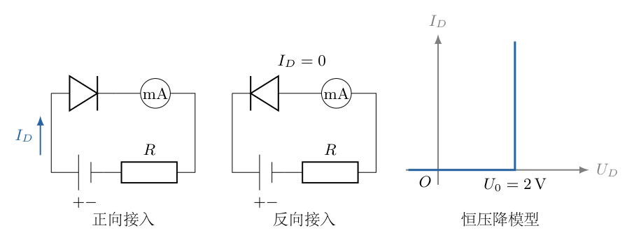
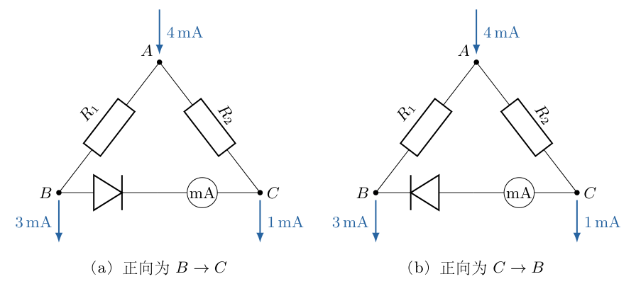
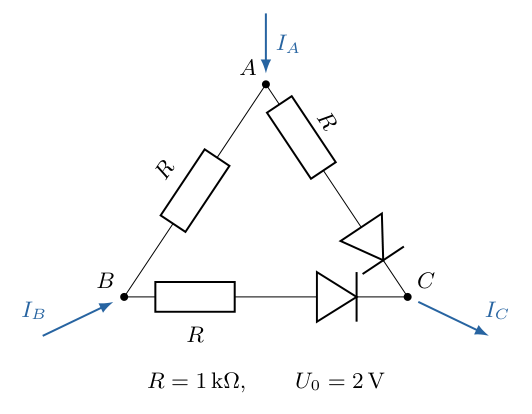
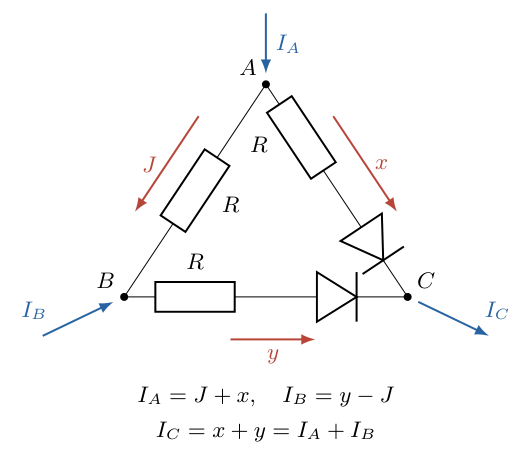
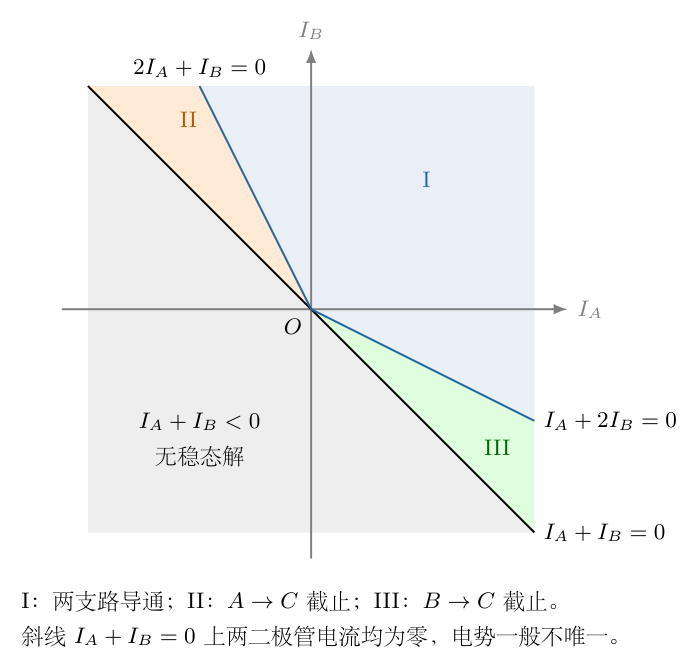

# 第 5 题

<!-- question-start -->

二极管具有单向导电特性。本题按图5-1给出的理想化伏安特性处理：正向导通时电压降恒为 $U_0=2\,\mathrm V$，截止时电流为零，并忽略反向击穿。电流正向取二极管由阳极流向阴极的方向，电压取阳极电势减阴极电势。

（1）图5-2（a）是某电路的一部分。$R_1=6\,\mathrm{k}\Omega$、$R_2=5\,\mathrm{k}\Omega$，有 $4\,\mathrm{mA}$ 从 $A$ 流入，$3\,\mathrm{mA}$ 从 $B$ 流出，$1\,\mathrm{mA}$ 从 $C$ 流出。求二极管上的电势降及流过毫安表的电流。

（2）如图5-2（b），将二极管反接，其他条件不变。求二极管上的电势降及流过毫安表的电流。两问中的毫安表均为理想电表。

（3）图5-3所示三端网络由三个相同电阻和两个上述二极管组成，电阻均为 $R=1\,\mathrm{k}\Omega$。$I_A,I_B$ 分别以流入 $A,B$ 为正，电流由 $C$ 流出。求电势差函数 $U_{AC}(I_A,I_B)$、$U_{BC}(I_A,I_B)$，并在横坐标为 $I_A$、纵坐标为 $I_B$ 的平面中标明各种工作状态的区域。

<!-- question-end -->

## 一、题型定位

含单向恒压降元件的分段线性电路。二极管的状态不是预先已知的开关位置，而要由电路的电流方向与端电压共同确定。每假设一种状态，都必须在求解后回代检验。

第三问进一步把两个外加端口电流作为参数，要求给出分区函数。除正常导通区域外，还要检查边界上电势是否唯一，以及某些外部电流组合是否与单向导电条件相容。

## 二、知识点

- 基尔霍夫电流定律：每个节点流入电流之和等于流出电流之和。
- 电阻满足有向欧姆定律 $U=RI$，电流负值表示与所选方向相反。
- 恒压降二极管导通时 $U_D=U_0$、$I_D\ge0$；截止时 $I_D=0$、$U_D\le U_0$。
- 理想毫安表电阻为零，不改变所串联支路的电压降。
- 端口电流和电势差均须先定义正方向。
- 导通边界应使相邻分支的电压、电流连续，但状态名称在零电流处可以重合。
- 断开的节点可能没有唯一电势差，不能为了写成函数而猜定一个值。

## 三、物理图像

本题称为“理想化”的二极管不是零正向压降的理想开关，而是图示的恒压降模型：只要有正向电流流过，二极管两端就保持 $2\,\mathrm V$。若截止，它可以承受正向不足 $2\,\mathrm V$ 或任意反向电压，而电流仍为零。

记阳极到阴极的电流为 $I_D$，相应电势差为 $U_D$。两种状态可以统一写为

$$
I_D\ge0,\qquad U_D\le U_0,\qquad
I_D(U_0-U_D)=0.
$$

最后一式表示二者至少有一项取零：若 $I_D>0$，必须 $U_D=U_0$；若 $U_D<U_0$，必须 $I_D=0$。在 $I_D=0,U_D=U_0$ 的边界，两种状态描述给出同一电气结果。

还要注意前两问中 $B$ 端给定的是流出电流 $3\,\mathrm{mA}$，第三问却把 $I_B$ 定义为流入 $B$ 的有向电流。它们的箭头约定不同，不能将同一个正数直接代入第三问而不改变符号。

## 四、解题入口

前两问先假设截止，利用已知端口电流直接求电阻压降，进而判断二极管是否满足截止条件。若不满足，再设其导通并由恒压降条件求支路电流。

第三问中只需选一个独立支路电流。先用节点电流定律表示其余电流，再分“两个导通”“只一个导通”“两个截止”列式。最后检查总流向 $C$ 的电流必须非负，这能在算方程之前排除半个参数平面。

## 五、解析

（1）第一问：先用截止假设确定两端电势。

图5-2（a）中的二极管正向为 $B\to C$。若它截止，横向支路电流为零，所以流向 $B$ 的 $3\,\mathrm{mA}$ 必须全部通过 $R_1$，流向 $C$ 的 $1\,\mathrm{mA}$ 必须全部通过 $R_2$。

取两电阻电流分别沿 $A\to B$、$A\to C$ 为正，有

$$
i_1=3\,\mathrm{mA},\qquad i_2=1\,\mathrm{mA}.
$$

这与 $A$ 端输入电流相符：$i_1+i_2=4\,\mathrm{mA}$。电阻压降为

$$
\begin{aligned}
V_A-V_B
&=R_1i_1
=(6\,\mathrm{k}\Omega)(3\,\mathrm{mA})
=18\,\mathrm V,\\
V_A-V_C
&=R_2i_2
=(5\,\mathrm{k}\Omega)(1\,\mathrm{mA})
=5\,\mathrm V.
\end{aligned}
$$

二极管阳极位于 $B$、阴极位于 $C$，因此其有向电势降为

$$
\begin{aligned}
U_D
&=V_B-V_C\\
&=(V_A-V_C)-(V_A-V_B)\\
&=5-18=-13\,\mathrm V.
\end{aligned}
$$

$U_D=-13\,\mathrm V<U_0$，截止条件满足。因此

$$
\boxed{U_D=-13\,\mathrm V,\qquad I_D=I_{\text{表}}=0.}
$$

负号表示反向偏置：$C$ 的电势比 $B$ 高 $13\,\mathrm V$。若只问反向电压大小，可以说 $13\,\mathrm V$，但不能把阳极到阴极的有向电势降写成 $+13\,\mathrm V$。

（2）再用导通假设检验第一问，排除伪解。

设二极管正向电流为 $j$，单位取 $\mathrm{mA}$。在 $B$ 节点，来自 $A$ 的电流要同时供应外流的 $3$ 和流向 $C$ 的 $j$，故 $i_1=3+j$；在 $C$ 节点，$i_2+j=1$，故 $i_2=1-j$。

用 $\mathrm{k}\Omega\times\mathrm{mA}=\mathrm V$ 写压降：

$$
\begin{aligned}
V_A-V_B&=6(3+j)=18+6j,\\
V_A-V_C&=5(1-j)=5-5j.
\end{aligned}
$$

于是

$$
U_D=V_B-V_C=-13-11j.
$$

若假设导通，$U_D=2$，则

$$
-13-11j=2,\qquad j=-\frac{15}{11}\,\mathrm{mA}<0.
$$

求出的电流违反二极管正向导通条件，所以这不是可用答案，而是导通假设被否定的证据。电阻电流允许负值，不代表二极管也允许负的正向电流。

（3）第二问：反接后二极管不能截止。

图5-2（b）的二极管正向变为 $C\to B$。若截止，两电阻压降仍为 $18\,\mathrm V$ 和 $5\,\mathrm V$，但现在阳极到阴极的电势差为

$$
U_D=V_C-V_B=18-5=13\,\mathrm V.
$$

这超过给定恒压降模型允许的截止上限 $U_0=2\,\mathrm V$，所以截止假设不成立，必须导通。

设正向电流 $j$ 沿 $C\to B$。在 $B$ 节点，$i_1+j=3$；在 $C$ 节点，来自 $A$ 的电流要供应外流的 $1$ 及流向 $B$ 的 $j$。因此

$$
i_1=3-j,\qquad i_2=1+j.
$$

电阻电势差为

$$
V_A-V_B=18-6j,\qquad
V_A-V_C=5+5j.
$$

二极管导通要求

$$
\begin{aligned}
V_C-V_B
&=(V_A-V_B)-(V_A-V_C)\\
&=(18-6j)-(5+5j)\\
&=13-11j=2.
\end{aligned}
$$

解得 $11j=11$，即 $j=1\,\mathrm{mA}>0$，方向满足导通要求。再求电阻电流：

$$
i_1=3-1=2\,\mathrm{mA},\qquad
i_2=1+1=2\,\mathrm{mA}.
$$

两电阻压降分别为 $12\,\mathrm V$、$10\,\mathrm V$，相减仍为 $2\,\mathrm V$。所以第二问结果为

$$
\boxed{
U_D=V_C-V_B=2\,\mathrm V,\qquad
I_{\text{表}}=1\,\mathrm{mA}\quad(C\to B).
}
$$

这里给出的是电表电流大小及实际方向。若人为把电表读数正向仍取为第一问的 $B\to C$，则有向读数应写成 $-1\,\mathrm{mA}$；题图没有指定仪表正、负接线柱，不能混淆这一读数约定与真实电流方向。

（4）第三问：统一端口和支路方向。

以 $V_C=0$ 作为电势参考，记

$$
U_A=U_{AC}=V_A-V_C,\qquad
U_B=U_{BC}=V_B-V_C.
$$

图5-4中，两条含二极管支路的正向电流分别定义为 $x:A\to C$、$y:B\to C$；纯电阻支路电流定义为 $J:A\to B$。

对 $A,B$ 节点列电流定律：

$$
I_A=J+x,\qquad I_B=y-J.
$$

相加后，内部支路 $J$ 消去：

$$
\boxed{x+y=I_A+I_B}.
$$

记总输出电流为

$$
S=I_A+I_B.
$$

于是

$$
y=S-x,\qquad J=I_A-x.
$$

纯电阻 $AB$ 支路的欧姆定律为

$$
\boxed{U_A-U_B=RJ=R(I_A-x)}.
$$

这个电压差不是二极管的电压，而是整个 $AB$ 电阻的压降。另两支路包含电阻与二极管串联，导通时的总压降应为 $RI+U_0$。

（5）先确定参数平面中根本不可能的区域。

两个二极管均指向 $C$，所以 $x\ge0,y\ge0$，从而

$$
S=x+y\ge0.
$$

若 $I_A+I_B<0$，意味着要求 $C$ 端向网络输入正电流，但从 $C$ 出发的两条支路都受到反向二极管阻断。本题理想稳态模型不能实现这个电流组合，因此该区域不存在所求稳态电势函数。

这不是将负电流一概判错。$I_A$ 或 $I_B$ 可以单独为负，只要另一端的输入足够大，使二极管支路仍保持正向；不允许的是两个二极管正向电流之和变成负数。

先处理 $S>0$ 的正常输出区域，最后再单独讨论 $S=0$。

（6）两个二极管均导通。

导通时

$$
U_A=Rx+U_0,\qquad
U_B=Ry+U_0.
$$

两式相减，公共压降 $U_0$ 约去：

$$
U_A-U_B=R(x-y).
$$

与 $AB$ 支路欧姆定律比较，约去 $R>0$：

$$
x-y=I_A-x.
$$

代入 $y=S-x$：

$$
\begin{aligned}
x-(S-x)&=I_A-x,\\
2x-S&=I_A-x,\\
3x&=I_A+S=2I_A+I_B.
\end{aligned}
$$

所以

$$
\boxed{
x=\frac{2I_A+I_B}{3},\qquad
y=\frac{I_A+2I_B}{3},\qquad
J=\frac{I_A-I_B}{3}.
}
$$

保持两个正向支路电流非负，需要

$$
2I_A+I_B\ge0,\qquad I_A+2I_B\ge0.
$$

在 $S>0$ 范围内，电势函数为

$$
\boxed{
U_{AC}=U_0+\frac R3(2I_A+I_B),\qquad
U_{BC}=U_0+\frac R3(I_A+2I_B).
}
$$

如果两不等式均严格成立，两个二极管均有正向电流。某一不等式取等时，相应电流为零，属于与相邻截止区相接的边界。

（7）只有 $B\to C$ 支路导通。

假设 $A\to C$ 二极管截止，则 $x=0$。由节点方程，

$$
y=S=I_A+I_B,\qquad J=I_A.
$$

$B\to C$ 支路导通且 $S>0$，因此

$$
U_B=RS+U_0.
$$

$AB$ 电阻给出 $U_A-U_B=RI_A$，故

$$
\begin{aligned}
U_A&=U_B+RI_A\\
&=R(I_A+I_B)+U_0+RI_A\\
&=U_0+R(2I_A+I_B).
\end{aligned}
$$

现在检验截止支路。由于 $x=0$，该支路电阻压降为零，二极管承受整个 $U_A$。截止要求

$$
U_A\le U_0
\quad\Longleftrightarrow\quad
2I_A+I_B\le0.
$$

所以此区域满足

$$
\boxed{S>0,\qquad 2I_A+I_B\le0},
$$

对应

$$
\boxed{
U_{AC}=U_0+R(2I_A+I_B),\qquad
U_{BC}=U_0+R(I_A+I_B).
}
$$

这两个条件还意味着 $I_A<0$、$I_B>0$。物理上是 $B$ 端提供电流，一部分流向 $C$，另一部分通过 $AB$ 电阻流出 $A$，因此 $A\to C$ 二极管没有正向电流。

（8）只有 $A\to C$ 支路导通。

此时 $y=0$、$x=S>0$。节点方程给出

$$
J=I_A-S=-I_B.
$$

导通支路有 $U_A=RS+U_0$。再利用 $U_A-U_B=RJ=-RI_B$：

$$
\begin{aligned}
U_B&=U_A+RI_B\\
&=U_0+R(I_A+I_B)+RI_B\\
&=U_0+R(I_A+2I_B).
\end{aligned}
$$

截止支路的电阻无电流，二极管承受整个 $U_B$，所以

$$
U_B\le U_0
\quad\Longleftrightarrow\quad
I_A+2I_B\le0.
$$

于是区域条件与电势函数分别为

$$
\boxed{S>0,\qquad I_A+2I_B\le0},
$$

$$
\boxed{
U_{AC}=U_0+R(I_A+I_B),\qquad
U_{BC}=U_0+R(I_A+2I_B).
}
$$

它是上一种状态在 $A,B$ 互换后的对应情形。这里必须使用第三问的相同电阻 $R$；前两问的 $6\,\mathrm{k}\Omega$、$5\,\mathrm{k}\Omega$ 不应带入。

（9）检查三个正常输出区域是否完整且互不矛盾。

在 $S>0$ 内，若同时有

$$
2I_A+I_B<0,\qquad I_A+2I_B<0,
$$

将两式相加会得到 $3S<0$，与 $S>0$ 矛盾。因此两个“单支路导通”区域不会彼此重叠。

如果两个线性组合均为非负，就属于双导通区域；若其中一个为负，就进入相应截止区域。三种状态因此覆盖整个 $S>0$ 半平面。图5-5用不同区域标出这一分类；边界 $S=0$ 不包含在三个正常输出区域内部。

用一个表汇总 $S>0$ 时的结果，始终保留单位完整的 $R,U_0$：

|状态|条件|$U_{AC}$|$U_{BC}$|
|---|---|---|---|
|I：两个导通|$2I_A+I_B\ge0$，$I_A+2I_B\ge0$|$U_0+\frac R3(2I_A+I_B)$|$U_0+\frac R3(I_A+2I_B)$|
|II：仅 $B\to C$ 导通|$2I_A+I_B\le0$|$U_0+R(2I_A+I_B)$|$U_0+RS$|
|III：仅 $A\to C$ 导通|$I_A+2I_B\le0$|$U_0+RS$|$U_0+R(I_A+2I_B)$|

表中所有行都以 $S=I_A+I_B>0$ 为前提，$R=1\,\mathrm{k}\Omega$、$U_0=2\,\mathrm V$。若 $I_A,I_B$ 的数值用 $\mathrm{mA}$ 表示，则 $R I$ 的数值直接以 $\mathrm V$ 给出；不能把毫安数值直接乘 $1000$ 后仍当成伏特。

（10）检查导通区域之间的电压连续性。

在区域I与II的共同边界，$2I_A+I_B=0$，且 $S>0$。由 $I_B=-2I_A$ 得 $S=-I_A$，双导通式中的

$$
\begin{aligned}
x&=0,\\
y&=\frac{I_A+2(-2I_A)}3=-I_A=S,\\
U_A&=U_0,\qquad U_B=U_0+RS.
\end{aligned}
$$

这与区域II的结果完全一致。

在区域I与III的共同边界，$I_A+2I_B=0$，同样得到 $y=0,x=S$，两种表达式均给出

$$
U_A=U_0+RS,\qquad U_B=U_0.
$$

所以改变端口电流跨越导通边界时，支路电流和节点电势都连续；变化的是函数斜率，也就是微小电流变化所引起的电压响应。

（11）单独讨论 $S=0$：电流唯一，电势差不唯一。

当 $I_A+I_B=0$，又有 $x,y\ge0$、$x+y=0$，只能是

$$
x=y=0.
$$

因此 $J=I_A=-I_B$，$AB$ 电阻上的电压确定：

$$
U_A-U_B=RI_A.
$$

但是两条通向 $C$ 的二极管均没有正向电流，$C$ 与 $AB$ 子网络之间没有导通连接。截止约束只有

$$
U_A\le U_0,\qquad U_B\le U_0.
$$

令 $U_B=\eta$，则

$$
\boxed{
U_{BC}=\eta,\qquad
U_{AC}=\eta+RI_A,
\qquad
\eta\le\min\{U_0,U_0-RI_A\}.
}
$$

这是一个电势差的集合，不是唯一数值。虽然已选 $V_C=0$ 作为参考，仍不能消去 $\eta$，因为它代表两个未导通连接子网络之间真正没有被本题稳态条件确定的相对电势，而不是整个电路共同加一个常数的任意性。

特别地，$I_A=I_B=0$ 时，只能说 $U_{AC}=U_{BC}\le U_0$，不能强行写成两者都为零或都为 $2\,\mathrm V$。从 $S>0$ 区域取极限可能选出边界集合中的某个值，但不代表 $S=0$ 本身只有该值。

（12）用具体电流点核对三个区域。

以下电流数值均以 $\mathrm{mA}$ 表示，电压以 $\mathrm V$ 表示。

若 $(I_A,I_B)=(1,1)$，则 $S=2$，两个判别式均为 $3>0$。由区域I，

$$
x=y=1,\quad J=0,\quad U_A=U_B=3.
$$

两个二极管压降均为 $3-1=2$，全部节点电流平衡。

若 $(I_A,I_B)=(-1,3/2)$，则 $S=1/2$，$2I_A+I_B=-1/2<0$。由区域II，

$$
x=0,\quad y=\frac12,\quad J=-1,
\qquad U_A=\frac32,\quad U_B=\frac52.
$$

$A\to C$ 二极管电压为 $1.5<2$，确实截止；$B\to C$ 二极管电压为 $2.5-0.5=2$，确实导通；$U_A-U_B=-1$ 与 $RJ=-1$ 一致。

若 $(I_A,I_B)=(3/2,-1)$，则由对称性进入区域III：

$$
x=\frac12,\quad y=0,\quad J=1,
\qquad U_A=\frac52,\quad U_B=\frac32.
$$

两支路的工作状态与上一例互换。可见单个端口电流为负完全可能，但所有二极管的正向电流始终非负。

（13）用功率守恒独立检查电流方向和节点电势。

以 $C$ 为零电势，外部端口向网络输入的功率为

$$
P_{\text{入}}=U_AI_A+U_BI_B.
$$

这里的端口电流必须按流入为正；某一项为负，表示该端口从网络取出能量，而不是电阻产生能量。利用已经核对的节点电流关系，逐项展开：

$$
\begin{aligned}
P_{\text{入}}
&=U_A(x+J)+U_B(y-J)\\
&=U_Ax+U_By+(U_A-U_B)J\\
&=(Rx+U_0)x+(Ry+U_0)y+(RJ)J\\
&=R(x^2+y^2+J^2)+U_0(x+y).
\end{aligned}
$$

第三行对截止支路仍可用于计算功率：该支路的电流为零，两种电压写法乘零后均为零，并不意味着截止电压也等于 $U_0$。最后一行的三项平方对应三个电阻的发热，$U_0(x+y)$ 对应两个二极管的耗散。各项均为非负，因此总输入功率也必须非负。

例如上一组单支路导通数值 $(I_A,I_B)=(-1,3/2)\,\mathrm{mA}$ 中，外部输入为 $[(3/2)(-1)+(5/2)(3/2)]\,\mathrm{mW}=9/4\,\mathrm{mW}$；内部耗散为 $[1^2+(1/2)^2+0^2+2(1/2)]\,\mathrm{mW}=9/4\,\mathrm{mW}$。两者一致，且允许 $A$ 端向外输出功率，与已经求出的负端口电流相符。

## 六、关键洞察

电路的非线性只来自支路电流必须非负。对于 $S>0$，先计算假设两个二极管均导通时的 $x_*=(2I_A+I_B)/3$，再把它截断到允许区间 $0\le x\le S$，就得到

$$
\boxed{
x=\min\left\{S,\max\left[0,\frac{2I_A+I_B}{3}\right]\right\},
\qquad y=S-x.
}
$$

如果 $x_*<0$，物理状态是 $x=0$，不是负向穿过二极管；如果 $x_*>S$，则 $y$ 会成为负值，应截断为 $x=S,y=0$。这种截断表达式概括了三种正常输出状态，但不能替代对 $S=0$ 电势不唯一的讨论。

还可以从电阻耗散建立独立核验。固定端口电流后，三个电阻电流为 $J=I_A-x$、$x$、$S-x$。定义

$$
\Psi(x)=\frac R2\left[(I_A-x)^2+x^2+(S-x)^2\right],
\qquad 0\le x\le S.
$$

求导：

$$
\begin{aligned}
\Psi'(x)
&=R[-(I_A-x)+x-(S-x)]\\
&=R(3x-I_A-S),\\
\Psi''(x)&=3R>0.
\end{aligned}
$$

无约束极小值为 $x_*=(I_A+S)/3$，约束极小值就是上述截断结果。二极管的总恒压降耗散为 $U_0(x+y)=U_0S$，与电流如何在两支路分配无关，因此不会移动这一极小值。

## 七、易错点

- 把本题的 $2\,\mathrm V$ 恒压降模型当作零压降理想二极管。
- 二极管反接后仍用原来的阳极到阴极电压，造成电势降符号反了。
- 假设导通求出负电流后，仍报告负的二极管电流，而不否定假设。
- 假设截止后只令电流为零，不检查其正向电压是否超过 $U_0$。
- 第三问的 $I_B$ 正向与前两问不同，套用电流数值时未改变符号。
- 在串联电阻与二极管的支路中，漏掉电阻压降或恒定导通压降。
- 把 $I_A+I_B<0$ 的区域也用某个线性电势公式填满，产生不符合单向器件的伪稳态。
- $S=0$ 时强行选定 $U_A=U_B=U_0$，忽略隔离子网络的电势不唯一。
- 混用 $\mathrm A$、$\mathrm{mA}$ 与 $\Omega$、$\mathrm{k}\Omega$，导致千倍数值错误。
- 只看区域图的颜色，不检查边界等号处是否与相邻公式连续。

## 八、课堂讲解建议

前两问可使用“先假设，再计算，最后回代”的固定格式。让学生在每个结果后同时写电流符号和二极管电压条件；不要只依据二极管符号朝向来判断是否导通。

第三问先让学生圈出两个指向 $C$ 的二极管，利用 $x+y=S$ 判断哪半个电流平面不可能实现，再开始解方程。这样既减少状态枚举，也把单向导电与端口电流联系起来。

画区域图时，先画 $I_A+I_B=0$，再画两条零支路电流线。用一个来自各区域的具体电流点进行验证，让学生用节点方程解释实际电流从哪里进入、从哪里流出。

边界 $S=0$ 可单独讨论。板书保留 $U_A-U_B=RI_A$，再让学生检查哪一条导通路径能够确定 $C$ 与另外两个节点之间的电压。由此引出“有确定电流不一定有唯一节点电势”的概念，不强行补上题目没有给出的电容或漏电条件。

## 九、变式训练

变式：第三问中三个电阻仍为 $R$，但 $A\to C$ 二极管的导通压降改为 $U_1$，$B\to C$ 的改为 $U_2$。在 $S=I_A+I_B>0$ 的条件下，求支路电流和状态边界。并取 $R=1\,\mathrm{k}\Omega$、$U_1=2\,\mathrm V$、$U_2=3\,\mathrm V$、$I_A=I_B=1\,\mathrm{mA}$ 计算一次。

解：两支路导通时，

$$
U_A=Rx+U_1,\qquad U_B=R(S-x)+U_2.
$$

与 $U_A-U_B=R(I_A-x)$ 联立：

$$
\begin{aligned}
Rx+U_1-R(S-x)-U_2&=R(I_A-x),\\
3Rx&=R(I_A+S)+U_2-U_1,\\
x_*&=\frac{2I_A+I_B}{3}+\frac{U_2-U_1}{3R}.
\end{aligned}
$$

电流仍须截断在 $[0,S]$：

$$
\boxed{x=\min\{S,\max(0,x_*)\},\qquad y=S-x}.
$$

若 $x_*\le0$，$A\to C$ 截止，$y=S$，则

$$
U_B=RS+U_2,\qquad
U_A=R(2I_A+I_B)+U_2.
$$

截止条件 $U_A\le U_1$ 正好给出

$$
2I_A+I_B\le\frac{U_1-U_2}{R}.
$$

若 $x_*\ge S$，$B\to C$ 截止，$x=S$，则

$$
U_A=RS+U_1,\qquad
U_B=R(I_A+2I_B)+U_1.
$$

截止条件 $U_B\le U_2$ 给出

$$
I_A+2I_B\le\frac{U_2-U_1}{R}.
$$

其余区域两支路均导通，使用 $x_*,y=S-x_*$ 及各支路的恒压降式。两条边界不再都通过原点，说明原题区域图的特殊对称性来自两个导通压降相同，而不仅是三个电阻相同。

对指定数值，$S=2\,\mathrm{mA}$，且

$$
\begin{aligned}
x_*&=\frac{2+1}{3}
+\frac{3-2}{3}
=\frac43\,\mathrm{mA},\\
y&=2-\frac43=\frac23\,\mathrm{mA},\\
J&=1-\frac43=-\frac13\,\mathrm{mA}.
\end{aligned}
$$

$0<x_*<S$，所以两个二极管均导通。相应电势为

$$
U_A=2+\frac43=\frac{10}{3}\,\mathrm V,\qquad
U_B=3+\frac23=\frac{11}{3}\,\mathrm V.
$$

两电势之差 $-1/3\,\mathrm V$ 与 $RJ=-1/3\,\mathrm V$ 一致。$B$ 端电势更高，除了向 $C$ 供电，还通过 $AB$ 电阻向 $A$ 输送 $1/3\,\mathrm{mA}$；两端外部输入仍各为 $1\,\mathrm{mA}$，满足全部节点关系。

还可以解释为何压降不同时仍采用区间截断。应在电阻的二次函数之外加入两只二极管各自的线性项，构造

$$
\Phi(x)=\frac R2\left[(I_A-x)^2+x^2+(S-x)^2\right]
+U_1x+U_2(S-x).
$$

它的导数为 $\Phi'(x)=R(3x-I_A-S)+U_1-U_2$，二阶导数仍为 $3R>0$。因而唯一无约束极小点正是 $x_*$；若它位于 $[0,S]$ 之外，函数在该区间单调，极小值便落在最近的端点。这给出分段公式的独立依据。不能仅沿用“二极管总功率恒定”的理由，因为 $U_1\ne U_2$ 时，$U_1x+U_2(S-x)$ 确实随电流分配改变。

数值例中还可直接核算功率：三个电阻合计耗散 $(1/9+16/9+4/9)\,\mathrm{mW}=7/3\,\mathrm{mW}$，两个二极管合计耗散 $[2(4/3)+3(2/3)]\,\mathrm{mW}=14/3\,\mathrm{mW}$。总耗散 $7\,\mathrm{mW}$，等于端口输入 $[(10/3)\times1+(11/3)\times1]\,\mathrm{mW}$。这一检查同时使用了支路电流、正向压降与端口电势，任何一处符号误用都可能破坏等式。
