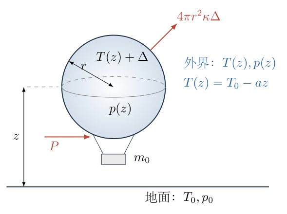
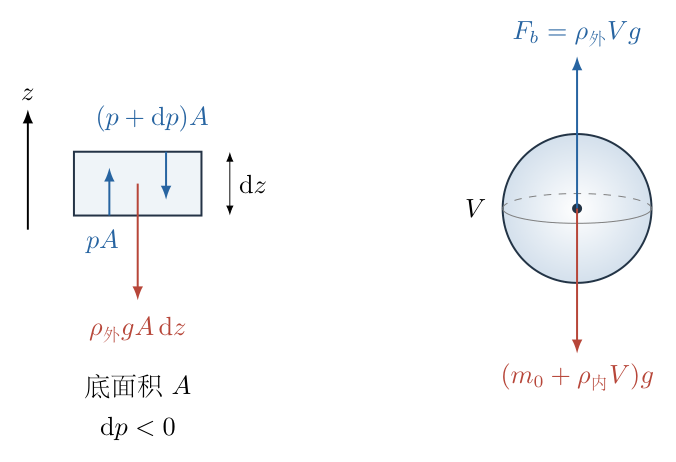

# 第 6 题

<!-- question-start -->

地面温度为 $T_0$、压强为 $p_0$，空气摩尔质量为 $\mu$，定容摩尔热容为 $C_V=\dfrac52R$，其中 $R$ 为摩尔气体常量，重力加速度为 $g$。

假设大气符合绝热大气模型：一团空气绝热上升一小段高度后，其密度仍与周围大气几乎相同。一个热气球的自身质量为 $m_0$，装气部分可视为半径固定为 $r$ 的球体。气球表面单位面积、单位时间的散热量为 $\kappa\Delta T$，其中 $\Delta T$ 为气球内外温差，球内空气近似等温。气球内外压强视为相同，最大加热功率为 $P$。

求热气球的最高巡航高度 $h$。计算中可将相对于地面的温度、压强变化视为小量，保留高度的一阶影响。

<!-- question-end -->

## 一、题型定位

绝热大气中的热气球热平衡与浮力平衡。气球内外压强相同，但温度不同，所以密度不同；加热通过减小内部空气质量来增加净承载能力，而不是直接产生一个向上的“热力”。

最高巡航高度由两项稳态条件共同决定：最大供热功率恰好补偿散热，净浮力恰好承担气球自身重量。外界温度和压强随高度变化，还必须由绝热大气模型单独求出，不能都保持为地面值。

## 二、知识点

- 大气静力平衡：$\mathrm dp/\mathrm dz=-\rho_{\text{外}}g$。
- 理想气体状态方程与密度：$\rho=\mu p/(RT)$。
- 绝热过程第一定律：$C_V\,\mathrm dT=-p\,\mathrm dV_m$。
- 定压摩尔热容 $C_p=C_V+R=7R/2$，绝热指数 $\gamma=7/5$。
- 球体体积 $V=4\pi r^3/3$，外表面积 $S=4\pi r^2$。
- 稳态供热功率等于散热功率。
- 乘积、倒数和分式的一阶展开；舍去两个高度小量相乘的二阶项。
- 浮力应先扣除内部热空气的重量，剩余部分才用于支持 $m_0$。

## 三、物理图像

以地面为 $z=0$，竖直向上为正。外界大气温度、压强随高度分别为 $T(z),p(z)$，满足 $T(0)=T_0$、$p(0)=p_0$。气球内部温度记为 $T_{\text{内}}(z)$。

由于内外压强相同，两种空气密度分别为

$$
\rho_{\text{外}}(z)=\frac{\mu p(z)}{RT(z)},
\qquad
\rho_{\text{内}}(z)=\frac{\mu p(z)}{RT_{\text{内}}(z)}.
$$

取“气囊、附属物与内部空气”作为受力整体。排开外界空气产生的浮力为 $\rho_{\text{外}}Vg$；向下重量包括 $m_0g$ 与 $\rho_{\text{内}}Vg$。气球自身质量 $m_0$ 不含内部空气，不能重复计算或漏算。

题目中气球“最高巡航”表示定高稳态；不需要求启动加热时间，也不需要把功率 $P$ 全部转化为重力势能变化率。用 $P=m_0g\,\mathrm dh/\mathrm dt$ 描述本题会漏掉始终存在的表面散热。

## 四、解题入口

先求外界大气的温度梯度和压强梯度。随后由最大功率确定内外温差，再将两个状态方程代入浮力平衡。

为避免在多个分式中丢失一阶项，先定义“净承载质量” $M(z)=[\rho_{\text{外}}(z)-\rho_{\text{内}}(z)]V$。最高高度对应 $M(h)=m_0$。将 $M(z)$ 整体展开，比单独猜测某个密度“随高度怎样变化”更可靠。

## 五、解析

（1）由绝热条件求定压热容及温度、压强之间的关系。

取一摩尔随周围环境准静态上升的空气，其摩尔体积为 $V_m$。绝热过程中没有吸热，第一定律为

$$
C_V\,\mathrm dT=-p\,\mathrm dV_m.
$$

对理想气体状态方程 $pV_m=RT$ 微分：

$$
p\,\mathrm dV_m+V_m\,\mathrm dp=R\,\mathrm dT.
$$

由此消去 $p\,\mathrm dV_m$：

$$
\begin{aligned}
C_V\,\mathrm dT
&=-R\,\mathrm dT+V_m\,\mathrm dp,\\
(C_V+R)\,\mathrm dT&=V_m\,\mathrm dp.
\end{aligned}
$$

定义 $C_p=C_V+R=7R/2$，并代入 $V_m=RT/p$，得到

$$
\boxed{C_p\,\mathrm dT=\frac{RT}{p}\,\mathrm dp.}
$$

外界大气符合题给绝热模型，空气团缓慢移动后能与当地环境匹配，因此这条绝热关系可以用于相邻高度的环境状态。它不是说整个大气在同一时刻处处温度相同。

（2）由小空气柱的受力平衡求压强梯度。

图6-2左图中，取底面积为 $A$、厚度为 $\mathrm dz$ 的水平小空气柱。下表面受到向上压力 $pA$，上表面受到向下压力 $(p+\mathrm dp)A$，重力为 $\rho_{\text{外}}gA\,\mathrm dz$。

向上为正，列平衡方程：

$$
\begin{aligned}
pA-(p+\mathrm dp)A-\rho_{\text{外}}gA\,\mathrm dz&=0,\\
-\mathrm dp-\rho_{\text{外}}g\,\mathrm dz&=0,\\
\boxed{\frac{\mathrm dp}{\mathrm dz}}
&=\boxed{-\rho_{\text{外}}g}
=-\frac{\mu p g}{RT}.
\end{aligned}
$$

负号表示越高压强越小。面积 $A$ 约去，说明压强梯度与任意选取的空气柱横截面积无关。

（3）联合绝热关系与静力平衡，求大气温度。

将 $\mathrm dp/\mathrm dz$ 代入绝热关系：

$$
\begin{aligned}
C_p\frac{\mathrm dT}{\mathrm dz}
&=\frac{RT}{p}\frac{\mathrm dp}{\mathrm dz}\\
&=\frac{RT}{p}\left(-\frac{\mu pg}{RT}\right)\\
&=-\mu g.
\end{aligned}
$$

所以

$$
\frac{\mathrm dT}{\mathrm dz}
=-\frac{\mu g}{C_p}
=-\frac{2\mu g}{7R}.
$$

定义正的温度递减率

$$
a=\frac{2\mu g}{7R}.
$$

$a$ 的单位为温度除以长度。对高度积分并用边界条件 $T(0)=T_0$：

$$
\begin{aligned}
T(z)-T_0
&=\int_0^z(-a)\,\mathrm dz',\\
T(z)&=\boxed{T_0-az}.
\end{aligned}
$$

在恒定 $C_p,g$ 的绝热大气模型内，这个温度式本身是线性的；本题的一阶近似主要还用于压强及后面的密度分式，并要求 $az/T_0\ll1$。

（4）求压强随高度的关系，并展开到一阶。

由 $C_p\,\mathrm dT=(RT/p)\mathrm dp$，分离变量：

$$
\frac{\mathrm dp}{p}
=\frac{C_p}{R}\frac{\mathrm dT}{T}
=\frac72\frac{\mathrm dT}{T}.
$$

在 $(p_0,T_0)$ 到 $(p,T)$ 之间积分：

$$
\begin{aligned}
\int_{p_0}^{p}\frac{\mathrm dp'}{p'}
&=\frac72\int_{T_0}^{T}\frac{\mathrm dT'}{T'},\\
\ln\frac p{p_0}&=\frac72\ln\frac T{T_0},\\
p(z)&=p_0\left(\frac{T(z)}{T_0}\right)^{7/2}\\
&=p_0\left(1-\frac{az}{T_0}\right)^{7/2}.
\end{aligned}
$$

用二项式展开 $(1-\epsilon)^{7/2}=1-(7/2)\epsilon+O(\epsilon^2)$，得到

$$
\begin{aligned}
p(z)
&\approx p_0\left(1-\frac{7a}{2T_0}z\right)\\
&=p_0\left(1-\frac{\mu g}{RT_0}z\right).
\end{aligned}
$$

定义

$$
b=\frac{\mu g}{RT_0}=\frac{7a}{2T_0},
$$

则 $p(z)\approx p_0(1-bz)$。$b$ 的单位为长度倒数，一阶近似要求 $bz\ll1$。不能一边采用这项压强的一阶式，一边保留后面乘积中某些 $z^2$ 项而舍掉另一些。

（5）由最大功率确定内外温差。

球体外表面积为 $S=4\pi r^2$。题给的 $\kappa\Delta T$ 是单位面积的散热功率，因此总散热功率为

$$
P_{\text{散}}=4\pi r^2\kappa
\bigl[T_{\text{内}}(z)-T(z)\bigr].
$$

定高巡航时，内部温度不再随时间变化，供热等于散热。要获得同一高度的最大浮力，应使用最大功率 $P$，于是

$$
P=4\pi r^2\kappa
\bigl[T_{\text{内}}(z)-T(z)\bigr].
$$

将由功率决定的温差记为 $\Delta$：

$$
\boxed{\Delta=\frac{P}{4\pi r^2\kappa}},
\qquad
\boxed{T_{\text{内}}(z)=T_0+\Delta-az}.
$$

在题设 $P,\kappa,r$ 不变的模型中，最大供热对应的内外温差是常数。常数的是温差，不是球内温度；外界温度下降时，球内稳态温度也相应下降。

这里没有额外假设 $\Delta/T_0\ll1$。题目允许的是相对地面的高度变化小，不应把最大功率产生的有限温差也无条件丢掉。若 $P=0$ 且 $m_0>0$，内外温度相同、净承载能力为零，热气球不能升空；以下讨论 $P>0,\kappa>0$。

（6）写出完整的浮力平衡，不漏掉内部空气重量。

图6-2右图中，向上的浮力为

$$
F_b=\rho_{\text{外}}Vg,
\qquad V=\frac43\pi r^3.
$$

向下重量为 $(m_0+\rho_{\text{内}}V)g$。定高平衡要求

$$
\begin{aligned}
\rho_{\text{外}}Vg
&=(m_0+\rho_{\text{内}}V)g,\\
m_0&=(\rho_{\text{外}}-\rho_{\text{内}})V.
\end{aligned}
$$

将状态方程代入：

$$
\begin{aligned}
m_0
&=\frac{\mu Vp(z)}{R}
\left[\frac1{T(z)}-\frac1{T(z)+\Delta}\right]\\
&=\frac{\mu Vp(z)}{R}
\frac{\Delta}{T(z)[T(z)+\Delta]}.
\end{aligned}
$$

定义净承载质量函数

$$
\boxed{
M(z)=\frac{\mu Vp(z)\Delta}
{R\,T(z)[T(z)+\Delta]}.
}
$$

它不等于气球排开空气的质量，而是排开空气质量减去球内空气质量。在地面上，其值为

$$
\boxed{
M_0=\frac{\mu Vp_0\Delta}
{R\,T_0(T_0+\Delta)}.
}
$$

$M_0$ 是地面最大供热下可承担的自身质量。如果 $m_0>M_0$，即使满功率也不能在地面悬浮；如果 $m_0=M_0$，临界高度就是零。

（7）将净承载质量按高度展开，逐项保留一阶量。

把温度、压强的表达式代入 $M(z)$：

$$
M(z)\approx
\frac{\mu Vp_0\Delta}{R}
\frac{1-bz}{(T_0-az)(T_0+\Delta-az)}.
$$

分别展开两个倒数。使用 $1/(1-\epsilon)=1+\epsilon+O(\epsilon^2)$：

$$
\begin{aligned}
\frac1{T_0-az}
&=\frac1{T_0}\frac1{1-az/T_0}
\approx\frac1{T_0}\left(1+\frac a{T_0}z\right),\\
\frac1{T_0+\Delta-az}
&\approx\frac1{T_0+\Delta}
\left(1+\frac a{T_0+\Delta}z\right).
\end{aligned}
$$

三个因子相乘时，只保留常数项和一次项：

$$
\begin{aligned}
&(1-bz)
\left(1+\frac a{T_0}z\right)
\left(1+\frac a{T_0+\Delta}z\right)\\
&\qquad\approx
1+\left(-b+\frac a{T_0}
+\frac a{T_0+\Delta}\right)z.
\end{aligned}
$$

故

$$
M(z)\approx M_0(1-Dz),
$$

其中

$$
D=b-a\left(\frac1{T_0}+\frac1{T_0+\Delta}\right).
$$

再把 $a,b$ 代入并通分：

$$
\begin{aligned}
D
&=\frac{\mu g}{RT_0}
-\frac{2\mu g}{7R}
\left(\frac1{T_0}+\frac1{T_0+\Delta}\right)\\
&=\frac{\mu g}{7R}
\left(\frac5{T_0}-\frac2{T_0+\Delta}\right)\\
&=\frac{\mu g}{7R}
\frac{5(T_0+\Delta)-2T_0}{T_0(T_0+\Delta)}\\
&=\boxed{
\frac{\mu g(3T_0+5\Delta)}
{7R\,T_0(T_0+\Delta)}}.
\end{aligned}
$$

各量为正时 $D>0$，所以在此近似下净承载能力随高度上升而下降。外界冷却虽有利于增大空气密度，但大气压强降低的效应也必须计入；二者合成后得到上式中的净递减率。

（8）求最高巡航高度并写明可达条件。

令 $M(h)=m_0$：

$$
\begin{aligned}
M_0(1-Dh)&=m_0,\\
Dh&=1-\frac{m_0}{M_0},\\
h&\approx\boxed{\frac{1-m_0/M_0}{D}}.
\end{aligned}
$$

将 $M_0,D$ 展开，得到题给参数表示的结果：

$$
\boxed{
h\approx
\frac{7R\,T_0(T_0+\Delta)}
{\mu g(3T_0+5\Delta)}
\left[
1-\frac{m_0R\,T_0(T_0+\Delta)}
{\mu Vp_0\Delta}
\right],
}
$$

其中

$$
V=\frac43\pi r^3,\qquad
\Delta=\frac{P}{4\pi r^2\kappa}.
$$

这是一阶近似的高度结果，适用于 $0<m_0<M_0$ 且求出的 $h$ 满足

$$
\frac{ah}{T_0}\ll1,\qquad bh\ll1.
$$

若 $m_0=M_0$，最高可平衡高度为 $0$；若 $m_0>M_0$，应回答最大功率不足以升空，不应把上式给出的负数称为负的巡航高度。

当 $m_0$ 比 $M_0$ 小得很多时，线性公式可能给出超出小高度范围的值。这表示近似失效，而不是热气球实际在那个数值处达到精确平衡。此时应回到尚未展开的绝热大气表达式。

（9）从未展开的模型证明最高平衡点的唯一性。

使用

$$
p=p_0\left(\frac T{T_0}\right)^{7/2},
\qquad T=T_0-az,
$$

将净承载质量写为温度的函数：

$$
\begin{aligned}
M(T)
&=\frac{\mu Vp_0\Delta}{R}
\frac{(T/T_0)^{7/2}}{T(T+\Delta)}\\
&=\frac{\mu Vp_0\Delta}{R\,T_0^{7/2}}
\frac{T^{5/2}}{T+\Delta}.
\end{aligned}
$$

对正的 $T,\Delta$，取对数求导：

$$
\begin{aligned}
\frac{\mathrm d\ln M}{\mathrm dT}
&=\frac5{2T}-\frac1{T+\Delta}\\
&=\frac{5(T+\Delta)-2T}{2T(T+\Delta)}\\
&=\frac{3T+5\Delta}{2T(T+\Delta)}>0.
\end{aligned}
$$

又有 $\mathrm dT/\mathrm dz=-a<0$，所以 $\mathrm dM/\mathrm dz<0$。因此只要地面净承载质量大于 $m_0$，向上最多出现一个 $M=m_0$ 的平衡点。继续升高时浮力不足，降低时浮力有余，这就是在温差能够保持稳态的模型下，该平衡高度成为最高巡航高度的原因。

这项单调性检验没有使用一阶高度公式，因而也检查了线性系数 $D$ 的正负是否合理。

（10）对温差、质量和量纲作交叉检查。

$M_0$ 的单位是质量，$D$ 的单位是长度倒数，因此 $(1-m_0/M_0)/D$ 是长度。热平衡式中 $4\pi r^2\kappa\Delta$ 的单位是功率，符合 $P$ 的含义。

当 $\Delta\to0^+$，$M_0\to0$，正质量气球不能起飞。任何推导若在无温差时仍得到有限正的净承载质量，就是忘记了内部空气重量或在两个相近倒数相减时丢项。

在相同最大功率下，$r$ 增大同时使体积增加、单位面积供热变小。不能只依据浮力随 $r^3$ 增加，就直接断言巡航高度也按 $r^3$ 增加；必须同时代入 $\Delta=P/(4\pi r^2\kappa)$。同理，$\kappa$ 越大，维持相同温差需要的功率越大，地面净承载能力随之减小。

近似的相对高度变化由地面承载余量控制。记 $\epsilon=1-m_0/M_0$，则 $h\approx\epsilon/D$。$\epsilon$ 很小时，求出的高度接近地面，展开更可靠；若 $\epsilon$ 不是小量，须检验 $bh$，不能只因为用了泰勒展开就认定结果自动适用。

## 六、关键洞察

大气温度递减率由 $\mu g/C_p$ 决定，可以从一摩尔空气的能量收支看出。空气团上升 $\mathrm dz$ 时，每摩尔重力势能增加 $\mu g\,\mathrm dz$，相应焓变化为 $C_p\,\mathrm dT$。在本题的准静态绝热模型中二者相加为零：

$$
C_p\,\mathrm dT+\mu g\,\mathrm dz=0.
$$

这正是正文通过第一定律、状态方程和静力平衡推得的关系。使用焓而不是只用内能，是因为空气团还要对周围环境做膨胀功。

净承载质量也可用两个密度分别展开，再作差来交叉核对。外界密度为

$$
\begin{aligned}
\rho_{\text{外}}
&\approx\frac{\mu p_0}{RT_0}
(1-bz)\left(1+\frac a{T_0}z\right)\\
&\approx\frac{\mu p_0}{RT_0}
\left[1-\left(b-\frac a{T_0}\right)z\right].
\end{aligned}
$$

内部密度为

$$
\rho_{\text{内}}\approx
\frac{\mu p_0}{R(T_0+\Delta)}
\left[1-\left(b-\frac a{T_0+\Delta}\right)z\right].
$$

将两式相减，常数项为 $M_0/V$；一次项为

$$
-\frac{\mu p_0}{R}
\left[
b\left(\frac1{T_0}-\frac1{T_0+\Delta}\right)
-a\left(\frac1{T_0^2}-\frac1{(T_0+\Delta)^2}\right)
\right]z.
$$

把两个差分别通分，括号内等于

$$
\begin{aligned}
&\frac{\Delta}{T_0(T_0+\Delta)}
\left[b-a\frac{2T_0+\Delta}{T_0(T_0+\Delta)}\right]\\
&\qquad=
\frac{\Delta D}{T_0(T_0+\Delta)}.
\end{aligned}
$$

因此再次得到 $M(z)=M_0(1-Dz)$。这条核验路线特别适合检查分式展开中遗漏的交叉项，以及内部、外部密度的一次变化是否被错误地取为相同。

## 七、易错点

- 将绝热大气当成等温大气，直接使用等温压强指数律。
- 使用 $C_V$ 代替 $C_p$ 求大气温度递减率，漏掉空气膨胀对环境做功。
- 把 $\kappa\Delta$ 当成总散热功率，漏乘球面积。
- 写 $P=m_0gh$，把功率和能量混淆。
- 浮力平衡只写 $\rho_{\text{外}}Vg=m_0g$，漏掉内部热空气的重力。
- 内外压强相同就把内外密度也设为相同。温度不同仍会导致密度不同。
- 将 $\Delta$ 与 $az$ 一同视为可以任意丢弃的小量，未说明温差近似。
- 展开两个倒数时只展开其中一个，或把 $(1-bz)$ 的负号写反。
- 得到负的高度后仍当作可达平衡点。应先检查地面能否起飞。
- 用一阶公式讨论温度降至零附近的高度，超出了小量近似范围。
- 把气球半径 $r$ 与气体常量 $R$ 混淆；二者单位完全不同。

## 八、课堂讲解建议

先让学生分别画出环境空气微元和气球整体的受力图。两幅图研究对象不同：前者求压强梯度，后者求净浮力。板书时保留两个对象，避免学生把气球内部压强直接当作一个额外上托力。

推导温度递减率时，先用一摩尔空气写第一定律，再对状态方程微分，让学生亲自消去体积变化。这样能解释为什么结果含 $7R/2$ 而不是 $5R/2$。

处理近似前，先保留完整的密度差分式。要求学生先判断在零温差、零高度时应有什么结果，再逐项展开。这比写完很长的分母后只检查算术更容易发现物理漏项。

最后给一个自身质量略小于地面承载能力的例子，让学生先估计高度应该较小，再计算 $bh$。如果自身质量很小，应引导他们指出近似条件可能失效，而不是把较高的计算值直接视为精确结论。

## 九、变式训练

变式：给定一个满足小高度条件的目标高度 $H$，其环境状态由上述绝热大气模型确定。保持气球半径 $r$、自身质量 $m_0$ 不变，求维持定高所需的最低加热功率，并说明是否总有有限解。

解：记当地环境温度、压强为 $T_H,p_H$，外界空气密度为

$$
\rho_H=\frac{\mu p_H}{RT_H}.
$$

令无量纲载荷比

$$
q=\frac{m_0}{\rho_HV}.
$$

浮力平衡为

$$
m_0=\rho_HV-\frac{\mu p_HV}{R(T_H+\Delta_H)}.
$$

将第二项写成 $\rho_HV\,T_H/(T_H+\Delta_H)$，并除以 $\rho_HV$：

$$
\begin{aligned}
q&=1-\frac{T_H}{T_H+\Delta_H}\\
&=\frac{\Delta_H}{T_H+\Delta_H}.
\end{aligned}
$$

解出温差：

$$
\begin{aligned}
q(T_H+\Delta_H)&=\Delta_H,\\
qT_H&=(1-q)\Delta_H,\\
\Delta_H&=\boxed{\frac{qT_H}{1-q}}.
\end{aligned}
$$

由热平衡，所需最低功率为

$$
\boxed{
P_{\min}(H)
=4\pi r^2\kappa\frac{qT_H}{1-q}.
}
$$

有限正解要求 $0<q<1$，也就是自身质量必须小于排开的外界空气总质量。若 $q\ge1$，即使把内部空气密度降得任意接近零，最大浮力也不够承担自身重量，故不存在有限的加热功率可以维持此高度。

例如 $q=1/10$，所需温差为 $T_H/9$；若载荷提高到 $q=1/5$，温差变为 $T_H/4$，功率提高到原来的 $9/4$ 倍，而不是简单翻倍。这是因为增加温度时密度按 $1/T$ 减小，浮力对加热并非线性响应。

当 $q\ll1$ 时，$\Delta_H=qT_H/(1-q)\approx qT_H$，功率近似与自身质量成正比；当 $q\to1^-$ 时，所需温差和功率都发散。这个极限提供了气球模型的绝对承载上限，不能用无限加热突破排开空气重量的限制。
