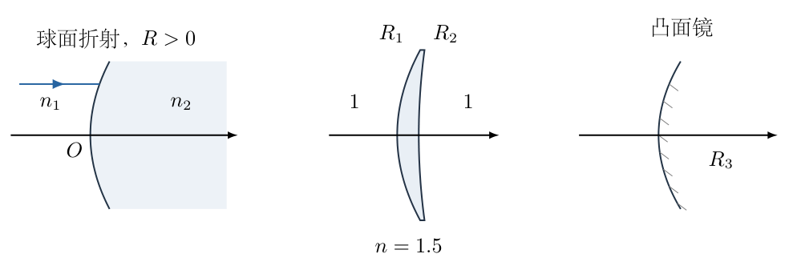
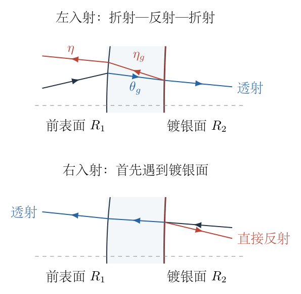
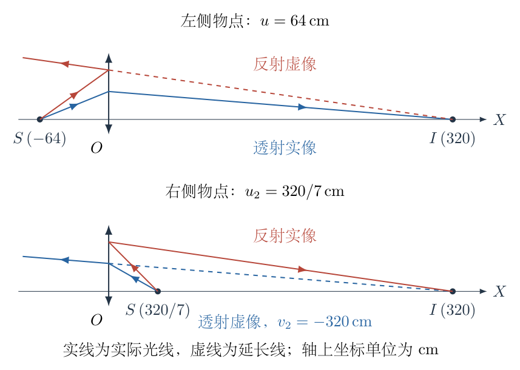

# 第 7 题

<!-- question-start -->

以下各问中的光路均满足近轴条件。

（1）对于曲率半径为 $R$ 的单球面折射系统，当入射、折射介质的折射率分别为 $n_1,n_2$，物距和像距分别为 $u,v$ 时，成像关系为

$$
\frac{n_1}{u}+\frac{n_2}{v}=\frac{n_2-n_1}{R}.
$$

图中球面曲率中心位于右侧。像方焦点定义为平行光入射后的会聚点，求左图系统的右焦距 $f_0$。

（2）中图是空气中的薄透镜。已知左边界面的曲率半径 $R_1=20\,\mathrm{cm}$，玻璃折射率 $n=1.5$，空气折射率取 $1$，透镜焦距 $f=\dfrac{160}{3}\,\mathrm{cm}$。求右边界面的曲率半径 $R_2$。

（3）右图是曲率半径大小为 $R_3$ 的凸面镜。反射光的反向延长线交于其虚焦点，焦距取负值。求该镜焦距，以 $R_3$ 表示。

（4）在第（2）问薄透镜的右边界面镀一层很薄的银，使其既反射部分光，又透射部分光。在透镜左侧光轴上放置一个发光点，使透射像与一次反射形成的像重合。求发光点距透镜的距离 $u$ 及共同像距 $v$。

（5）将第（4）问的发光点放在透镜右侧光轴上，使两个像重合，求物距 $u_2$、共同像距 $v_2$，以及两像横向放大率之比、纵向放大率之比。

第（4）、（5）问中，像位于物体的异侧时像距为正，位于同侧时像距为负。

<!-- question-end -->

## 一、题型定位

近轴折射、薄透镜成像、球面反射及部分反射系统的复合成像。前面三个分问分别建立基本界面的成像规律，后面两个分问要求同一物点经两条不同光路成像到同一空间位置。

真正需要统一的是像的实际空间位置，而不是把两条成像公式中的同名 $v$ 不加辨别地设为相等。反射会改变传播方向，同一个空间点可能对一束光是真像，对另一束光是虚像。

## 二、知识点

- 近轴近似：小角度用弧度计量，$\sin\theta\approx\tan\theta\approx\theta$。
- 单球面折射的物像关系与像方焦距。
- 空气中薄透镜公式 $1/u+1/v=1/f$。
- 曲率半径的符号与曲率中心位置有关，不单由“凸”或“凹”的名称决定。
- 球面镜焦距大小为曲率半径的一半，凹镜会聚、凸镜发散。
- 透射、反射光路必须按实际经过的界面顺序计算。
- 横向放大率需要保留像高的正负，纵向放大率需要先约定物点与像点的有向坐标。

## 三、物理图像

固定一条贯穿透镜的空间坐标轴 $X$，向右为正，薄透镜所在位置取为 $X=0$。近轴光线在透镜处的高度记为 $y$，上方为正。

从左往右看，图中两个球面均向左鼓起，曲率中心都在右侧，因此取

$$
R_1=+20\,\mathrm{cm},\qquad R_2>0.
$$

这是正曲率半径的约定，不意味着两个界面都对光束起相同作用：第一面是空气进入玻璃，第二面是玻璃进入空气，折射率的变化方向相反。

第（4）问的物点位于 $X=-u$，按题意共同像坐标就是 $X=v$。第（5）问的物点位于 $X=+u_2$，题目规定的共同像距与空间坐标关系则为

$$
X_{\text{像}}=-v_2.
$$

若 $v_2<0$，共同像位于透镜右侧，也就是与物点同侧。这个关系在求纵向倍率时尤其重要。

## 四、解题入口

先用已知薄透镜焦距确定 $R_2$。接着分别建立两条光路：左侧发光时，透射光经历两次折射，反射光经历“前表面折射—后表面反射—前表面再折射”；右侧发光时，反射光直接在镀银后表面反射，透射光才穿过透镜。

在每一步中记录光线高度、传播方向和近轴倾角，得到两束出射光各自的空间交点，再令交点重合。不能把镀银后的等效光焦度一概写成薄透镜光焦度的两倍；反射面的曲率也参加作用。

## 五、解析

（1）单球面折射的右焦距。

像方焦点对应从左侧入射的平行光，物距趋于正无穷，因此 $1/u\to0$。代入给定成像公式：

$$
\begin{aligned}
\frac{n_2}{f_0}&=\frac{n_2-n_1}{R},\\
\boxed{f_0}&=\boxed{\frac{n_2R}{n_2-n_1}}.
\end{aligned}
$$

当 $n_2>n_1$、$R>0$ 时，$f_0>0$，平行光在右侧会聚；当 $n_2<n_1$ 时，$f_0<0$，右侧出射光发散，其反向延长线在左侧相交。若 $n_2=n_1$，界面没有折射能力，焦点退到无穷远，不能把零分母当成有限焦距。

为了明确此后球面公式中曲率的符号，可从光线倾角再核对一次。设折射面处光线高度为 $y>0$，球心在右侧，指向右侧介质的法线相对 $+X$ 轴倾角约为 $-y/R$。入射、折射光线的有向小倾角为 $\theta_1,\theta_2$，近轴折射定律给出

$$
\begin{aligned}
n_1\left(\theta_1+\frac yR\right)
&=n_2\left(\theta_2+\frac yR\right),\\
n_2\theta_2
&=n_1\theta_1-\frac{n_2-n_1}{R}y.
\end{aligned}
$$

对于轴上物点，$\theta_1=y/u$，指向轴上实像的出射光有 $\theta_2=-y/v$，代入即恢复题给关系。这也确定了后续逐界面追迹所使用的正负号。

（2）由薄透镜焦距求右表面曲率半径。

薄透镜厚度在近轴成像中忽略，因此同一条光线在两个界面的高度均记为 $y$。设左侧空气中的入射倾角为 $\theta_{\text{入}}$，玻璃内为 $\theta_g$，右侧空气中为 $\theta_{\text{透}}$。

第一面空气到玻璃：

$$
n\theta_g
=\theta_{\text{入}}-\frac{n-1}{R_1}y.
$$

第二面玻璃到空气：

$$
\theta_{\text{透}}
=n\theta_g-\frac{1-n}{R_2}y
=n\theta_g+\frac{n-1}{R_2}y.
$$

把第一式代入第二式，玻璃内倾角消去：

$$
\theta_{\text{透}}
=\theta_{\text{入}}
-(n-1)\left(\frac1{R_1}-\frac1{R_2}\right)y.
$$

平行光入射时 $\theta_{\text{入}}=0$；出射光若在距离 $f$ 处会聚，则 $\theta_{\text{透}}=-y/f$。于是得到薄透镜制造者公式

$$
\frac1f=(n-1)\left(\frac1{R_1}-\frac1{R_2}\right).
$$

这一步不是凭形状给两个曲率半径任意加符号，而是两次折射方程的直接相加。代入数据，统一以 $\mathrm{cm}$ 为长度单位：

$$
\begin{aligned}
\frac3{160}
&=\frac12\left(\frac1{20}-\frac1{R_2}\right),\\
\frac3{80}
&=\frac1{20}-\frac1{R_2},\\
\frac1{R_2}
&=\frac4{80}-\frac3{80}=\frac1{80}.
\end{aligned}
$$

故

$$
\boxed{R_2=80\,\mathrm{cm}}.
$$

左面曲率较大、右面曲率较小，且两面曲率中心都在右侧，这与图示弯月形会聚透镜一致。

（3）凸面镜的焦距及其符号。

对从左侧水平入射的近轴光线，设反射点高度为 $y$。凸面镜球心在右侧，入射方向与局部法线的夹角大小近似为 $y/R_3$。

反射定律使反射光偏离水平向左方向的角度大小为 $2y/R_3$。上半部反射光向左上方发散，其反向延长线到达镜后光轴的距离为

$$
\left|f_{\text{凸}}\right|
=\frac{y}{2y/R_3}=\frac{R_3}{2}.
$$

因为焦点在反射光实际传播方向的反侧，是虚焦点，按题目约定焦距取负：

$$
\boxed{f_{\text{凸}}=-\frac{R_3}{2}}.
$$

这里 $R_3$ 是题给的半径大小。后面从透镜右侧看镀银面时，它呈凹面而不是凸面，不能仍然给其焦距加同样的负号。

（4）左侧发光时，先写透射像的空间坐标关系。

定义透射光焦度 $K_t=1/f=3/160\,\mathrm{cm}^{-1}$。

物点在 $X=-u$，透镜处高度为 $y$ 的入射光倾角为 $y/u$。经过两面折射后，

$$
\theta_{\text{透}}=\frac yu-K_ty.
$$

如果透射像位于 $X=v$，光线从 $(0,y)$ 到 $(v,0)$，所以 $\theta_{\text{透}}=-y/v$。约去非零辅助高度 $y$，得

$$
\boxed{\frac1u+\frac1v=K_t=\frac3{160}}.
$$

单位仍为厘米。这是透射支的成像关系，尚不能单独确定 $u,v$，还需反射支。

（5）逐界面计算左侧发光的反射支。

图7-2上图把薄透镜的两表面在水平方向适度拉开，并放大偏折，以便看清传播先后；图不用于量取厚度和角度。计算仍采用薄透镜近似，各界面处均取同一高度 $y$。反射发生在右表面，光随后向左返回，最后从左表面出射。

第一次折射仍为

$$
\boxed{
n\theta_g=\frac yu-\frac{n-1}{R_1}y.
}
$$

反射以后，以水平向左为新的前进方向，但竖直向上仍取正。将向左传播光线的倾角记为 $\eta_g$。右表面的法线相对向右水平方向倾斜 $-y/R_2$，反射定律给出

$$
\boxed{\eta_g=\theta_g+\frac{2y}{R_2}}.
$$

这个符号可以用平面镜极限检查：若 $R_2\to\infty$，反射前向右上方的光线，反射后向左上方传播，因此相对于各自前进方向的竖直倾角同为正，即 $\eta_g=\theta_g$。凸向左侧的曲面还会使返回光线进一步向上偏转，所以曲率项为正。

返回到左表面后，光由玻璃射入空气。该表面指向左侧空气的法线相对向左水平方向倾角为 $+y/R_1$。近轴折射定律为

$$
\begin{aligned}
n\left(\eta_g-\frac y{R_1}\right)
&=\eta-\frac y{R_1},\\
\eta&=n\eta_g-\frac{n-1}{R_1}y.
\end{aligned}
$$

把前面的两步依次代入：

$$
\begin{aligned}
\eta
&=n\left(\theta_g+\frac{2y}{R_2}\right)
-\frac{n-1}{R_1}y\\
&=\left(\frac yu-\frac{n-1}{R_1}y\right)
+\frac{2n}{R_2}y
-\frac{n-1}{R_1}y\\
&=\frac yu-
\left[\frac{2(n-1)}{R_1}-\frac{2n}{R_2}\right]y.
\end{aligned}
$$

定义左入射反射支的等效光焦度

$$
K_r=\frac{2(n-1)}{R_1}-\frac{2n}{R_2}.
$$

代入 $n=3/2,R_1=20,R_2=80$：

$$
\begin{aligned}
K_r
&=\frac{2(1/2)}{20}-\frac{2(3/2)}{80}\\
&=\frac1{20}-\frac3{80}\\
&=\frac4{80}-\frac3{80}
=\boxed{\frac1{80}\,\mathrm{cm}^{-1}}.
\end{aligned}
$$

因此返回空气后的倾角为

$$
\boxed{\eta=y\left(\frac1u-\frac1{80}\right)}.
$$

对应平行光入射的反射等效焦距是 $80\,\mathrm{cm}$。不能把它写成 $f/2=80/3\,\mathrm{cm}$，因为右表面的曲率反射作用并未包含在“两次透镜折射”的简单叠加中。

（6）以同一个空间像点建立反射支方程。

左向出射光从 $(0,y)$ 出发，其光线路径可写成

$$
Y(X)=y-\eta X.
$$

负号来自 $X$ 正向向右，而实际传播方向向左。令 $Y=0$，该直线与光轴交点为

$$
X_{\text{反}}=\frac y\eta.
$$

如果 $\eta>0$，出射光向左上方发散，交点在右侧，是反射光的虚像；如果 $\eta<0$，出射光向左下方会聚，交点在左侧，是真像。

要求此交点与透射像坐标 $X=v$ 相同，就有 $\eta=y/v$。与上一步联立：

$$
\begin{aligned}
\frac1v&=\frac1u-K_r,\\
\boxed{\frac1u-\frac1v}&=\boxed{K_r=\frac1{80}}.
\end{aligned}
$$

这与透射支的 $1/u+1/v=K_t$ 相差一个符号。原因不是同一个像距可以随意改正负，而是反射支实际传播方向已反向。

（7）联立两支方程，完整计算左侧物距和共同像距。

方程组为

$$
\begin{cases}
\dfrac1u+\dfrac1v=\dfrac3{160},\\[4pt]
\dfrac1u-\dfrac1v=\dfrac1{80}=\dfrac2{160}.
\end{cases}
$$

相加求物距：

$$
\begin{aligned}
\frac2u&=\frac5{160}=\frac1{32},\\
\frac1u&=\frac1{64},\\
u&=64\,\mathrm{cm}.
\end{aligned}
$$

相减求像距：

$$
\begin{aligned}
\frac2v&=\frac1{160},\\
\frac1v&=\frac1{320},\\
v&=320\,\mathrm{cm}.
\end{aligned}
$$

因此 $\boxed{u=64\,\mathrm{cm},\ v=320\,\mathrm{cm}}$。物点在左侧，共同像在右侧，所以按题给规则 $v>0$。但“位于右侧”对两束光的含义不同：透射光向右传播，在那里实际会聚，形成实像；反射光向左传播，它的反向延长线在那里相交，形成虚像。

图7-3上图用实线区分实际传播段，用虚线标出反射光的反向延长线。两支像同位并不意味着两支光同时沿同一方向到达该点。

直接代回倾角可以检查同像条件。取任意足够小的高度 $y$：

$$
\begin{aligned}
\theta_{\text{透}}
&=y\left(\frac1{64}-\frac3{160}\right)
=y\left(\frac5{320}-\frac6{320}\right)
=-\frac y{320},\\
\eta
&=y\left(\frac1{64}-\frac1{80}\right)
=y\left(\frac5{320}-\frac4{320}\right)
=+\frac y{320}.
\end{aligned}
$$

于是透射交点 $-y/\theta_{\text{透}}$ 与反射交点 $y/\eta$ 都等于 $320\,\mathrm{cm}$。这项核验同时检查了数值、方向和虚实像解释。

（8）右侧发光时，分别确定两支成像能力。

光从右向左射来，先到达镀银面。被直接反射的那一部分不进入透镜，因此其成像只由该反射面的几何曲率决定。球心在镀银面的右侧，与入射物点同侧，所以从右看是凹面镜，焦距为

$$
f_m=\frac{R_2}{2}=40\,\mathrm{cm}.
$$

另一部分光穿过镀银层和玻璃，经过两次折射，仍构成空气中的同一薄透镜。薄透镜从两侧入射具有相同焦距 $f=160/3\,\mathrm{cm}$；也可将入射方向反转后的两次球面折射方程相加得到这一结果。

设共同像的实际空间坐标为 $X$。物点位于 $X=+u_2$。对向左透射的光，题定像距为 $v_2=-X$，所以透镜公式为

$$
\frac1{u_2}-\frac1X=\frac3{160}.
$$

对向右反射的光，实际会聚在右侧时，其镜像距离就是 $X$，因此凹面镜公式为

$$
\frac1{u_2}+\frac1X=\frac1{40}.
$$

同一空间 $X$ 在两支公式中符号相反，不能因为物点改到右侧就把两个公式都写成相同的加号。

（9）求右侧物距与共同像距。

联立

$$
\begin{cases}
\dfrac1{u_2}-\dfrac1X=\dfrac3{160},\\[4pt]
\dfrac1{u_2}+\dfrac1X=\dfrac4{160}.
\end{cases}
$$

相加、相减分别得到

$$
\begin{aligned}
\frac2{u_2}&=\frac7{160},
&\quad \boxed{u_2=\frac{320}{7}\,\mathrm{cm}},\\
\frac2X&=\frac1{160},
&\quad \boxed{X=320\,\mathrm{cm}}.
\end{aligned}
$$

再转换成题目要求的像距：

$$
\boxed{v_2=-X=-320\,\mathrm{cm}}.
$$

此时物点距透镜约 $45.714\,\mathrm{cm}$，介于凹面镜焦距 $40\,\mathrm{cm}$ 与透镜焦距 $53.333\,\mathrm{cm}$ 之间。故反射支形成位于右侧的实像，透射支形成位于右侧的虚像，正好与图7-3下图对应。

（10）求横向放大率，并说明比值的方向约定。

把轴上点稍微移到轴外，高度记为 $Y$，求两个像的近轴高度。定义有向横向放大率为像高除以物高，上下方向在整个空间中采用同一约定。

透射支的薄透镜横向放大率为

$$
\begin{aligned}
m_t&=-\frac{v_2}{u_2}\\
&=-\frac{-320}{320/7}
=\boxed{+7}.
\end{aligned}
$$

反射支凹面镜的像距在其实际出射一侧取正，数值为 $X=320\,\mathrm{cm}$，所以

$$
\begin{aligned}
m_r&=-\frac{X}{u_2}\\
&=-\frac{320}{320/7}
=\boxed{-7}.
\end{aligned}
$$

因此两像大小相等，但一个正立、另一个倒立。若“放大率之比”指大小之比，答案为

$$
\boxed{|m_t|:|m_r|=1:1}.
$$

若保留有向倍率，则

$$
\boxed{\frac{m_t}{m_r}=-1}.
$$

轴上点的两像能重合，不代表任意轴外物体的两幅像也逐点重合。离开光轴后，像高分别为 $+7Y$ 和 $-7Y$，除 $Y=0$ 外并不相同。

（11）求纵向放大率，避免反射后的坐标反转。

统一定义纵向放大率为共同空间轴中像坐标变化与物坐标变化之比：

$$
M=\frac{\mathrm dX_{\text{像}}}{\mathrm dX_{\text{物}}}.
$$

在右侧发光的情形，$X_{\text{物}}=u$。先暂时不固定同像物距，分别写两支像位置随 $u$ 的变化。

透射支的成像关系为 $1/u-1/X_t=1/f$，解得

$$
\begin{aligned}
\frac1{X_t}&=\frac1u-\frac1f
=\frac{f-u}{fu},\\
X_t(u)&=\frac{fu}{f-u}.
\end{aligned}
$$

用商法则求导：

$$
\begin{aligned}
\frac{\mathrm dX_t}{\mathrm du}
&=\frac{f(f-u)-fu(-1)}{(f-u)^2}\\
&=\frac{f^2}{(f-u)^2}.
\end{aligned}
$$

代入 $f=160/3$、$u=320/7$。先算分母中的差：

$$
f-u=\frac{1120-960}{21}=\frac{160}{21}\,\mathrm{cm}.
$$

因此

$$
\boxed{
M_t=
\frac{(160/3)^2}{(160/21)^2}=49.
}
$$

反射支满足 $1/u+1/X_r=1/f_m$，解得

$$
X_r(u)=\frac{f_mu}{u-f_m}.
$$

同样用商法则：

$$
\begin{aligned}
\frac{\mathrm dX_r}{\mathrm du}
&=\frac{f_m(u-f_m)-f_mu}{(u-f_m)^2}\\
&=-\frac{f_m^2}{(u-f_m)^2}.
\end{aligned}
$$

代入 $f_m=40$，并先计算

$$
u-f_m=\frac{320}{7}-40=\frac{40}{7}\,\mathrm{cm},
$$

得到

$$
\boxed{
M_r=-\frac{40^2}{(40/7)^2}=-49.
}
$$

故纵向倍率大小之比同样为 $1:1$；采用同一空间轴的有向定义时，

$$
\boxed{
|M_t|:|M_r|=1:1,\qquad
\frac{M_t}{M_r}=-1.
}
$$

物点向右移动一小段 $\delta u>0$，透射像向右移动约 $49\delta u$，反射像向左移动约 $49\delta u$。这表明两像仅在指定物距处同位，物点稍作轴向移动就会分离。

（12）对各分问作一致性检查。

两次折射、折射后返回、直接反射对应三条不同的界面序列，不能共用一个“镀银透镜焦距”。

各项光焦度具有长度倒数的量纲；求得的物距和像距均为长度。第（4）问 $u=64>f$，透射像为实像；第（5）问 $40<u_2<f$，反射成实像、透射成虚像，符合各自的焦距判断。

把左入射反射支与透射支的光焦度相比较，还可得到

$$
\begin{aligned}
K_r-2K_t
&=\left[\frac{2(n-1)}{R_1}-\frac{2n}{R_2}\right]
-\left[\frac{2(n-1)}{R_1}-\frac{2(n-1)}{R_2}\right]\\
&=-\frac2{R_2}.
\end{aligned}
$$

故仅在镀银后表面趋于平面、即 $R_2\to\infty$ 时才有 $K_r=2K_t$；本题后表面曲率有限，不能将反射等效焦距取为透射焦距的一半。

## 六、关键洞察

反射成像最可靠的检查量是实际光线的轴线交点。对于从透镜向右出射的光，交点为 $X=-y/\theta$；对于向左出射且以向左为前进方向定义倾角的光，交点为 $X=y/\eta$。两式的不同来自坐标方向，不来自记忆中的“实正虚负”口号。

还可用二维光线向量组织逐界面计算。取状态向量为 $(y,p)^{\mathsf T}$，其中 $p=n\theta$，倾角相对于每一段实际前进方向定义，竖直正向不变。忽略透镜厚度，传播过程中高度不变。左表面每次折射对 $p$ 的作用均为

$$
p_{\text{后}}=p_{\text{前}}-Ay,
\qquad A=\frac{n-1}{R_1}.
$$

右表面一次反射的作用为 $p_{\text{后}}=p_{\text{前}}+By$，其中 $B=2n/R_2$。三步矩阵相乘：

$$
\begin{aligned}
\begin{pmatrix}1&0\\-A&1\end{pmatrix}
\begin{pmatrix}1&0\\B&1\end{pmatrix}
\begin{pmatrix}1&0\\-A&1\end{pmatrix}
&=
\begin{pmatrix}1&0\\B-2A&1\end{pmatrix}\\
&=
\begin{pmatrix}1&0\\-K_r&1\end{pmatrix}.
\end{aligned}
$$

矩阵乘积再次给出 $K_r=2A-B$。它没有消除反射的方向约定；相反，只有先把角度正向定义清楚，矩阵才有确定意义。

有限高度的精确球面光线也能检查上述近轴极限。以左侧物距 $64\,\mathrm{cm}$ 为例，取入射高度 $0.001\,\mathrm{cm}$、透镜中心厚度 $0.00001\,\mathrm{cm}$，用球面几何求交、精确折射定律和反射定律追迹，透射像坐标约为 $319.999946\,\mathrm{cm}$，反射像约为 $320.000605\,\mathrm{cm}$。两者随着高度和厚度趋零而共同趋向 $320\,\mathrm{cm}$。这里微小差异是有限孔径与有限厚度的残余，不应反过来用较粗的图画读数修正近轴解析结果。

## 七、易错点

- 看到透镜两面都向左弯，就给两个半径相反的符号。曲率符号应由球心相对于所选轴向的位置判断。
- 第二次折射仍使用空气到玻璃的折射率变化。正确过程是玻璃到空气，光焦度项相反。
- 把左入射的镀银透镜等效光焦度写成 $2/f$。该式漏掉后球面反射的曲率项。
- 反射后继续把光线斜率按向右传播理解，导致共同像条件中 $1/v$ 的符号错。
- 将题目规定的“物的异侧为正”与每条光束自身的“实际出射侧为正”混为一谈。应先用空间坐标 $X$ 表示同一点。
- 认为“两个像重合”要求两者都是实像。一个实像与另一个虚像可以位于同一几何位置。
- 从右侧入射时仍让反射光先穿过透镜。直接反射已经在最先遇到的镀银表面发生。
- 只报告倍率绝对值为 $1:1$，却没有说明横向正倒和纵向移动方向。两种有向倍率都相反。
- 用倍率公式直接求导，却在物点和像点之间改变坐标正向。纵向倍率的符号必须对应明确的空间坐标约定。

## 八、课堂讲解建议

先让学生逐条写出界面顺序，不急于使用组合焦距。板书分成左入射透射、左入射反射、右入射反射三列，要求每列标出实际经过的曲率面和折射率变化。

反射支可以选一条高于光轴的光线，检查平面镜极限：向右上方的光反射后应向左上方传播。这个直观检查能帮助学生建立返回倾角 $\eta$ 的正向，避免只靠符号口诀。

求共同像时，先在整张图上固定向右的 $X$ 轴，再分别写 $X=-y/\theta$ 与 $X=y/\eta$。让学生解释为什么两式不同，再联立方程。这样出现虚像时也不必重新猜符号。

倍率部分可让学生把物点向上移一点，再向右移一点，预测两像如何分离。先用正倒、左右运动作定性判断，再以 $+7,-7,+49,-49$ 的结果核对。强调轴上同像条件不是两套系统对整个空间完全等效。

## 九、变式训练

变式：把上述透镜的镀银后表面改为平面，保留前表面半径 $R_1=20\,\mathrm{cm}$、折射率 $n=1.5$。仍为薄透镜，光源在左侧，求使透射像与一次反射像同位的物距、共同像距。

解：后表面半径 $R_2\to\infty$，透射光焦度为

$$
K_t=(n-1)\frac1{R_1}
=\frac12\frac1{20}
=\frac1{40}\,\mathrm{cm}^{-1}.
$$

反射支经过前表面两次折射与一次平面反射，其光焦度为

$$
K_r=\frac{2(n-1)}{R_1}
=\frac1{20}\,\mathrm{cm}^{-1}=2K_t.
$$

沿用同一空间坐标，左侧物点对应两支方程

$$
\frac1u+\frac1v=K_t,\qquad
\frac1u-\frac1v=K_r.
$$

相加、相减：

$$
\begin{aligned}
\frac2u&=\frac1{40}+\frac1{20}=\frac3{40},
&\quad u&=\frac{80}{3}\,\mathrm{cm},\\
\frac2v&=\frac1{40}-\frac1{20}=-\frac1{40},
&\quad v&=-80\,\mathrm{cm}.
\end{aligned}
$$

共同像位于左侧，与物点同侧。此时透射支形成虚像，反射支形成实像，与原题左入射时的虚实关系恰好相反。

一般地，对于任意满足近轴、薄元件近似的两支光焦度 $K_t,K_r$，只要 $K_t+K_r\ne0$，左侧同像物距为

$$
u=\frac{2}{K_t+K_r}.
$$

当 $K_t-K_r\ne0$ 时，共同像距为

$$
v=\frac{2}{K_t-K_r}.
$$

物点要求位于左侧实物空间，因此还需 $u>0$；不能只输出代数分式。如果 $K_t=K_r$，两支均为平行出射，并不存在有限共同像距。这些条件说明后表面曲率不仅改变数值，还可能改变共同像所在的一侧及其是否有限。

进一步保持 $R_1=20\,\mathrm{cm}$、$n=1.5$，连续改变镀银后表面的曲率半径，透镜焦距也随之改变。共同像从右侧移到左侧的分界由 $K_t-K_r=0$ 决定。代入两种光焦度：

$$
\begin{aligned}
K_t-K_r
&=-\frac{n-1}{R_1}+\frac{n+1}{R_2},\\
K_t=K_r
&\quad\Longrightarrow\quad
R_2=\frac{n+1}{n-1}R_1=100\,\mathrm{cm}.
\end{aligned}
$$

此时 $K_t=K_r=1/50\,\mathrm{cm}^{-1}$，物点应放在 $u=50\,\mathrm{cm}$ 处，透射、反射两支都成为平行光束；共同像经由无穷远改变所在侧，并不是像的位置发生有限跳变。

例如将后表面改为 $R_2=120\,\mathrm{cm}$，有

$$
\begin{aligned}
K_t&=\frac12\left(\frac1{20}-\frac1{120}\right)=\frac1{48},\\
K_r&=\frac1{20}-\frac3{120}=\frac1{40},\\
u&=\frac{2}{1/48+1/40}=\frac{480}{11}\,\mathrm{cm},\\
v&=\frac{2}{1/48-1/40}=-480\,\mathrm{cm}.
\end{aligned}
$$

这组结果的共同像已经移到左侧，且物距仍为正。与原题 $R_2=80\,\mathrm{cm}$ 的结果比较，可以直接检验后表面曲率项的符号是否处理正确。
