# 第 1 题

在 $x$—$y$ 平面内有无穷多个固定的同心带电圆环，各环的电荷线密度均为 $\lambda$，圆心均在原点 $O$，半径依次为 $r,2r,3r,\ldots$。一个电荷量为 $q>0$、质量为 $m$ 的点电荷，初始静止在圆心处。

（1）限制点电荷在 $x$—$y$ 平面内运动。受到微小扰动后，圆心是否为稳定平衡位置？若稳定，求小振动周期。

（2）限制点电荷在 $z$ 轴上运动，回答同样的问题。

（3）限制点电荷在圆锥面 $x^2+y^2-kz^2=0$ 上运动。当 $k$ 在什么范围内时，圆心处的平衡稳定？

提示：

$$
\sum_{n=1}^{\infty}\frac1{n^2}=\frac{\pi^2}{6}.
$$

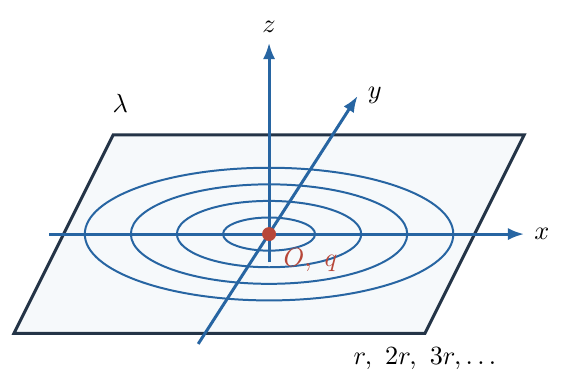{ width=75% }

## 一、题型定位

本题研究同一静电场在不同运动约束下的局部稳定性。解题对象不是任意位置处的完整电场，而是圆心附近的最低阶势能变化。先求一个圆环的局部展开，再利用叠加原理求出所有圆环的贡献，最后把平面、轴线和圆锥面的几何约束分别代入。决定稳定性的量是允许位移方向上的势能曲率，而不只是原点处电场是否为零。

题面没有显式说明 $\lambda$ 的正负。以下先按 $\lambda>0$ 给出主要结论，随后说明改变符号时的变化。这样既不擅自改写已知条件，也不把依赖电荷符号的结论说成无条件成立。

## 二、知识点

1. 电势叠加与电场关系 $\mathbf E=-\nabla\Phi$；
2. 环形电荷元 $dq=\lambda a\,d\varphi$；
3. 二项式展开中的一阶量与二阶量计数；
4. 对称性消去奇次项，以及 $\cos^2\varphi$ 的周期积分；
5. 二次势能与简谐振动角频率的关系；
6. 约束面上的势能极小判据，以及二阶项消失时的高阶检验。

## 三、物理图像

正电环对位于环面内、偏离圆心很近的正电荷产生指向圆心的合力：离近侧电荷更近，使近侧排斥的增强超过远侧排斥的减弱。沿垂直环面的轴线移动时则不同，各电荷元的轴向分力均指向远离环面的一侧，形成离开原点的趋势。两种效应共同产生鞍形的局部势能。

限制在圆锥面后，向外运动同时带有平面内分量和轴向分量。前者提高势能，后者降低势能。稳定与否取决于圆锥的开口是否足够大，使前一种效应占优势。这个判断必须量化，不能只凭三维示意图的视觉角度。

## 四、解题入口

用 $K_e=1/(4\pi\varepsilon_0)$ 表示静电力常量，避免与圆锥参数 $k$ 混淆。先取半径为 $a$ 的单个圆环，把观察点放在 $(x,0,0)$，对电势展开到 $x^2$。再由轴线上的精确电势计算 $z^2$ 项。最后整理成只含 $\rho^2=x^2+y^2$ 和 $z^2$ 的统一局部表达式。

这里还有一个求和顺序问题：每个环在圆心处产生的电势都是 $2\pi K_e\lambda$，无限个这样的常量相加发散。因此应对有限个环先计算 $\Phi(P)-\Phi(O)$，然后取环数趋于无穷的极限。电势的共同零点并不影响受力；这一处理保证后面每个求和式都具有明确意义。

## 五、解析

（1）先求环面内的局部势差。图1-2左侧将圆环上的电荷元、观察点和两者间距离同时标出。电荷元的极角是 $\varphi$，环半径为 $a=nr$，观察点横坐标为 $x$。余弦定理直接给出后续积分的分母。

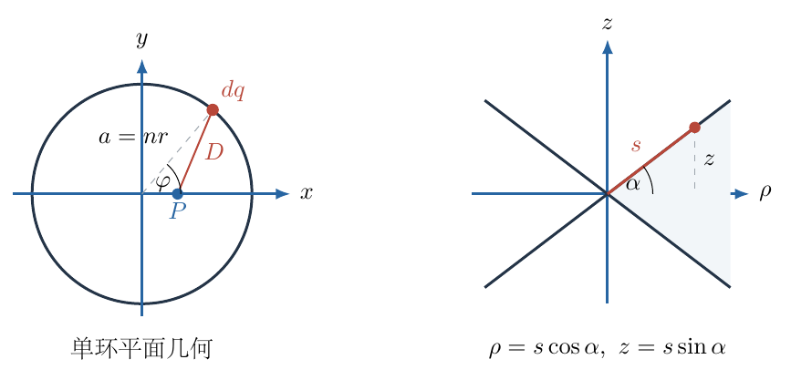{ width=94% }

具体地，

$$
\begin{aligned}
dq&=\lambda a\,d\varphi,\\
D^2&=a^2+x^2-2ax\cos\varphi,\\
d\Phi&=\frac{K_e\lambda a\,d\varphi}
{\sqrt{a^2+x^2-2ax\cos\varphi}}.
\end{aligned}
$$

提出根号中的 $a^2$，并定义无量纲小量 $\epsilon=x/a$：

$$
\Phi_a(x,0)=K_e\lambda\int_0^{2\pi}
\left(1-2\epsilon\cos\varphi+\epsilon^2\right)^{-1/2}\,d\varphi.
$$

因为 $|x|\ll r\leq a$，对所有圆环都有 $|\epsilon|\ll1$。所用的二项式展开为

$$
(1+u)^{-1/2}=1-\frac12u+\frac38u^2+O(u^3).
$$

此处 $u=-2\epsilon\cos\varphi+\epsilon^2$。不能只保留 $-u/2$，因为 $u$ 中含有一阶项，它的平方也会贡献二阶结果。逐项计算，

$$
\begin{aligned}
-\frac12u&=\epsilon\cos\varphi-\frac12\epsilon^2,\\
\frac38u^2&=\frac32\epsilon^2\cos^2\varphi+O(\epsilon^3).
\end{aligned}
$$

因此积分中的函数在二阶精度下为

$$
1+\epsilon\cos\varphi-\frac12\epsilon^2
+\frac32\epsilon^2\cos^2\varphi.
$$

三个需要的周期积分分别是

$$
\begin{aligned}
\int_0^{2\pi}1\,d\varphi&=2\pi,\\
\int_0^{2\pi}\cos\varphi\,d\varphi&=0,\\
\int_0^{2\pi}\cos^2\varphi\,d\varphi
&=\int_0^{2\pi}\frac{1+\cos2\varphi}{2}\,d\varphi=\pi.
\end{aligned}
$$

把这些结果放回积分，

$$
\begin{aligned}
\Phi_a(x,0)
&=K_e\lambda\left(2\pi-\pi\epsilon^2+\frac32\pi\epsilon^2
+O(\epsilon^4)\right)\\
&=2\pi K_e\lambda+\frac{\pi K_e\lambda}{2a^2}x^2
+O(x^4/a^4).
\end{aligned}
$$

由于圆环关于 $x\mapsto-x$ 对称，最终积分没有三阶项，故余项可以写成四阶。减去原点电势，得到具有物理意义的单环势差：

$$
\Delta\Phi_a(x,0)=\frac{\pi K_e\lambda}{2a^2}x^2+O(x^4/a^4).
$$

先对前 $N$ 个环求和，再取极限，

$$
\begin{aligned}
\Delta\Phi(x,0)
&=\lim_{N\to\infty}\sum_{n=1}^N
\frac{\pi K_e\lambda}{2n^2r^2}x^2+O(x^4/r^4)\\
&=\frac{\pi K_e\lambda x^2}{2r^2}\frac{\pi^2}{6}
+O(x^4/r^4).
\end{aligned}
$$

定义正系数

$$
A=\frac{\pi^3K_e\lambda}{12r^2}\qquad(\lambda>0),
$$

则 $\Delta\Phi(x,0)=Ax^2+O(x^4)$。这里四阶余项求和也收敛，因为其系数按 $1/n^4$ 衰减。绝对电势的常数项虽然发散，但影响运动的二阶、四阶势差均没有这个问题。

在 $x$ 方向上的力不是 $-d\Phi/dx$，而是电荷量乘电场，即

$$
\begin{aligned}
F_x&=-q\frac{\partial\Phi}{\partial x}\\
&=-2qAx+O(x^3).
\end{aligned}
$$

只保留小振动所需的线性项，牛顿第二定律给出

$$
m\ddot x=-2qAx,\qquad
\ddot x+\frac{2qA}{m}x=0.
$$

轴对称性保证 $y$ 方向具有同样的方程。因此任意平面内小位移都受指向圆心的回复力，而不是只在选定的 $x$ 轴上稳定。对应的角频率与周期为

$$
\begin{aligned}
\omega_{xy}^2&=\frac{2qA}{m}
=\frac{\pi^3K_eq\lambda}{6mr^2},\\
\boxed{T_{xy}}&=\boxed{2\pi\sqrt{\frac{6mr^2}{\pi^3K_eq\lambda}}}.
\end{aligned}
$$

如果初始位移和初始速度不共线，两个同频的正交简谐运动叠加为圆心附近的椭圆轨迹；其各坐标周期仍为上式。这里的“周期”是微小振幅极限的周期，不保证有限振幅时严格不变。

（2）沿 $z$ 轴，圆环上所有电荷元到观察点的距离完全相同，不必再作角积分。圆环总电荷为 $2\pi a\lambda$，所以

$$
\Phi_a(0,z)=\frac{2\pi K_ea\lambda}{\sqrt{a^2+z^2}}
=2\pi K_e\lambda\left(1+\frac{z^2}{a^2}\right)^{-1/2}.
$$

现在括号里的小量本身已经是二阶量，只取二项式的一次项即可：

$$
\begin{aligned}
\Delta\Phi_a(0,z)
&=-\frac{\pi K_e\lambda}{a^2}z^2+O(z^4/a^4),\\
\Delta\Phi(0,z)
&=-\frac{\pi^3K_e\lambda}{6r^2}z^2+O(z^4/r^4)\\
&=-2Az^2+O(z^4).
\end{aligned}
$$

负的二阶势差表示原点在轴线上是势能极大点。受力与运动方程为

$$
F_z=-q\frac{\partial\Phi}{\partial z}=4qAz,\qquad
\ddot z-\frac{4qA}{m}z=0.
$$

若向 $z>0$ 方向作一小位移，力也指向 $z>0$，不会把电荷拉回原点。写出形式解可以进一步看清这种差别：

$$
z(t)=C_1e^{\Omega t}+C_2e^{-\Omega t},
\qquad \Omega=\sqrt{\frac{4qA}{m}}.
$$

例如从 $z(0)=z_0$、$\dot z(0)=0$ 释放，解为 $z=z_0\cosh\Omega t$。这不是振荡函数。因此在 $\lambda>0$ 时，轴线上的平衡不稳定，不存在小振动周期；不能把频率平方的负号取绝对值后仍宣称有周期。

（3）把两个方向的结果合并。轴对称性不允许出现 $x^2-y^2$ 项，对称平面不允许出现 $\rho z$ 项，所以局部势差是

$$
\Delta\Phi(\rho,z)=A(\rho^2-2z^2)+O\!\left((\rho^2+z^2)^2\right).
$$

图1-2右侧取圆锥的一条母线，母线与水平面的夹角为 $\alpha$，母线上到顶点的距离为 $s$。几何关系为

$$
\rho=s\cos\alpha,\qquad z=s\sin\alpha,\qquad
\tan\alpha=\frac1{\sqrt k}.
$$

真实圆锥要求 $k>0$。进一步有

$$
\cos^2\alpha=\frac{k}{k+1},\qquad
\sin^2\alpha=\frac1{k+1}.
$$

代回势差，

$$
\begin{aligned}
\Delta\Phi_{\rm cone}
&=As^2\left(\cos^2\alpha-2\sin^2\alpha\right)+O(s^4)\\
&=A\frac{k-2}{k+1}s^2+O(s^4).
\end{aligned}
$$

约束力垂直于允许的瞬时位移，不在母线方向做功。因此沿母线的回复力由约束后的势能求导：

$$
F_s=-\frac{d(q\Delta\Phi_{\rm cone})}{ds}
=-2qA\frac{k-2}{k+1}s+O(s^3).
$$

当 $k>2$ 时，原点附近每个非零允许位置的势能都比原点高，原点是严格局部极小点，平衡稳定。当 $0<k<2$ 时，沿任何母线离开原点都会降低势能，平衡不稳定。剩下的 $k=2$ 不能用二阶近似直接判定。

为了检查临界值，必须把单环电势展开到四阶。设 $\epsilon=s/a$、$b=\rho/s$、$c_\varphi=\cos\varphi$，则单环电势的无量纲分母对应

$$
u=-2b\epsilon c_\varphi+\epsilon^2.
$$

二项式展开需要用到

$$
(1+u)^{-1/2}
=1-\frac12u+\frac38u^2-\frac5{16}u^3+\frac{35}{128}u^4+O(u^5).
$$

各次幂中保留至 $\epsilon^4$ 的部分是

$$
u^2=4b^2\epsilon^2c_\varphi^2
-4b\epsilon^3c_\varphi+\epsilon^4,
$$

$$
u^3=-8b^3\epsilon^3c_\varphi^3
+12b^2\epsilon^4c_\varphi^2+O(\epsilon^5),
$$

$$
u^4=16b^4\epsilon^4c_\varphi^4+O(\epsilon^5).
$$

其中 $\epsilon^4$ 系数依次来自 $3u^2/8$、$-5u^3/16$ 和 $35u^4/128$。对角度平均后，

$$
\begin{aligned}
c_4
&=\frac38-\frac5{16}\cdot12b^2\cdot\frac12
+\frac{35}{128}\cdot16b^4\cdot\frac38\\
&=\frac38-\frac{15}{8}b^2+\frac{105}{64}b^4.
\end{aligned}
$$

奇次角函数平均为零，因而无须逐个计算它们的积分。最终还必须乘回 $2\pi K_e\lambda$ 和 $(s/a)^4$，才能从无量纲平均系数得到电势差。这样每一个倍数都可回溯，避免在临界值上因漏掉角平均或 $2\pi$ 得到错误判据。

在 $k=2$ 的母线上，$b^2=2/3$，于是

$$
\begin{aligned}
c_4
&=\frac38-\frac{15}{8}\frac23+\frac{105}{64}\frac49\\
&=\frac{18-60+35}{48}=-\frac7{48}.
\end{aligned}
$$

该环在临界母线上的最低非零势差因而是

$$
\Delta\Phi_a=-\frac{7\pi K_e\lambda}{24a^4}s^4+O(s^6).
$$

各环的四阶系数同号且绝对收敛。对于 $\lambda>0$，它仍使离开顶点的势能下降，所以 $k=2$ 也不稳定。最终答案为

$$
\boxed{\lambda>0:\quad k>2.}
$$

对结果作三项检查。第一，$K_eq\lambda/(mr^2)$ 的量纲为 $\mathrm{s^{-2}}$，周期公式的量纲正确。第二，$k\to\infty$ 时圆锥母线趋于水平，母线频率趋于平面内频率；$k\to0^+$ 时母线趋于轴线，回复力变为发散力。第三，二阶电势满足

$$
\nabla^2[A(x^2+y^2-2z^2)]=2A+2A-4A=0,
$$

符合原点附近没有源电荷的条件。这也检查了轴向系数相对横向系数的负号和倍数。

最后补足题面未指定的电荷符号。当 $\lambda<0$ 时势能整体反号：平面内不稳定，轴线上稳定，轴线周期为

$$
\boxed{T_z=2\pi\sqrt{\frac{3mr^2}{\pi^3K_eq|\lambda|}}}.
$$

对真实圆锥 $k>0$，此时 $0<k<2$ 的二阶项为正，$k=2$ 的四阶项也为正，所以稳定范围为 $0<k\leq2$。临界点的回复力从三次项起，不能再给出与振幅无关的线性小振动周期。若 $\lambda=0$，则没有电场回复力。上述符号分类说明，题目的常用正电环结论依赖 $\lambda>0$，而不是仅依赖 $q>0$。

## 六、关键洞察

无限源的“电势发散”与“局部动力学不存在”不是同一件事。本题每个环在中心贡献一个相同常量，但位移引起的变化按半径平方的倒数衰减。使用势差，相当于在有限系统中先统一扣除中心电势，再进行无限极限。这一步不是形式上的修饰，而是使稳定性展开合法的关键。

稳定性还取决于允许位移集合。三维空间中的鞍点，在横向平面上可以是极小点；当约束面包含足够大的轴向位移成分时，又会失去稳定。即使所有线性项均为零，也不能只凭“对称”宣布稳定，因为不稳定平衡点同样可以有零合力。

临界参数应与一般参数分开处理。$k=2$ 时并非没有电场，而是两种二阶效应恰好抵消。只要检查到下一个非零阶，正负号就会重新确定趋势。由此可以把“线性判据不确定”与“物理上随遇平衡”严格区分。

横向振动在小振幅之外还会受到四阶项修正。取 $z=0$，有 $b=1$，上面的四阶平均系数变为

$$
c_4=\frac38-\frac{15}{8}+\frac{105}{64}=\frac9{64}>0.
$$

把所有环的贡献求和，沿任一水平直线的势差可写为

$$
\Delta\Phi(x)=Ax^2+B_4x^4+O(x^6),
$$

其中

$$
B_4=\frac{9\pi K_e\lambda}{32r^4}
\sum_{n=1}^{\infty}\frac1{n^4}>0.
$$

四阶级数绝对收敛。对势能求导再除以质量，得到弱非线性振动方程

$$
\ddot x+\omega_0^2x+\beta x^3=0,\qquad
\omega_0^2=\frac{2qA}{m},\quad \beta=\frac{4qB_4}{m}.
$$

设小但非零振幅为 $a_0$，先以 $x\simeq a_0\cos\Omega t$ 代入主频项。使用三倍角恒等式

$$
\cos^3\theta=\frac34\cos\theta+\frac14\cos3\theta,
$$

并在首阶频率修正中匹配 $\cos\Omega t$ 的系数：

$$
-\Omega^2a_0+\omega_0^2a_0+\frac34\beta a_0^3=0.
$$

所以

$$
\Omega^2=\omega_0^2+\frac34\beta a_0^2,\qquad
\Omega=\omega_0\left[1+\frac{3B_4a_0^2}{4A}+O(a_0^4)\right].
$$

相应周期为

$$
T(a_0)=T_0\left[1-\frac{3B_4a_0^2}{4A}+O(a_0^4)\right].
$$

这里忽略的三倍频项会修正波形，但不改变所列的首阶主频系数。对于正电环，$B_4>0$，有限振幅时回复力比线性模型更强，因此频率稍增、周期稍减。这给出“小振动周期”适用范围的定量说明：主解并未声称任意振幅都具有完全相同的周期。

## 七、易错点

把圆锥参数 $k$ 与静电力常量混用，会让周期及稳定性条件失去可读性。应从第一行起分别记作 $k$ 与 $K_e$。

在单环展开中漏掉 $u^2$ 的二阶贡献，会把横向电势曲率算成负值，进而把第（1）问和第（2）问的结论全部颠倒。正确的二阶系数来自 $-\epsilon^2/2$ 与 $3\epsilon^2\cos^2\varphi/2$ 的共同作用。

计算力时漏乘 $q$、对势能求导时又多乘一次 $q$，都会造成电荷量的次数错误。可以固定记法：$\Phi$ 始终代表电势，$U=q\Phi$ 才代表势能。

对圆锥顶点谈“切平面”并不适当，因为顶点不是光滑点。这里用所有允许位置的势能变化判定稳定，使用的是约束集合上的极小判据，不依赖顶点存在唯一法向。

## 八、课堂讲解建议

课堂先画两个剖面：在圆环平面内横移正电荷，以及沿轴线向上移动正电荷。让学生先判断受力趋势，再用同一套电势展开验证。这样后面的正负号有直观支撑，不必孤立记忆系数。

板书二项式展开时，把 $u$ 中的一阶部分和二阶部分分开标记，并要求学生说明为什么 $u^2$ 还需要保留。教师应把这一步作为推导核心，而不应从积分式直接跳到简谐运动方程。

最后将 $\rho^2=kz^2$ 代入二次势能，先得到一般判据，再专门提出“等号能否取到”。对已有泰勒展开基础的学生继续算四阶；初学者至少应明确：二阶项为零只表示当前近似不足，不能据此宣布稳定或不稳定。

## 九、变式训练

把无穷多个圆环改为前 $N$ 个正电圆环，其余条件不变。求平面内的小振动周期，并判断圆锥稳定范围是否改变。

有限环数只改变二阶系数的大小：

$$
A_N=\frac{\pi K_e\lambda}{2r^2}\sum_{n=1}^N\frac1{n^2}.
$$

因此

$$
\begin{aligned}
\omega_N^2&=\frac{2qA_N}{m}
=\frac{\pi K_eq\lambda}{mr^2}\sum_{n=1}^N\frac1{n^2},\\
T_N&=2\pi\sqrt{\frac{mr^2}
{\pi K_eq\lambda\sum_{n=1}^N n^{-2}}}.
\end{aligned}
$$

由于 $A_N>0$，约束势能的二阶符号仍由 $k-2$ 决定。临界处每个圆环的四阶项仍为负，故稳定条件仍为 $k>2$。增加圆环会增大回复力系数、缩短周期，却不改变稳定性分界。这是“强度参数”与“几何参数”作用不同的一例。

\newpage

# 第 2 题

在倾角 $\theta=30^\circ$ 的斜面上放置两个质量均为 $m$ 的质点，用一根柔软、不可伸长、质量为 $m$、长度为 $l$ 的均匀绳连接。质点与斜面间的摩擦系数为 $\mu=0.5$，绳与斜面间的摩擦系数为

$$
\sqrt3-1<\mu'<\frac{\sqrt3}{2}.
$$

在斜面内取沿等高线的方向为 $x$ 轴，沿斜面向上的方向为 $y$ 轴。合理摆放绳子，使系统保持平衡，并保持左右对称。

（1）求端点处绳子切线与 $y$ 轴夹角 $\alpha$ 的最大值，用 $\mu'$ 表示 $\tan\alpha$。

（2）在达到上述最大角的条件下，取 $\mu'=0.75$，求两个质点的距离，结果保留三位有效数字。

提示：

$$
\int\frac{dx}{\sqrt{a^2+x^2}}
=\ln\left(\frac xa+\sqrt{1+\frac{x^2}{a^2}}\right)+C.
$$

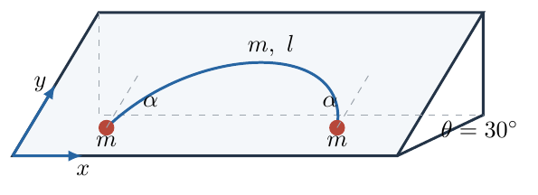{ width=82% }

## 一、题型定位

这是带分布摩擦的柔绳平衡与极值问题。先由整体平衡和端点摩擦的可行范围找到最大的端点切线角，再在该极限状态下求绳形，将弧长转换成端点水平距离。不必一开始就求任意摩擦分布下的曲线，但必须证明所选受力状态确实使角度最大。

## 二、知识点

1. 重力在斜面内及法向的分解；
2. 静摩擦力的二维可行域；
3. 对称系统的整体平衡与半绳受力；
4. 柔绳张力沿切线及分布载荷下的分量变化；
5. 极值函数的单调性；
6. 弧长参数、双曲函数积分及无量纲计算。

## 三、物理图像

两个质点自身能够提供的最大摩擦力小于其沿斜面的重力分量，绳必须给端点一部分向上的拉力。绳在两端同时受到向下、向外的反作用力，因此绳上摩擦要承担自身和端点传来的下滑负担。

$\alpha$ 是切线与向上 $y$ 轴的夹角，其正切等于端点张力的水平分量与向上分量之比。这个角最大不等于绳的拱高最大。要把比值做大，端点摩擦和整根绳的摩擦限制必须同时满足。

## 四、解题入口

设左端绳张力为 $(H,V)$，其中 $H>0$ 指向中间，$V>0$ 沿斜面向上。先用质点平衡得到关于 $H,V$ 的圆盘不等式，再用整根绳平衡得到 $V$ 的上界。然后在可行域内最大化 $\tan\alpha=H/V$。

找到极限状态后，绳上每个微元的摩擦方向和大小也被确定。以拱顶为弧长起点，张力的竖直分量与弧长成正比，水平分量为常量。用这个张力三角形写出 $dx/ds$，就能求端点距离。

## 五、解析

（1）质点法向支持力由法向平衡得到。绳张力在斜面内，因此不影响法向分量：

$$
N_m=mg\cos30^\circ=\frac{\sqrt3}{2}mg.
$$

端点最大静摩擦力和沿斜面重力分别为

$$
f_{\max}=\mu N_m=\frac{\sqrt3}{4}mg,\qquad
G_\parallel=mg\sin30^\circ=\frac12mg.
$$

由于 $G_\parallel>f_{\max}$，质点没有绳的帮助就不能平衡。左端质点的两个分量方程为

$$
\begin{aligned}
H+f_x&=0,\\
V+f_y-\frac12mg&=0,
\end{aligned}
\qquad
f_x=-H,\quad f_y=\frac12mg-V.
$$

静摩擦可以在斜面内改变方向，但其合力不能超过上限。故

$$
\boxed{H^2+\left(\frac12mg-V\right)^2
\leq\frac{3m^2g^2}{16}.}
$$

图2-2左侧放大显示这个摩擦圆盘靠近原点的边界，浅蓝色位于端点摩擦允许的一侧，还需与 $V_{\max}$ 下方的区域取交集。原点到可行点的连线代表张力，其与 $V$ 轴的夹角就是 $\alpha$。右侧定义后续绳形计算中的拱顶 $C$、弧长 $s$ 和端点距离 $D$。

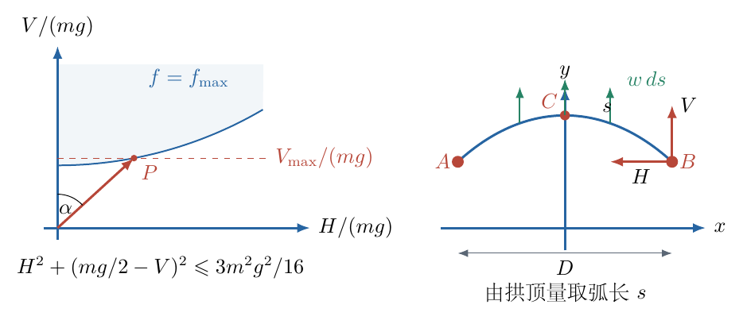{ width=97% }

接着取整根绳为对象。两个端点对绳各有向下分力 $V$，水平分量互相抵消。故总摩擦的向上分量必须满足

$$
F_{f,y}=\frac12mg+2V.
$$

长度元 $ds$ 的质量是 $(m/l)\,ds$，其法向支持力为

$$
dN=\frac ml g\cos30^\circ\,ds.
$$

对局部摩擦上限积分，注意“向上分量”不可能超过“摩擦大小”：

$$
\begin{aligned}
F_{f,y}
&\leq\int|d\mathbf f|
\leq\int_0^l\mu'\frac ml g\cos30^\circ\,ds\\
&=\frac{\sqrt3}{2}\mu'mg.
\end{aligned}
$$

于是

$$
\boxed{V\leq V_{\max}=\frac{mg}{4}(\sqrt3\mu'-1).}
$$

等号成立要求每个绳元摩擦都达到上限，并且全部沿斜面向上。如果某些摩擦具有横向分量，即使其大小满额，向上合力仍会变小。这说明图中极限状态的分布力方向有严格依据。

还需证明 $V=V_{\max}$ 确实使角最大。对给定 $V$，摩擦圆盘允许的最大 $H$ 是

$$
H_{\max}=
\sqrt{\frac{3m^2g^2}{16}-\left(\frac12mg-V\right)^2}.
$$

令 $v=V/(mg)$，则

$$
\begin{aligned}
\tan^2\alpha
&\leq\frac{3/16-(1/2-v)^2}{v^2}\\
&=-\frac1{16v^2}+\frac1v-1.
\end{aligned}
$$

右端的导数为

$$
\frac{d}{dv}\left(-\frac1{16v^2}+\frac1v-1\right)
=\frac{1/8-v}{v^3}.
$$

题设的上界保证

$$
v\leq v_{\max}=\frac{\sqrt3\mu'-1}{4}<\frac18.
$$

因此可行区间内导数为正，$\tan^2\alpha$ 随 $V$ 增大，最大值就在 $V_{\max}$ 处。题设下界也有作用：端点圆盘要求

$$
v\geq\frac12-\frac{\sqrt3}{4},
$$

而 $\mu'>\sqrt3-1$ 正好保证 $v_{\max}$ 大于这一最低值，存在 $H>0$ 的非退化平衡。两个给定边界分别保证可行性和上述单调区间，不是可以忽略的附带条件。

最大角状态下，

$$
\begin{aligned}
\frac12mg-V_{\max}
&=\frac{mg}{4}(3-\sqrt3\mu'),\\
H^2&=\frac{m^2g^2}{16}
\left[3-(3-\sqrt3\mu')^2\right],\\
H&=\frac{mg}{4}\sqrt{3-(3-\sqrt3\mu')^2}.
\end{aligned}
$$

两分量相除，得到

$$
\boxed{\tan\alpha_{\max}=
\frac{\sqrt{3-(3-\sqrt3\mu')^2}}{\sqrt3\mu'-1}.}
$$

分母为正，根号内的正值则由可行性保证。$H$ 取正根，是因为它代表指向中间的水平分量大小。

（2）最大角状态下，每单位弧长所受净向上载荷为

$$
\begin{aligned}
w&=\frac{mg}{l}\left(\mu'\cos30^\circ-\sin30^\circ\right)\\
&=\frac{mg}{2l}(\sqrt3\mu'-1).
\end{aligned}
$$

$w$ 的单位是 $\mathrm{N/m}$，不是集中力。它与端点向上拉力满足

$$
\frac{wl}{2}=V_{\max}.
$$

从拱顶沿右半绳量弧长 $s$，$0\leq s\leq l/2$。对拱顶至截面的这段绳，向上净载荷是 $ws$，所以截面张力沿向右下方的切线，其分量为

$$
T_x=H,\qquad T_y=-ws,\qquad T(s)=\sqrt{H^2+w^2s^2}.
$$

水平张力为常量，竖直分量随弧长线性变化，张力大小却不是常量。绳切线的单位矢量同时等于坐标对弧长的导数，因此

$$
\boxed{
\frac{dx}{ds}=\frac{H}{\sqrt{H^2+w^2s^2}},\qquad
\frac{dy}{ds}=-\frac{ws}{\sqrt{H^2+w^2s^2}}.}
$$

负号表达从拱顶向右端走时高度降低。两端同高，距离就是水平跨度。由对称性，

$$
\frac D2=\int_0^{l/2}\frac{H\,ds}{\sqrt{H^2+w^2s^2}}.
$$

作变量代换 $u=ws/H$，有 $ds=(H/w)\,du$，上限为 $V/H$，故

$$
\begin{aligned}
\frac D2
&=\frac Hw\int_0^{V/H}\frac{du}{\sqrt{1+u^2}}\\
&=\frac Hw\ln\left[
\frac VH+\sqrt{1+\left(\frac VH\right)^2}\right].
\end{aligned}
$$

下限给 $\ln1=0$。利用 $w=2V/l$，把结果写成无量纲形式：

$$
\boxed{\frac Dl=\frac HV\operatorname{arsinh}\frac VH
=\tan\alpha_{\max}\,
\operatorname{arsinh}\!\left(\frac1{\tan\alpha_{\max}}\right).}
$$

这也解释了质量和重力加速度为什么消去：它们把所有力同比例放大，却不改变绳形。跨度只随绳长按比例变化。

对 $\mu'=0.75$，先保留充分位数计算

$$
\begin{aligned}
a&=\sqrt3\mu'=1.2990381057\ldots,\\
\frac{V}{mg}&=\frac{a-1}{4}=0.0747595264\ldots,\\
\frac{H}{mg}&=\frac14\sqrt{3-(3-a)^2},\\
\frac VH&=\frac{a-1}{\sqrt{3-(3-a)^2}}.
\end{aligned}
$$

将未舍入的比值代入上述对数式，最后才保留三位有效数字，得到

$$
\begin{aligned}
\frac H{mg}&=0.0816733716\ldots,\\
\frac VH&=0.9153476213\ldots,\\
\operatorname{arsinh}\frac VH
&=\ln(0.9153476213\ldots+\sqrt{1+0.9153476213^2\ldots})\\
&=0.8202312897\ldots,\\
\frac Dl&=\frac{0.8202312897\ldots}{0.9153476213\ldots}
=0.8960872030\ldots.
\end{aligned}
$$

因此正确的三位有效数字结果为

$$
\boxed{D=0.896\,l.}
$$

为进一步核对图形，可求拱高 $h=y_C-y_B$：

$$
\begin{aligned}
h&=\int_0^{l/2}\frac{ws\,ds}{\sqrt{H^2+w^2s^2}}\\
&=\frac1w\left[\sqrt{H^2+w^2s^2}\right]_0^{l/2}\\
&=\frac{\sqrt{H^2+V^2}-H}{w}>0.
\end{aligned}
$$

第二步使用了根式求导：$\frac{d}{ds}\sqrt{H^2+w^2s^2}
=w^2s/\sqrt{H^2+w^2s^2}$。所以图中必须是向上的拱，而不能把普通悬链线直接照搬为向下的垂绳。

进一步积分并反解弧长，

$$
x(s)=\frac Hw\operatorname{arsinh}\frac{ws}{H},
\qquad
s=\frac Hw\sinh\frac{wx}{H}.
$$

由 $y(0)=y_C$ 得

$$
\begin{aligned}
y(s)&=y_C-\frac{\sqrt{H^2+w^2s^2}-H}{w},\\
y(x)&=y_C-\frac Hw\left(\cosh\frac{wx}{H}-1\right).
\end{aligned}
$$

这是一条反向悬链线，不是精确抛物线。只有在 $wx/H$ 很小时，才可用 $\cosh\xi=1+\xi^2/2+\cdots$ 得到局部抛物线近似。求距离时保留完整双曲函数，正是因为本题不能预先保证这一小量条件。

检查 $D<l$：对 $u>0$，被积函数 $1/\sqrt{1+u^2}<1$，故 $\operatorname{arsinh}u<u$，立即得到

$$
\frac Dl=\frac{\operatorname{arsinh}(V/H)}{V/H}<1.
$$

若 $V/H\to0$，展开后

$$
\frac Dl=1-\frac16(V/H)^2+O((V/H)^4),
$$

表示近水平绳的跨度趋于绳长。若 $\mu'$ 趋近给定下界，则 $H\to0$，跨度趋于零，因为 $H\ln(1/H)\to0$。这两个极限分别检验水平直绳和窄拱状态，与力学图像一致。

## 六、关键洞察

端点摩擦是一个矢量资源：用于抵消水平张力的部分增加，可用于抵消下滑的部分就减少。可行域的圆形结构把这种竞争表达得很清楚，两个方向不能分别独立取满 $\mu N$。

绳形积分选弧长而不选横坐标，是因为均匀绳的载荷按弧长均匀。若选 $x$ 为自变量，每单位 $dx$ 内的质量带有 $\sqrt{1+y'^2}$，需要额外处理坡度因子。弧长法直接把净载荷写成 $ws$，再利用几何投影得到坐标。

题设摩擦范围还决定极值落在哪一段边界。当 $\mu'$ 足够大以致 $v_{\max}>1/8$ 时，继续增加 $V$ 不再增大角度，原有结论的适用范围已经结束。公式的条件与公式本身同样重要。

若将绳的摩擦系数提高到 $\mu'\geq\sqrt3/2$，仍保持质点摩擦系数不变，可以把这一边界继续算完。端点摩擦圆盘不变，之前的角度函数导数为

$$
\frac{d(\tan^2\alpha_{\rm allowed})}{dv}
=\frac{1/8-v}{v^3}.
$$

它在 $v=1/8$ 前为正、之后为负，所以不受绳上界截断时，最优向上分量是

$$
V_*=\frac18mg.
$$

端点圆盘边界给

$$
\begin{aligned}
H_*^2
&=\frac{3m^2g^2}{16}
-\left(\frac12mg-\frac18mg\right)^2\\
&=\left(\frac{12}{64}-\frac9{64}\right)m^2g^2
=\frac3{64}m^2g^2.
\end{aligned}
$$

因此 $H_*=\sqrt3mg/8$，最大角固定为

$$
\tan\alpha_*=\frac{H_*}{V_*}=\sqrt3,\qquad \alpha_*=60^\circ.
$$

这个状态需要绳总摩擦沿斜面向上，大小为 $mg/2+2V_*=3mg/4$。相应的实际摩擦与总法向支持力之比为

$$
\frac{3mg/4}{mg\cos30^\circ}
=\frac{\sqrt3}{2}.
$$

当可用 $\mu'$ 更大时，绳摩擦不必取满，只需达到上述实际值。由此可见，静摩擦系数增加不意味着系统每处的实际摩擦都必须增加。

最优张力比固定后，跨度和拱高也有简单结果：

$$
\begin{aligned}
\frac{D_*}{l}
&=\sqrt3\,\operatorname{arsinh}\frac1{\sqrt3}\\
&=\sqrt3\ln\left(\frac1{\sqrt3}+\sqrt{\frac43}\right)
=\frac{\sqrt3}{2}\ln3,
\end{aligned}
$$

$$
\frac{h_*}{l}
=\frac{\sqrt{H_*^2+V_*^2}-H_*}{2V_*}
=1-\frac{\sqrt3}{2}.
$$

这给出原题上边界处的连续检验：由原公式让 $\mu'\to(\sqrt3/2)^-$，张力比、跨度和拱高都应趋于这组结果。继续增大绳摩擦能力后，最大角被端点摩擦限制住，不再增加。

## 七、易错点

质点的摩擦不单纯向上；它还必须抵消绳的水平拉力。只有极限状态中绳上各微元摩擦才全部向上，这两种摩擦不能混同。

整体受力只给 $V$ 上界，没有直接给出最大角；省略圆盘约束和单调性，相当于没有完成极值证明。反之，只有端点受力而不考虑绳整体，也可能选到绳摩擦无法维持的状态。

注意 $l$ 是弧长、$D$ 是跨度、$s$ 是从拱顶开始量的局部弧长；三个长度不能互换。积分上限是 $l/2$ 而不是 $D/2$。

计算时先保留比值精度，最后对跨度舍入。过早把角度或张力分量取三位，会在根式与对数复合计算中放大相对误差。

## 八、课堂讲解建议

课堂先只画一个端点，让学生写出摩擦的两个分量，再把“合力有上限”画成圆盘。教师随后叠加整根绳给出的水平截线，使“可行”与“最优”两层判断可见。

板书求导时保留无量纲变量 $v$，让学生自行核对导数分子的 $1/8-v$，再回头解释题设上下界。积分前要求学生在右半绳标明弧长起点，并用张力三角形写出 $dx/ds$；不直接引用悬链线结论。

## 九、变式训练

绳质量不变，只把绳长从 $l$ 改为 $2l$，其余参数不变。求最大角、跨度、拱高及端点张力的变化。

端点及整绳总受力不变，所以 $H,V$ 均不变，最大角也不变。单位弧长净载荷减半：

$$
w'=\frac{mg}{4l}(\sqrt3\mu'-1)=\frac w2.
$$

代入跨度与拱高公式，

$$
D'=\frac{2H}{w'}\operatorname{arsinh}\frac VH=2D,\qquad
h'=\frac{\sqrt{H^2+V^2}-H}{w'}=2h.
$$

相同比例弧长位置处的 $ws$ 仍相等，因此张力分布按相对位置看也不改变。几何尺寸放大两倍，并不意味着质量或受力也放大两倍。

\newpage

# 第 3 题

质量分别为 $m,2m,3m$ 的三个光滑小环套在半径为 $R$ 的光滑轻质大圆环上，相邻小环所对的圆心角均为 $120^\circ$。整个装置放在光滑水平面内。使质量为 $3m$ 的小环获得沿大圆环切向的初速度 $v_0$，其余部分此刻速度为零。

求该瞬间三个小环各自的加速度，以及大圆环圆心的加速度。

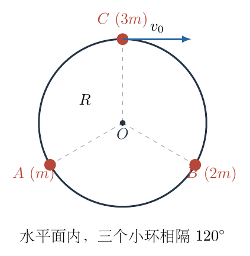{ width=72% }

## 一、题型定位

本题是可移动约束下的瞬时动力学问题。圆环没有固定在地面上，因此不能给有速度的小环直接套用相对地面的向心加速度 $v_0^2/R$。正确关系属于“小环相对圆心”的径向加速度。另一方面，圆环轻质使它所受合力必须为零，从而把三个径向约束力联系起来。

## 二、知识点

1. 光滑约束的法向力与切向无作用力；
2. 轻质刚体的瞬时力平衡；
3. 固定长度约束的一阶、二阶时间导数；
4. 相对速度、相对加速度与向心项；
5. 矢量分量联立及质量加权检验；
6. 区分系统质心与几何圆心。

## 三、物理图像

把质量为 $m,2m,3m$ 的小环分别记为 $A,B,C$。按图示，$C$ 位于圆环顶端，$A$ 在左下，$B$ 在右下。由于接触光滑，每个小环在水平面内只受沿半径的约束力，所以其绝对加速度必沿对应半径，但大小要由整个系统共同决定。

获得速度的 $C$ 倾向沿切线离开原来的圆周。圆环随之发生平移，使原先静止的 $A,B$ 也受到径向力而开始加速。圆心不是一个物质质点，它的加速度可以与各个小环加速度不同；它也不是整个系统的质心。

## 四、解题入口

先由轻环合力为零求三个径向加速度大小的比例。将圆心加速度的两分量分别记为 $a_x$ 和 $a_y$，再对三条半径的定长关系写二阶约束。

前两个小环相对圆心的初速度为零，第三个相对速度为 $v_0$，故第三式多出 $v_0^2/R$。这三条约束加上比例关系即可封闭求解。

## 五、解析

取 $x$ 轴向右、$y$ 轴向上。指向圆心的单位矢量依次为

$$
\begin{aligned}
\mathbf n_A&=\left(\frac{\sqrt3}{2},\frac12\right),\\
\mathbf n_B&=\left(-\frac{\sqrt3}{2},\frac12\right),\\
\mathbf n_C&=(0,-1).
\end{aligned}
$$

设三个加速度的径向大小为 $a_A,a_B,a_C$，先按指向圆心为正写

$$
\mathbf a_A=a_A\mathbf n_A,\qquad
\mathbf a_B=a_B\mathbf n_B,\qquad
\mathbf a_C=a_C\mathbf n_C.
$$

若最终某个 $a_i$ 为负，就表示该加速度实际背离圆心；这样设未知数不预先排除结果。图3-2中的红色箭头代表本题求得的方向，蓝色箭头代表圆心加速度。

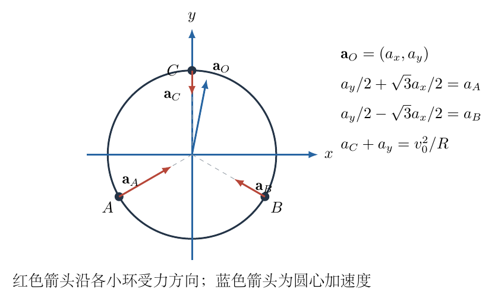{ width=95% }

三个小环的径向力大小分别是 $ma_A,2ma_B,3ma_C$。它们对轻环的反作用力相反，而轻环质量趋于零但加速度有限，故其所受合力为零。等价地，

$$
m a_A\mathbf n_A+2m a_B\mathbf n_B+3m a_C\mathbf n_C=\mathbf0.
$$

分别投影到两轴：

$$
\begin{aligned}
\frac{\sqrt3}{2}ma_A-\frac{\sqrt3}{2}(2m)a_B&=0,\\
\frac12ma_A+\frac12(2m)a_B-3ma_C&=0.
\end{aligned}
$$

第一式约去共同因子，得到

$$
a_A=2a_B.
$$

代入第二式，

$$
\frac12a_A+a_B=3a_C
\quad\Rightarrow\quad a_A=3a_C.
$$

因此可令

$$
a_A=a,\qquad a_B=\frac a2,\qquad a_C=\frac a3.
$$

这里加速度与质量成反比，不是因为三者“运动相同”，而是三个方向相隔 $120^\circ$，轻环平衡要求三个径向力大小相等。其矢量和为零的几何条件产生了这个比例。

下面推导运动约束，避免混用绝对和相对向心加速度。对任一小环，令

$$
\mathbf r=\mathbf r_i-\mathbf r_O,\qquad
\mathbf v_{\rm rel}=\mathbf v_i-\mathbf v_O.
$$

圆环保持半径 $R$，所以

$$
\mathbf r\cdot\mathbf r=R^2.
$$

对时间求一次导数，

$$
2\mathbf r\cdot\mathbf v_{\rm rel}=0.
$$

再求一次导数，

$$
2\mathbf v_{\rm rel}\cdot\mathbf v_{\rm rel}
+2\mathbf r\cdot(\mathbf a_i-\mathbf a_O)=0.
$$

因 $\mathbf r=-R\mathbf n_i$，约去 $2R$ 后得到统一的径向约束：

$$
\boxed{(\mathbf a_i-\mathbf a_O)\cdot\mathbf n_i
=\frac{v_{\rm rel}^2}{R}.}
$$

右侧是相对速度平方，而不是绝对速度平方。左侧也必须是相对加速度的径向分量。这个等式是把熟悉的向心加速度推广到可移动圆心时所需的完整形式。

初瞬间 $\mathbf v_O=\mathbf0$，$A,B$ 也静止，因此它们的 $v_{\rm rel}=0$。记 $\mathbf a_O=(a_x,a_y)$，对 $A$，

$$
\begin{aligned}
(\mathbf a_A-\mathbf a_O)\cdot\mathbf n_A&=0,\\
a-\frac{\sqrt3}{2}a_x-\frac12a_y&=0.
\end{aligned}
$$

即

$$
\frac{\sqrt3}{2}a_x+\frac12a_y=a.
$$

对 $B$ 同理，

$$
-\frac{\sqrt3}{2}a_x+\frac12a_y=\frac a2.
$$

将两式相加，横向项消去：

$$
a_y=\frac32a.
$$

将第一式减去第二式，竖向项消去：

$$
\sqrt3a_x=\frac a2,\qquad
a_x=\frac{a}{2\sqrt3}.
$$

对 $C$，初瞬间相对速度为 $v_0$，且 $\mathbf n_C=(0,-1)$，故

$$
\begin{aligned}
(\mathbf a_C-\mathbf a_O)\cdot\mathbf n_C
&=\frac{v_0^2}{R},\\
\frac a3+a_y&=\frac{v_0^2}{R}.
\end{aligned}
$$

注意这里是相加：$C$ 的加速度向下，而圆心加速度的竖直分量向上，因此相对圆心的向下加速度大小为两者之和。若把这项写成 $a_C-a_y$，将会破坏二阶长度约束。

代入 $a_y=3a/2$，

$$
\begin{aligned}
\left(\frac13+\frac32\right)a&=\frac{v_0^2}{R},\\
\frac{11}{6}a&=\frac{v_0^2}{R},\\
a&=\frac6{11}\frac{v_0^2}{R}.
\end{aligned}
$$

于是三个小环的加速度大小为

$$
\boxed{
a_A=\frac6{11}\frac{v_0^2}{R},\qquad
a_B=\frac3{11}\frac{v_0^2}{R},\qquad
a_C=\frac2{11}\frac{v_0^2}{R}.}
$$

三个结果均为正，验证了它们确实指向圆心。若要求完整矢量，分别乘以对应单位矢量：

$$
\begin{aligned}
\boxed{\mathbf a_A}
&=\boxed{\left(\frac{3\sqrt3}{11},\frac3{11}\right)\frac{v_0^2}{R}},\\
\boxed{\mathbf a_B}
&=\boxed{\left(-\frac{3\sqrt3}{22},\frac3{22}\right)\frac{v_0^2}{R}},\\
\boxed{\mathbf a_C}
&=\boxed{\left(0,-\frac2{11}\right)\frac{v_0^2}{R}}.
\end{aligned}
$$

圆心的分量为

$$
\begin{aligned}
a_x&=\frac1{2\sqrt3}\frac6{11}\frac{v_0^2}{R}
=\frac{\sqrt3}{11}\frac{v_0^2}{R},\\
a_y&=\frac32\frac6{11}\frac{v_0^2}{R}
=\frac9{11}\frac{v_0^2}{R}.
\end{aligned}
$$

因此

$$
\boxed{\mathbf a_O=
\left(\frac{\sqrt3}{11},\frac9{11}\right)\frac{v_0^2}{R}}.
$$

其大小和方向分别为

$$
\begin{aligned}
|\mathbf a_O|
&=\frac{\sqrt{3+81}}{11}\frac{v_0^2}{R}
=\boxed{\frac{2\sqrt{21}}{11}\frac{v_0^2}{R}},\\
\tan\beta&=\frac{a_x}{a_y}=\frac1{3\sqrt3},
\end{aligned}
$$

其中 $\beta$ 为从竖直向上方向向右偏转的角，约为 $10.9^\circ$。图3-2中蓝色圆心加速度应主要向上、略向右，不能画成水平向右，也不能画成向着质量为 $3m$ 的小环以外的任意方向。

用三种方法核验。先检查轻环的合力：三个径向力分别为

$$
ma_A=2ma_B=3ma_C=\frac{6m}{11}\frac{v_0^2}{R}.
$$

大小相等、方向间隔 $120^\circ$，其矢量和恰好为零。再检查 $C$ 的相对向心项：

$$
a_C+a_y=\left(\frac2{11}+\frac9{11}\right)\frac{v_0^2}{R}
=\frac{v_0^2}{R}.
$$

最后检查质心加速度。系统水平外力为零，应有

$$
\mathbf a_G=
\frac{m\mathbf a_A+2m\mathbf a_B+3m\mathbf a_C}{6m}
=\mathbf0.
$$

分量代入时，水平项 $3\sqrt3/11-3\sqrt3/11=0$，竖直项 $3/11+3/11-6/11=0$。圆心 $\mathbf a_O\neq0$ 与质心 $\mathbf a_G=0$ 并不矛盾，因为不等质量小环使系统质心不在几何圆心；而且质心位置随小环在环上的分布变化。

再看初瞬间的功率：$A,B$ 的速度为零，$C$ 的速度水平而约束力竖直，故三个力对小环的总瞬时功率为零。这并不要求各个加速度为零；力垂直于速度时，仍可以改变运动方向。量纲上所有结果都按 $v_0^2/R$ 缩放，符合速度平方和曲率半径决定的加速度尺度。

## 六、关键洞察

“半径不变”只规定小环相对圆心的运动，而不规定相对地面的圆周运动。对长度平方连求两次导数，是最可靠的约束推导方式；它会自动生成相对速度平方项，不必依赖记忆不同参考系里的向心加速度公式。

轻环虽然质量为零，仍能通过约束力改变三个小环的运动。无质量不等于没有约束、没有位移或加速度为零。正确使用的是：轻环有限加速度要求合力为零，圆心运动再由几何约束确定。

质量不同却受力相等，是本题的几何平衡结论，而非一般规律。若三个小环的圆心角改变，三个法向力的大小通常不再相等，应该重新作矢量平衡。

还可以用一个非轻质圆环的连续极限检查主解。设大圆环质量改为 $M$，几何与初始速度不变，记 $\delta=M/m$、$K_0=v_0^2/R$。小环的径向约束仍给

$$
a_A=\frac{\sqrt3}{2}a_x+\frac12a_y,\qquad
a_B=-\frac{\sqrt3}{2}a_x+\frac12a_y,
$$

$$
a_C=K_0-a_y.
$$

但圆环所受合力不再为零，而应等于 $M\mathbf a_O$。将小环作用力的反作用代入，有

$$
M\mathbf a_O+
m a_A\mathbf n_A+2m a_B\mathbf n_B+3m a_C\mathbf n_C=\mathbf0.
$$

逐项展开两坐标，约去 $m$：

$$
\begin{aligned}
\left(\delta+\frac94\right)a_x-\frac{\sqrt3}{4}a_y&=0,\\
-\frac{\sqrt3}{4}a_x+\left(\delta+\frac{15}{4}\right)a_y&=3K_0.
\end{aligned}
$$

第一式给 $a_x=\sqrt3a_y/(4\delta+9)$。代入第二式并统一分母，

$$
\left[(4\delta+15)(4\delta+9)-3\right]a_y
=12(4\delta+9)K_0.
$$

括号展开为 $16\delta^2+96\delta+132$，约去公因子 $4$ 后得到

$$
a_y=\frac{12\delta+27}{4\delta^2+24\delta+33}K_0,\qquad
a_x=\frac{3\sqrt3}{4\delta^2+24\delta+33}K_0.
$$

相应的小环加速度为

$$
\begin{aligned}
a_A&=\frac{6\delta+18}{4\delta^2+24\delta+33}K_0,\\
a_B&=\frac{6\delta+9}{4\delta^2+24\delta+33}K_0,\\
a_C&=\frac{4\delta^2+12\delta+6}{4\delta^2+24\delta+33}K_0.
\end{aligned}
$$

令 $\delta\to0$，五个结果全部还原主解。令 $\delta\to\infty$，圆心加速度趋于零，$A,B$ 加速度趋于零，$C$ 加速度趋于 $v_0^2/R$，恢复固定圆环近似。这个连续过渡明确展示了直接套固定圆心公式相当于采用“大质量环”极限，而题目恰好给的是相反的轻环极限。

## 七、易错点

直接写 $a_C=v_0^2/R$ 等于偷偷固定了圆心，会导致另外两环“没有速度就没有加速度”的连锁错误。没有速度仅表示此刻不需要相对向心项，不能消去圆心的径向加速度投影。

把圆心当质心，会由水平外力为零误判 $\mathbf a_O=0$。本题三个质量不等，而且小环可滑动，几何中心没有质心定理的资格。

对 $A,B$ 写约束时只写竖直分量，会漏掉 $a_x$ 在斜半径方向上的投影。图中的 $30^\circ$、$60^\circ$ 关系决定了 $\sqrt3/2$ 和 $1/2$，不能交换。

## 八、课堂讲解建议

课堂先提出两个不同问题：“大环半径是否固定”和“大环圆心是否固定”，让学生明确前者成立、后者不成立。教师随后用 $\mathbf r^2=R^2$ 的两次求导建立一般式，再给三个小环分别代入。

板书把四个加速度分开画，特别保留圆心的蓝色箭头。求解结束后让学生用质量加权和检查质心加速度，而不是只检查数值是否与预期接近。这样能同时训练约束、动力学和守恒之间的交叉校验。

## 九、变式训练

如果三个小环质量都改成 $m$，初始位置与仅顶端小环获得 $v_0$ 的条件不变，求该瞬间圆心及三个小环的加速度。

轻环平衡与三个等夹角方向要求三个径向力相等，因此三个小环径向加速度都为 $a$。左右对称给 $a_x=0$。对任一下方小环，二阶约束变为

$$
\frac12a_y=a,\qquad a_y=2a.
$$

对顶端小环，

$$
a+a_y=\frac{v_0^2}{R},
\qquad 3a=\frac{v_0^2}{R}.
$$

故

$$
\boxed{a=\frac{v_0^2}{3R}},\qquad
\boxed{\mathbf a_O=\left(0,\frac{2v_0^2}{3R}\right)}.
$$

虽然三个质量相同，圆心仍可以加速。初始三个位置的算术平均等于圆心，并不表示整个后续运动中这一等式持续成立，因为小环不再始终相隔 $120^\circ$。不能对只在某一瞬间成立的位置关系直接求两次导数。

\newpage

# 第 4 题

如图所示，电源电动势为 $E$，经开关及源支路串联电阻接到电阻 $R$ 与理想电感 $L$ 的并联电路，各元件参数均已知。为便于区分，图中源支路串联电阻记为 $r_s$。

初始开关断开，电感中没有电流。闭合开关一段时间后再断开。已知开关闭合期间流过电感的电荷量为 $q_0$；再次断开开关后，在全部后续时间内电路放出的热量为 $Q_0$。

求：（1）再次断开前瞬间的电感电流 $I_0$；（2）闭合期间流过 $R$ 的电荷量 $q_1$；（3）断开后流过 $R$ 的电荷量 $q_2$；（4）全过程电源做的功 $W$；（5）闭合期间电路放出的总热量 $Q$。

提示：求出流过电阻的电荷与电感磁通链变化的关系。

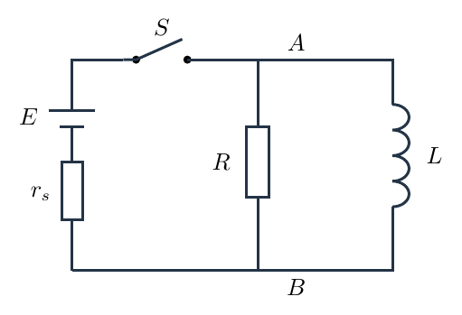{ width=70% }

## 一、题型定位

这是用积分关系处理暂态电路的问题。已知量不是开关持续时间，而是电荷量和断开后的热量，因此首先求指数电流再积分并不经济。应利用电感储能确定终端电流，用并联电压的时间积分确定支路电荷，最后用电荷守恒和能量守恒求电源功及热量。

## 二、知识点

1. 理想电感储能 $U_L=LI^2/2$；
2. 电感端电压与电流变化率的关系；
3. 并联支路等电压及电荷量的时间积分；
4. 电感电流连续、开关前后回路重组；
5. 代数电荷与通过电荷量大小的区别；
6. 电源供能、焦耳热与磁场储能之间的账目。

## 三、物理图像

闭合后，电流从电源流入并联节点，分成电阻电流和电感电流；电感电流逐渐建立，磁场储能增大。断开时，电源支路被切离，但 $R$ 与 $L$ 仍构成闭合回路。电感电流沿原方向继续流动，电阻支路的电流则必须反向，才能形成回路。

因此两阶段通过 $R$ 的电荷量大小可能相等，方向却相反。若始终把 $R$ 中从上到下定义为正，闭合阶段的积分为正，断开阶段的积分为负。方向问题最好在积分前确定，而不是在最终答案后补一个模糊的“反向”。

## 四、解题入口

从末态往前推。断开后没有电源继续供能，电感最终电流归零，全部初始磁能变成 $Q_0$。于是先由 $Q_0$ 求 $I_0$。随后对 $Ri_R=L\,di_L/dt$ 积分，避免把未知的闭合时间引入主解。

源支路的串联电阻影响电流随时间的形状，却不进入由 $I_0$ 决定的电阻电荷积分。这不表示串联电阻可以删去，而是本题给出的积分量已替代了有关暂态细节。

## 五、解析

统一符号：并联电路上端节点为 $A$，下端为 $B$，定义

$$
u(t)=V_A-V_B.
$$

两支路电流 $i_R,i_L$ 均先以从 $A$ 到 $B$ 为正，源支路流入 $A$ 的电流为 $i_s$。采用被动符号约定，支路方程为

$$
u=Ri_R,\qquad u=L\frac{di_L}{dt}.
$$

第二式不是 $\mathcal E_L=-L\,di_L/dt$ 的错误反号。自感电动势描述沿回路的电动势，而这里的 $u$ 是电流流入端相对流出端的电压降；在此约定下两者恰好相反。固定符号约定后，后续每个积分的正负号都能追溯。

图4-2分别画出两阶段的支路方向。断开阶段蓝色电阻箭头向上，而红色电感箭头仍向下，这个回路方向直接对应后面的 $i_R=-i_L$。

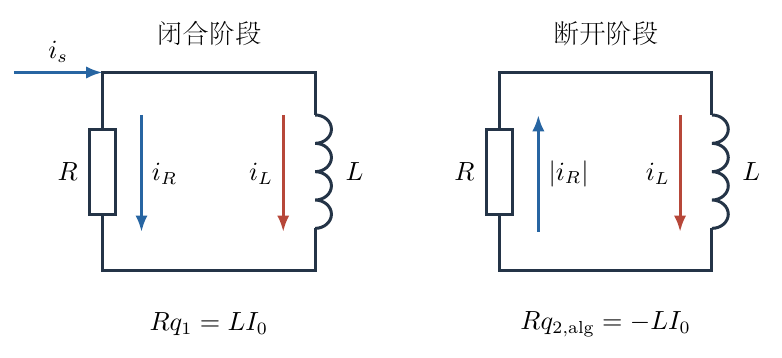{ width=95% }

（1）设再次断开的时刻为 $t=t_b$。理想电感不允许电流在有限电压下发生有限跳变；积分形式为

$$
L\,[i_L(t_b^+)-i_L(t_b^-)]
=\lim_{\epsilon\to0}\int_{t_b-\epsilon}^{t_b+\epsilon}u(t)\,dt=0.
$$

所以两侧瞬时电流同为 $I_0$。这里 $R$ 始终提供续流通道，不需要通过无限开关电压强制截断电感电流。

断开后电路中没有电源，串联电阻 $r_s$ 所在支路断路，不再放热；电感本身理想，也不发热。$L$ 的初始磁能全部在 $R$ 中耗散：

$$
Q_0=U_L(t_b^+)-U_L(\infty)
=\frac12LI_0^2-0.
$$

取电流大小的正根，

$$
\boxed{I_0=\sqrt{\frac{2Q_0}{L}}}.
$$

量纲检查：$\mathrm{J/H}=\mathrm{A^2}$，因此平方根确实为电流。

（2）在闭合阶段，两个支路端电压相同，消去 $u$：

$$
Ri_R=L\frac{di_L}{dt}.
$$

从初始 $0$ 到 $t_b$ 积分，$R,L$ 为常量，可以移到积分号外：

$$
\begin{aligned}
R\int_0^{t_b}i_R\,dt
&=L\int_0^{t_b}\frac{di_L}{dt}\,dt\\
&=L[i_L(t_b)-i_L(0)]\\
&=LI_0.
\end{aligned}
$$

左端就是 $Rq_1$，所以

$$
q_1=\frac{LI_0}{R}
=\boxed{\frac{\sqrt{2LQ_0}}{R}}.
$$

积分结果只依赖起末电流，不依赖建立过程的具体时间曲线。这相当于用磁通链 $\Psi=Li_L$ 表达

$$
Rq_1=\Delta\Psi.
$$

不要把 $\Psi$ 与单匝磁通不加区分地混用；对一般电感，$L i$ 表示磁通链，已包含线圈匝数的作用。

（3）断开后，沿原有正方向仍写同一组支路方程。但节点没有外部输入电流，故

$$
i_R+i_L=0,\qquad i_R=-i_L.
$$

因此

$$
-Ri_L=L\frac{di_L}{dt},
\qquad
\frac{di_L}{dt}=-\frac RL i_L.
$$

正的电感电流随时间减小，$u=L\,di_L/dt<0$，上端节点的电势反而低于下端，这正好驱动 $R$ 中的反向电流。

若仍按从上到下计算代数电荷，则

$$
\begin{aligned}
Rq_{2,\mathrm{alg}}
&=L[i_L(\infty)-i_L(t_b^+)]\\
&=-LI_0,
\end{aligned}
$$

即

$$
q_{2,\mathrm{alg}}=-\frac{\sqrt{2LQ_0}}{R}.
$$

题目问通过的电荷量，通常报告其大小并同时说明方向：

$$
\boxed{q_2=\frac{\sqrt{2LQ_0}}{R},\quad
\text{方向从下端 }B\text{ 流向上端 }A.}
$$

与第（2）问相比，大小 $q_2=q_1$，方向相反。全过程通过 $R$ 的代数电荷为零，但绝对通过量为 $2q_1$，也仍然产生正的焦耳热。净电荷为零不等于电流从未流过。

（4）开关闭合时节点电流守恒：

$$
i_s=i_L+i_R.
$$

对闭合时间积分，

$$
q_s=\int_0^{t_b}i_s\,dt
=\int_0^{t_b}i_L\,dt+\int_0^{t_b}i_R\,dt
=q_0+q_1.
$$

断开后电源支路没有电流，所以它在后续阶段不再做功。电动势 $E$ 恒定，电源总功为

$$
\begin{aligned}
W&=\int_0^{t_b}E i_s\,dt=E q_s,\\
\boxed W&=\boxed{E\left(q_0+\frac{\sqrt{2LQ_0}}R\right)}.
\end{aligned}
$$

这里不能只写 $Eq_0$，因为电源除了给电感支路输送电荷，还给并联电阻支路输送了 $q_1$。电源做功中的电荷必须是流经电源本身的电荷。

（5）闭合期间，初始电感磁能为零，终态磁能为 $Q_0$。电源提供的能量分为闭合期间的焦耳热 $Q$ 和增加的磁能：

$$
W=Q+\frac12LI_0^2.
$$

代入第（1）问，

$$
\boxed{Q=
E\left(q_0+\frac{\sqrt{2LQ_0}}R\right)-Q_0.}
$$

$Q$ 包括闭合期间 $R$ 与 $r_s$ 两个电阻中的热量，不能只理解成 $R$ 中的热。断开后热量 $Q_0$ 则只来自续流回路。两者相加，应恢复全过程电源能量：

$$
Q+Q_0=W.
$$

下面用显式暂态解再核对积分关系，同时说明参数的允许范围。闭合时源支路满足

$$
E=r_s i_s+u
=r_s\left(i_L+\frac uR\right)+u.
$$

代入 $u=L\,di_L/dt$，

$$
L\left(1+\frac{r_s}{R}\right)\frac{di_L}{dt}+r_s i_L=E.
$$

对于 $r_s>0$，定义

$$
I_\infty=\frac E{r_s},\qquad
\tau_{\rm on}=\frac{L(R+r_s)}{Rr_s}.
$$

微分方程化为

$$
\frac{di_L}{dt}+\frac1{\tau_{\rm on}}i_L
=\frac{I_\infty}{\tau_{\rm on}}.
$$

将 $i_L=I_\infty+y$ 代入，有 $dy/dt=-y/\tau_{\rm on}$。结合 $i_L(0)=0$，得到

$$
i_L(t)=I_\infty(1-e^{-t/\tau_{\rm on}}).
$$

电阻电流为

$$
\begin{aligned}
i_R(t)&=\frac LR\frac{di_L}{dt}\\
&=\frac{L I_\infty}{R\tau_{\rm on}}e^{-t/\tau_{\rm on}}\\
&=\frac{E}{R+r_s}e^{-t/\tau_{\rm on}}.
\end{aligned}
$$

积分确实给出

$$
\begin{aligned}
q_1&=\frac{E\tau_{\rm on}}{R+r_s}
(1-e^{-t_b/\tau_{\rm on}})\\
&=\frac LR I_\infty(1-e^{-t_b/\tau_{\rm on}})
=\frac{LI_0}{R}.
\end{aligned}
$$

而给定的 $q_0$ 与持续时间满足

$$
q_0=I_\infty\left[t_b-\tau_{\rm on}
(1-e^{-t_b/\tau_{\rm on}})\right].
$$

可见 $q_0,Q_0$ 不是任意独立的正数：它们必须对应同一个 $t_b$，并且有限闭合时间下 $0<I_0<E/r_s$。主解不需要反解 $t_b$，但这条关系可用于检查输入数据是否物理可实现。

断开阶段取 $\tau=t-t_b$，分离变量得

$$
i_L(\tau)=I_0e^{-R\tau/L}.
$$

直接积分焦耳热，

$$
\begin{aligned}
Q_{\rm off}
&=\int_0^\infty R I_0^2e^{-2R\tau/L}\,d\tau\\
&=RI_0^2\frac{L}{2R}=\frac12LI_0^2=Q_0.
\end{aligned}
$$

这既核对能量法，也核对指数的系数。若漏掉平方后指数中的因子 $2$，将错误得到两倍热量。最后，$\sqrt{LQ_0}/R$ 的单位为 $\mathrm C$，$Eq$ 的单位为 $\mathrm J$，所有最终答案量纲一致。

若需要区分闭合阶段两个电阻各自的热量，也可以由显式暂态解完成。令 $\tau=\tau_{\rm on}$、$b=e^{-t_b/\tau}$，电阻 $R$ 中的热量为

$$
\begin{aligned}
Q_{R,\rm on}
&=\int_0^{t_b}R\left(\frac{E}{R+r_s}\right)^2e^{-2t/\tau}\,dt\\
&=\frac{RE^2\tau}{2(R+r_s)^2}(1-b^2).
\end{aligned}
$$

源支路电流应先把两个支路相加，而不能只使用 $i_L$：

$$
i_s=\frac E{r_s}
\left[1-\frac{R}{R+r_s}e^{-t/\tau}\right].
$$

记 $a_R=R/(R+r_s)$，平方后逐项积分，

$$
\begin{aligned}
Q_{r_s,\rm on}
&=\frac{E^2}{r_s}\int_0^{t_b}
\left(1-2a_Re^{-t/\tau}+a_R^2e^{-2t/\tau}\right)dt\\
&=\frac{E^2}{r_s}
\left[t_b-2a_R\tau(1-b)+\frac{a_R^2\tau}{2}(1-b^2)\right].
\end{aligned}
$$

相加时注意 $\tau=L(R+r_s)/(Rr_s)$，两个含 $1-b^2$ 的系数合并为

$$
\frac{RE^2\tau}{2(R+r_s)^2}
+\frac{E^2a_R^2\tau}{2r_s}
=\frac{LE^2}{2r_s^2}.
$$

再使用 $I_0=(E/r_s)(1-b)$ 和 $q_s=q_0+LI_0/R$，即可整理回

$$
Q_{R,\rm on}+Q_{r_s,\rm on}
=E q_s-\frac12LI_0^2.
$$

这是一项更细的能量核对：两个电阻各自的热量都非负，总和又与主解一致。保留 $r_s$ 的作用能够防止把源支路画成理想电源直接并联电感，从而误用另一个暂态模型。

## 六、关键洞察

积分型题目常常不需要先知道时间函数。并联的共同电压把电阻的时间积分与电感电流的端点差联系起来，正如力的时间积分与动量差相联系。先看已知量是瞬时量、积分量还是端点能量，再选择匹配的方法，可以明显减少中间未知数。

同样的 $R,L,I_0$ 决定同样的 $q_1,q_2$，但不同的源支路参数仍可能导致不同闭合时间和不同电源功。不能因为一个结果里没有 $r_s$，就断言整个过程与 $r_s$ 无关。

电感储能有状态函数性质，$LI^2/2$ 只由该时刻电流决定。闭合热量却是过程量，需要电源总功和磁能增量共同确定。本题把状态量与过程量放在同一能量账目中，能防止重复计算断开后的热。

## 七、易错点

断开开关不等于电路所有支路都断开。必须沿导线检查 $R$—$L$ 的续流回路是否仍闭合，再判断电感能量在哪里耗散。

电感电流不能跳变，电阻电流可以在开关动作时变号。把电阻电流也强行设为连续，会与节点电流守恒冲突。

通过电感的电荷 $q_0$ 不是流经电源的全部电荷。遗漏 $q_1$ 会同时使电源功和闭合热量偏小。代数电荷的抵消也不能用于抵消热量，因为焦耳热取决于 $i^2$。

## 八、课堂讲解建议

课堂先只画断开后的回路，让学生沿电感原电流方向走完整一圈，亲自确定电阻反向。教师再列两个阶段共用的电压方程，用同一正方向完成积分，以显示负号从何处产生。

板书最后用三列表达初始磁能、末态磁能和电源供能，再写能量守恒。暂态指数解可作为第二轮验证，不必抢在能量法和积分法前面增加运算负担。

## 九、变式训练

断开后在电感支路中另有一电阻 $r_L$ 串联，闭合阶段参数不变。已知断开瞬间电流仍为 $I_0$，求断开后流过 $R$ 的电荷及 $R$ 中放热。

续流回路的总电阻变为 $R+r_L$，故

$$
i(\tau)=I_0e^{-(R+r_L)\tau/L}.
$$

电荷量对电流积分，焦耳热对 $Ri^2$ 积分。两项分别得到

$$
\begin{aligned}
q_R&=\int_0^\infty i\,d\tau=\frac{LI_0}{R+r_L},\\
Q_R&=R I_0^2\frac{L}{2(R+r_L)}
=\frac{R}{R+r_L}\frac12LI_0^2.
\end{aligned}
$$

剩余的 $r_L/(R+r_L)$ 比例磁能在 $r_L$ 中释放。总热仍为 $LI_0^2/2$，但不能再把全部断开热都归入 $R$，原题电荷相等的结论也随回路结构改变。

\newpage

# 第 5 题

单极感应器由高速转动的圆盘形永磁体构成。圆盘由磁性合金制成，表面覆盖薄导电层。圆盘转动时，可以用固定电压表通过滑动接触测量转轴与圆周边缘的电势差；在两者之间接入电池，也可以使圆盘像电动机一样转动。

圆盘半径为 $r_0=2\,\mathrm{cm}$，表面磁感应强度 $\mathbf B$ 垂直盘面向上，大小恒为 $B=1\,\mathrm T$。为简化计算，假定导电层中的电流沿轴心与圆周接触点之间的半径流动。最终数值保留两位有效数字。

（1）按图左侧连接电压表。圆盘转速为 $3000\,\mathrm{r/min}$，从上方看沿逆时针方向转动。以上方接线端电势较高为正，求电压表读数。

（2）按图右侧连接电动势 $E=1.5\,\mathrm V$ 的电池，滑动接触良好，圆盘从静止开始转动。忽略摩擦，求可达到的最大转速，并指出从上方看的转动方向。

（3）接上问，设摩擦阻力矩大小为 $M=k\omega$，其中 $\omega$ 为角速度。整个转子质量为 $m$，转动惯量为 $I=\frac12mr_0^2$，电路总内阻为 $R$。求由静止加速时角加速度和角速度的最大值。

（4）接上问，电动机以恒定角速度驱动阻力矩为 $M_0$ 的负载。求使负载获得最大功率的 $M_0$。

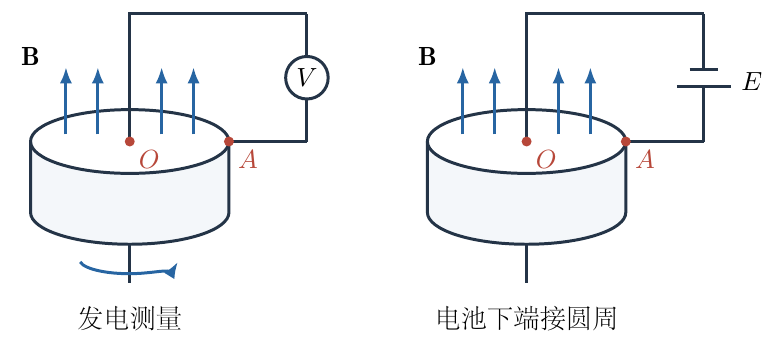{ width=95% }

## 一、题型定位

本题把动生电动势、安培力矩、转动方程和负载功率连接在同一个装置中。先建立一个共同的机电耦合系数 $K=Br_0^2/2$：圆盘转动产生电动势 $K\omega$，径向电流产生力矩 $Ki$。两者的一致性保证机械功率和电能转化功率相等。

## 二、知识点

1. 洛伦兹力 $q\mathbf v\times\mathbf B$ 与导体内电荷分离；
2. 动生电动势的径向积分；
3. 径向电流元所受安培力及其力矩；
4. 反电动势、摩擦阻尼与一阶转动动力学；
5. 稳态负载条件下的功率极值；
6. 转速单位换算及能量守恒核验。

## 三、物理图像

规定从上方看逆时针为正转动，故 $\boldsymbol\omega$ 和 $\mathbf B$ 都向上。盘面某点的速度沿正切线方向，$\mathbf v\times\mathbf B$ 指向径向外侧，正电荷被推向圆周，圆周电势高于轴心。上方电压表接线端连接轴心，所以按题定正负读数应为负。

电池长线端接圆周，驱动常规电流从圆周向轴心流动。向内的径向电流在向上的磁场中受到逆时针切向力，使转子加速。转得越快，圆周相对轴心的动生电势差越大，与电池电动势对抗，电流和驱动力矩随之减小。

## 四、解题入口

对半径 $r$ 处的导体元 $dr$ 分别做两个积分：发电时积分 $B\omega r\,dr$，电动时积分 $r\,iB\,dr$。先从物理上得到共同系数 $K$，再写

$$
i=\frac{E-K\omega}{R},\qquad
I\dot\omega=Ki-k\omega-M_0.
$$

无负载加速取 $M_0=0$；匀速驱动负载取 $\dot\omega=0$。不应在这两个阶段使用同一个“净力矩为零”条件。

## 五、解析

（1）用右手基矢明确方向。取 $\mathbf e_r$ 向外，$\mathbf e_\varphi$ 沿逆时针，$\mathbf e_z$ 向上。则

$$
\mathbf v=\omega r\,\mathbf e_\varphi,\qquad
\mathbf B=B\,\mathbf e_z,\qquad
\mathbf e_\varphi\times\mathbf e_z=\mathbf e_r.
$$

于是磁力对正电荷的作用为

$$
q\mathbf v\times\mathbf B=qB\omega r\,\mathbf e_r,
$$

方向向外。开路稳态中电荷分离产生的静电场与之平衡：

$$
q(\mathbf E_{\rm el}+\mathbf v\times\mathbf B)=0,
\qquad E_r=-B\omega r.
$$

由于 $E_r=-dV/dr$，有 $dV/dr=B\omega r$。从轴心 $O$ 积分到圆周 $A$，

$$
\begin{aligned}
V_A-V_O
&=\int_0^{r_0}B\omega r\,dr\\
&=B\omega\left[\frac{r^2}{2}\right]_0^{r_0}\\
&=\frac12B\omega r_0^2.
\end{aligned}
$$

这个正号表示圆周电势更高。题目规定的仪表读数却是上接线端减下接线端，而图中上端接轴、下端接边缘，因此

$$
U_{\rm meter}=V_O-V_A=-\frac12B\omega r_0^2.
$$

转速 $n=3000\,\mathrm{r/min}$ 换算为角速度：

$$
\begin{aligned}
f&=\frac{3000}{60}\,\mathrm{s^{-1}}=50\,\mathrm{s^{-1}},\\
\omega&=2\pi f=100\pi\,\mathrm{rad/s}.
\end{aligned}
$$

半径必须化为米，$r_0=0.020\,\mathrm m$。代入，

$$
\begin{aligned}
U_{\rm meter}
&=-\frac12(1)(100\pi)(0.020)^2\,\mathrm V\\
&=-0.0628318\ldots\,\mathrm V.
\end{aligned}
$$

保留两位有效数字，

$$
\boxed{U_{\rm meter}=-0.063\,\mathrm V=-63\,\mathrm{mV}.}
$$

负号是接线方向的结果，不表示电动势大小为负。若交换仪表接线，读数变正；若在原接线下反转圆盘或反转磁场，读数也变号。

（2）电池驱动与最终空载速度。定义

$$
K=\frac12Br_0^2.
$$

从圆周流向轴心的常规电流取正。其在半径元上的方向为 $-\mathbf e_r$，故

$$
d\mathbf F=i(-dr\,\mathbf e_r)\times(B\mathbf e_z)
=iB\,dr\,\mathbf e_\varphi.
$$

安培力沿逆时针，力矩与正角速度同向。图5-2左侧把半径 $r$、微元 $dr$、向内电流和切向力画在同一平面中。后面的 $r$ 因子来自作用点到轴的力臂，而不是再乘一次导线长度。

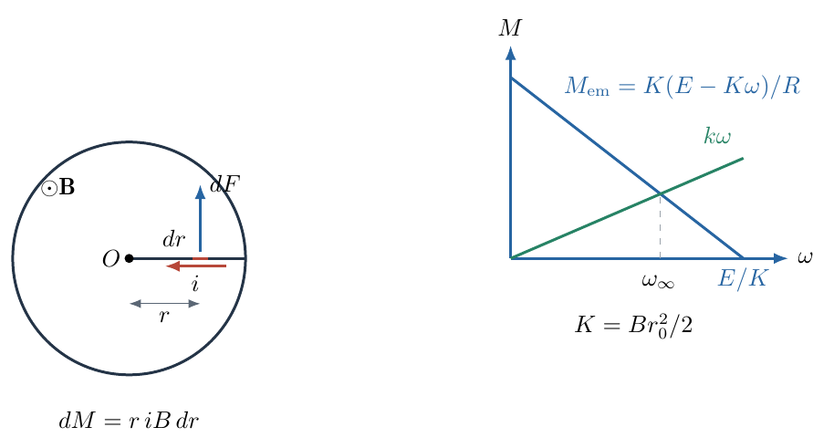{ width=95% }

单个微元的力矩为 $dM=r\,iB\,dr$，全盘有效半径上的积分给出

$$
\begin{aligned}
M_{\rm em}
&=\int_0^{r_0}riB\,dr\\
&=\frac12iBr_0^2=Ki.
\end{aligned}
$$

逆时针转动产生的圆周高电势抵抗电池所驱动的向内电流，因此

$$
Ri=E-K\omega,\qquad
i=\frac{E-K\omega}{R}.
$$

忽略摩擦且没有负载时，只要 $K\omega<E$，电流和力矩就为正，转子继续加速；达到 $K\omega=E$ 的极限时，电流趋于零，净力矩趋于零。因此

$$
\boxed{\omega_{\max}=\frac EK=\frac{2E}{Br_0^2}}.
$$

代入数据，

$$
\omega_{\max}=\frac{2(1.5)}{1(0.020)^2}
=7500\,\mathrm{rad/s}.
$$

转为每分钟转数：

$$
\begin{aligned}
n_{\max}
&=\frac{60}{2\pi}\omega_{\max}\\
&=\frac{60}{2\pi}\times7500
=7.16197\ldots\times10^4\,\mathrm{r/min}.
\end{aligned}
$$

故

$$
\boxed{n_{\max}=7.2\times10^4\,\mathrm{r/min},\quad
\text{从上方看逆时针}.}
$$

在有限电阻和惯量的理想模型中，这个“最大值”是随时间渐近达到的极限速度，不能理解为某一有限时刻突然停止加速。真实装置还可能受机械强度等限制，但题目模型没有包含这些因素。

（3）加入线性摩擦。无负载时，摩擦力矩反向，大小 $k\omega$，所以

$$
I\dot\omega=K\frac{E-K\omega}{R}-k\omega.
$$

展开并整理，

$$
\begin{aligned}
I\dot\omega
&=\frac{KE}{R}-\left(\frac{K^2}{R}+k\right)\omega,\\
\dot\omega
&=\frac{KE}{IR}
-\frac{K^2+kR}{IR}\omega.
\end{aligned}
$$

初始 $\omega=0$，反电动势和题设的线性摩擦力矩均为零，此时加速度最大：

$$
\alpha_{\max}=\frac{KE}{IR}.
$$

代入 $K=Br_0^2/2$ 和 $I=mr_0^2/2$，

$$
\begin{aligned}
\alpha_{\max}
&=\frac{(Br_0^2/2)E}{(mr_0^2/2)R}\\
&=\boxed{\frac{EB}{mR}}.
\end{aligned}
$$

半径消去的原因是驱动力矩和转动惯量都含同一个 $r_0^2$ 因子，不表示所有形状的转子都有这个性质。若质量分布改变，$I$ 的表达式也会改变。

随 $\omega$ 增大，加速度以线性规律减小。稳态由驱动力矩与摩擦平衡：

$$
\frac{KE}{R}-\frac{K^2}{R}\omega_\infty-k\omega_\infty=0.
$$

移项、合并系数，

$$
KE=(K^2+kR)\omega_\infty.
$$

所以

$$
\boxed{\omega_{\max}=\omega_\infty
=\frac{KE}{K^2+kR}
=\frac{2EBr_0^2}{B^2r_0^4+4kR}.}
$$

图5-2右侧的下降直线为电磁力矩，上升直线为摩擦力矩，两者交点对应上述 $\omega_\infty$。不计摩擦时交点退到横轴截距 $E/K$，与第（2）问连续相接。

再解出整个加速过程，以验证最大值所在位置。定义机械—电磁共同时间常量

$$
\tau=\frac{IR}{K^2+kR}.
$$

方程化为

$$
\dot\omega=\frac{\omega_\infty-\omega}{\tau}.
$$

分离变量并使用 $\omega(0)=0$，

$$
\begin{aligned}
\int_0^\omega\frac{d\widetilde\omega}
{\omega_\infty-\widetilde\omega}
&=\int_0^t\frac{dt'}{\tau},\\
-\ln\left(1-\frac{\omega}{\omega_\infty}\right)
&=\frac t\tau.
\end{aligned}
$$

故

$$
\omega(t)=\omega_\infty(1-e^{-t/\tau}),\qquad
\alpha(t)=\frac{\omega_\infty}{\tau}e^{-t/\tau}.
$$

两式分别单调增加和单调减小；又 $\omega_\infty/\tau=KE/(IR)$，与前面由初始状态求出的 $\alpha_{\max}$ 一致。这里隐含题目忽略电路自感，电流由瞬时欧姆关系决定；若另加电感，初始电流与加速度将需要重新求解。

（4）现在接入恒定阻力矩 $M_0$ 的负载，并讨论正向匀速状态。转动方程变为

$$
0=\frac{K(E-K\omega)}R-k\omega-M_0.
$$

乘以 $R$ 并整理，

$$
KE=(K^2+kR)\omega+RM_0.
$$

所以匀速角速度为

$$
\omega=\frac{KE-RM_0}{K^2+kR}.
$$

正向运行要求 $\omega\geq0$，即

$$
0\leq M_0\leq\frac{KE}{R}.
$$

负载得到的机械功率不是 $Ei$，而是

$$
\begin{aligned}
P_{\rm load}
&=M_0\omega\\
&=\frac{KE\,M_0-RM_0^2}{K^2+kR}.
\end{aligned}
$$

分母为正，与 $M_0$ 无关；分子是开口向下的二次函数。可以求导，也可以配方。配方过程为

$$
\begin{aligned}
KE\,M_0-RM_0^2
&=-R\left[M_0^2-\frac{KE}{R}M_0\right]\\
&=-R\left(M_0-\frac{KE}{2R}\right)^2
+\frac{K^2E^2}{4R}.
\end{aligned}
$$

所以最大值位于

$$
\boxed{M_0^*=\frac{KE}{2R}=\frac{EBr_0^2}{4R}}.
$$

它在允许区间的正中，确实是正向运行时的内部最大值，不需要再与无物理意义的负角速度区间比较。相应速度和功率为

$$
\omega_*=\frac{KE}{2(K^2+kR)}=\frac{\omega_\infty}{2},
$$

$$
P_{\max}=\frac{K^2E^2}{4R(K^2+kR)}.
$$

最优负载力矩没有 $k$，但最优速度及最大功率都依赖 $k$。原因是线性摩擦只改变整个功率抛物线的正比例系数，不改变它的横坐标顶点；这不是任意摩擦规律下都成立的结论。

做能量检验。欧姆关系 $E=Ri+K\omega$ 乘以 $i$，得到

$$
Ei=Ri^2+Ki\omega.
$$

转动方程乘以 $\omega$，得到

$$
Ki\omega=I\omega\dot\omega+k\omega^2+M_0\omega.
$$

合并为

$$
\boxed{Ei=Ri^2+\frac{d}{dt}\left(\frac12I\omega^2\right)
+k\omega^2+P_{\rm load}.}
$$

等式逐项对应电源输入、焦耳热、转动动能、摩擦热及负载输出。若电动势积分或力矩积分漏掉因子 $1/2$，这项检验将无法成立。它是两个径向积分应得到同一 $K$ 的根本原因。

最后看极限：$k\to0$ 时空载速度回到 $E/K$；$M_0\to0$ 时负载功率为零但转子可转得很快；$M_0\to KE/R$ 时转子堵转，负载功率仍为零。最大功率只能在二者之间，不能用“力矩越大功率越大”或“速度越大功率越大”单独判断。

在求得的最大功率工作点，还可以把电流明确算出，确认电池确实在供能而不是被反充电。将 $\omega_*=KE/[2(K^2+kR)]$ 代入欧姆关系，

$$
\begin{aligned}
i_*
&=\frac ER-\frac KR\frac{KE}{2(K^2+kR)}\\
&=\frac ER\left[1-\frac{K^2}{2(K^2+kR)}\right]\\
&=\frac{E(K^2+2kR)}{2R(K^2+kR)}>0.
\end{aligned}
$$

当 $k>0$ 时，$i_*>E/(2R)$。同一电源与电阻下，摩擦增加使该工作点需要更大的电流，而不是可以忽略电流变化只从输出功率中简单减去一个常数。

转子在此时匀速，驱动力矩应分成负载和摩擦两部分。把电流乘以 $K$ 后减去最优负载力矩，得到

$$
\begin{aligned}
Ki_*-M_0^*
&=\frac{KE}{2R}
\left[\frac{K^2+2kR}{K^2+kR}-1\right]\\
&=\frac{kKE}{2(K^2+kR)}=k\omega_*.
\end{aligned}
$$

这项直接代回验证说明 $M_0^*=KE/(2R)$ 虽然没有 $k$，但电磁力矩并非与摩擦无关。多出来的力矩恰好抵消摩擦；把 $Ki_*$ 误认成全部负载力矩，将会错误预测更大的负载输出。

## 六、关键洞察

本题的核心是一对互相匹配的转换规律：电压与角速度成正比，力矩与电流成正比。它们用相同的 $K$ 联系，是能量一致性要求，而不只是积分巧合。建立这一对关系后，发电、空载加速、摩擦稳态和带载运行都能在同一个模型内处理。

最大功率状态与最大效率状态不同。最大功率位于力矩—转速直线的中部，是乘积的极值；效率还需要考虑电阻损耗和摩擦损耗的比例。题目只要求前者，不能用最大功率传输的口号替代本装置的能量账目。

这种差别可以定量说明。令无量纲速度 $x=K\omega/E$，无量纲摩擦强度 $\beta=kR/K^2$。匀速运行时

$$
i=\frac ER(1-x),\qquad
M_0=\frac{KE}{R}\left[1-(1+\beta)x\right].
$$

负载为正要求 $0\leq x\leq1/(1+\beta)$。负载功率和输入功率分别为

$$
P_{\rm out}=\frac{E^2}{R}x[1-(1+\beta)x],
\qquad
P_{\rm in}=\frac{E^2}{R}(1-x).
$$

所以效率函数为

$$
\eta(x)=\frac{x[1-(1+\beta)x]}{1-x}.
$$

对商式求导，分子先展开再合并：

$$
\eta'(x)=
\frac{1-2(1+\beta)x+(1+\beta)x^2}{(1-x)^2}.
$$

当 $\beta>0$，令导数为零并配方，

$$
(x-1)^2=\frac{\beta}{1+\beta}.
$$

允许区间内的根为

$$
x_\eta=1-\sqrt{\frac{\beta}{1+\beta}},
$$

另一根大于一而被排除。把效率式改写为

$$
\eta=(1+\beta)x+\beta-\frac{\beta}{1-x},
$$

代入 $x_\eta$，得到

$$
\eta_{\max}=1+2\beta-2\sqrt{\beta(1+\beta)}
=\left(\sqrt{1+\beta}-\sqrt\beta\right)^2.
$$

相比之下，最大功率位置是 $x_P=1/[2(1+\beta)]$，此时效率只有 $1/[2(1+2\beta)]$。两个优化目标选取不同工作点。$\beta\to0$ 时最大效率趋近一，但发生在趋近空载、输出功率趋近零的边界；这不推翻无摩擦最大功率时效率为二分之一的结果。

## 七、易错点

电压表上端接轴心，故本题开路读数为负。仅判断圆周电势高，却没有回到实际接线定义，仍可能把最后符号写错。

半径导体不同位置的速度为 $\omega r$，不能把整条半径都当成边缘速度 $\omega r_0$。这样会把动生电动势算大一倍。力矩积分同样不能把所有力臂取成 $r_0$。

有摩擦时，稳态不等于电流为零。稳态电流需要提供摩擦力矩。仅在完全无摩擦、无负载的空载极限下，电流才趋于零。

## 八、课堂讲解建议

课堂先在俯视图中选一个右侧导体元，让学生用右手法则分别判断发电时正电荷受力和电动时径向电流受力。教师把两个判断用同一个坐标三基矢写下，再进行积分。

板书保留 $K$ 到求完动态方程后再展开，可以让学生看见方程结构；数值换算则单独列出厘米到米、转每分到弧度每秒两步。最后用功率守恒反查两个积分，强化独立核验意识。

## 九、变式训练

若无摩擦 $k=0$，负载取最大功率时的 $M_0^*$，求电流、转速、输出功率和效率，并求每转一周的输入电能、负载做功和电阻放热。

此时

$$
\omega_*=\frac{E}{2K},\qquad
i_*=\frac{E-K\omega_*}{R}=\frac{E}{2R}.
$$

电源功率和负载功率分别代入电流和转速，效率取两者之比：

$$
\begin{aligned}
P_{\rm in}&=Ei_*=\frac{E^2}{2R},\\
P_{\rm out}&=M_0^*\omega_*=\frac{E^2}{4R},\\
\eta&=\frac{P_{\rm out}}{P_{\rm in}}=\boxed{\frac12}.
\end{aligned}
$$

输入功率的另一半为焦耳热 $Ri_*^2=E^2/(4R)$，所以无机械摩擦并不等于无损耗。

每转一周的时间由角速度确定，输入电能和焦耳热分别由功率乘时间求得，负载做功还可直接用恒定力矩乘转角求出：

$$
\begin{aligned}
T_*&=\frac{2\pi}{\omega_*}=\frac{4\pi K}{E},\\
W_{\rm in}&=P_{\rm in}T_*=\frac{2\pi KE}{R},\\
Q_R&=Ri_*^2T_*=\frac{\pi KE}{R},\\
W_{\rm load}&=2\pi M_0^*=\frac{\pi KE}{R}.
\end{aligned}
$$

每周都满足 $W_{\rm in}=Q_R+W_{\rm load}$。匀速时动能不增加，电能全部成为焦耳热和负载功；转动惯量仅影响到达此工作点的加速过程，不影响稳态能量比例。

\newpage

# 第 6 题

一张褪色的光学系统图中，原来有一个透镜、点光源 $S_0$ 及其像 $S_1$。现在只剩下透镜主轴、$S_0,S_1$ 和一个焦点 $F$，三点的位置如图所示。测得

$$
|S_0S_1|=l,\qquad |S_0F|=d,\qquad 0<d<l.
$$

（1）求所有可能的透镜光心位置。

（2）用圆规和无刻度直尺作出透镜可能的位置。

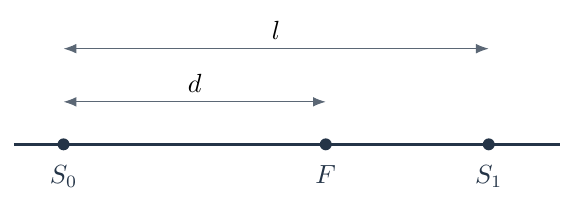{ width=84% }

## 一、题型定位

这是薄透镜逆向定位问题。已知的是共轭点和某一个焦点，却没有说明它是物方焦点还是像方焦点，也没有预设透镜会聚或发散。必须保留全部代数根，再用真实光源和光传播方向解释各根，而不能从最熟悉的凸透镜实像图出发只找一个位置。

## 二、知识点

1. 薄透镜公式及实物、实像、虚像的符号约定；
2. 光心两侧焦点关于光心对称；
3. 物方、像方焦点的两种归属；
4. 二次方程的全部根及几何可行性；
5. 直径所对圆周角、直角三角形高定理；
6. 用几何平均构造平方根长度。

## 三、物理图像

以 $S_0$ 为坐标原点，向 $S_1$ 为正方向，则 $S_0=0,F=d,S_1=l$。透镜光心坐标记为 $a$。光心可能在两点之间，也可能在两点外侧：在两点之间时通常形成实像；在右侧时可能由发散透镜产生位于物点与透镜之间的虚像；在左侧时，点光源向左发出的光也可能经会聚透镜形成右侧虚像。

题图没有指定单向入射光束，点光源本来向两侧发光，所以左侧透镜也属于需要考察的可能位置。如果另行限定仅使用从 $S_0$ 向右传播的光束，才应在最后排除 $a<0$ 的那一个解，不能把这个额外限制暗中加入题意。

## 四、解题入口

采用有物理含义的焦距 $f$：会聚透镜 $f>0$，发散透镜 $f<0$。设光入射方向符号为 $\sigma=\operatorname{sgn}a$，则真实点光源到透镜的物距为 $u=|a|=\sigma a$；沿出射方向量取的有符号像距是 $v=\sigma(l-a)$。用透镜公式消去 $f$，再利用已知点 $F$ 必须距光心 $|f|$，得到关于 $a$ 的四次式。它可以分解成两条简单二次式。

## 五、解析

（1）先把符号约定落实到距离上。光源发出的光到达右侧透镜时向右传播，$\sigma=+1$；到达左侧透镜时向左传播，$\sigma=-1$。在两种情况下，物点都是真实光源，物距必须取正：

$$
u=|a|=\sigma a>0.
$$

像点在出射方向一侧时 $v>0$，是实像；在入射一侧时 $v<0$，是虚像。用统一坐标表达为

$$
v=\sigma(l-a).
$$

薄透镜公式为

$$
\frac1f=\frac1u+\frac1v.
$$

把上面两式代入，利用 $\sigma^2=1$：

$$
\begin{aligned}
\frac1f
&=\frac1{\sigma a}+\frac1{\sigma(l-a)}\\
&=\sigma\left(\frac1a+\frac1{l-a}\right)\\
&=\frac{\sigma l}{a(l-a)}.
\end{aligned}
$$

反解焦距，

$$
\boxed{f=\frac{\sigma a(l-a)}l}.
$$

光心不能与 $S_0,S_1$ 重合，所以推导中 $a=0,l$ 被排除。后面得到的根在 $0<d<l$ 时不会落在这两个点上。

无论会聚还是发散透镜，其两个焦点的坐标集合都是 $\{a-f,a+f\}$。已知 $F$ 位于 $d$，因此

$$
(a-d)^2=f^2.
$$

代入消去焦距后的表达式，$\sigma^2$ 自动消去：

$$
l^2(a-d)^2=a^2(l-a)^2.
$$

两边都是平方，故等价于两种有符号关系：

$$
l(a-d)=a(l-a)
\quad\text{或}\quad
l(a-d)=-a(l-a).
$$

第一种关系展开，

$$
\begin{aligned}
la-ld&=al-a^2,\\
a^2&=ld,
\end{aligned}
$$

于是得到两个根

$$
a=\pm\sqrt{ld}.
$$

第二种关系展开，

$$
\begin{aligned}
la-ld&=-al+a^2,\\
a^2-2la+ld&=0,\\
(a-l)^2&=l(l-d),
\end{aligned}
$$

得到另外两个根

$$
a=l\pm\sqrt{l(l-d)}.
$$

所以全部候选光心坐标为

$$
\boxed{
a=-\sqrt{ld},\quad
l-\sqrt{l(l-d)},\quad
\sqrt{ld},\quad
l+\sqrt{l(l-d)}.}
$$

图6-2上半部把四个位置按实际大小排序。两条平方根来自不同的焦点归属；下半部的半圆构造正是第（2）问所需的几何平均关系。

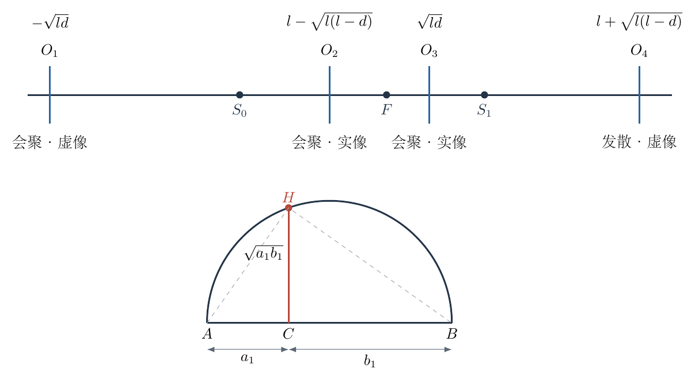{ width=99% }

需要确认这些代数根确实不同且位置正确。因为 $0<d<l$，

$$
0<\sqrt{ld}<l,\qquad
0<\sqrt{l(l-d)}<l.
$$

所以一根在 $0$ 左侧、一根在 $l$ 右侧，另外两根位于两点之间。进一步，

$$
\sqrt{ld}>d
$$

成立，因为两端均正、平方后等价于 $ld>d^2$，即 $l>d$。同理

$$
\sqrt{l(l-d)}>l-d,
$$

故

$$
l-\sqrt{l(l-d)}<d.
$$

于是完整次序为

$$
-\sqrt{ld}<0<l-\sqrt{l(l-d)}
<d<\sqrt{ld}<l<l+\sqrt{l(l-d)}.
$$

这说明两个内部解分居已知焦点两侧，并且不会重合。画图时若把它们放在 $F$ 同一侧，虽公式可能写对，位置关系仍然错误。

下面逐个检查透镜类型和像的性质。为缩短式子，令

$$
b=\sqrt{ld},\qquad c_1=\sqrt{l(l-d)}.
$$

对最左侧光心 $a=-b$，入射方向向左，$\sigma=-1$。真实物距、像距和焦距为

$$
\begin{aligned}
u&=b>0,\\
v&=-(l+b)<0,\\
f&=\frac{b(l+b)}l=b+d>0.
\end{aligned}
$$

因此它是会聚透镜，物距小于焦距，形成位于透镜右侧的虚像。这与熟悉的放大镜条件一致；虚像恰在 $S_1$，并非把真实光源变成了虚物。

对左侧内部光心 $a=l-c_1$，有 $\sigma=+1$，且

$$
u=l-c_1>0,\qquad v=c_1>0,
$$

$$
f=\frac{(l-c_1)c_1}{l}
=c_1-(l-d)>0.
$$

它是会聚透镜形成实像，已知焦点位于光心右侧，因为 $d-a=f$。对右侧内部光心 $a=b$，

$$
u=b>0,\qquad v=l-b>0,
$$

$$
f=\frac{b(l-b)}l=b-d>0.
$$

同样是会聚透镜形成实像，但已知焦点位于光心左侧，因为 $a-d=f$。这两个内部解正对应焦点归属的交换，不能随便合并为一个。

对最右侧光心 $a=l+c_1$，

$$
u=l+c_1>0,\qquad v=-c_1<0,
$$

$$
f=-\frac{(l+c_1)c_1}{l}
=-(c_1+l-d)<0.
$$

所以它是发散透镜，形成位于光源与透镜之间的虚像。这里 $|v|<u$，符合发散透镜对真实物体产生缩小虚像的几何关系。

四个根均满足透镜公式、已知焦点位置和真实点光源条件，因此全部保留。若在某一中间公式中只因焦距出现负值便删去该根，就会漏掉允许的发散透镜；若规定入射方向后忘记改变物距约定，又可能把左侧会聚透镜错误分类。

（2）尺规构造不需要数值刻度，关键是作出 $b=\sqrt{ld}$ 与 $c_1=\sqrt{l(l-d)}$。图6-2下侧先给一般构造：在一条辅助直线上依次取 $AC=a_1$、$CB=b_1$，以 $AB$ 为直径作半圆，再过 $C$ 作垂线交半圆于 $H$。由直径所对圆周角，

$$
\angle AHB=90^\circ.
$$

直角三角形 $AHB$ 的斜边高是 $CH$。两个小直角三角形相似：

$$
\triangle ACH\sim\triangle HCB.
$$

由对应边的比例，

$$
\frac{AC}{CH}=\frac{CH}{CB},
\qquad CH^2=AC\cdot CB=a_1b_1.
$$

取正长度，故

$$
CH=\sqrt{a_1b_1}.
$$

实际作图分三步完成。第一，把已有线段 $S_0S_1$ 和 $S_0F$ 用圆规依次搬到辅助直线上，作为 $AC=l,CB=d$。作半圆及垂线，得到长度 $b=\sqrt{ld}$。以 $S_0$ 为圆心、该长度为半径作圆，与主轴交于两个点，其坐标就是 $\pm b$。

第二，已有线段 $FS_1$ 长为 $l-d$。把 $l$ 与 $l-d$ 搬到另一辅助直线上，同样作半圆及垂线，得到长度 $c_1=\sqrt{l(l-d)}$。以 $S_1$ 为圆心、$c_1$ 为半径作圆，其与主轴的两个交点坐标是 $l\pm c_1$。

第三，在这四个候选点处分别作主轴的垂线，便得到透镜主平面的位置。若还要画出透镜类型，按第（1）问的分类标成三个会聚位置和一个发散位置；这一步用的是光学判定，不是仅凭圆规交点的位置猜测。

整个作图只用圆规搬运已有长度、作圆、连线和作垂线，没有读取任何刻度，也没有实际计算平方根小数。直角三角形高定理承担了“长度乘积再开平方”的几何运算。

还可用一条非轴上近轴光线检验每个光心，而不依赖焦点名称。取光线到达透镜时的高度为 $h\ne0$，由 $S_0=(0,0)$ 到透镜点 $(a,h)$ 的入射直线斜率是

$$
m_{\rm in}=\frac ha.
$$

出射光线本身或其反向延长线经过 $S_1=(l,0)$，因此出射直线斜率必须为

$$
m_{\rm out}=\frac{h}{a-l}.
$$

薄透镜的近轴偏折关系对传播方向符号 $\sigma$ 写为

$$
m_{\rm out}=m_{\rm in}-\frac{\sigma h}{f}.
$$

将两个几何斜率代入并约去非零 $h$，

$$
\frac1{a-l}=\frac1a-\frac{\sigma}{f}
\quad\Rightarrow\quad
\frac1f=\frac{\sigma l}{a(l-a)}.
$$

这正是主解得到的统一透镜关系。对于 $a<0$，出射方向仍向左，位于右侧 $S_1$ 的只是反向延长线交点，不应把实际出射光箭头画向右；对于 $a>l$，虚像同样由反向延长线构成。通过这条斜率检查，虚像的“线相交”与“实际光到达”就能明确区分。

再用一个对称特例检验：若 $d=l/2$，两个平方根均为 $l/\sqrt2$，四个光心是

$$
-\frac l{\sqrt2},\qquad
l\left(1-\frac1{\sqrt2}\right),\qquad
\frac l{\sqrt2},\qquad
l\left(1+\frac1{\sqrt2}\right).
$$

两个内部位置关于 $l/2$ 对称，符合交换 $S_0,S_1$ 后共轭关系的可逆性。所有结果的量纲都是长度；若误写成 $\sqrt{d/l}$ 而没有乘 $l$，量纲检查便能直接发现。

## 六、关键洞察

逆向光学题应把“未知的分类”保留为未知，而不是用熟悉图像先替它作决定。这里至少有焦点归属、透镜性质、像的实虚性和入射方向四个需要核对的项目。用统一坐标先消元，再逐根解释，可以系统地防止漏解。

平方关系带来的两个符号分支不是多余形式。已知一个焦点而不知道它在透镜哪侧，恰好需要这两个分支。随后每条二次方程中的正负根又对应光心位于给定点的两侧；两层“正负”有不同几何意义。

## 七、易错点

不能把“点光源在左、像在右”自动理解为透镜一定在两者之间。虚像允许光心位于两者外侧，图上也没有预设单向光束。

焦距负值代表发散透镜，不应一律舍去。反过来，改变入射方向时必须重新使用正物距，不能把右向传播公式里的负物距直接当成真实光源。

尺规作图必须说明平方根长度怎样得到，只写“以 $\sqrt{ld}$ 为半径画圆”还未完成无刻度构造。辅助半圆及高定理正是需要补出的步骤。

## 八、课堂讲解建议

课堂先让学生把已知量和未确定的分类分别列出。教师可先展示两个内部会聚位置，再问为什么外侧位置不能直接排除，以推动学生从熟悉的实像图走向统一符号分析。

板书每找到一根都填写 $u,v,f$ 的符号，而不是只写一个坐标。作图阶段让学生亲自解释相似三角形中哪两边对应，防止把几何平均当作记忆图案。

## 九、变式训练

若另加条件“透镜为会聚透镜且所用光从 $S_0$ 向右传播”，问还剩几个位置，各是什么？

向右传播要求 $a>0$，先排除 $a=-\sqrt{ld}$。其余三个正坐标中，$a=l+\sqrt{l(l-d)}$ 对应 $f<0$，不符合会聚条件。故只剩两个：

$$
\boxed{a=l-\sqrt{l(l-d)},\qquad a=\sqrt{ld}.}
$$

它们分别对应已知焦点在透镜右侧和左侧。增加的两个条件各排除一个外侧根，说明删根必须依据明示的物理条件，而不能只凭代数根的正负或示意图习惯。

\newpage

# 第 7 题

两个体积均为 $V_0$ 的刚性绝热容器由一个小孔连通，左右均装有同种理想气体，其摩尔定容热容为 $C_V=1.5R$。初始两边温度均为 $T_0$，左侧压强为 $2P_0$，右侧压强为 $P_0$。左侧气体通过小孔缓慢流向右侧。

已知定量理想气体的绝热方程为 $PV^\gamma=\text{常量}$，其中

$$
\gamma=\frac{C_V+R}{C_V}.
$$

（1）当左侧压强为 $P$、温度为 $T$ 时，用 $P,T,T_0,P_0,V_0$ 表示左右容器内的摩尔数 $n_L,n_R$。

（2）利用绝热关系求此时左侧温度 $T$。

（3）当左右压强刚达到相等时，求 $n_L:n_R$。

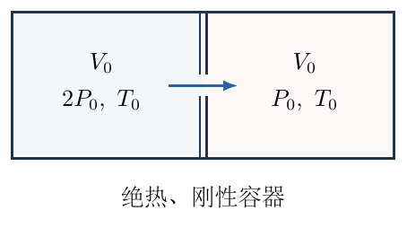{ width=85% }

## 一、题型定位

这是绝热开口系统的放气问题。两容器整体没有质量交换、没有对外热交换、没有边界体积功，因此整体内能守恒；但左室单独有气体流出，摩尔数变化，不能把固定几何体积 $V_0$ 直接代入定量气体的绝热方程。需要追踪最终留在左室的同一团气体，或使用包含流出焓的开口系统能量关系。

## 二、知识点

1. 理想气体状态方程与摩尔数守恒；
2. 定量气体绝热关系的适用对象；
3. 固定物质气团的等效绝热膨胀；
4. 开口系统中流出气体携带的焓；
5. 同种理想气体内能与压强、容积的关系；
6. 压强平衡与温度平衡的区别。

## 三、物理图像

左室失去气体，同时降温；右室得到气体及其携带的能量，温度升高。压强相等时，两室体积虽然相同，但温度并不相同，因而摩尔数也不相同。只用“等压、等体积”得出等摩尔数，实际偷偷加入了等温这一未成立条件。

按题目给定绝热关系采用缓慢、各室近似均匀、忽略整体流动动能的理想放气模型。这里的“小孔”不另解释为需要分子速度分布选择效应的真空分子束逸出孔。模型的终点是压差驱动阶段结束时的机械平衡；不是在此后无限等待直到一切交换使两侧完全热平衡。

## 四、解题入口

第一步求总摩尔数，第二步用左室状态方程表示 $n_L$。求温度时选定最终仍在左室的 $n_L$ 摩尔气体：这部分物质初始只占左室的一部分体积 $V_i$，后来占满 $V_0$，可对这同一气团应用绝热式。最后将整体内能写成 $C_V(P_LV_0+P_RV_0)/R$，无需先求右侧温度便可确定终态共同压强。

## 五、解析

（1）设 $R$ 为摩尔气体常量。两侧初始摩尔数分别由状态方程给出

$$
n_{L0}=\frac{2P_0V_0}{RT_0},\qquad
n_{R0}=\frac{P_0V_0}{RT_0}.
$$

整个装置与外界没有气体交换，故总摩尔数恒为

$$
n_{\rm tot}=n_{L0}+n_{R0}
=\frac{3P_0V_0}{RT_0}.
$$

任意时刻左侧仍占据固定几何体积 $V_0$，所以

$$
PV_0=n_LRT,
\qquad
\boxed{n_L=\frac{PV_0}{RT}}.
$$

用总摩尔数减去左侧摩尔数，

$$
\boxed{n_R=
\frac{3P_0V_0}{RT_0}-\frac{PV_0}{RT}.}
$$

这里右侧气体温度尚未知，不能在右侧状态方程中继续使用初始 $T_0$；摩尔数守恒绕过了这一未知量。

（2）由热容求绝热指数，

$$
\begin{aligned}
C_P&=C_V+R=\frac52R,\\
\gamma&=\frac{C_P}{C_V}=\frac{5/2}{3/2}=\frac53.
\end{aligned}
$$

图7-2用阴影标出“最终留在左室的同一团气体”。在初始左室中，这 $n_L$ 摩尔气体所占的等效体积是 $V_i$；到所考察时刻，它占据整个左室 $V_0$。虚线是用来定义研究对象的物质边界，不是一块真实插入的活塞。

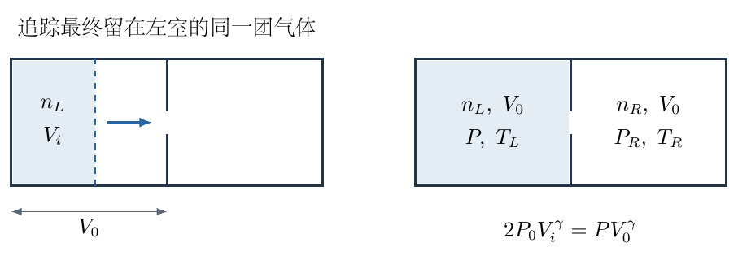{ width=97% }

该气团初态满足

$$
2P_0V_i=n_LRT_0.
$$

故

$$
V_i=\frac{n_LRT_0}{2P_0}.
$$

在题设的缓慢绝热放气模型中，这团最终留下的气体等效作绝热膨胀，定量气体关系应写为

$$
2P_0V_i^\gamma=PV_0^\gamma.
$$

不是 $2P_0V_0^\gamma=PV_0^\gamma$。后一个错误式子将强迫 $P=2P_0$ 不变，原因正是把“固定容器体积”误当成“同一团气体初始体积”。

把 $V_i$ 代入，并用第（1）问的 $n_L=PV_0/(RT)$，

$$
\begin{aligned}
V_i
&=\frac{PV_0}{RT}\frac{RT_0}{2P_0}\\
&=V_0\frac{PT_0}{2P_0T}.
\end{aligned}
$$

于是绝热式成为

$$
2P_0V_0^\gamma
\left(\frac{PT_0}{2P_0T}\right)^\gamma
=PV_0^\gamma.
$$

约去 $V_0^\gamma$，两侧再除以 $2P_0$：

$$
\left(\frac{PT_0}{2P_0T}\right)^\gamma
=\frac{P}{2P_0}.
$$

各量均为正，取 $1/\gamma$ 次方，

$$
\frac{PT_0}{2P_0T}
=\left(\frac{P}{2P_0}\right)^{1/\gamma}.
$$

解出温度，

$$
\frac T{T_0}
=\left(\frac{P}{2P_0}\right)^{1-1/\gamma}.
$$

因为 $1-1/\gamma=1-3/5=2/5$，所以

$$
\boxed{T=T_0\left(\frac{P}{2P_0}\right)^{2/5}}.
$$

左侧压强从 $2P_0$ 降低时，括号小于一，温度低于 $T_0$，符合放气冷却的物理图像。反过来若误把指数写成 $-2/5$，就会预测放气过程中左室升温。

将温度结果代入摩尔数，还可得到便于后续计算的形式。令

$$
A_0=\frac{P_0V_0}{RT_0},\qquad p=\frac{P}{2P_0}.
$$

其中 $A_0$ 有摩尔量纲，$p$ 无量纲。则

$$
\begin{aligned}
n_L
&=\frac{2P_0pV_0}{RT_0p^{2/5}}
=2A_0p^{3/5},\\
n_R&=A_0(3-2p^{3/5}).
\end{aligned}
$$

因此左侧摩尔数变化满足

$$
\boxed{\frac{n_L}{n_{L0}}=p^{1/\gamma}}.
$$

这也能直接由固定气团的初始体积分数 $V_i/V_0=n_L/n_{L0}$ 推得，构成同一计算的第二条路径。

再用开口系统能量方程独立验证。取左室为固定控制体，其内能为 $U_L=n_LC_VT$。设一个短时间内流出 $-dn_L>0$ 摩尔气体。每摩尔流出气体不仅携带内能 $C_VT$，还包含推动流体通过出口所需的流动功 $RT$，总计焓 $C_PT$。因此

$$
d(n_LC_VT)=C_PT\,dn_L,
\qquad dn_L<0.
$$

右端为负，表示能量流出。将左端展开，

$$
C_Vn_L\,dT+C_VT\,dn_L=C_PT\,dn_L.
$$

移项，并用 $C_P-C_V=R$，

$$
C_Vn_L\,dT=RT\,dn_L.
$$

分离变量后

$$
\frac{dT}{T}=\frac{R}{C_V}\frac{dn_L}{n_L}
=(\gamma-1)\frac{dn_L}{n_L}.
$$

从初态积分，

$$
\ln\frac T{T_0}=(\gamma-1)\ln\frac{n_L}{n_{L0}},
\qquad
\frac T{T_0}=\left(\frac{n_L}{n_{L0}}\right)^{\gamma-1}.
$$

状态方程在固定容积下又给

$$
\frac P{2P_0}
=\frac{n_L}{n_{L0}}\frac T{T_0}
=\left(\frac{n_L}{n_{L0}}\right)^\gamma.
$$

消去摩尔数比，再次得到 $T/T_0=(P/2P_0)^{(\gamma-1)/\gamma}$。这说明前面的等效气团法与开口系统能量法一致，也说明只计算流出内能而漏掉流动功会得到错误的温度规律。

（3）整个双室装置绝热且刚性，没有外界热量或体积功，故总内能守恒。由于两室装同种气体，热容相同，

$$
U_{\rm tot}=C_V(n_LT_L+n_RT_R).
$$

分别对两侧使用状态方程，$n_LT_L=P_LV_0/R$、$n_RT_R=P_RV_0/R$，得到

$$
U_{\rm tot}=\frac{C_VV_0}{R}(P_L+P_R).
$$

初始 $P_L+P_R=3P_0$，因此在所用模型下任意时刻都有

$$
P_L+P_R=3P_0.
$$

压强刚相等时令 $P_L=P_R=P_f$，于是

$$
2P_f=3P_0,\qquad
\boxed{P_f=\frac32P_0}.
$$

这一步没有假设终态等温。共同压强来自总内能及等体积，而不是把初始压强平均当作无条件经验公式；若两气体热容或容积不同，需重新列内能方程。

代入左侧温度式，

$$
\boxed{T_{Lf}=T_0\left(\frac34\right)^{2/5}}.
$$

相应摩尔数为

$$
\begin{aligned}
n_{Lf}
&=\frac{(3P_0/2)V_0}{RT_0(3/4)^{2/5}}\\
&=2A_0\left(\frac34\right)^{3/5},\\
n_{Rf}
&=A_0\left[3-2\left(\frac34\right)^{3/5}\right].
\end{aligned}
$$

为避免混淆 $n_L:n_R$ 与单个数值，先写出完整比例，

$$
\boxed{
n_L:n_R=
2(3/4)^{3/5}:
\left[3-2(3/4)^{3/5}\right].}
$$

两边同除以右侧系数，可得

$$
\boxed{\frac{n_L}{n_R}\approx1.28,\qquad n_L:n_R\approx1.28:1.}
$$

左室最终仍有更多摩尔气体，并不违反左室曾向右流气：初始比值为 $2:1$，终态降到约 $1.28:1$，左室确实失去了一部分气体，但无需失去到两室摩尔数完全相等才达到等压。

为核验这个解释，求右侧终温：

$$
\frac{T_{Rf}}{T_0}
=\frac{3/2}{3-2(3/4)^{3/5}}>1.
$$

由于等压、等容积，必有

$$
n_{Lf}T_{Lf}=n_{Rf}T_{Rf},
\qquad
\frac{n_{Lf}}{n_{Rf}}=\frac{T_{Rf}}{T_{Lf}}.
$$

较冷的左室确实需要更多摩尔数才能与较热的右室保持相同压强。把计算出的两温度代入这条比值关系，应得到同一个约 $1.28$，这是一项不依赖总内能形式的独立状态方程检查。

再核对转移量：

$$
\Delta n=n_{L0}-n_{Lf}
=2A_0\left[1-(3/4)^{3/5}\right]>0.
$$

右侧的增加量

$$
n_{Rf}-n_{R0}
=A_0[3-2(3/4)^{3/5}-1]
=\Delta n,
$$

质量守恒完全一致。初态 $P=2P_0$ 时温度式回到 $T_0$，两摩尔数回到 $2A_0,A_0$，也没有引入错误积分常量。

必须区分“此刻压强相等”和“无限长时间后的完全热平衡”。本问按压差驱动的绝热放气模型求前者，因此 $T_{Lf}\ne T_{Rf}$。如果继续允许足够长时间的跨孔热与粒子交换，最终两侧同种气体达到共同温度，则刚性绝热整体的总内能会使该共同温度为 $T_0$，等压等容积时摩尔数比成为 $1:1$。这属于后续的另一过程，不能拿它替换题目给定绝热路径的终点。

## 六、关键洞察

绝热方程写的是一团固定气体的状态变化，不是一个容器名字的状态变化。左室边界虽固定，内部物质在变化；要使用闭口公式，就必须重新挑出同一批物质并求它的初始占据体积。图7-2的阴影是这一研究对象转换的核心。

总内能可以通过 $PV$ 表达，是同种理想气体、相同摩尔热容带来的简化。它允许在不知道各室温度的情况下求共同压强，再回头用各室路径关系求温度和摩尔数。整体守恒与局部过程方程各解决不同未知量，不能互相替代。

## 七、易错点

对整个左室直接写 $PV_0^\gamma=\text{常量}$ 会把压强强制设为不变，明显与漏气过程冲突。发现这一矛盾时，应检查研究对象是否定量，而不是修改绝热指数来凑结果。

右侧不是一团定量气体作同样的绝热膨胀，它接收物质和能量，不能给左右两侧分别套相同的 $P^{1-\gamma}T^\gamma$ 常量式。

等压不自动等温，等压等容积也不自动等摩尔数。必须把温度写在状态方程中，不能用日常对平衡的印象替代所问时刻的严格条件。

## 八、课堂讲解建议

课堂先区分三个对象：整个装置、左侧固定容器、最终留在左侧的固定气团。让学生分别判断质量是否固定、体积是否固定、能否直接用闭口绝热式。

教师用阴影图说明 $V_i$ 的含义，再按状态方程—绝热关系—整体内能的顺序求解。板书最后将左右终态温度并列，要求学生用等压关系解释为什么冷的一侧摩尔数更多。

## 九、变式训练

把两侧初压改为 $aP_0,bP_0$，其中 $a>b>0$，仍同温、同体积、同种理想气体，绝热指数为 $\gamma$。求压差刚消失时的摩尔数比。

整体内能守恒给

$$
P_f=\frac{a+b}{2}P_0.
$$

初始左室摩尔数为 $aA_0$，左室绝热放气关系给

$$
n_{Lf}=aA_0
\left(\frac{a+b}{2a}\right)^{1/\gamma}.
$$

总摩尔数为 $(a+b)A_0$，故

$$
\boxed{\frac{n_{Lf}}{n_{Rf}}=
\frac{a[(a+b)/(2a)]^{1/\gamma}}
{a+b-a[(a+b)/(2a)]^{1/\gamma}}.}
$$

取 $a=2,b=1,\gamma=5/3$ 恢复本题；令 $a\to b$，括号趋于一，比例趋于 $1:1$，与没有初始压差的极限一致。

\newpage

# 第 8 题

黄俏站在固定位置，每隔 $\Delta t$ 以速度 $v_0$ 向前抛出一个小球。一个球拍以相对黄俏的恒定速度 $u$ 迎面运动，且 $v_0=u=c/2$，其中 $c$ 为光速。球在球拍静止参考系中反弹前后速率相同、方向相反。忽略重力，以下各量均在黄俏参考系中求解。

（1）黄俏每隔多长时间接到一个反弹回来的球？

（2）若每个球的静质量均为 $m$，为保持球拍匀速运动，长时间内施加于球拍的平均作用力是多少？

（3）求上述外力的平均功率。

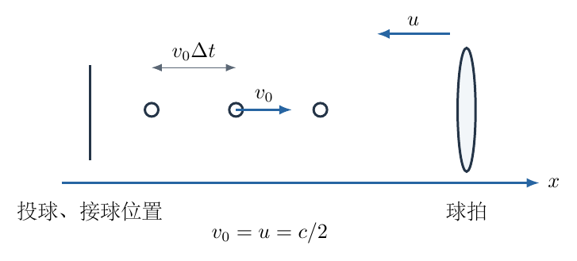{ width=94% }

## 一、题型定位

这是一维相对论弹性反射与事件频率问题。先用两次速度变换求反弹球在实验室系的速度，再分别计算连续碰撞的时间间隔与连续回收的时间间隔。平均外力由每次碰撞的动量变化乘碰撞频率决定，平均功率可由外力乘球拍速度，也可用球获得的能量乘碰撞频率独立验证。

## 二、知识点

1. 一维洛伦兹速度变换；
2. 在球拍静止系中等速反向的碰撞条件；
3. 同一参考系内的世界线交点和事件时间差；
4. 相对论动量 $p=\gamma mv$、能量 $\mathcal E=\gamma mc^2$；
5. 冲量、事件频率和平均作用力；
6. 功率 $P=Fv$ 的方向符号与能量检验。

## 三、物理图像

取抛球方向为 $+x$。球在碰撞前以 $+v_0$ 运动，球拍以 $-u$ 运动。球拍迎面而来，反弹球在实验室系中的回程速率会大于 $v_0$，但必须小于 $c$。每次球拍把球更猛烈地送回时，也受到向前的冲量；保持它继续向后匀速，需要外力施加向后的补偿冲量。

这里存在三种不同节奏：抛出节奏 $\Delta t$、撞拍节奏 $\Delta t_c$、回收节奏 $\Delta t_r$。球拍不断靠近，碰撞间隔小于抛球间隔；后一只反弹球又在更靠近投球点的位置出发，因此回收间隔比碰撞间隔还小。三个节奏不可互换。

## 四、解题入口

记实验室系为 $S$，球拍静止系为 $S'$。在 $S$ 中球拍速度是 $V=-u$。先把入射速度 $v_0$ 变到 $S'$，在该系中反向，再变回 $S$。反弹速度记为 $-w$，其中 $w>0$。得到 $w$ 后，用两条相邻球的碰撞事件坐标求 $\Delta t_r$。计算外力时则返回 $\Delta t_c$，不能使用第（1）问的回收间隔。

## 五、解析

（1）在速度变换中始终保留方向。参考系 $S'$ 相对 $S$ 的速度为 $V=-u$，所以入射球在 $S'$ 中的速度为

$$
v'_{\rm in}=\frac{v_0-V}{1-v_0V/c^2}
=\frac{v_0+u}{1+v_0u/c^2}.
$$

将 $v_0=u=c/2$ 代入，

$$
\begin{aligned}
v'_{\rm in}
&=\frac{c/2+c/2}{1+(1/2)(1/2)}\\
&=\frac{c}{5/4}=\frac45c.
\end{aligned}
$$

分子 $v_0+u=c$ 是同一实验室系中两者坐标距离的缩短率，不是球拍系测得的球速；真正的相对速度必须带洛伦兹分母，因此是 $4c/5$。

题设的反弹规律在 $S'$ 中写为

$$
v'_{\rm out}=-v'_{\rm in}=-\frac45c.
$$

从 $S'$ 变回实验室系，使用逆变换

$$
v_{\rm out}=\frac{v'_{\rm out}+V}{1+v'_{\rm out}V/c^2}.
$$

逐步代入两个负速度，

$$
\begin{aligned}
v_{\rm out}
&=\frac{-4c/5-c/2}{1+(-4/5)(-1/2)}\\
&=\frac{-13c/10}{1+2/5}\\
&=-\frac{13c}{10}\frac57=-\frac{13}{14}c.
\end{aligned}
$$

因此回程速率为

$$
\boxed{w=\frac{13}{14}c<c.}
$$

如果使用伽利略相加，会得到 $v_0+2u=3c/2$，明显超光速；这也提示本题不能在第二次变换时只做普通加减。

为了核验代数结构，保留一般 $v_0,u$ 可以得到

$$
w=\frac{v_0+2u+v_0u^2/c^2}
{1+2v_0u/c^2+u^2/c^2}.
$$

该式来自把 $v'_{\rm out}=-(v_0+u)/(1+v_0u/c^2)$ 代入逆变换并通分。低速时分母趋于一，才近似还原为 $v_0+2u$。

把通分过程写清楚，可以同时检查所有速度交叉项。令 $b_0=v_0/c$、$b=u/c$，入射球在球拍系中的无量纲速度为 $a'=(b_0+b)/(1+b_0b)$。反向后变回实验室系，其回程速率满足

$$
\begin{aligned}
\frac wc
&=\frac{a'+b}{1+a'b}\\
&=\frac{(b_0+b)/(1+b_0b)+b}
{1+b(b_0+b)/(1+b_0b)}\\
&=\frac{b_0+b+b(1+b_0b)}
{1+b_0b+b(b_0+b)}\\
&=\frac{b_0+2b+b_0b^2}{1+2b_0b+b^2}.
\end{aligned}
$$

分母减去分子还可以因式分解：

$$
1+2b_0b+b^2-(b_0+2b+b_0b^2)
=(1-b_0)(1-b)^2.
$$

只要 $0\leq b_0<1$、$0\leq b<1$，右侧为正，便严格证明 $w<c$，不是仅凭本题数值恰好小于光速。另一个需要的条件是回球比球拍更快，否则它不能顺利脱离球拍返回。计算

$$
\begin{aligned}
\frac wc-b
&=\frac{b_0+2b+b_0b^2-b(1+2b_0b+b^2)}
{1+2b_0b+b^2}\\
&=\frac{(b_0+b)(1-b^2)}{1+2b_0b+b^2}>0.
\end{aligned}
$$

所以对于非零入射或迎面运动，必有 $w>u$。后面出现的回收间隔因子 $1-u/w$ 因而为正，不会导致后一球先于前一球回收的次序颠倒。这个不等式把相对论速度变换与事件几何的适用条件连接起来。

接下来计算事件时间。图8-2采用横轴 $x$、纵轴 $ct$。两条入射线从投球位置在相隔 $\Delta t$ 的时刻出发，与向左运动的球拍世界线相交于 $C_1,C_2$。反射线斜率对应回程速率 $w$，它们与竖直的投球位置线相交，给出回收时刻。

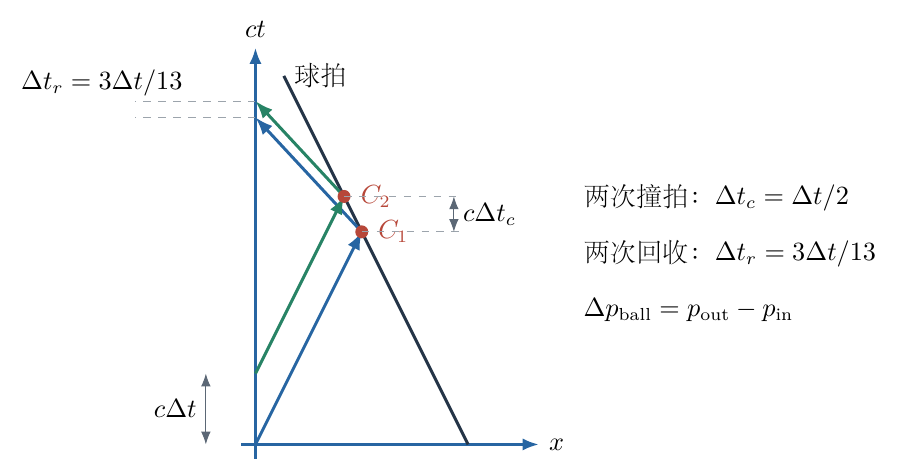{ width=97% }

设在某初始时刻球拍坐标为 $D>0$，第 $n$ 个球于 $t_n=n\Delta t$ 从 $x=0$ 抛出。其碰撞前世界线和球拍世界线分别为

$$
x_n(t)=v_0(t-n\Delta t),\qquad
x_{\rm racket}(t)=D-ut.
$$

在碰撞时刻 $t_{c,n}$ 两者相等：

$$
v_0(t_{c,n}-n\Delta t)=D-u t_{c,n}.
$$

把含 $t_{c,n}$ 的项移到同一侧，

$$
(v_0+u)t_{c,n}=D+v_0n\Delta t,
$$

因此

$$
t_{c,n}=\frac{D+v_0n\Delta t}{v_0+u}.
$$

相邻相减，初始距离 $D$ 消去：

$$
\boxed{\Delta t_c=t_{c,n+1}-t_{c,n}
=\frac{v_0}{v_0+u}\Delta t=\frac12\Delta t.}
$$

这里使用 $v_0+u$ 完全合法，因为所有坐标和时间都在同一实验室系中，求的是两条世界线何时相交。它不同于前面把一个速度变到另一参考系的运算，不应把这项闭合速度再套一次相对论速度加法。

碰撞位置是

$$
x_{c,n}=D-u t_{c,n}.
$$

反弹后小球以速率 $w$ 返回原点，所需回程时间为 $x_{c,n}/w$。故回收时刻

$$
\begin{aligned}
t_{r,n}
&=t_{c,n}+\frac{x_{c,n}}w\\
&=\left(1-\frac uw\right)t_{c,n}+\frac Dw.
\end{aligned}
$$

相邻两次回收相减，得到

$$
\Delta t_r=\left(1-\frac uw\right)\Delta t_c.
$$

代入 $u=c/2,w=13c/14$，

$$
\begin{aligned}
1-\frac uw
&=1-\frac{1/2}{13/14}
=1-\frac7{13}=\frac6{13},\\
\Delta t_r&=\frac6{13}\frac{\Delta t}{2}.
\end{aligned}
$$

所以第（1）问答案是

$$
\boxed{\Delta t_r=\frac3{13}\Delta t.}
$$

也可直接用空间间距检查。两次碰撞间第一只反弹球向左走 $w\Delta t_c$，球拍向左走 $u\Delta t_c$，所以第二只球刚反弹时，两只回程球之间的距离是

$$
\Delta x=(w-u)\Delta t_c.
$$

它们随后以同一速率 $w$ 返回，回收间隔是 $\Delta x/w$，恰为上式。这项几何解释与图中两条反射世界线平行的事实一致。

还可检查低速极限，此时 $w\simeq v_0+2u$。回收间隔中的因子变为
$1-u/w\simeq(v_0+u)/(v_0+2u)$，再乘以撞拍间隔
$v_0\Delta t/(v_0+u)$，约去共同因子后得到
$\Delta t_r\simeq v_0\Delta t/(v_0+2u)$。若 $u=0$，回收间隔恢复为原抛球间隔 $\Delta t$；这项极限与世界线几何和速度变换同时吻合。

（2）求每次碰撞的动量变化。先按洛伦兹因子的定义，分别代入入射速率 $c/2$ 与反弹速率 $13c/14$：

$$
\begin{aligned}
\gamma(v)&=\frac1{\sqrt{1-v^2/c^2}},\\
\gamma_{\rm in}&=\frac1{\sqrt{1-1/4}}=\frac2{\sqrt3},\\
\gamma_{\rm out}&=\frac1{\sqrt{1-169/196}}
=\frac1{\sqrt{27/196}}=\frac{14}{3\sqrt3}.
\end{aligned}
$$

有符号动量分别为

$$
p_{\rm in}=\frac2{\sqrt3}m\frac c2=\frac{mc}{\sqrt3},
$$

$$
p_{\rm out}=\frac{14}{3\sqrt3}m\left(-\frac{13c}{14}\right)
=-\frac{13mc}{3\sqrt3}.
$$

球的动量变化必须用“后减前”：

$$
\begin{aligned}
\Delta p_{\rm ball}
&=p_{\rm out}-p_{\rm in}\\
&=-\frac{13mc}{3\sqrt3}-\frac{mc}{\sqrt3}\\
&=-\frac{16mc}{3\sqrt3}
=-\frac{16\sqrt3}{9}mc.
\end{aligned}
$$

球得到向左冲量，球拍从球得到同样大小的向右冲量。若球拍速度必须保持 $-u$ 不变，则维持装置施加的外冲量应抵消这一向右冲量：

$$
J_{\rm ext}=\Delta p_{\rm ball}
=-\frac{16\sqrt3}{9}mc.
$$

单位时间内作用在球拍上的碰撞次数是 $1/\Delta t_c$，不是回收次数 $1/\Delta t_r$。因此平均外力为

$$
\begin{aligned}
\overline F_{\rm ext}
&=\frac{J_{\rm ext}}{\Delta t_c}\\
&=-\frac{16\sqrt3}{9}mc\,\frac{2}{\Delta t}.
\end{aligned}
$$

完整的方向答案是

$$
\boxed{\overline{\mathbf F}_{\rm ext}
=-\frac{32\sqrt3}{9}\frac{mc}{\Delta t}\,\mathbf e_x.}
$$

即平均力大小为 $32\sqrt3\,mc/(9\Delta t)$，方向与球拍运动方向相同，指向黄俏。外力虽与球拍速度同向，仍是“保持匀速”所需，因为它抵消球不断给予球拍的反向冲量。

为什么不能用第（1）问的间隔？外力施加的事件发生在球拍上，而回收事件发生在另一位置，两串事件的发生时刻不同。球拍持续靠近使传播时延逐次缩短，所以接收事件频率被进一步压缩。把回收频率拿来计算球拍受力，相当于把传播时间变化误当成球拍单位时间承受更多碰撞。

（3）球拍在实验室系速度恒定为 $-u$，因此外力平均功率为

$$
\overline P_{\rm ext}
=\overline F_{\rm ext}(-u).
$$

两个负号相消，说明外界持续向系统输入能量。代入 $u=c/2$，

$$
\boxed{\overline P_{\rm ext}
=\frac{16\sqrt3}{9}\frac{mc^2}{\Delta t}.}
$$

再用球的能量变化独立验证。先分别计算入射、出射能量，再用后者减去前者，逐项得到

$$
\begin{aligned}
\mathcal E_{\rm in}&=\frac2{\sqrt3}mc^2,\\
\mathcal E_{\rm out}&=\frac{14}{3\sqrt3}mc^2,\\
\Delta\mathcal E
&=\left(\frac{14}{3\sqrt3}-\frac2{\sqrt3}\right)mc^2\\
&=\frac8{3\sqrt3}mc^2
=\frac{8\sqrt3}{9}mc^2.
\end{aligned}
$$

以撞拍频率平均，并同时检查每次碰撞的功与冲量关系：

$$
\begin{aligned}
\frac{\Delta\mathcal E}{\Delta t_c}
&=\frac{8\sqrt3}{9}mc^2\frac2{\Delta t}
=\frac{16\sqrt3}{9}\frac{mc^2}{\Delta t},\\
(-u)\Delta p_{\rm ball}
&=\left(-\frac c2\right)\left(-\frac{16\sqrt3}{9}mc\right)
=\Delta\mathcal E.
\end{aligned}
$$

第二行说明球拍速度乘冲量等于传递给球的能量，同时核对速度变换、动量符号和碰撞频率；任一出错都会破坏这项一致性。

“长时间平均”指包含许多次碰撞、球拍尚未越过投球点的工作区间，并忽略起止时少数事件。初始距离有限，球拍最终会经过投球位置，故当前几何布置不能无条件延续至无限长时间。

量纲上，$mc/\Delta t$ 是力，$mc^2/\Delta t$ 是功率。若球拍静止，球反弹前后能量不变；维持球拍的外力可不为零，但由 $P=Fv$ 可知功率为零。因此有冲量不等于有能量输入。

## 六、关键洞察

本题有两类速度运算：跨参考系测量的速度要用洛伦兹变换，同一参考系中两个位置的变化率可以普通相减。区分二者，既能防止超光速的错误相加，也能避免在世界线相交问题中多加一个不该有的洛伦兹分母。

在球拍系等速反弹，只表示该系中球的动能不变，并不意味着实验室系中能量不变。运动球拍能够传递能量；维持装置补偿球拍的动量损失，正是反弹球额外能量的来源。

三个时间间隔分别属于发射、作用和接收位置。平均受力与平均能流必须使用它们实际发生位置上的事件频率。频率选择是物理建模的一部分，不是代数细节。

用能量—动量的直接变换还可以得到一般的单次反射关系。记入射球在实验室系中的能量和动量为 $\mathcal E,p$，球拍速度仍为 $-u$，并记 $\Gamma=1/\sqrt{1-u^2/c^2}$。变换到球拍系，

$$
\mathcal E'=\Gamma(\mathcal E+up),\qquad
p'=\Gamma\left(p+\frac{u\mathcal E}{c^2}\right).
$$

反射使 $p'\mapsto-p'$，而 $\mathcal E'$ 不变。再变回实验室系，

$$
\mathcal E_{\rm out}=\Gamma(\mathcal E'+up'),
\qquad
p_{\rm out}=-\Gamma\left(p'+\frac{u\mathcal E'}{c^2}\right).
$$

逐项代入得到

$$
\mathcal E_{\rm out}
=\Gamma^2\left[\left(1+\frac{u^2}{c^2}\right)\mathcal E+2up\right],
$$

$$
p_{\rm out}
=-\Gamma^2\left[\left(1+\frac{u^2}{c^2}\right)p
+\frac{2u\mathcal E}{c^2}\right].
$$

利用 $\Gamma^2-1=\Gamma^2u^2/c^2$，分别减去入射能量和动量：

$$
\Delta\mathcal E
=2\Gamma^2\left(\frac{u^2\mathcal E}{c^2}+up\right),
$$

$$
\Delta p=-2\Gamma^2\left(p+\frac{u\mathcal E}{c^2}\right).
$$

因此恒有 $\Delta\mathcal E=-u\Delta p$，与主解逐次功率检验一致。这条推导不依赖本题 $v_0=u=c/2$ 的特殊数值，说明功与冲量之间的一致性来自同一个运动边界的洛伦兹变换。它还能用于检查不同入射速度的带解变式，而不必每次重新化简两个不同的洛伦兹因子。

## 七、易错点

第二次速度变换时，球在球拍系已经反向，必须写成负速度；如果只把速率代回公式，会得到错误方向甚至相同的原速度。

相对论动量是 $\gamma mv$，入射与出射的 $\gamma$ 不同。不能把一个共同的“相对论质量”提出动量差，更不能使用牛顿公式 $m(v_{\rm out}-v_{\rm in})$。

第（2）问用的是 $\Delta t_c=\Delta t/2$，第（1）问得到的是 $\Delta t_r=3\Delta t/13$。两者若混用，平均力和能量功率核验会立即不一致。

## 八、课堂讲解建议

课堂用两列分别标记实验室系和球拍系，只在球拍系列执行“速度变号”。教师完成两次变换后，再另画时空图处理间隔，不在参考系变换过程中掺入碰撞计数。

板书将三种时间间隔用不同下标固定下来，计算平均力前让学生指明分母对应哪一串事件。最终同时用 $Fv$ 和球能量增量求功率，要求两个答案精确相同，而不是只比较数量级。

## 九、变式训练

球拍静止，即 $u=0$，投球速率仍为 $c/2$，其余条件不变。求回收间隔、维持球拍静止的平均外力和功率。

球拍系就是实验室系，所以反弹速度直接为 $-c/2$。两次碰撞和两次回收都保持原间隔：

$$
\Delta t_c=\Delta t_r=\Delta t.
$$

入射动量为 $mc/\sqrt3$，反弹动量为 $-mc/\sqrt3$，故

$$
\Delta p_{\rm ball}=-\frac{2mc}{\sqrt3}.
$$

维持静止所需外力为

$$
\boxed{\overline{\mathbf F}_{\rm ext}
=-\frac{2mc}{\sqrt3\,\Delta t}\mathbf e_x},
\qquad
\boxed{\overline P_{\rm ext}=0}.
$$

球拍受力并不为零，但其作用点没有位移，外力不做功；球在实验室系也没有能量增量。这是检查原题动量和能量概念是否真正分开的最简单极限。
