# 第 1 题

一根长度为 $L$、质量为 $m$ 的均匀细杆，其中点放在长度为 $l$ 的固定底座中央，且 $l\ll L$。底座仅以左右两个端点与杆接触；杆在底座上既不滑动，也不会掉落。初始时使杆绕左支承端转过小角度 $\varphi_0$，然后由静止释放，杆始终在竖直平面内运动。

（1）若每次与支承端的碰撞均为完全弹性碰撞，求往复运动周期；

（2）若碰撞恢复系数为 $e=1-\delta$，其中 $\delta\ll1$，求杆的最大转角衰减到初始值一半时所经历的碰撞次数。

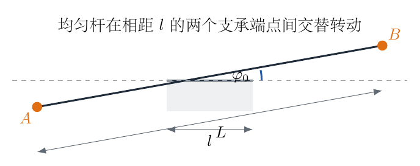{ width=82% }

## 一、题型定位

本题是“分段定轴转动—瞬时碰撞—周期拼接”模型。支承端间距远小于杆长，因此杆绕某一端点转动时，重力矩在小角范围内近似为常量，角位移随时间呈抛物线而非简谐函数。杆到达水平位置时另一支承端发生碰撞，完全弹性碰撞把运动镜像延续；非完全弹性时则按恢复系数逐次损失碰撞法向动能。

## 二、知识点

1. 均匀细杆绕质心和偏置轴的转动惯量；
2. 小角度下重力矩的常量近似；
3. 匀角加速度转动；
4. 碰撞瞬间的能量、角动量与恢复系数；
5. 线性势能下振幅与机械能成正比；
6. $\ln(1-x)$ 的小量展开。

## 三、物理图像

设底座左、右支承端分别为 $P,Q$，杆质心为 $C$。杆向右上方倾斜时只绕 $P$ 转动；到达水平位置后，$Q$ 与杆发生瞬时碰撞并成为下一段运动的支承端。由于 $l\ll L$，质心到支承端的距离约为 $l/2$，而杆绕支承端的转动惯量主要由 $mL^2/12$ 决定。

完全弹性情形如图1-2所示，一个周期由四段相同的“极限位置到水平位置”运动组成。

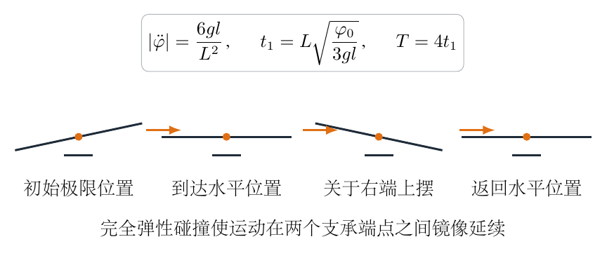{ width=96% }

## 四、解题入口

先只研究杆绕左端点 $P$ 从 $\varphi_0$ 落到水平的过程。计算关于 $P$ 的重力矩和转动惯量，得到恒定角加速度，再求四分之一周期 $t_1$。完全弹性碰撞只改变下一段的支承端，不改变运动幅度；非完全弹性情形则比较碰撞前后最大势能，从而直接得到振幅的递推式。

## 五、解析

杆绕左支承端 $P$ 转动时，质心到 $P$ 的距离为 $l/2$。均匀杆绕质心的转动惯量为

$$
I_C=\frac{1}{12}mL^2. \tag{1}
$$

由平行轴定理，绕 $P$ 的转动惯量为

$$
\begin{aligned}
I_P
&=I_C+m\left(\frac l2\right)^2\\
&=\frac{1}{12}mL^2+\frac14ml^2.
\end{aligned} \tag{2}
$$

因为 $l\ll L$，保留主项：

$$
I_P\simeq\frac{1}{12}mL^2. \tag{3}
$$

设杆相对水平面的转角为 $\varphi$。重力对 $P$ 的力矩大小为

$$
M_g=mg\frac l2\cos\varphi. \tag{4}
$$

小角度下 $\cos\varphi\simeq1$，且力矩使 $\varphi$ 减小，因此

$$
I_P\ddot\varphi=-mg\frac l2. \tag{5}
$$

代入式（3）：

$$
\begin{aligned}
\ddot\varphi
&=-\frac{mgl/2}{mL^2/12}\\
&=-\frac{6gl}{L^2}.
\end{aligned} \tag{6}
$$

记角加速度大小为

$$
a_\varphi=\frac{6gl}{L^2}. \tag{7}
$$

初态 $\varphi(0)=\varphi_0$、$\dot\varphi(0)=0$。匀角加速度运动给出

$$
\varphi(t)=\varphi_0-\frac12a_\varphi t^2. \tag{8}
$$

第一次到达水平位置时 $\varphi(t_1)=0$，所以

$$
\begin{aligned}
0&=\varphi_0-\frac12\frac{6gl}{L^2}t_1^2,\\
t_1^2&=\frac{\varphi_0L^2}{3gl}.
\end{aligned} \tag{9}
$$

因此

$$
\boxed{t_1=L\sqrt{\frac{\varphi_0}{3gl}}}. \tag{10}
$$

到达水平位置前的角速度由

$$
\dot\varphi^2=2a_\varphi\varphi_0 \tag{11}
$$

得到

$$
|\dot\varphi_-|
=\sqrt{\frac{12gl\varphi_0}{L^2}}. \tag{12}
$$

质心竖直速度的大小为

$$
|v_{C,-}|=\frac l2|\dot\varphi_-|. \tag{13}
$$

碰撞时间极短，重力冲量可以忽略。完全弹性碰撞保持机械能；同时以新接触点 $Q$ 为矩心，碰撞冲量对 $Q$ 的力矩为零，角动量守恒。左右支承端关于质心对称，因此碰撞后的状态与碰撞前状态关于竖直线镜像，速度大小不变，下一段运动绕 $Q$ 展开。

杆由水平位置上摆到另一侧最大角 $\varphi_0$ 所需时间仍为 $t_1$。从右侧最大角回到水平、再回到最初左侧最大角各需要一个 $t_1$。所以完整周期为

$$
T=4t_1. \tag{14}
$$

代入式（10）：

$$
\boxed{
T=4L\sqrt{\frac{\varphi_0}{3gl}}
}. \tag{15}
$$

这里周期依赖振幅 $\sqrt{\varphi_0}$，说明该运动不是简谐振动。原因是小角度下势能近似与 $|\varphi|$ 成正比，而不是与 $\varphi^2$ 成正比。

下面处理非完全弹性碰撞。恢复系数定义为碰撞点碰后法向分离速度与碰前法向接近速度之比，因此碰撞后相关速度分量变为原来的 $e$ 倍。对应动能变为

$$
E_{k,+}=e^2E_{k,-}. \tag{16}
$$

由于 $e=1-\delta$，

$$
e^2=(1-\delta)^2
=1-2\delta+\delta^2
\simeq1-2\delta. \tag{17}
$$

每次碰撞后，杆上摆到新的最大角。小角度下质心高度相对水平位置为

$$
h\simeq\frac l2|\varphi|, \tag{18}
$$

所以最大势能为

$$
E_{\max}=mgh
\simeq mg\frac l2|\varphi|. \tag{19}
$$

最大势能与最大转角成正比。因此一次碰撞后振幅满足

$$
\varphi_{n+1}=e^2\varphi_n. \tag{20}
$$

经历 $N$ 次碰撞后

$$
\varphi_N=e^{2N}\varphi_0. \tag{21}
$$

令 $\varphi_N=\varphi_0/2$：

$$
e^{2N}=\frac12. \tag{22}
$$

取自然对数：

$$
2N\ln e=-\ln2. \tag{23}
$$

精确写成

$$
N=\frac{\ln2}{-2\ln(1-\delta)}. \tag{24}
$$

利用

$$
\ln(1-\delta)=-\delta+O(\delta^2), \tag{25}
$$

得到

$$
\boxed{N\simeq\frac{\ln2}{2\delta}}. \tag{26}
$$

碰撞次数只能取整数。实际第一次不超过半振幅的次数应取式（24）的向上取整。

量纲检查：$L^2/(gl)$ 的量纲为时间平方，故式（15）为时间；式（26）只含无量纲量。极限上，$l$ 越小，重力力臂越短，周期越长；$\delta\to0$ 时衰减碰撞次数发散，均符合物理预期。

还可以不先作 $\cos\varphi\simeq1$ 的近似，用能量积分核对周期。绕固定支承点转动的一段内，精确重力矩方程为

$$
\begin{aligned}
I_P\ddot\varphi&=-mg\frac l2\cos\varphi,\\
I_P\ddot\varphi\,\dot\varphi
&=-mg\frac l2\cos\varphi\,\dot\varphi.
\end{aligned}
$$

第二行由第一行同乘 $\dot\varphi$ 得到。

左边是转动动能对时间的导数，右边是 $-mg(l/2)\sin\varphi$ 对时间的导数。由极限位置 $\varphi=\varphi_0$ 处 $\dot\varphi=0$ 积分到任意 $\varphi$，得

$$
\begin{aligned}
\frac12I_P\dot\varphi^2
&=mg\frac l2\left(\sin\varphi_0-\sin\varphi\right),\\
\dot\varphi^2
&=\frac{mgl}{I_P}\left(\sin\varphi_0-\sin\varphi\right),\\
|\dot\varphi|
&=\sqrt{\frac{mgl}{I_P}}\,
\sqrt{\sin\varphi_0-\sin\varphi}.
\end{aligned}
$$

最后一行取速度大小；下降过程中实际有 $\dot\varphi<0$。

所以从极限位置到水平位置的精确时间积分为

$$
\begin{aligned}
t_1
&=\sqrt{\frac{I_P}{mgl}}
\int_0^{\varphi_0}
\frac{\mathrm d\varphi}
{\sqrt{\sin\varphi_0-\sin\varphi}}\\
&\simeq\sqrt{\frac{I_P}{mgl}}
\int_0^{\varphi_0}\frac{\mathrm d\varphi}{\sqrt{\varphi_0-\varphi}}\\
&=\sqrt{\frac{I_P}{mgl}}\,2\sqrt{\varphi_0}\\
&=2\sqrt{\frac{I_P\varphi_0}{mgl}}.
\end{aligned}
$$

第二行使用 $\varphi_0\ll1$，第三行令 $u=\varphi_0-\varphi$ 完成积分。

代入 $I_P\simeq mL^2/12$ 后正好回到式（11）。这条能量路线还揭示了振幅递推的更精确形式。碰撞前极限位置的能量是

$$
\begin{aligned}
E_n&=mg\frac l2\sin\varphi_n,\\
mg\frac l2\sin\varphi_{n+1}
&=e^2mg\frac l2\sin\varphi_n,\\
\sin\varphi_{n+1}&=e^2\sin\varphi_n.
\end{aligned}
$$

第二行使用“碰撞后动能乘 $e^2$”，第三行约去公共因子。

只有在小角度下使用 $\sin\varphi\simeq\varphi$，才化成式（20）的 $\varphi_{n+1}=e^2\varphi_n$。因此“振幅乘 $e^2$”并非对任意大角度都精确成立；精确地按几何角度衰减的是 $\sin\varphi$。这一说明把碰撞恢复系数、机械能与转角三者的逻辑链完整闭合。

\newpage

# 第 2 题

比奥—萨伐尔的复仇：

（1）利用安培环路定理，求电流为 $I$ 的无限长直导线在距轴线 $r$ 处产生的磁感应强度。真空磁导率为 $\mu_0$；

（2）长度为 $L$、质量为 $m$ 的细铁棒与长直导线共面、初始平行，棒中点固定，可绕垂直于平面的轴转动。导线与棒中点距离为 $d$，棒中电流 $I'$ 与长直导线电流 $I$ 反向。求铁棒的小幅振动周期；

（3）电流 $I$ 沿轴线注入立体角为 $\Omega$ 的圆锥面，并沿圆锥表面均匀向外流动，求全空间磁场；

（4）电流 $I$ 垂直注入无限大导体平面，并在平面内径向流开，求平面两侧距轴线 $r$ 处的磁场；

（5）定义平面电流密度 $J=dI/dl$，证明磁场平行于平面的分量与 $J$ 成正比并求比例系数；

（6）无限大平面导体薄层两侧存在方向相同、大小分别为 $B_1,B_2$ 的平行磁场，求薄层承受的磁压；

（7）长直导线沿直径穿过导体球壳，两极连接半无限长导线，电流经导线和球壳表面流过，求磁场分布；

（8）半径为 $R$ 的均匀导体球，电流从北极沿表面均匀流到南极，再由球内轴线从南极流回北极。求赤道平面内距南北轴为 $r$ 处的磁场。

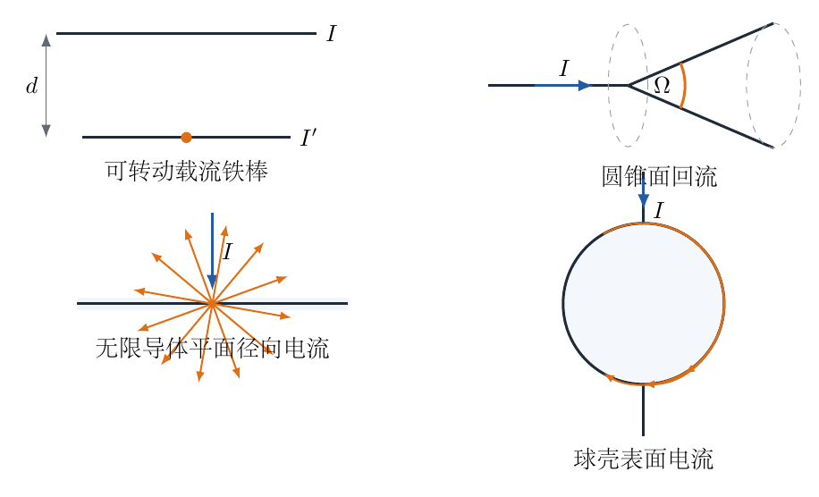{ width=97% }

## 一、题型定位

这是一道以安培环路定理为主线的综合磁场题。八个小问依次建立长直导线场、载流棒回复力矩、圆锥和无限平面的拓扑包围关系、面电流边界条件、磁压以及球面电流的叠加。核心不是逐点做毕奥—萨伐尔积分，而是识别轴对称性、选取闭合环路并判断包围电流。

## 二、知识点

1. 安培环路定理 $\oint\boldsymbol B\cdot d\boldsymbol l=\mu_0I_{\rm enc}$；
2. 长直导线的环向磁场；
3. 载流元安培力与小角回复力矩；
4. 面电流边界条件 $\boldsymbol B_+-\boldsymbol B_-=\mu_0\boldsymbol K\times\boldsymbol n$；
5. 磁压 $B^2/(2\mu_0)$；
6. 球面电流与完整长直导线的叠加；
7. 用场的分区结果检查回路包围电流。

## 三、物理图像

所有几何均绕一条轴具有旋转对称性，因此磁场只能沿以轴为中心的圆周切向。圆锥面或球面上的回流电流改变了安培环路所包围的净电流：有的区域包围 $I$，有的区域同时包围流入和流出，净值为零。无限平面的两侧则由镜面对称性平分磁场跃变。

图2-2把后续反复使用的两个结论画在一起：长直导线场按 $1/r$ 衰减；面电流引起切向磁场跳变，并由两侧平均场决定机械压力。

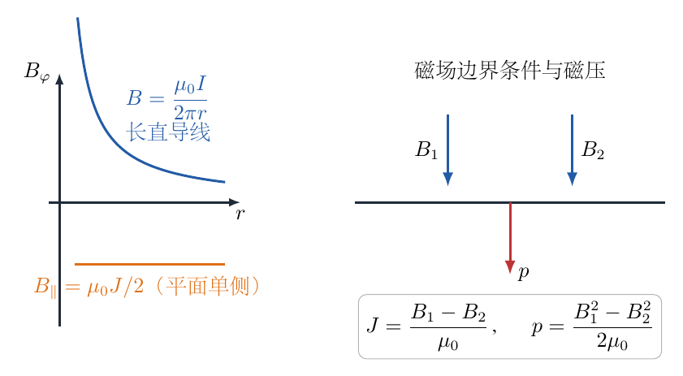{ width=94% }

## 四、解题入口

先固定统一记号：$r$ 表示到对称轴的垂直距离，$\boldsymbol e_\varphi$ 表示绕轴的环向单位矢量。每个小问先判断磁场方向，再选与磁场平行的圆形或矩形安培环路。第（2）问需把长直导线磁场沿细棒位置展开到转角的一阶；第（6）问应使用薄层内部的平均外场，而不能直接取某一侧总场。

## 五、解析

（1）取以长直导线为轴、半径为 $r$ 的圆形安培环路。由柱对称性，圆周上磁场大小处处相等，方向沿 $\boldsymbol e_\varphi$，所以

$$
\oint\boldsymbol B\cdot d\boldsymbol l
=B(r)\,2\pi r. \tag{1}
$$

环路包围电流为 $I$，安培环路定理给出

$$
B(r)\,2\pi r=\mu_0I. \tag{2}
$$

因此

$$
\boxed{
\boldsymbol B(r)=\frac{\mu_0I}{2\pi r}\boldsymbol e_\varphi
}. \tag{3}
$$

方向由右手螺旋定则确定。

（2）以铁棒中点为原点，沿棒取坐标 $x\in[-L/2,L/2]$。铁棒相对初始平行位置转过小角 $\theta$ 后，位置 $x$ 处到长直导线的距离为

$$
r(x)\simeq d-x\theta. \tag{4}
$$

长直导线在该处产生的磁场为

$$
B(x)=\frac{\mu_0I}{2\pi(d-x\theta)}. \tag{5}
$$

棒上长度元 $dx$ 中电流为 $I'$，安培力大小

$$
dF=I'B(x)\,dx. \tag{6}
$$

关于棒中点的力矩元为

$$
dM=-xI'B(x)\,dx. \tag{7}
$$

负号表示反向电流相互排斥时，近端受到更强推力，合力矩使 $\theta$ 回到零。对式（5）作一阶展开：

$$
\begin{aligned}
B(x)
&=\frac{\mu_0I}{2\pi d}
\left(1-\frac{x\theta}{d}\right)^{-1}\\
&\simeq\frac{\mu_0I}{2\pi d}
\left(1+\frac{x\theta}{d}\right).
\end{aligned} \tag{8}
$$

代入式（7）并积分：

$$
\begin{aligned}
M
&=-\frac{\mu_0II'}{2\pi d}
\int_{-L/2}^{L/2}
\left(x+\frac{x^2\theta}{d}\right)dx\\
&=-\frac{\mu_0II'\theta}{2\pi d^2}
\int_{-L/2}^{L/2}x^2dx.
\end{aligned} \tag{9}
$$

奇函数项积分为零，而

$$
\int_{-L/2}^{L/2}x^2dx
=\frac{L^3}{12}. \tag{10}
$$

所以

$$
M=-\frac{\mu_0II'L^3}{24\pi d^2}\theta. \tag{11}
$$

细棒绕中点的转动惯量为

$$
I_C=\frac{1}{12}mL^2. \tag{12}
$$

转动方程 $I_C\ddot\theta=M$ 化为

$$
\ddot\theta+\frac{\mu_0II'L}{2\pi md^2}\theta=0. \tag{13}
$$

因此角频率和周期分别为

$$
\omega^2=\frac{\mu_0II'L}{2\pi md^2}, \tag{14}
$$

$$
\boxed{
T=2\pi\sqrt{\frac{2\pi md^2}{\mu_0II'L}}
}. \tag{15}
$$

（3）设圆锥半顶角为 $\theta_0$，则

$$
\Omega=2\pi(1-\cos\theta_0). \tag{16}
$$

由于轴对称，磁场仍沿 $\boldsymbol e_\varphi$。取绕轴半径为 $r$ 的圆形环路。若观察点位于圆锥内部区域，环路所张曲面只穿过轴向流入电流 $I$，故

$$
B\,2\pi r=\mu_0I. \tag{17}
$$

若观察点位于圆锥外部区域，所选曲面同时截获轴向流入电流和圆锥面向外回流的总电流，净包围电流为零，故 $B=0$。于是

$$
\boxed{
\boldsymbol B=
\begin{cases}
\dfrac{\mu_0I}{2\pi r}\boldsymbol e_\varphi,
&0\le\theta<\theta_0,\\[6pt]
\boldsymbol0,&\theta>\theta_0.
\end{cases}
} \tag{18}
$$

圆锥面本身存在理想面电流引起的场跃变，通常取两侧极限值描述。

（4）电流垂直注入无限平面后径向散开。取一个跨越平面的矩形安培环路，其上、下两条长边均沿环向，长度取半圆周 $\pi r$。由镜面对称性，两侧磁场大小相等、方向相反。于是

$$
B\pi r+B\pi r=\mu_0I. \tag{19}
$$

所以平面每一侧的磁场大小为

$$
\boxed{B=\frac{\mu_0I}{2\pi(2r)}
=\frac{\mu_0I}{4\pi r}}. \tag{20}
$$

若取平面法向为 $\boldsymbol n$，面电流方向为 $\boldsymbol e_r$，则两侧方向分别沿 $\pm\boldsymbol e_\varphi$。

（5）在局部把平面看成无限大均匀面电流。取长边为 $\ell$ 的窄矩形环路跨过平面，面电流密度为 $J$。包围电流为

$$
I_{\rm enc}=J\ell. \tag{21}
$$

安培环路积分为两侧切向场之差乘 $\ell$：

$$
(B_+-B_-)\ell=\mu_0J\ell. \tag{22}
$$

因此一般边界条件为

$$
\boxed{B_+-B_-=\mu_0J}. \tag{23}
$$

对于真空中孤立面电流，两侧由对称性满足 $B_+=-B_-$，所以

$$
\boxed{|B_\parallel|=\frac{\mu_0J}{2}}. \tag{24}
$$

（6）已知两侧磁场 $B_1,B_2$ 同向。由式（23），薄层面电流密度大小为

$$
J=\frac{|B_1-B_2|}{\mu_0}. \tag{25}
$$

计算薄层受力时不能让薄层自己的磁场作用于自身。薄层位置的外磁场等于两侧总场的平均值：

$$
B_{\rm ext}=\frac{B_1+B_2}{2}. \tag{26}
$$

单位面积受力大小即磁压：

$$
\begin{aligned}
p
&=JB_{\rm ext}\\
&=\frac{|B_1-B_2|}{\mu_0}\frac{B_1+B_2}{2}\\
&=\frac{|B_1^2-B_2^2|}{2\mu_0}.
\end{aligned} \tag{27}
$$

故

$$
\boxed{p=\frac{|B_1^2-B_2^2|}{2\mu_0}}, \tag{28}
$$

方向由磁场较强的一侧指向较弱的一侧。这也等于两侧磁能密度 $B^2/(2\mu_0)$ 之差。

（7）把实际电流分布分解为两个容易处理的系统：

1. 一根贯穿全空间的无限长直导线，磁场处处为 $\mu_0I/(2\pi r)$；
2. 在球外两段叠加反向电流，并配合球面电流，使球外直导线场抵消，而球内不受这部分影响。

等价地，对球内圆形安培环路，所张曲面只穿过轴向电流 $I$；对完全位于球外的环路，可以选取曲面同时穿过导线与球面回流，净电流为零。因此

$$
\boxed{
\boldsymbol B=
\begin{cases}
\dfrac{\mu_0I}{2\pi r}\boldsymbol e_\varphi,
&\text{球壳内部},\\[6pt]
\boldsymbol0,&\text{球壳外部}.
\end{cases}
} \tag{29}
$$

这里 $r$ 仍是到南北轴的垂直距离，而“内部、外部”由到球心的距离是否小于球半径判断。

（8）现在表面电流方向仍由北极流向南极，但回流导线改为球内由南极指向北极。可在第（7）问系统上叠加一根方向相反、贯穿全空间的无限长直导线：它恰好消去球外的两段半无限长导线，并在球内留下所需反向轴线电流。

第（7）问的球内磁场与所叠加无限直导线的磁场大小相等、方向相反，所以球内相消；球外第（7）问本来为零，只剩叠加直导线的磁场。赤道平面上到轴距离 $r$ 就等于到球心距离，因此

$$
\boxed{
\boldsymbol B(r)=
\begin{cases}
\boldsymbol0,&0<r<R,\\[4pt]
-\dfrac{\mu_0I}{2\pi r}\boldsymbol e_\varphi,&r>R.
\end{cases}
} \tag{30}
$$

负号表示方向与“北极向南的无限直导线”按右手定则产生的方向相反。$r=R$ 处存在理想表面电流，切向磁场发生跃变。

式（30）可由安培环路再检查：$r<R$ 时，环路所围轴线回流与相应表面电流的净贡献相消；$r>R$ 时，环路包围完整轴线回流电流 $I$，故场按 $1/r$ 衰减。

为了避免八个小问之间只剩公式记忆，可把方向判定统一成“先定环路正向，再由右手定则定面积法向，最后给包围电流加符号”。以长直导线为例，若电流沿 $+z$，从 $+z$ 方向俯视时取逆时针环路为正，则

$$
\oint\boldsymbol B\cdot\mathrm d\boldsymbol l
=B_\varphi(2\pi r).
$$

相应面积法向为 $+z$，包围电流为 $+I$，所以 $B_\varphi>0$。如果把环路正向反过来，线积分和面积法向会同时反号，最终物理磁场不变。方向不能在列完标量方程后再凭图猜测。

圆锥问题中，对圆锥内部的环路，可取一张只穿过轴线电流的圆盘曲面，故

$$
I_{\rm enc}=I.
$$

对圆锥外部的同轴环路，曲面除穿过轴线去程电流外，还穿过圆锥面回流：

$$
I_{\rm enc}=I-I=0.
$$

这说明外部零场并不是“离导线太远”，而是净包围电流严格为零。只要理想几何与电流分布不变，这个结论与环路半径无关。

无限平面径向电流问题也可由局部电流守恒检查。半径为 $r$ 的圆周上，总径向电流 $I$ 均匀分布，故面电流密度为

$$
J_r(r)=\frac{I}{2\pi r}.
$$

孤立面电流层两侧磁场大小为 $\mu_0J_r/2$，因此

$$
B=\frac{\mu_0}{2}\frac{I}{2\pi r}
=\frac{\mu_0I}{4\pi r},
$$

与式（20）的安培环路结果一致。这一交叉检验同时解释了为什么平面每一侧只得到长直导线磁场的一半。

第（5）、（6）问可用矢量边界条件统一写成

$$
\boldsymbol n\times(\boldsymbol B_+-\boldsymbol B_-)
=\mu_0\boldsymbol J.
$$

它说明面电流方向与磁场跳变方向互相垂直。计算单位面积所受力时，薄层不能受到自身磁场的净力，因此应使用去掉自场后的外场，也就是两侧总场的平均：

$$
\boldsymbol B_{\rm ext}
=\frac{\boldsymbol B_++\boldsymbol B_-}{2}.
$$

于是面力密度为

$$
\boldsymbol f_s
=\boldsymbol J\times\boldsymbol B_{\rm ext}.
$$

若两侧磁场平行且大小分别为 $B_1>B_2$，代入 $J=(B_1-B_2)/\mu_0$ 和 $B_{\rm ext}=(B_1+B_2)/2$，就得到

$$
f_s
=\frac{B_1-B_2}{\mu_0}\frac{B_1+B_2}{2}
=\frac{B_1^2-B_2^2}{2\mu_0}.
$$

这个结果也可理解为两侧磁压 $B^2/(2\mu_0)$ 之差。方向总是从磁压较强的一侧指向磁压较弱的一侧。把“场跳变决定电流、场平均决定受力”分开记忆，可以避免把自场错误地计入力中。

\newpage

# 第 3 题

某液体中有两个外切的、半径均为 $R$ 的空气泡，液体折射率为 $n$。一只小虫位于两泡球心连线上，距左泡左边缘 $a=0.195R$。由小虫向右发出的近轴光一部分在左泡左表面反射，另一部分经两个气泡折射后向右出射。若反射光和折射光所成像重合，求液体的折射率 $n$。

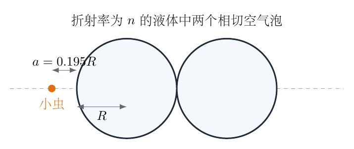{ width=84% }

## 一、题型定位

本题是“球面反射—空气泡等效透镜—单球面折射—像位重合”的组合近轴光学题。难点不在某一条成像公式，而在于为反射支路和折射支路建立同一个带符号的位置标准。

## 二、知识点

1. 球面镜的近轴成像关系；
2. 薄透镜光焦度与空气泡的发散性；
3. 单个球面的折射成像公式；
4. 虚物、虚像的符号处理；
5. 无量纲化与二次方程的物理根筛选。

## 三、物理图像

如图3-2，红色光线表示在左泡左表面反射后的近轴光束，蓝色光线表示穿过气泡系统的近轴光束。空气泡的折射率小于周围液体，因而对光束起发散作用，其光焦度必为负。

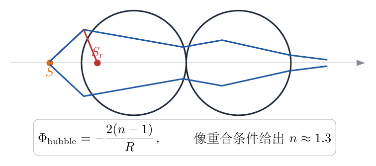{ width=95% }

本题中物距 $a<R/2$，所以球面镜支路得到的是镜后虚像。折射支路的中间像同样可以落在虚物区域。这两个“负距离”都是系统本身的物理结果，不能为了追求正数而取绝对值。

## 四、解题入口

先单独计算反射支路的像位，它是最终折射像必须达到的目标。再把左边空气泡在近轴条件下看成发散薄透镜，求它给出的中间像距 $u$。最后把 $u$ 作为右侧球面折射的物距，以“最终像与反射像重合”消去像距。

## 五、解析

先看反射光。对左泡左表面使用球面镜公式，按参考解答的符号约定，有

$$
\frac{1}{s_{\rm r}}+\frac1a=\frac2R. \tag{1}
$$

移项得

$$
\frac{1}{s_{\rm r}}
=\frac2R-\frac1a
=\frac{2a-R}{Ra}. \tag{2}
$$

因而反射支路的有符号像距为

$$
s_{\rm r}=\frac{Ra}{2a-R}. \tag{3}
$$

令

$$
\lambda=\frac aR=0.195=\frac{39}{200}. \tag{4}
$$

则

$$
\frac{s_{\rm r}}R
=\frac{\lambda}{2\lambda-1}
=\frac{39}{78-200}
=-\frac{39}{122}
\approx-0.319672. \tag{5}
$$

式（5）为负，正是因为 $a<R/2$：物体在球面镜焦内，反射光的反向延长线相交于镜后。

再看透过气泡的光。近轴条件下，空气泡的两个球面光焦度相加。周围液体折射率为 $n$，泡内空气折射率取 $1$，所以

$$
\begin{aligned}
\Phi
&=\frac{1-n}{R}+\frac{n-1}{-R}\\
&=-\frac{2(n-1)}R.
\end{aligned} \tag{6}
$$

这里 $n>1$，故 $\Phi<0$，与“气泡是发散元件”的直观一致。设经左泡后得到的中间像距为 $u$，则薄透镜成像关系写成

$$
\frac1a+\frac1u=\Phi. \tag{7}
$$

将式（6）代入：

$$
\frac1u=-\frac{2(n-1)}R-\frac1a. \tag{8}
$$

提出 $1/R$：

$$
\frac1u
=-\frac1R\left[2(n-1)+\frac R a\right]. \tag{9}
$$

因而

$$
u=-\frac{R}{2(n-1)+1/\lambda}. \tag{10}
$$

$u<0$ 说明左泡所成中间像是虚像。对右侧最后一个球面使用单球面折射公式。按图3-2的几何距离，该球面看到的物距为

$$
p=2R-u. \tag{11}
$$

由式（10），

$$
p=2R+\frac{R}{2(n-1)+1/\lambda}. \tag{12}
$$

设该球面折射后的像距为 $v$。从空气到液体的球面折射关系为

$$
\frac1p+\frac nv=\frac{1-n}{R}. \tag{13}
$$

要使折射像与式（3）的反射像重合，必须把反射像换算到式（13）所用的右侧顶点坐标。由两个顶点间的几何间隔，有

$$
v=-s_{\rm r}-2R. \tag{14}
$$

代入式（3），

$$
\begin{aligned}
v
&=-\frac{Ra}{2a-R}-2R\\
&=R\left(-\frac{\lambda}{2\lambda-1}-2\right).
\end{aligned} \tag{15}
$$

以 $R$ 将所有长度无量纲化，把式（12）和式（15）代入式（13）：

$$
\frac{1}{2+\dfrac{1}{2(n-1)+1/\lambda}}
+\frac{n}{-\dfrac{\lambda}{2\lambda-1}-2}
=1-n. \tag{16}
$$

代入 $\lambda=39/200$。先化简第二个分母：

$$
-\frac{39/200}{78/200-1}-2
=\frac{39}{122}-2
=-\frac{205}{122}. \tag{17}
$$

第一个分母中，

$$
2(n-1)+\frac{200}{39}=2n+\frac{122}{39}. \tag{18}
$$

因而

$$
\frac{1}{2+\dfrac{39}{78n+122}}
-\frac{122n}{205}
=1-n. \tag{19}
$$

将复分式通分：

$$
\frac{78n+122}{156n+283}-\frac{122n}{205}=1-n. \tag{20}
$$

两边同乘 $205(156n+283)$，并把各项移到左边，得

$$
12948n^2+7499n-33005=0. \tag{21}
$$

二次方程的两个根为

$$
n=\frac{-7499\pm\sqrt{7499^2+4\times12948\times33005}}{2\times12948}. \tag{22}
$$

数值为

$$
n_1\approx1.33304,
\qquad
n_2\approx-1.91220. \tag{23}
$$

普通透明液体的折射率为正且通常大于 $1$，故舍去负根。按题目给定的 $a=0.195R$ 精度取值，

$$
\boxed{n\approx1.33\approx1.3}. \tag{24}
$$

等式检验：取 $n=1.33304$，式（10）给出 $u\approx-0.1726R$，式（12）给出 $p\approx2.1726R$；将它们代回式（13），左右两边在显示精度内相等。

把这个检验完整展开，可以建立一张不容易混淆的“有符号距离账本”。反射支路的像距为

$$
\frac{s_{\rm r}}R=-\frac{39}{122}\approx-0.319672.
$$

左气泡形成的中间像距为

$$
\frac uR
=-\frac{1}{2(n-1)+200/39}.
$$

代入物理根 $n=1.3330398$：

$$
\frac uR
=-\frac{1}{2(0.3330398)+5.1282051}
\approx-0.172584.
$$

因此最后一个折射球面看到的物距为

$$
\frac pR=2-\frac uR
\approx2.172584.
$$

把反射像换算到最后球面的坐标原点，得到

$$
\frac vR=-\frac{s_{\rm r}}R-2
\approx-1.680328.
$$

现在逐项计算球面折射公式左侧：

$$
\frac{R}{p}\approx\frac1{2.172584}
\approx0.460281.
$$

$$
\frac{nR}{v}
\approx\frac{1.3330398}{-1.680328}
\approx-0.793321.
$$

二者之和为

$$
\frac Rp+\frac{nR}{v}
\approx-0.333040.
$$

而右侧为

$$
1-n\approx-0.333040.
$$

左右完全相等。这一逐项回代不仅验证数值根，还验证了 $u$、$v$ 两个负号；任意一个负号写错，左侧都会变成正值或数值相差约一倍。另一个代数根 $n\approx-1.9122$ 虽然满足二次方程，却会使普通透明液体的折射率条件失效，必须在代数求根之后舍去。

还可以检查极限趋势。若周围液体折射率逐渐趋近 $1$，空气泡的光焦度趋于零：

$$
\lim_{n\to1}\Phi=0.
$$

此时系统不再具有足够的发散能力把折射像移到指定的反射像位置。因此题目给出的像重合条件自然要求 $n$ 明显大于 $1$，所得 $n\approx1.33$ 与常见透明液体的数量级一致。

\newpage

# 第 4 题

如图，两个质量均为 $m$ 的小球 $A$、$B$ 构成平面双摆。上端细绳长为 $l_1$，下端细绳长为 $l_2$。在参考温度下 $l_1=l_2=l_0$；两绳的线膨胀系数分别为 $\alpha_1$、$\alpha_2$。

（1）若只有上绳长度随温度变化，求小振动周期的一阶相对温漂；

（2）对完整双摆，求两个正则模频率；

（3）要使正则模周期在一阶近似下不随温度变化，$\alpha_1$与 $\alpha_2$ 应满足什么关系？

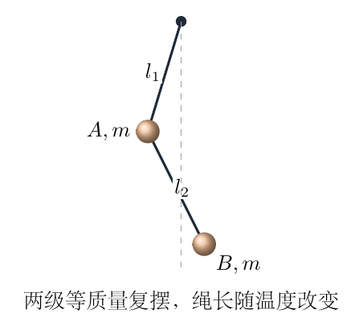{ width=58% }

## 一、题型定位

本题将单摆的温度误差与双摆的线性简正模结合在一起。必须先由动能和势能建立质量矩阵、刚度矩阵，再由特征方程求频率，最后对长度的温度微变化作一阶展开。

## 二、知识点

1. 单摆周期对摆长的对数微分；
2. 双摆小角度运动的二次型；
3. 广义特征值问题 $\det(K-\omega^2M)=0$；
4. 正则模的同相、反相物理图像；
5. 对称点附近的一阶摄动。

## 三、物理图像

两个小角位移不是彼此独立的。低频模中两摆大体同向运动，系统形变较小；高频模中上下两段的运动方向相反，相对形变更快。

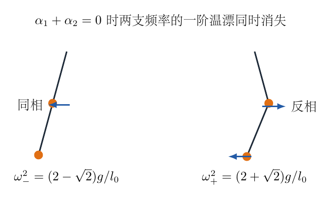{ width=86% }

## 四、解题入口

第（1）问直接从 $T\propto\sqrt l$ 取对数微分。第（2）问选两根绳相对竖直方向的小角 $\theta_1,\theta_2$ 作广义坐标，把位置和速度只保留到足以构成二次型的阶数。第（3）问不必对复杂根式盲目全微分，可以先利用 $l_1=l_2$ 处交换对称性。

## 五、解析

第（1）问中，单摆周期为

$$
T=2\pi\sqrt{\frac{l_1}{g}}. \tag{1}
$$

温度变化 $\Delta\Theta$ 后，线膨胀给出

$$
l_1'=l_1(1+\alpha_1\Delta\Theta). \tag{2}
$$

对式（1）取对数：

$$
\ln T=\ln(2\pi)-\frac12\ln g+\frac12\ln l_1. \tag{3}
$$

微分后

$$
\frac{\Delta T}{T}=\frac12\frac{\Delta l_1}{l_1}. \tag{4}
$$

又有

$$
\frac{\Delta l_1}{l_1}=\alpha_1\Delta\Theta, \tag{5}
$$

所以

$$
\boxed{\frac{\Delta T}{T}=\frac12\alpha_1\Delta\Theta}. \tag{6}
$$

下面建立双摆的线性运动方程。小球 $A$、$B$ 的坐标为

$$
\begin{aligned}
x_A&=l_1\sin\theta_1,& y_A&=-l_1\cos\theta_1,\\
x_B&=l_1\sin\theta_1+l_2\sin\theta_2,
&y_B&=-l_1\cos\theta_1-l_2\cos\theta_2.
\end{aligned} \tag{7}
$$

对时间求导，有

$$
v_A^2=l_1^2\dot\theta_1^2. \tag{8}
$$

对 $B$ 球，

$$
v_B^2=l_1^2\dot\theta_1^2+l_2^2\dot\theta_2^2
+2l_1l_2\dot\theta_1\dot\theta_2\cos(\theta_1-\theta_2). \tag{9}
$$

在线性近似中，动能已经是速度的二阶量，因此式（9）中可取 $\cos(\theta_1-\theta_2)\simeq1$。总动能为

$$
\begin{aligned}
K
&=\frac12mv_A^2+\frac12mv_B^2\\
&=\frac12m\left(2l_1^2\dot\theta_1^2+l_2^2\dot\theta_2^2
+2l_1l_2\dot\theta_1\dot\theta_2\right).
\end{aligned} \tag{10}
$$

取竖直向下平衡位置的重力势能为零。由 $1-\cos\theta\simeq\theta^2/2$，

$$
\begin{aligned}
U
&=2mgl_1(1-\cos\theta_1)+mgl_2(1-\cos\theta_2)\\
&\simeq\frac12mg\left(2l_1\theta_1^2+l_2\theta_2^2\right).
\end{aligned} \tag{11}
$$

由拉格朗日方程 $\frac d{dt}(\partial K/\partial\dot\theta_i)+\partial U/\partial\theta_i=0$，得

$$
\begin{aligned}
2ml_1^2\ddot\theta_1+ml_1l_2\ddot\theta_2+2mgl_1\theta_1&=0,\\
ml_1l_2\ddot\theta_1+ml_2^2\ddot\theta_2+mgl_2\theta_2&=0.
\end{aligned} \tag{12}
$$

约去公因子 $m$，并设

$$
\theta_1=Ae^{i\omega t},
\qquad
\theta_2=Be^{i\omega t}. \tag{13}
$$

代入式（12）：

$$
\begin{pmatrix}
2gl_1-2l_1^2\omega^2&-l_1l_2\omega^2\\
-l_1l_2\omega^2&gl_2-l_2^2\omega^2
\end{pmatrix}
\begin{pmatrix}A\\B\end{pmatrix}=0. \tag{14}
$$

要有非零振幅，系数行列式必须为零：

$$
(2gl_1-2l_1^2\omega^2)(gl_2-l_2^2\omega^2)
-l_1^2l_2^2\omega^4=0. \tag{15}
$$

展开后先合并 $\omega^4$ 项：

$$
2g^2l_1l_2-2gl_1l_2(l_1+l_2)\omega^2
+l_1^2l_2^2\omega^4=0. \tag{16}
$$

除以 $l_1l_2$：

$$
l_1l_2\omega^4-2g(l_1+l_2)\omega^2+2g^2=0. \tag{17}
$$

把 $\omega^2$ 看成未知数，用求根公式：

$$
\omega_\pm^2
=\frac{2g(l_1+l_2)\pm
\sqrt{4g^2(l_1+l_2)^2-8g^2l_1l_2}}{2l_1l_2}. \tag{18}
$$

根号中化简为

$$
(l_1+l_2)^2-2l_1l_2=l_1^2+l_2^2. \tag{19}
$$

因而一般绳长下的两个正则模频率为

$$
\boxed{
\omega_\pm^2
=g\frac{l_1+l_2\pm\sqrt{l_1^2+l_2^2}}{l_1l_2}
}. \tag{20}
$$

在参考温度下 $l_1=l_2=l_0$，式（20）给出

$$
\omega_\pm^2
=\frac g{l_0}(2\pm\sqrt2). \tag{21}
$$

所以

$$
\boxed{
\omega_- =\sqrt{\frac g{l_0}(2-\sqrt2)},
\qquad
\omega_+ =\sqrt{\frac g{l_0}(2+\sqrt2)}
}. \tag{22}
$$

相应周期为

$$
T_\pm=\frac{2\pi}{\omega_\pm}. \tag{23}
$$

现在研究温度稳定性。设

$$
l_1=l_0(1+\varepsilon_1),
\qquad
l_2=l_0(1+\varepsilon_2), \tag{24}
$$

其中

$$
\varepsilon_1=\alpha_1\Delta\Theta,
\qquad
\varepsilon_2=\alpha_2\Delta\Theta. \tag{25}
$$

对根号作一阶展开：

$$
\begin{aligned}
\sqrt{l_1^2+l_2^2}
&=l_0\sqrt{(1+\varepsilon_1)^2+(1+\varepsilon_2)^2}\\
&\simeq l_0\sqrt{2+2(\varepsilon_1+\varepsilon_2)}\\
&=\sqrt2l_0\sqrt{1+\varepsilon_1+\varepsilon_2}\\
&\simeq\sqrt2l_0\left[1+\frac12(\varepsilon_1+\varepsilon_2)\right].
\end{aligned} \tag{26}
$$

分子为

$$
l_1+l_2\pm\sqrt{l_1^2+l_2^2}
=(2\pm\sqrt2)l_0
\left(1\pm\frac1{\sqrt2}\right)l_0(\varepsilon_1+\varepsilon_2). \tag{27}
$$

注意恒等式

$$
\frac{1\pm1/\sqrt2}{2\pm\sqrt2}=\frac12. \tag{28}
$$

因此分子的相对变化对两个分支都是

$$
\frac{\Delta N_\pm}{N_\pm}=\frac12(\varepsilon_1+\varepsilon_2). \tag{29}
$$

分母一阶变化为

$$
l_1l_2=l_0^2(1+\varepsilon_1)(1+\varepsilon_2)
\simeq l_0^2[1+(\varepsilon_1+\varepsilon_2)], \tag{30}
$$

所以

$$
\frac{\Delta(l_1l_2)}{l_1l_2}=\varepsilon_1+\varepsilon_2. \tag{31}
$$

由式（20）的“分子除以分母”结构，

$$
\frac{\Delta\omega_\pm^2}{\omega_\pm^2}
=\frac12(\varepsilon_1+\varepsilon_2)-(\varepsilon_1+\varepsilon_2)
=-\frac12(\varepsilon_1+\varepsilon_2). \tag{32}
$$

由 $T_\pm\propto(\omega_\pm^2)^{-1/2}$，

$$
\frac{\Delta T_\pm}{T_\pm}
=-\frac12\frac{\Delta\omega_\pm^2}{\omega_\pm^2}
=\frac14(\varepsilon_1+\varepsilon_2). \tag{33}
$$

再代入式（25）：

$$
\frac{\Delta T_\pm}{T_\pm}
=\frac14(\alpha_1+\alpha_2)\Delta\Theta. \tag{34}
$$

要使周期的一阶温漂为零，必须

$$
\boxed{\alpha_1+\alpha_2=0,
\qquad\text{即 }\alpha_1=-\alpha_2}. \tag{35}
$$

值得注意的是，在 $l_1=l_2$ 的对称点，两个正则模的一阶温漂具有相同系数。因此式（35）不仅使其中一个周期不变，而使两个周期都在一阶上不变。

高低两支的频率比还可化成一个简洁常数：

$$
\left(\frac{\omega_+}{\omega_-}\right)^2
=\frac{2+\sqrt2}{2-\sqrt2}.
$$

分子、分母同乘 $2+\sqrt2$：

$$
\frac{2+\sqrt2}{2-\sqrt2}
=\frac{(2+\sqrt2)^2}{4-2}
=3+2\sqrt2.
$$

注意

$$
3+2\sqrt2=(1+\sqrt2)^2.
$$

所以

$$
\frac{\omega_+}{\omega_-}=1+\sqrt2.
$$

周期与频率成反比，故

$$
\frac{T_-}{T_+}=1+\sqrt2.
$$

这个比值与 $m$、$g$、$l_0$ 都无关，是等质量、等长度双摆的纯几何特征。若数值求特征频率后得不到这一比值，通常说明质量矩阵的交叉项或势能中上绳承受两个小球重量的因子 $2$ 被漏掉。

为使图4-2中的“同相、反相”不只停留在示意图，还应由线性方程求出振型。等长时取 $l_1=l_2=l_0$，式（14）的第二行化为

$$
-l_0^2\omega^2A+(gl_0-l_0^2\omega^2)B=0.
$$

约去 $l_0$：

$$
-l_0\omega^2A+(g-l_0\omega^2)B=0.
$$

所以

$$
\frac BA=\frac{l_0\omega^2}{g-l_0\omega^2}.
$$

对低频支 $l_0\omega_-^2/g=2-\sqrt2$，

$$
\frac BA
=\frac{2-\sqrt2}{1-(2-\sqrt2)}.
$$

分母为 $\sqrt2-1$，利用

$$
2-\sqrt2=\sqrt2(\sqrt2-1),
$$

得到

$$
\frac BA=\sqrt2.
$$

低频支中 $A$、$B$ 同号，两个角位移同相，且下球角振幅较大。对高频支 $l_0\omega_+^2/g=2+\sqrt2$，

$$
\frac BA
=\frac{2+\sqrt2}{1-(2+\sqrt2)}
=-\sqrt2.
$$

高频支中两个角位移反相。把振型代回式（12）的两行会得到同一个频率条件，这提供了对行列式求根的独立核验。还要区分“角位移同相”与“两个球的水平速度处处完全相等”：下球水平位置含有上、下两段绳的共同贡献，不能只看 $\theta_2$ 的正负就判断绝对速度。

\newpage

# 第 5 题

木卫一、木卫二、木卫三构成拉普拉斯共振，公转周期近似满足 $T_1:T_2:T_3=1:2:4$，且轨道可视为圆轨道。

（1）求三颗卫星的轨道半径比 $r_1:r_2:r_3$。

木星探测器 Juno 利用地球引力弹弓进入转移轨道。简化认为转移椭圆的近日点、远日点分别位于地球和木星圆轨道，$R_E=1.50\times10^{11}\ \mathrm m$，木星周期 $T_J=11.86\ \mathrm y$，一年取 $365$ 天。

（2）求木星轨道半径 $R_J$；（3）求 Juno 刚进入转移轨道时的速度 $v_1$；（4）已知弹射前 Juno 的日心速度为 $35\ \mathrm{km/s}$，求该速度与地球运行速度的夹角；（5）求 Juno 在转移轨道远日点的速度 $v_3$；（6）求转移轨道的周期。

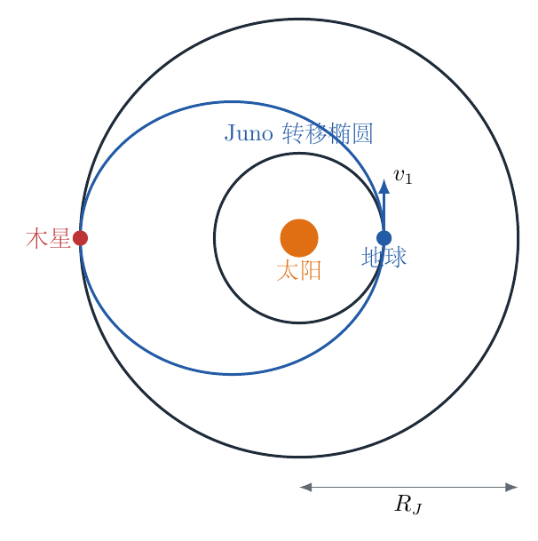{ width=88% }

## 一、题型定位

本题是开普勒第三定律、活力公式、角动量守恒与引力弹弓速度矢量图的综合题。各小问并非独立：第（2）问给出的 $R_J$ 决定转移椭圆，第（3）问得到的近日点速度又是第（4）问弹弓后的目标速度。

## 二、知识点

1. $T^2\propto r^3$ 与轨道比例；
2. 椭圆半长轴 $a=(r_p+r_a)/2$；
3. 活力公式 $v^2=\mu(2/r-1/a)$；
4. 近日点与远日点的角动量守恒；
5. 地心系中引力弹弓前后相对速度等大；
6. 速度三角形与余弦定理。

## 三、物理图像

转移椭圆与地球轨道相切于近日点，与木星轨道相切于远日点。在近日点，Juno 需要比地球更快的顺行速度；在远日点，它的速度显著减小。弹弓过程中要区分日心速度 $\boldsymbol v$ 和地心相对速度 $\boldsymbol u=\boldsymbol v-\boldsymbol v_E$。

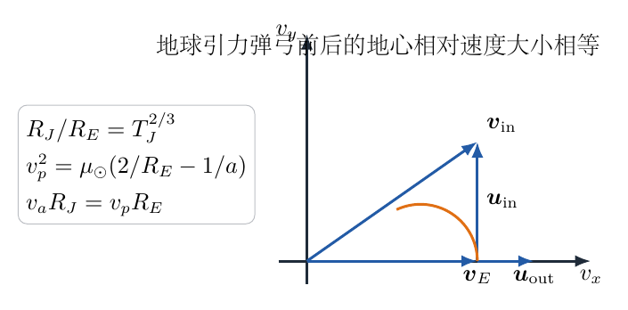{ width=91% }

## 四、解题入口

先用开普勒第三定律把所有轨道尺度化为 $R_E$ 的倍数。再用地球圆轨道消去太阳引力参数 $\mu_\odot=GM_\odot$，这样可不必额外查太阳质量。弹弓问题则画速度三角形，把弹射后的地心速度大小认成 $v_1-v_E$。

## 五、解析

对绕同一中心天体运动的卫星，开普勒第三定律为

$$
\frac{T^2}{r^3}=\text{常量}. \tag{1}
$$

因而

$$
r\propto T^{2/3}. \tag{2}
$$

把 $T_1:T_2:T_3=1:2:4$ 代入：

$$
\boxed{r_1:r_2:r_3=1:2^{2/3}:4^{2/3}
=1:2^{2/3}:2^{4/3}}. \tag{3}
$$

对木星和地球绕太阳的圆轨道，

$$
\left(\frac{T_J}{T_E}\right)^2
=\left(\frac{R_J}{R_E}\right)^3. \tag{4}
$$

$T_E=1\ \mathrm y$，所以

$$
\frac{R_J}{R_E}=11.86^{2/3}=5.20064. \tag{5}
$$

从而

$$
\boxed{R_J=5.20064\times1.50\times10^{11}
\approx7.80\times10^{11}\ \mathrm m}. \tag{6}
$$

地球公转速度可直接由周长除以周期求得：

$$
v_E=\frac{2\pi R_E}{T_E}. \tag{7}
$$

一年的秒数为

$$
T_E=365\times24\times3600=3.1536\times10^7\ \mathrm s. \tag{8}
$$

因此

$$
v_E=\frac{2\pi\times1.50\times10^{11}}{3.1536\times10^7}
=2.9886\times10^4\ \mathrm{m/s}. \tag{9}
$$

转移椭圆半长轴为

$$
a_t=\frac{R_E+R_J}{2}. \tag{10}
$$

地球圆轨道满足

$$
v_E^2=\frac{\mu_\odot}{R_E},
\qquad
\mu_\odot=v_E^2R_E. \tag{11}
$$

在转移椭圆的近日点 $r=R_E$，活力公式给出

$$
v_1^2=\mu_\odot\left(\frac2{R_E}-\frac1{a_t}\right). \tag{12}
$$

代入式（10）、（11）：

$$
\begin{aligned}
v_1^2
&=v_E^2R_E\left(\frac2{R_E}-\frac2{R_E+R_J}\right)\\
&=v_E^2\left(2-\frac{2R_E}{R_E+R_J}\right)\\
&=v_E^2\frac{2R_J}{R_E+R_J}.
\end{aligned} \tag{13}
$$

所以

$$
v_1=v_E\sqrt{\frac{2R_J}{R_E+R_J}}. \tag{14}
$$

代入 $R_J/R_E=5.20064$：

$$
\boxed{v_1\approx38.7\ \mathrm{km/s}}. \tag{15}
$$

由于 $v_1>v_E$，地球弹弓必须为 Juno 增加顺行方向的日心速度。忽略弹弓时间内地球速度的变化，地心系中弹弓前后相对速度大小不变：

$$
|\boldsymbol u_{\rm in}|=|\boldsymbol u_{\rm out}|. \tag{16}
$$

弹射后的目标速度与地球同向，故

$$
u_{\rm out}=v_1-v_E=38.707-29.886=8.821\ \mathrm{km/s}. \tag{17}
$$

令弹射前日心速度大小 $v_{\rm in}=35\ \mathrm{km/s}$，它与 $\boldsymbol v_E$ 夹角为 $\gamma$。由图5-2的速度三角形，

$$
\boldsymbol u_{\rm in}=\boldsymbol v_{\rm in}-\boldsymbol v_E. \tag{18}
$$

对式（18）平方：

$$
u_{\rm in}^2=v_{\rm in}^2+v_E^2-2v_{\rm in}v_E\cos\gamma. \tag{19}
$$

由 $u_{\rm in}=u_{\rm out}$，

$$
\cos\gamma
=\frac{v_{\rm in}^2+v_E^2-u_{\rm out}^2}{2v_{\rm in}v_E}. \tag{20}
$$

代入数值：

$$
\cos\gamma
=\frac{35^2+29.886^2-8.821^2}{2\times35\times29.886}
=0.97531. \tag{21}
$$

因而

$$
\boxed{\gamma\approx12.8^\circ}. \tag{22}
$$

在椭圆近日点和远日点，速度都与径向垂直。角动量守恒给出

$$
v_1R_E=v_3R_J. \tag{23}
$$

所以

$$
v_3=v_1\frac{R_E}{R_J}. \tag{24}
$$

代入数值：

$$
\boxed{v_3=\frac{38.707}{5.20064}\approx7.44\ \mathrm{km/s}}. \tag{25}
$$

转移椭圆也遵守开普勒第三定律。与地球轨道比较：

$$
\frac{T_t}{T_E}=\left(\frac{a_t}{R_E}\right)^{3/2}. \tag{26}
$$

而

$$
\frac{a_t}{R_E}=\frac{1+R_J/R_E}{2}
=\frac{1+5.20064}{2}=3.10032. \tag{27}
$$

因而

$$
\boxed{T_t=(3.10032)^{3/2}\ \mathrm y\approx5.46\ \mathrm y}. \tag{28}
$$

这是整个椭圆周期。从近日点飞到远日点只需半个周期：

$$
t_{E\to J}=\frac{T_t}{2}\approx2.73\ \mathrm y. \tag{29}
$$

可以用轨道比机械能对 $v_1$、$v_3$ 再作一次互相独立的检查。椭圆轨道单位质量的机械能只由半长轴决定：

$$
\varepsilon_t=-\frac{\mu_\odot}{2a_t}.
$$

在近日点，

$$
\varepsilon_t=\frac{v_1^2}{2}-\frac{\mu_\odot}{R_E}.
$$

把 $a_t=(R_E+R_J)/2$ 代入，整理为

$$
\frac{v_1^2}{2}
=\frac{\mu_\odot}{R_E}
-\frac{\mu_\odot}{R_E+R_J}.
$$

两边乘 $2$ 后正好得到式（13）。在远日点，

$$
\varepsilon_t=\frac{v_3^2}{2}-\frac{\mu_\odot}{R_J}.
$$

所以

$$
v_3^2
=2\mu_\odot\left(\frac1{R_J}-\frac1{R_E+R_J}\right)
=\frac{2\mu_\odot R_E}{R_J(R_E+R_J)}.
$$

另一方面，由式（13）和角动量关系 $v_3=v_1R_E/R_J$，

$$
v_3^2
=\left[\frac{2\mu_\odot R_J}{R_E(R_E+R_J)}\right]
\left(\frac{R_E}{R_J}\right)^2
=\frac{2\mu_\odot R_E}{R_J(R_E+R_J)}.
$$

两条路线完全一致。数值上，木星圆轨道速度为

$$
v_J=v_E\sqrt{\frac{R_E}{R_J}}
\approx13.1\ \mathrm{km/s}.
$$

而转移椭圆远日点速度只有 $7.44\ \mathrm{km/s}$。这意味着探测器到达木星轨道半径时仍比木星本身运行得慢，若要真正被木星捕获，还必须依靠木星引力和后续制动改变相对能量；“到达木星轨道”不等于“自动进入绕木星圆轨道”。

地球引力弹弓的数值还可用双曲超越速度作检查。弹射后相对地球的速度大小为

$$
v_\infty=v_1-v_E\approx8.821\ \mathrm{km/s}.
$$

相应的特征能量为

$$
C_3=v_\infty^2.
$$

代入数值：

$$
C_3\approx(8.821)^2
\approx77.8\ \mathrm{km^2/s^2}.
$$

弹射前的日心速度为 $35\ \mathrm{km/s}$，但相对地球的速度不是简单的 $35-29.886$，因为两者并不同向。由求出的 $\gamma=12.8^\circ$，

$$
u_{\rm in}^2
=35^2+29.886^2
-2(35)(29.886)\cos12.8^\circ.
$$

数值上

$$
u_{\rm in}\approx8.82\ \mathrm{km/s},
$$

与 $u_{\rm out}$ 一致。这是对速度夹角的直接回代。如果误把弹射前两速度当作同向，只会得到约 $5.11\ \mathrm{km/s}$，无法与弹射后的 $8.82\ \mathrm{km/s}$ 满足地心系弹性散射条件。

还应区分“探测器在太阳引力场中的机械能增加”和“地心系相对动能不变”。地心系中

$$
\frac12u_{\rm in}^2=\frac12u_{\rm out}^2,
$$

但日心系中速度方向改变后，

$$
\frac12v_{\rm out}^2-\frac12v_{\rm in}^2
=\boldsymbol v_E\cdot
(\boldsymbol u_{\rm out}-\boldsymbol u_{\rm in}).
$$

能量差来自运动中的地球与探测器之间的引力交换；在完整的太阳—地球—探测器系统中，总能量仍然守恒。

\newpage

# 第 6 题

相对论中两事件的时空间隔定义为

$$
\Delta s^2=(c\Delta t)^2-(\Delta x^2+\Delta y^2+\Delta z^2).
$$

（1）将一物体以初速度 $v_0$、与水平方向夹角 $\theta_0$ 抛出，重力加速度大小为 $g$。求 $t=0$ 与 $t=t_1$ 两事件间的时空间隔。

（2）考虑抛出点与落地点。在 $ct-x-z$ 三维欧几里得空间中，将事件轨迹当作一段普通圆弧，求圆弧的曲率半径。取非相对论极限 $v_0\ll c$。

（3）飞船沿 $x$ 方向运动，船内人测得自己的加速度大小为 $g$、方向竖直向下。右侧 $A$ 向左侧 $B$ 发送频率 $f_1$ 的激光信号，$AB=d$，且 $gd\ll c^2$。求 $B$ 接收到的频率 $f_2$，必要时保留二阶小量。

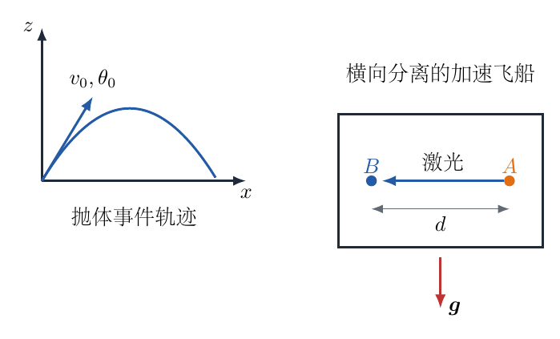{ width=94% }

## 一、题型定位

本题把经典抛体运动映射到闵可夫斯基时空，又用等效原理讨论加速飞船中的频率比较。前两问的关键是区分闵可夫斯基间隔和为了做几何近似而引入的欧几里得距离；第（3）问的关键是一阶效应相消，首个非零结果来自二阶时钟效应。

## 二、知识点

1. 抛体坐标的参数表示；
2. 闵可夫斯基时空间隔；
3. 弦长、矢高与圆半径的近似关系；
4. 尺度分析 $c^2/g$；
5. 等效原理、相对论时钟效应与二阶展开。

## 三、物理图像

图6-2左图中，红线是抛出与落地两事件在 $ct-x-z$ 欧几里得图示中的弦，蓝线是用圆弧近似的事件轨迹，两者的最大偏离是矢高。右图表示加速舱中两次同时比较所对应的短时间间隔。

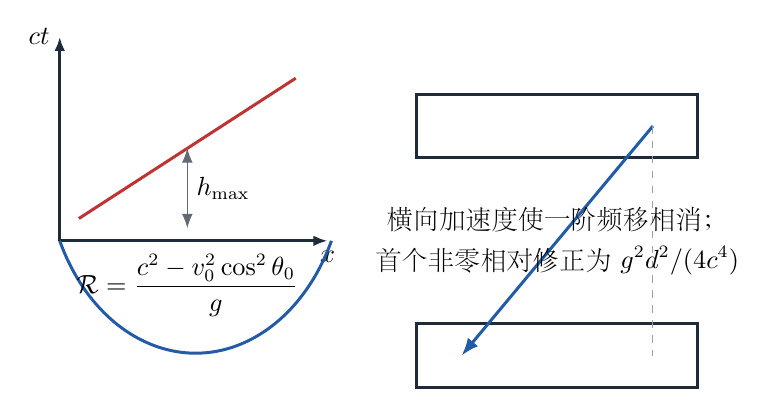{ width=94% }

## 四、解题入口

第（1）问只要把两事件的四坐标差完整代入定义。第（2）问利用“圆半径远大于矢高”时 $R\simeq S^2/(8h)$，弦长 $S$ 来自事件间的欧几里得坐标差。第（3）问则先确认一阶 $gd/c^2$ 项为零，再保留参考解答所要求的首个非零二阶修正。

## 五、解析

取抛出点为坐标原点，运动在 $x-z$ 平面内。$t=0$ 事件 $P$ 的坐标为

$$
P:(ct,x,y,z)=(0,0,0,0). \tag{1}
$$

$t=t_1$ 事件 $Q$ 的坐标为

$$
Q:\left(ct_1, v_0\cos\theta_0t_1, 0,
v_0\sin\theta_0t_1-\frac12gt_1^2\right). \tag{2}
$$

代入间隔定义：

$$
\boxed{
\Delta s^2=(ct_1)^2-(v_0\cos\theta_0t_1)^2
-\left(v_0\sin\theta_0t_1-\frac12gt_1^2\right)^2
}. \tag{3}
$$

若将平方项展开，可得

$$
\Delta s^2
=(c^2-v_0^2)t_1^2+v_0g\sin\theta_0t_1^3-\frac14g^2t_1^4. \tag{4}
$$

两种写法等价；式（3）更能直接看出每一个坐标差的来源。

对抛出与落地事件，飞行时间为

$$
t_f=\frac{2v_0\sin\theta_0}{g}. \tag{5}
$$

水平射程为

$$
X=v_0\cos\theta_0t_f
=\frac{v_0^2\sin2\theta_0}{g}. \tag{6}
$$

在 $ct-x-z$ 欧几里得图示中，两端点的 $z$ 坐标相同，因而弦长平方为

$$
S^2=(ct_f)^2+X^2. \tag{7}
$$

但参考解答将“时空间隔的数值”作为弦的有效长度，其约定为

$$
S_{\rm eff}^2=(ct_f)^2-X^2. \tag{8}
$$

按题目与手写解答的这一约定继续，代入式（5）、（6）：

$$
S_{\rm eff}^2
=\left(\frac{2cv_0\sin\theta_0}{g}\right)^2
-\left(\frac{2v_0^2\sin\theta_0\cos\theta_0}{g}\right)^2. \tag{9}
$$

轨迹相对于两端点弦的最大偏离出现在 $t=t_f/2$。它等于抛体的最大高度：

$$
h=\frac{v_0^2\sin^2\theta_0}{2g}. \tag{10}
$$

对半径为 $\mathcal R$ 的圆弧，半弦、矢高与半径满足

$$
\left(\mathcal R-h\right)^2+\left(\frac{S_{\rm eff}}2\right)^2
=\mathcal R^2. \tag{11}
$$

展开并约去 $\mathcal R^2$：

$$
-2\mathcal Rh+h^2+\frac{S_{\rm eff}^2}{4}=0. \tag{12}
$$

精确解为

$$
\mathcal R=\frac{S_{\rm eff}^2}{8h}+\frac h2. \tag{13}
$$

由 $v_0\ll c$，曲率半径远大于 $h$，所以取

$$
\mathcal R\simeq\frac{S_{\rm eff}^2}{8h}. \tag{14}
$$

将式（9）和式（10）代入，先约去公因子 $4v_0^2\sin^2\theta_0/g^2$：

$$
\begin{aligned}
\mathcal R
&=\frac{\dfrac{4v_0^2\sin^2\theta_0}{g^2}
(c^2-v_0^2\cos^2\theta_0)}
{\dfrac{4v_0^2\sin^2\theta_0}{g}}\\
&=\frac{c^2-v_0^2\cos^2\theta_0}{g}.
\end{aligned} \tag{15}
$$

因此

$$
\boxed{\mathcal R=\frac{c^2-v_0^2\cos^2\theta_0}{g}
\simeq\frac{c^2}{g}}. \tag{16}
$$

数量级 $c^2/g\sim10^{16}\ \mathrm m$ 远大于普通抛体轨迹尺度，故“大半径小弧段”的近似是自洽的。

第（3）问中，光行经水平距离 $d$ 的主导时间为

$$
\tau=\frac dc. \tag{17}
$$

在这段时间内，舱的竖直速度改变量数量级为

$$
u=g\tau=\frac{gd}{c}. \tag{18}
$$

无量纲小参数为

$$
\epsilon=\frac uc=\frac{gd}{c^2}\ll1. \tag{19}
$$

由于 $A$、$B$ 处于同一竖直高度，没有一阶重力势差；横向光行中发射端与接收端的一阶多普勒项也相消。所以

$$
\frac{f_2-f_1}{f_1}=0\times\epsilon+O(\epsilon^2). \tag{20}
$$

参考解答以相邻脉冲的发射间隔 $\Delta t_A$ 和接收间隔 $\Delta t_B$ 做比较。对称取光行中段的速度后，有

$$
\Delta t_B
\simeq\left(1+\frac{\epsilon^2}{4}\right)\Delta t_A. \tag{21}
$$

频率是时间间隔的倒数，因而

$$
\frac{f_2}{f_1}
=\frac{\Delta t_A}{\Delta t_B}
\simeq\frac{1}{1+\epsilon^2/4}. \tag{22}
$$

使用 $1/(1+x)\simeq1-x$：

$$
\frac{f_2}{f_1}\simeq1-\frac{\epsilon^2}{4}. \tag{23}
$$

代回式（19），得到首个非零修正

$$
\boxed{
f_2\simeq f_1\left(1-\frac{g^2d^2}{4c^4}\right)
}. \tag{24}
$$

若只保留题目明说的一阶小量，则应写成

$$
\boxed{f_2=f_1+O\!\left(\frac{g^2d^2}{c^4}\right)}. \tag{25}
$$

手写解答所列 $g^2d^2/(4c^4)$ 是相对频移的大小；式（24）同时补明了按该时钟比较约定得到的红移方向。

\newpage

# 第 7 题

三个质量均为 $m$ 的小球 $A$、$B$、$C$ 在光滑平面上排成一列。$A$ 以速度 $v_0$ 沿球心连线撞向初始静止的 $B$、$C$，碰撞中总动量和总动能守恒。碰撞后速度分别为 $v_1$、$v_2$、$v_3$。

（1）若 $A$、$B$ 先碰撞，然后 $B$、$C$ 再碰撞，求 $v_1$、$v_2$、$v_3$。

（2）若三球同时碰撞，以 $v_2/v_0$ 为横轴、$v_3/v_0$ 为纵轴，画出所有可能解。

（3）若三球球心不共线，出射球可在 $x-y$ 平面内运动，以 $A$ 球初速方向为 $x$ 轴，以 $v_{2x}/v_0$、$v_{2y}/v_0$ 为坐标，画出 $B$ 球所有可能速度。

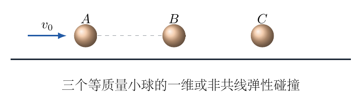{ width=86% }

## 一、题型定位

本题考查多体完全弹性碰撞的“守恒量允许集”。两体一维碰撞的结果是唯一的；三体同时碰撞只有动量和能量约束，因而产生一条椭圆上的可能解；允许二维速度后，固定其中一球的速度并对其余两球做最小能量分配，可得一个圆盘。

## 二、知识点

1. 等质量小球的一维完全弹性碰撞；
2. 多体系统的动量与动能守恒；
3. 归一化变量和二次曲线；
4. 碰撞后分离条件与接触冲量非负性；
5. 固定总动量时的最小动能原理；
6. 平方配方与速度空间中的圆盘。

## 三、物理图像

图7-2左图的整条蓝色椭圆是仅由总动量、总动能守恒得到的代数允许集，其中只有满足碰后分离次序和接触冲量条件的弧段才是指定同时碰撞的物理解。右图中圆盘边界表示另两球以相同速度分担剩余动量；圆盘内部对应它们还有相对运动。

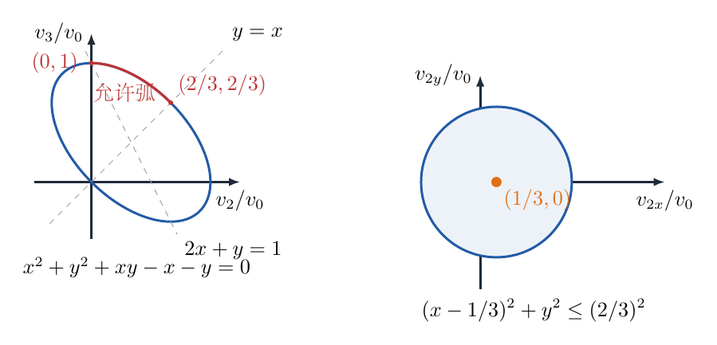{ width=96% }

## 四、解题入口

第（1）问每次只是“一个运动的等质量球撞一个静止球”，可先由守恒律证明速度交换。第（2）问先用动量消去 $v_1$，再把能量方程化为关于 $v_2/v_0$、$v_3/v_0$ 的椭圆。第（3）问固定 $\boldsymbol v_2$，询问其余两球能否以剩余动量且不超过剩余能量实现运动。

## 五、解析

先证明等质量一维完全弹性碰撞的速度交换性质。设碰撞前速度为 $u$、$0$，碰撞后为 $p$、$q$。动量守恒为

$$
mu=mp+mq. \tag{1}
$$

约去 $m$：

$$
u=p+q. \tag{2}
$$

动能守恒为

$$
\frac12mu^2=\frac12mp^2+\frac12mq^2. \tag{3}
$$

约去 $m/2$：

$$
u^2=p^2+q^2. \tag{4}
$$

将式（2）平方：

$$
u^2=p^2+q^2+2pq. \tag{5}
$$

与式（4）相减：

$$
2pq=0. \tag{6}
$$

非平凡撞击中入射球停下，即

$$
p=0. \tag{7}
$$

再由式（2）得

$$
q=u. \tag{8}
$$

因此 $A$、$B$ 第一次碰撞后，

$$
v_A=0,
\qquad
v_B=v_0. \tag{9}
$$

$B$、$C$ 第二次碰撞后，

$$
v_B=0,
\qquad
v_C=v_0. \tag{10}
$$

所以第（1）问为

$$
\boxed{v_1=0,
\qquad v_2=0,
\qquad v_3=v_0}. \tag{11}
$$

下面讨论三球同时共线碰撞。总动量守恒：

$$
mv_0=m(v_1+v_2+v_3). \tag{12}
$$

约去 $m$：

$$
v_1=v_0-v_2-v_3. \tag{13}
$$

总动能守恒：

$$
\frac12mv_0^2=\frac12m(v_1^2+v_2^2+v_3^2). \tag{14}
$$

约去 $m/2$，并代入式（13）：

$$
v_0^2=(v_0-v_2-v_3)^2+v_2^2+v_3^2. \tag{15}
$$

展开平方：

$$
v_0^2=v_0^2+v_2^2+v_3^2-2v_0v_2-2v_0v_3+2v_2v_3
+v_2^2+v_3^2. \tag{16}
$$

两边消去 $v_0^2$，再除以 $2$：

$$
v_2^2+v_3^2+v_2v_3-v_0v_2-v_0v_3=0. \tag{17}
$$

引入无量纲速度

$$
x=\frac{v_2}{v_0},
\qquad
y=\frac{v_3}{v_0}. \tag{18}
$$

式（17）除以 $v_0^2$，得

$$
\boxed{x^2+y^2+xy-x-y=0}. \tag{19}
$$

这是图7-2左图中的椭圆。为看清其中心和主轴，先求中心。令一阶偏导为零：

$$
2x+y-1=0. \tag{20}
$$

$$
x+2y-1=0. \tag{21}
$$

联立得

$$
x_c=y_c=\frac13. \tag{22}
$$

令

$$
X=x-\frac13,
\qquad
Y=y-\frac13. \tag{23}
$$

代回式（19）：

$$
X^2+Y^2+XY=\frac13. \tag{24}
$$

再作 $45^\circ$ 旋转：

$$
P=\frac{X+Y}{\sqrt2},
\qquad
Q=\frac{X-Y}{\sqrt2}. \tag{25}
$$

反解为

$$
X=\frac{P+Q}{\sqrt2},
\qquad
Y=\frac{P-Q}{\sqrt2}. \tag{26}
$$

代入式（24），

$$
\frac32P^2+\frac12Q^2=\frac13. \tag{27}
$$

化为标准式：

$$
\frac{P^2}{2/9}+\frac{Q^2}{2/3}=1. \tag{28}
$$

但守恒律只给出代数椭圆，还需施加碰撞后的分离条件。$B$、$C$ 不再相互压紧要求

$$
v_3>v_2. \tag{29}
$$

即

$$
y>x. \tag{30}
$$

$A$、$B$ 不再相互压紧要求

$$
v_2>v_1. \tag{31}
$$

由式（13），

$$
v_2>v_0-v_2-v_3. \tag{32}
$$

整理得

$$
2v_2+v_3>v_0. \tag{33}
$$

即

$$
2x+y>1. \tag{34}
$$

再从冲量非负性检查。设 $A$—$B$ 间冲量为 $J_1$，$B$—$C$ 间冲量为 $J_2$，则

$$
mv_1=mv_0-J_1. \tag{35}
$$

$$
mv_2=J_1-J_2. \tag{36}
$$

$$
mv_3=J_2. \tag{37}
$$

由式（37），

$$
J_2=mv_3. \tag{38}
$$

由式（36），

$$
J_1=m(v_2+v_3). \tag{39}
$$

对正向压紧冲量，

$$
J_1\ge0,
\qquad
J_2\ge0. \tag{40}
$$

因而实际作图时应在椭圆上同时保留

$$
y>x,
\qquad
2x+y>1,
\qquad
y\ge0,
\qquad
x+y\ge0. \tag{41}
$$

这就是第（2）问的物理允许弧段，不是整条椭圆。

允许弧段的两个端点可以由约束直线与椭圆的交点明确求出。先看 $B$、$C$ 刚好以相同速度分离的边界 $y=x$。代入椭圆方程：

$$
x^2+x^2+x^2-x-x=0.
$$

整理为

$$
3x^2-2x=0.
$$

因而

$$
x=0
\quad\text{或}\quad
x=\frac23.
$$

对应交点为

$$
(x,y)=(0,0),
\qquad
(x,y)=\left(\frac23,\frac23\right).
$$

其中 $(0,0)$ 不满足 $2x+y>1$，物理边界点是 $(2/3,2/3)$。再看 $A$、$B$ 刚好以相同速度分离的边界

$$
2x+y=1.
$$

令 $y=1-2x$ 并代入椭圆：

$$
x^2+(1-2x)^2+x(1-2x)-x-(1-2x)=0.
$$

逐项展开：

$$
x^2+1-4x+4x^2+x-2x^2-x-1+2x=0.
$$

合并同类项：

$$
3x^2-2x=0.
$$

仍得到 $x=0$ 或 $x=2/3$。相应交点是

$$
(x,y)=(0,1),
\qquad
(x,y)=\left(\frac23,-\frac13\right).
$$

后一点具有 $y<0$，不符合正向接触冲量所对应的区域；所以另一物理边界点为 $(0,1)$。于是指定碰撞次序的允许解是椭圆上从

$$
(0,1)
\quad\text{到}\quad
\left(\frac23,\frac23\right)
$$

之间、同时满足 $y>x$ 和 $2x+y>1$ 的那一段弧。若把严格分离条件写成严格不等号，两个端点本身只作为极限状态；若允许“刚好不再压缩”，则可以把端点并入闭弧。由此也能读出该弧上

$$
0\le\frac{v_2}{v_0}\le\frac23.
$$

这正是手写解答图中标出的横坐标范围。边界点 $(0,1)$ 对应顺次碰撞的极限结果 $v_1=v_2=0,v_3=v_0$；另一端点表示 $B$、$C$ 以相同速度离开，二者间的分离相对速度趋于零。

下面处理二维情形。初总动量为

$$
\boldsymbol P_0=mv_0\boldsymbol e_x. \tag{42}
$$

初总动能为

$$
E_0=\frac12mv_0^2. \tag{43}
$$

固定 $B$ 球的出射速度

$$
\boldsymbol w=\boldsymbol v_2. \tag{44}
$$

其余两球必须分担的速度和为

$$
\boldsymbol v_1+\boldsymbol v_3=v_0\boldsymbol e_x-\boldsymbol w. \tag{45}
$$

对任意两个向量，有恒等式

$$
|\boldsymbol v_1|^2+|\boldsymbol v_3|^2
=\frac12|\boldsymbol v_1+\boldsymbol v_3|^2
+\frac12|\boldsymbol v_1-\boldsymbol v_3|^2. \tag{46}
$$

因为第二项非负，

$$
|\boldsymbol v_1|^2+|\boldsymbol v_3|^2
\ge\frac12|\boldsymbol v_1+\boldsymbol v_3|^2. \tag{47}
$$

等号在

$$
\boldsymbol v_1=\boldsymbol v_3 \tag{48}
$$

时取到。所以，在固定 $\boldsymbol w$ 和剩余总动量时，其余两球的最小动能为

$$
E_{13,\min}
=\frac m4|v_0\boldsymbol e_x-\boldsymbol w|^2. \tag{49}
$$

要存在某种 $\boldsymbol v_1$、$\boldsymbol v_3$ 使能量守恒，必须且只需

$$
\frac12m|\boldsymbol w|^2+E_{13,\min}
\le\frac12mv_0^2. \tag{50}
$$

代入式（49），并约去 $m/4$：

$$
2|\boldsymbol w|^2+|v_0\boldsymbol e_x-\boldsymbol w|^2
\le2v_0^2. \tag{51}
$$

写成分量 $\boldsymbol w=(w_x,w_y)$：

$$
2(w_x^2+w_y^2)+(v_0-w_x)^2+w_y^2\le2v_0^2. \tag{52}
$$

展开：

$$
3w_x^2+3w_y^2-2v_0w_x-v_0^2\le0. \tag{53}
$$

除以 $3$：

$$
w_x^2+w_y^2-\frac{2v_0}{3}w_x-\frac{v_0^2}{3}\le0. \tag{54}
$$

对 $w_x$ 配方：

$$
\left(w_x-\frac{v_0}{3}\right)^2+w_y^2
\le\frac{4v_0^2}{9}. \tag{55}
$$

最后除以 $v_0^2$：

$$
\boxed{
\left(\frac{v_{2x}}{v_0}-\frac13\right)^2
+\left(\frac{v_{2y}}{v_0}\right)^2
\le\left(\frac23\right)^2
}. \tag{56}
$$

因而第（3）问的所有可能解是：圆心在 $(1/3,0)$、半径为 $2/3$ 的闭圆盘。

还需说明式（50）不仅是必要条件，也是充分条件。设

$$
\boldsymbol q=v_0\boldsymbol e_x-\boldsymbol w. \tag{57}
$$

把其余两球的速度写成“平均部分加相对部分”：

$$
\boldsymbol v_1=\frac{\boldsymbol q}{2}+\boldsymbol s. \tag{58}
$$

$$
\boldsymbol v_3=\frac{\boldsymbol q}{2}-\boldsymbol s. \tag{59}
$$

将式（58）、（59）相加：

$$
\boldsymbol v_1+\boldsymbol v_3=\boldsymbol q. \tag{60}
$$

因此不论 $\boldsymbol s$ 的方向如何，动量守恒都自动满足。两球速度平方和为

$$
|\boldsymbol v_1|^2+|\boldsymbol v_3|^2
=\left|\frac{\boldsymbol q}{2}+\boldsymbol s\right|^2
+\left|\frac{\boldsymbol q}{2}-\boldsymbol s\right|^2. \tag{61}
$$

展开后交叉项正好抵消：

$$
|\boldsymbol v_1|^2+|\boldsymbol v_3|^2
=\frac12|\boldsymbol q|^2+2|\boldsymbol s|^2. \tag{62}
$$

能量守恒要求

$$
|\boldsymbol w|^2+\frac12|\boldsymbol q|^2+2|\boldsymbol s|^2=v_0^2. \tag{63}
$$

所以只需选择 $\boldsymbol s$ 的大小满足

$$
|\boldsymbol s|^2
=\frac12\left[v_0^2-|\boldsymbol w|^2-\frac12|\boldsymbol q|^2\right]. \tag{64}
$$

圆盘不等式式（51）正好保证式（64）右边非负，因而总能找到实向量 $\boldsymbol s$。在圆盘边界上，

$$
|\boldsymbol s|=0. \tag{65}
$$

此时

$$
\boldsymbol v_1=\boldsymbol v_3=\frac{\boldsymbol q}{2}. \tag{66}
$$

在圆盘内部，$|\boldsymbol s|>0$，且 $\boldsymbol s$ 的方向仍可变，它表示 $A$、$C$ 两球在质心运动之外的相对运动。这一构造从代数上证明了圆盘内的每一点都能满足动量与能量守恒。

\newpage

# 第 8 题

一个半径为 $R$ 的圆盘在水平面内运动。圆盘边缘绕有三条细线，某时刻三条线的切点恰好位于圆周三等分点。三条线的自由端分别沿线方向以速度 $v_1$、$v_2$、$v_3$ 拉动，且该时刻三个自由端沿绿方向的加速度均为零。细线与圆盘之间不打滑。

（1）求此时圆心速度的大小和圆盘角速度的大小；

（2）求此时圆心加速度的大小。

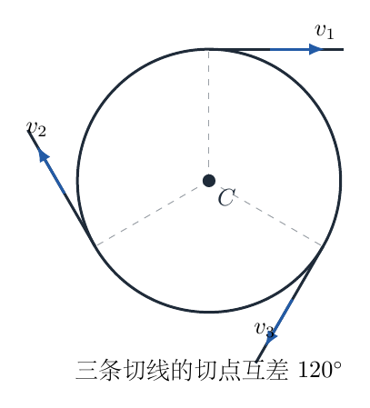{ width=70% }

## 一、题型定位

本题是平面刚体运动学中的“三个切向速度约束反求平动与转动”模型。圆盘在平面内只有三个瞬时速度自由度：圆心速度的两个分量和一个角速度。三条无滑动约束恰好可完全确定它们。加速度问题则要在切向投影中识别：向心加速度沿半径方向，对绳的切向长度约束没有直接贡献。

## 二、知识点

1. 平面刚体上一点的速度关系 $\boldsymbol v_P=\boldsymbol v_C+\boldsymbol\omega\times\boldsymbol r$；
2. 切点处绳与圆盘的无滑动条件；
3. 互差 $120^\circ$ 的三个单位向量的对称恒等式；
4. 非正交投影数据中的向量重建；
5. 刚体上一点的切向、向心加速度；
6. 速度和加速度约束的阶次区分。

## 三、物理图像

如图8-2，以圆心为 $C$，第 $i$ 个切点为 $P_i$。取 $\boldsymbol n_i$ 沿第 $i$ 条细线的正速度方向，三个 $\boldsymbol n_i$ 位于同一平面并互差 $120^\circ$。选定圆盘正角速度方向，使得转动在每个切点的切向速度投影都写成 $+\omega R$。

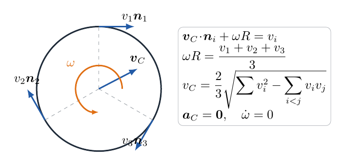{ width=91% }

三条切向在平面内形成对称的“三方向标架”。它们不是两两正交的基，所以不能把三个投影平方直接相加当作速度平方；必须使用 $120^\circ$ 方向的点积关系。

## 四、解题入口

对每个切点都写一次“圆心平动的切向投影 $+$ 圆盘转动的切向速度 $=$ 绳速”。将三式相加，利用 $\boldsymbol n_1+\boldsymbol n_2+\boldsymbol n_3=\boldsymbol0$ 立即得到 $\omega$。再减去三个速度的平均值，留下纯平动投影，由对称向量标架重建 $\boldsymbol v_C$。加速度部分重复同一结构，但右端变为零。

## 五、解析

首先把几何关系写成向量恒等式。三个切向单位向量的模均为 $1$：

$$
\boldsymbol n_i\cdot\boldsymbol n_i=1
\qquad(i=1,2,3). \tag{1}
$$

两两夹角为 $120^\circ$，因而

$$
\boldsymbol n_i\cdot\boldsymbol n_j
=\cos120^\circ=-\frac12
\qquad(i\ne j). \tag{2}
$$

三向量的和为零：

$$
\boldsymbol n_1+\boldsymbol n_2+\boldsymbol n_3=\boldsymbol0. \tag{3}
$$

还可将它们的并矢和写成

$$
\sum_{i=1}^3\boldsymbol n_i\boldsymbol n_i^{\mathsf T}
=\frac32I_2. \tag{4}
$$

式（4）的意义是，对任意平面向量 $\boldsymbol q$，

$$
\sum_{i=1}^3(\boldsymbol q\cdot\boldsymbol n_i)\boldsymbol n_i
=\frac32\boldsymbol q. \tag{5}
$$

现在写切点速度。刚体上 $P_i$ 点的速度为

$$
\boldsymbol v_{P_i}
=\boldsymbol v_C+\boldsymbol\omega\times\boldsymbol r_i. \tag{6}
$$

其中

$$
|\boldsymbol r_i|=R. \tag{7}
$$

将式（6）沿绳方向 $\boldsymbol n_i$ 投影，按图8-2的正向约定，

$$
\boldsymbol v_{P_i}\cdot\boldsymbol n_i
=\boldsymbol v_C\cdot\boldsymbol n_i+\omega R. \tag{8}
$$

绳与圆盘之间不打滑，所以切点的切向速度必须等于相应绳端速度：

$$
\boldsymbol v_C\cdot\boldsymbol n_1+\omega R=v_1. \tag{9}
$$

$$
\boldsymbol v_C\cdot\boldsymbol n_2+\omega R=v_2. \tag{10}
$$

$$
\boldsymbol v_C\cdot\boldsymbol n_3+\omega R=v_3. \tag{11}
$$

将式（9）至（11）相加：

$$
\boldsymbol v_C\cdot
(\boldsymbol n_1+\boldsymbol n_2+\boldsymbol n_3)
+3\omega R=v_1+v_2+v_3. \tag{12}
$$

利用式（3），平动项正好相消：

$$
3\omega R=v_1+v_2+v_3. \tag{13}
$$

所以有符号角速度为

$$
\omega=\frac{v_1+v_2+v_3}{3R}. \tag{14}
$$

题目要求角速度大小，因而

$$
\boxed{|\omega|=\frac{|v_1+v_2+v_3|}{3R}}. \tag{15}
$$

令三个绳速的平均值为

$$
\bar v=\frac{v_1+v_2+v_3}{3}. \tag{16}
$$

由式（13），

$$
\omega R=\bar v. \tag{17}
$$

再定义去平均后的速度

$$
b_i=v_i-\bar v. \tag{18}
$$

显然

$$
b_1+b_2+b_3=0. \tag{19}
$$

用式（9）至（11）分别减去式（17），得

$$
\boldsymbol v_C\cdot\boldsymbol n_i=b_i
\qquad(i=1,2,3). \tag{20}
$$

将式（20）两边乘 $\boldsymbol n_i$ 并对 $i$ 求和：

$$
\sum_{i=1}^3
(\boldsymbol v_C\cdot\boldsymbol n_i)\boldsymbol n_i
=\sum_{i=1}^3b_i\boldsymbol n_i. \tag{21}
$$

由式（5），左边等于 $3\boldsymbol v_C/2$，因而

$$
\frac32\boldsymbol v_C
=\sum_{i=1}^3b_i\boldsymbol n_i. \tag{22}
$$

解得圆心速度向量

$$
\boxed{
\boldsymbol v_C
=\frac23\sum_{i=1}^3(v_i-\bar v)\boldsymbol n_i
}. \tag{23}
$$

为求大小，对式（23）平方：

$$
v_C^2
=\frac49\left|
b_1\boldsymbol n_1+b_2\boldsymbol n_2+b_3\boldsymbol n_3
\right|^2. \tag{24}
$$

展开点积：

$$
v_C^2
=\frac49\left[
\sum_{i=1}^3b_i^2
+2\sum_{i<j}b_ib_j(\boldsymbol n_i\cdot\boldsymbol n_j)
\right]. \tag{25}
$$

代入式（2）：

$$
v_C^2
=\frac49\left(
\sum_{i=1}^3b_i^2-\sum_{i<j}b_ib_j
\right). \tag{26}
$$

由式（19）平方，

$$
(b_1+b_2+b_3)^2=0. \tag{27}
$$

即

$$
\sum_{i=1}^3b_i^2+2\sum_{i<j}b_ib_j=0. \tag{28}
$$

所以

$$
\sum_{i<j}b_ib_j=-\frac12\sum_{i=1}^3b_i^2. \tag{29}
$$

代入式（26）：

$$
v_C^2
=\frac49\left(1+\frac12\right)\sum_{i=1}^3b_i^2. \tag{30}
$$

因而

$$
v_C^2=\frac23\sum_{i=1}^3b_i^2. \tag{31}
$$

现在把 $b_i$ 换回 $v_i$。由式（18），

$$
\sum_{i=1}^3b_i^2
=\sum_{i=1}^3(v_i-\bar v)^2. \tag{32}
$$

展开：

$$
\sum_{i=1}^3b_i^2
=\sum_{i=1}^3v_i^2-2\bar v\sum_{i=1}^3v_i+3\bar v^2. \tag{33}
$$

由 $\sum v_i=3\bar v$，

$$
\sum_{i=1}^3b_i^2
=\sum_{i=1}^3v_i^2-3\bar v^2. \tag{34}
$$

再代入 $\bar v=(v_1+v_2+v_3)/3$：

$$
\sum_{i=1}^3b_i^2
=\sum_{i=1}^3v_i^2-\frac13(v_1+v_2+v_3)^2. \tag{35}
$$

展开后合并：

$$
\sum_{i=1}^3b_i^2
=\frac23\left(
v_1^2+v_2^2+v_3^2-v_1v_2-v_2v_3-v_3v_1
\right). \tag{36}
$$

将式（36）代入式（31）：

$$
v_C^2
=\frac49\left(
v_1^2+v_2^2+v_3^2-v_1v_2-v_2v_3-v_3v_1
\right). \tag{37}
$$

所以圆心速度大小为

$$
\boxed{
v_C=\frac23\sqrt{
v_1^2+v_2^2+v_3^2-v_1v_2-v_2v_3-v_3v_1
}
}. \tag{38}
$$

根号内也可写成差的平方和：

$$
v_1^2+v_2^2+v_3^2-v_1v_2-v_2v_3-v_3v_1
=\frac12\left[(v_1-v_2)^2+(v_2-v_3)^2+(v_3-v_1)^2\right]. \tag{39}
$$

式（39）立即表明根号内恒非负，且只有当 $v_1=v_2=v_3$ 时 $v_C=0$。

下面求加速度。刚体上 $P_i$ 点的加速度为

$$
\boldsymbol a_{P_i}
=\boldsymbol a_C
+\boldsymbol\beta\times\boldsymbol r_i
+\boldsymbol\omega\times(\boldsymbol\omega\times\boldsymbol r_i), \tag{40}
$$

其中

$$
\boldsymbol\beta=\dot{\boldsymbol\omega}. \tag{41}
$$

最后一项是向心加速度，沿半径方向：

$$
\boldsymbol\omega\times(\boldsymbol\omega\times\boldsymbol r_i)
=-\omega^2\boldsymbol r_i. \tag{42}
$$

因为 $\boldsymbol n_i$ 沿切向，

$$
\boldsymbol r_i\cdot\boldsymbol n_i=0. \tag{43}
$$

所以式（42）在绳方向的投影为零：

$$
[-\omega^2\boldsymbol r_i]\cdot\boldsymbol n_i=0. \tag{44}
$$

将式（40）沿 $\boldsymbol n_i$ 投影：

$$
\boldsymbol a_{P_i}\cdot\boldsymbol n_i
=\boldsymbol a_C\cdot\boldsymbol n_i+\beta R. \tag{45}
$$

题目给出三个绳端沿绳方向的加速度都为零，无滑动约束给出

$$
\boldsymbol a_C\cdot\boldsymbol n_1+\beta R=0. \tag{46}
$$

$$
\boldsymbol a_C\cdot\boldsymbol n_2+\beta R=0. \tag{47}
$$

$$
\boldsymbol a_C\cdot\boldsymbol n_3+\beta R=0. \tag{48}
$$

将三式相加：

$$
\boldsymbol a_C\cdot
(\boldsymbol n_1+\boldsymbol n_2+\boldsymbol n_3)
+3\beta R=0. \tag{49}
$$

利用式（3）：

$$
3\beta R=0. \tag{50}
$$

因 $R\ne0$，

$$
\beta=0. \tag{51}
$$

代回式（46）至（48）：

$$
\boldsymbol a_C\cdot\boldsymbol n_1=0. \tag{52}
$$

$$
\boldsymbol a_C\cdot\boldsymbol n_2=0. \tag{53}
$$

$$
\boldsymbol a_C\cdot\boldsymbol n_3=0. \tag{54}
$$

平面内任取两个不平行的 $\boldsymbol n_i$ 就能张成整个平面。一个平面向量同时与它们都垂直，只能是零向量：

$$
\boldsymbol a_C=\boldsymbol0. \tag{55}
$$

因而圆心加速度大小为

$$
\boxed{a_C=0}. \tag{56}
$$

同时还得到了题目未直接询问的结果

$$
\boxed{\dot\omega=\beta=0}. \tag{57}
$$

做三个特殊情形检验。若三条绳等速拉动，

$$
v_1=v_2=v_3=V. \tag{58}
$$

则式（38）给出

$$
v_C=0. \tag{59}
$$

式（14）给出

$$
\omega=\frac VR. \tag{60}
$$

即对称拉动只使圆盘转动。若

$$
v_1+v_2+v_3=0, \tag{61}
$$

则

$$
\omega=0, \tag{62}
$$

此时三个投影中的平均转动成分完全消失，剩下纯平动。若只拉第一条绳，

$$
v_1=V,
\qquad v_2=v_3=0, \tag{63}
$$

则

$$
|\omega|=\frac{|V|}{3R}, \tag{64}
$$

且

$$
v_C=\frac23|V|. \tag{65}
$$

上述结果均符合量纲：$\omega$ 的量纲为速度除以长度，$v_C$ 的根号内为速度平方。

为了独立检验向量标架方法，还可以选取显式直角坐标。令第一条绳沿 $+x$ 方向，则

$$
\boldsymbol n_1=(1,0). \tag{66}
$$

其余两条绳相对它分别转过 $120^\circ$、$240^\circ$：

$$
\boldsymbol n_2=\left(-\frac12,\frac{\sqrt3}{2}\right). \tag{67}
$$

$$
\boldsymbol n_3=\left(-\frac12,-\frac{\sqrt3}{2}\right). \tag{68}
$$

设

$$
\boldsymbol v_C=(V_x,V_y). \tag{69}
$$

由式（20）的第一式，

$$
V_x=b_1. \tag{70}
$$

第二、第三个投影方程分别为

$$
-\frac12V_x+\frac{\sqrt3}{2}V_y=b_2. \tag{71}
$$

$$
-\frac12V_x-\frac{\sqrt3}{2}V_y=b_3. \tag{72}
$$

式（71）减式（72）：

$$
\sqrt3V_y=b_2-b_3. \tag{73}
$$

因而

$$
V_y=\frac{b_2-b_3}{\sqrt3}. \tag{74}
$$

这样圆心速度平方为

$$
v_C^2=b_1^2+\frac{(b_2-b_3)^2}{3}. \tag{75}
$$

由 $b_1+b_2+b_3=0$，可写 $b_1=-(b_2+b_3)$。代入式（75）：

$$
\begin{aligned}
v_C^2
&=(b_2+b_3)^2+\frac{(b_2-b_3)^2}{3}\\
&=\frac43(b_2^2+b_2b_3+b_3^2).
\end{aligned} \tag{76}
$$

另一方面，

$$
\begin{aligned}
\frac23(b_1^2+b_2^2+b_3^2)
&=\frac23[(b_2+b_3)^2+b_2^2+b_3^2]\\
&=\frac43(b_2^2+b_2b_3+b_3^2).
\end{aligned} \tag{77}
$$

式（76）与式（77）完全一致，因而显式坐标法独立验证了式（31）和最终结果式（38）。这一检查也说明，如果不熟悉并矢恒等式（4），仍然可以从两个直角分量稳妥求解，但必须保留三条绳方向的 $120^\circ$ 几何关系。
